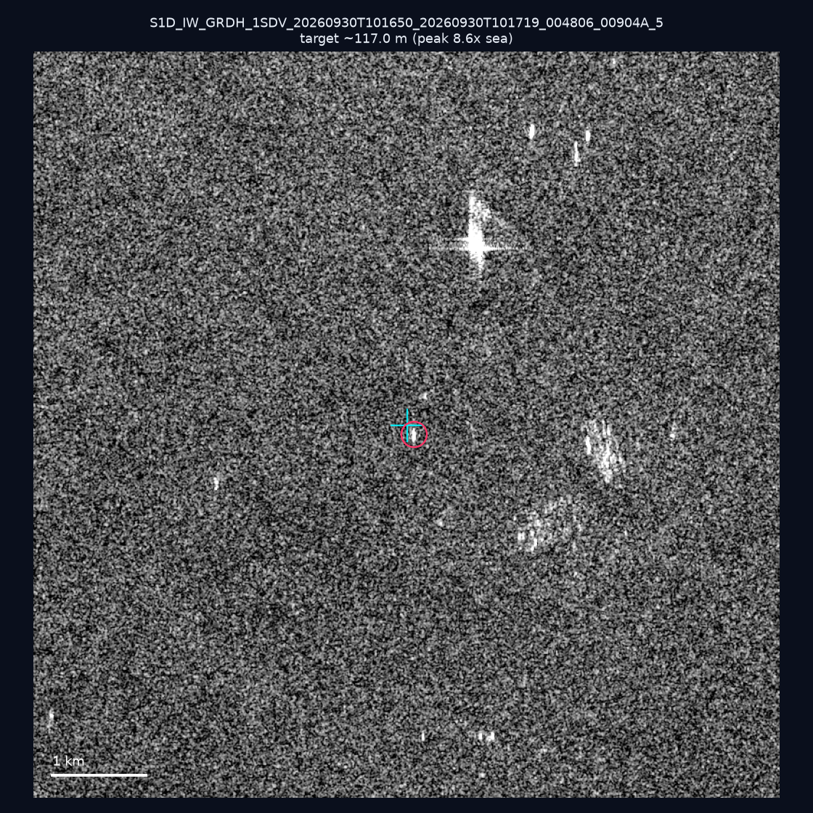
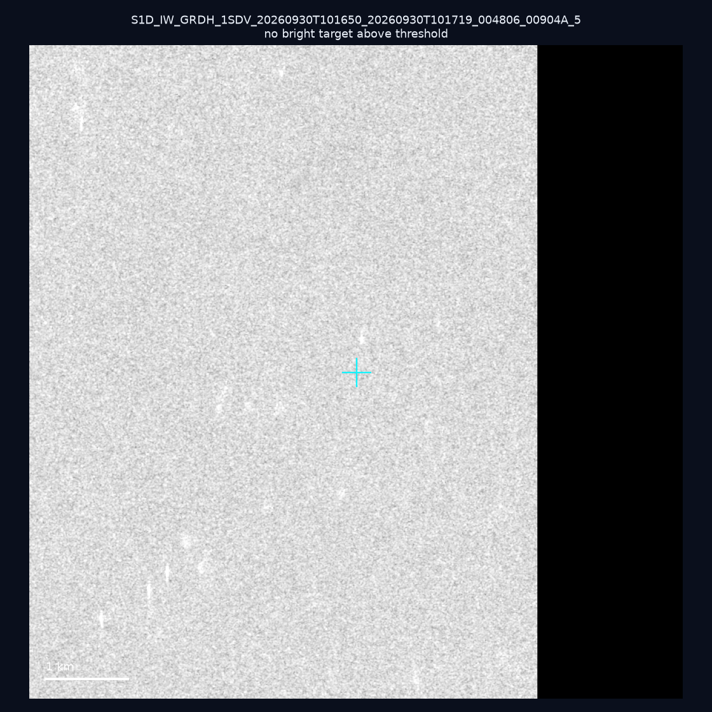
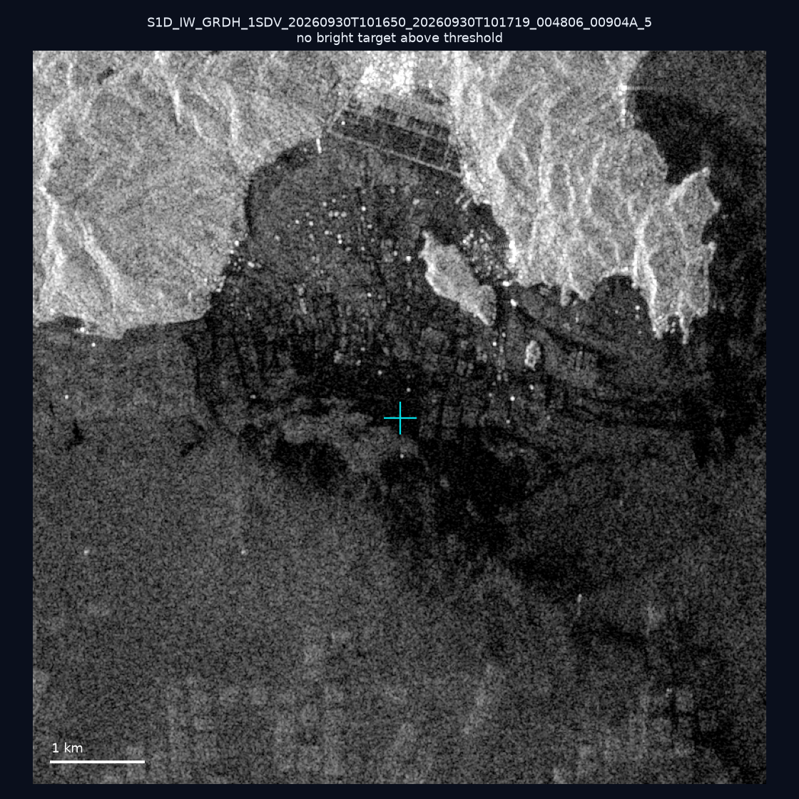
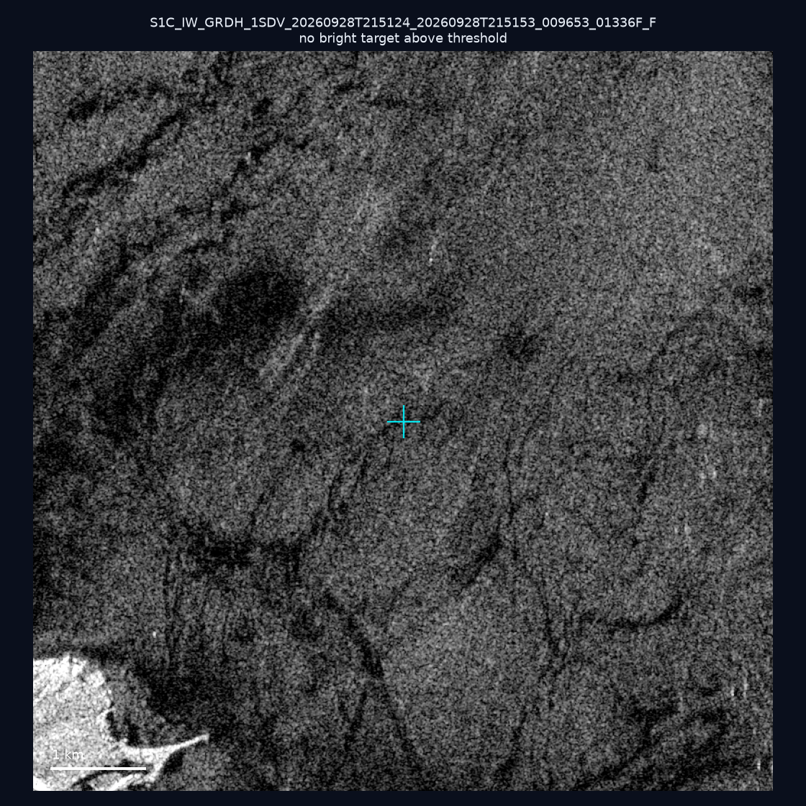
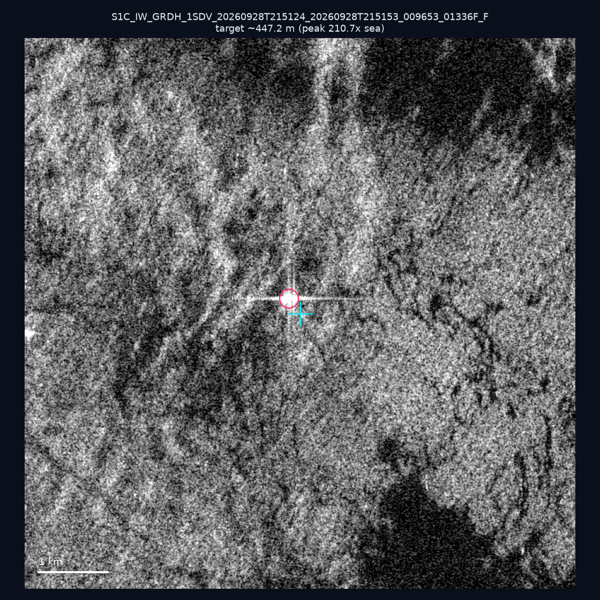
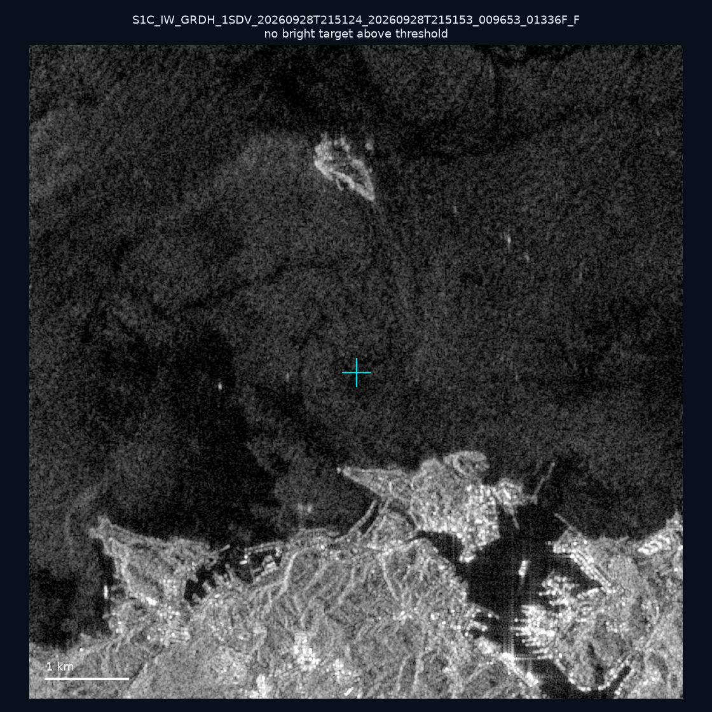
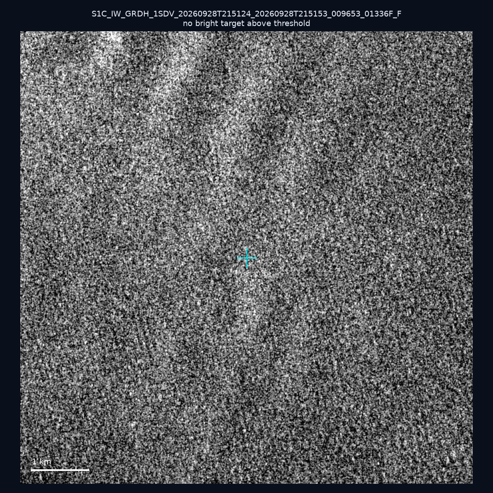
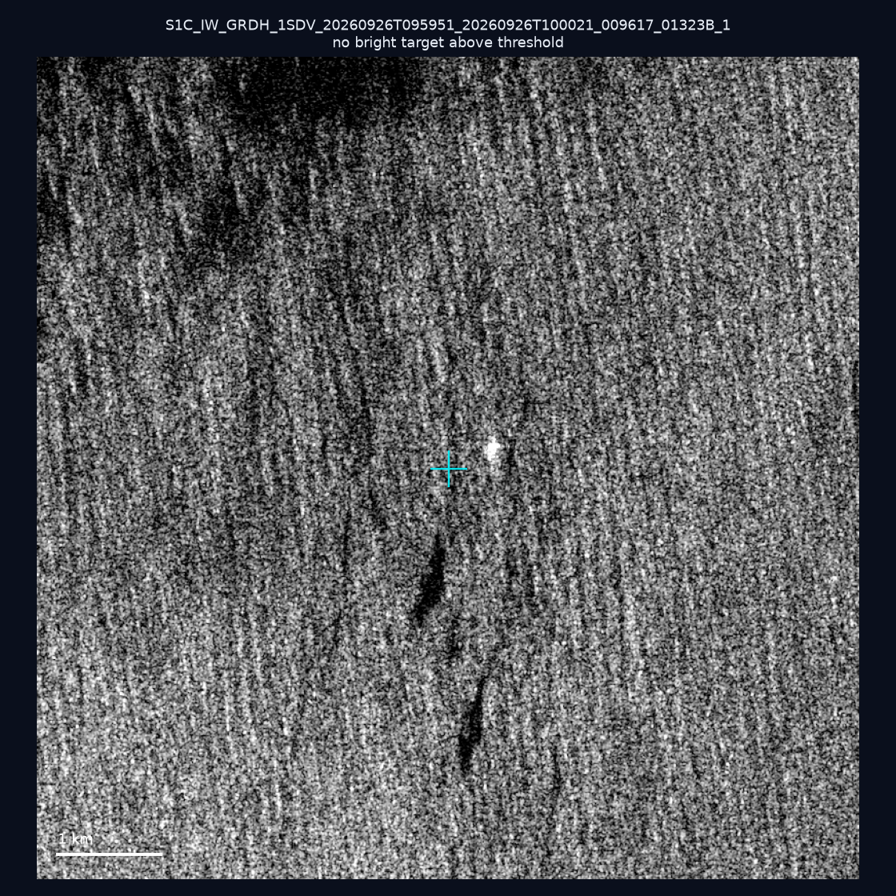
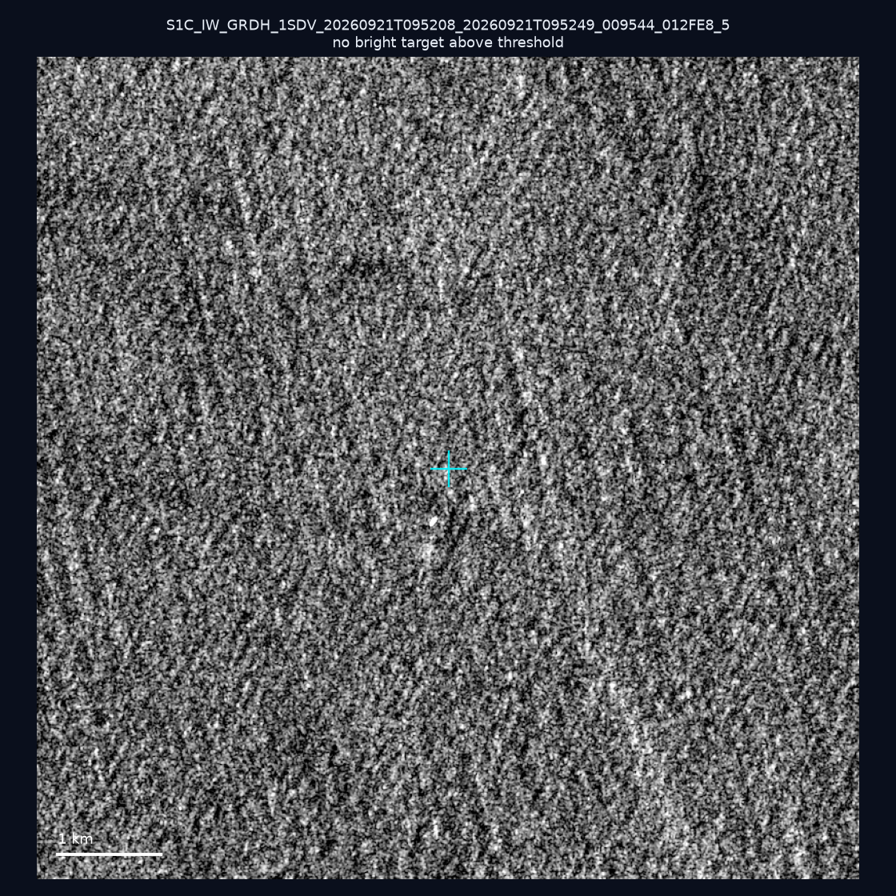
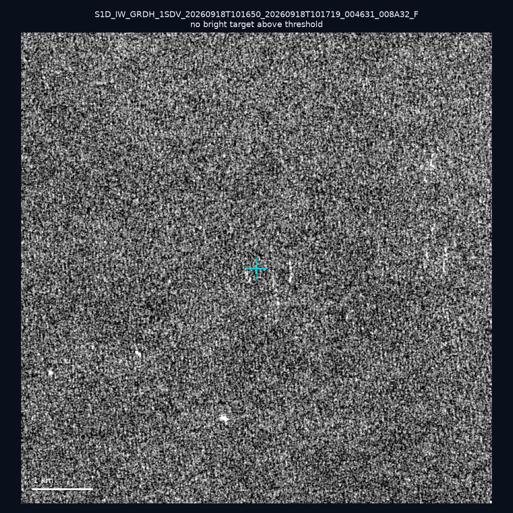

# 暗船 SAR 取證報告 — 2026-10-05

## 1. 總覽

- 執行時間：2026-10-05（GitHub Actions cron 自動執行）
- 線上比對摘要：暗偵測 18298 筆、殘餘暗船 13721 筆、假暗船剔除率 25.0%
- 本輪測試：10 筆
- 成功：10 筆
- 找到亮目標：2 筆
- 失敗：0 筆

## 2. 結果總表

| 日期 | 座標 | 海域 | 法域 | 成像時刻 | 判定 | 估計長度 | 峰值比 |
|------|------|------|------|----------|------|----------|--------|
| 2026-09-30 | 23.44, 118.08 | southwest | eez | 10:16:50 | 🟡 弱目標 | ~117.0 m | 8.6× |
| 2026-09-30 | 23.23, 118.45 | southwest | eez | 10:16:50 | ⚪ 無目標（雜訊或低RCS） | — | — |
| 2026-09-30 | 23.49, 117.09 | southwest | eez | 10:16:50 | ⚪ 無目標（雜訊或低RCS） | — | — |
| 2026-09-28 | 24.88, 121.92 | east | internal_waters | 21:51:24 | ⚪ 無目標（雜訊或低RCS） | — | — |
| 2026-09-28 | 25.26, 121.81 | east | internal_waters | 21:51:24 | ✅ 確認實體目標 | ~447.2 m | 210.7× |
| 2026-09-28 | 25.17, 121.78 | east | internal_waters | 21:51:24 | ⚪ 無目標（雜訊或低RCS） | — | — |
| 2026-09-28 | 25.36, 121.66 | east | internal_waters | 21:51:24 | ⚪ 無目標（雜訊或低RCS） | — | — |
| 2026-09-26 | 22.1, 122.31 | east | eez | 09:59:51 | ⚪ 無目標（雜訊或低RCS） | — | — |
| 2026-09-21 | 25.27, 121.96 | east | internal_waters | 09:52:08 | ⚪ 無目標（雜訊或低RCS） | — | — |
| 2026-09-18 | 23.41, 117.23 | southwest | eez | 10:16:50 | ⚪ 無目標（雜訊或低RCS） | — | — |

## 3. 逐目標段落

### 2026-09-30 (23.44, 118.08)

🟡 弱目標，估計長度 ~117.0 m，峰值 8.6× 海面背景（30 px）。

### 2026-09-30 (23.23, 118.45)

⚪ 無目標（雜訊或低RCS）。

### 2026-09-30 (23.49, 117.09)

⚪ 無目標（雜訊或低RCS）。

### 2026-09-28 (24.88, 121.92)

⚪ 無目標（雜訊或低RCS）。

### 2026-09-28 (25.26, 121.81)

✅ 確認實體目標，估計長度 ~447.2 m，峰值 210.7× 海面背景（344 px）。

### 2026-09-28 (25.17, 121.78)

⚪ 無目標（雜訊或低RCS）。

### 2026-09-28 (25.36, 121.66)

⚪ 無目標（雜訊或低RCS）。

### 2026-09-26 (22.1, 122.31)

⚪ 無目標（雜訊或低RCS）。

### 2026-09-21 (25.27, 121.96)

⚪ 無目標（雜訊或低RCS）。

### 2026-09-18 (23.41, 117.23)

⚪ 無目標（雜訊或低RCS）。

## 4. 後續建議

- 值得人工深查（確認實體目標且長度 ≥ 50m）：
  - 2026-09-28 (25.26, 121.81) ~447.2 m — 建議比對周邊 AIS 船長
- 累積統計：全歷史 429 筆（有效 429 筆），確認實體目標 55 筆（12.8%）

> 所有結果是研判線索，不是法律認定；無目標 ≠ 誤報（小型木殼漁船 RCS 低，SAR 可能拍不到）。
