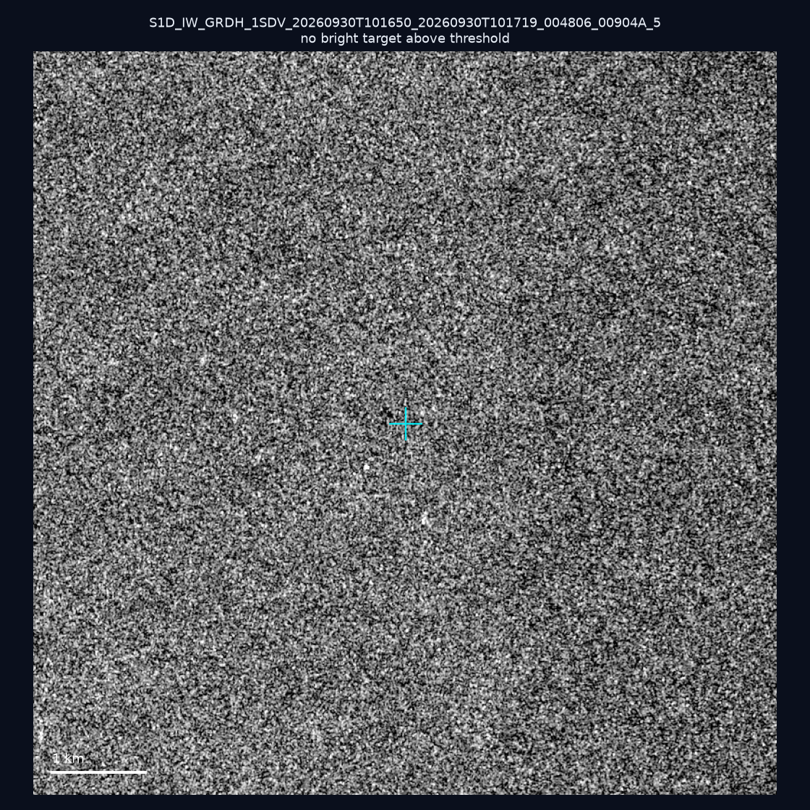
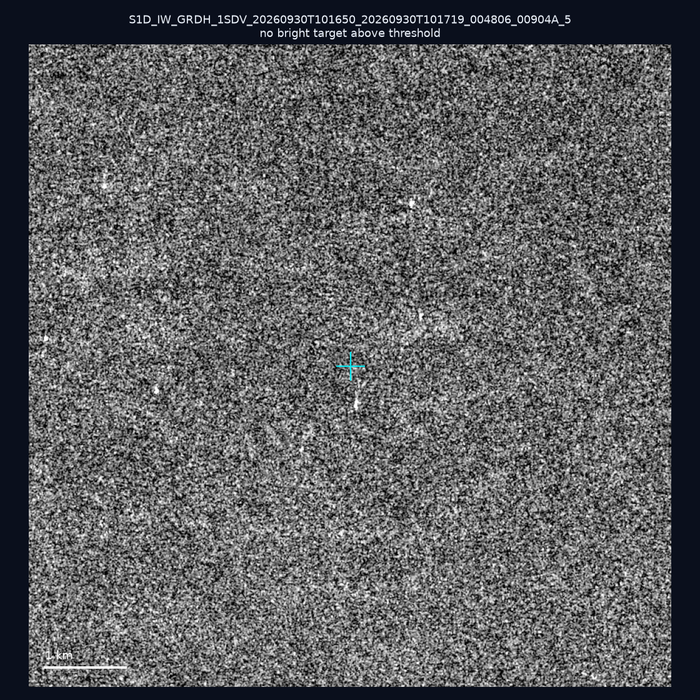
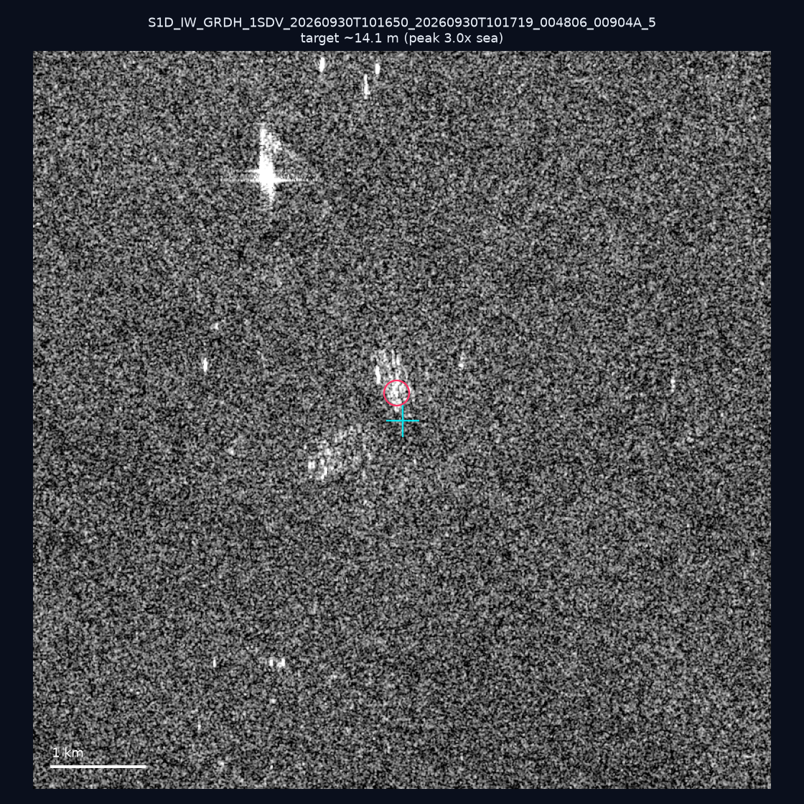
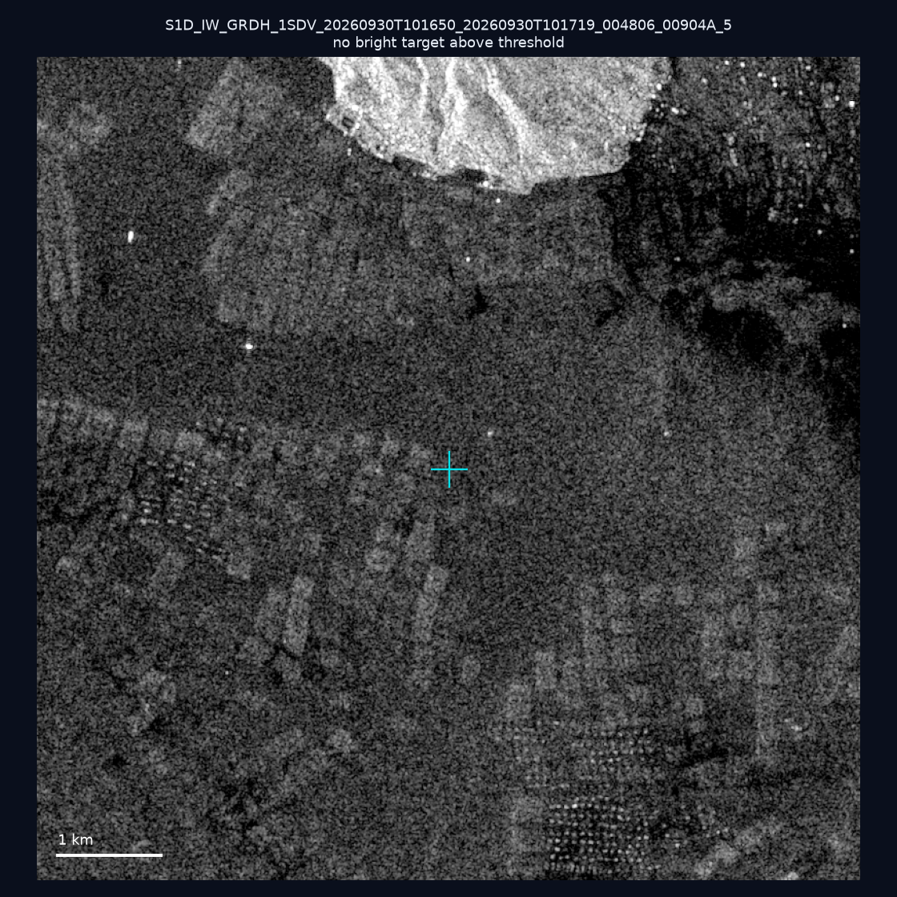
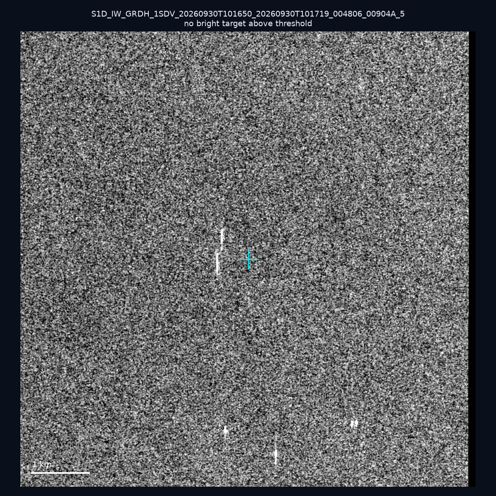
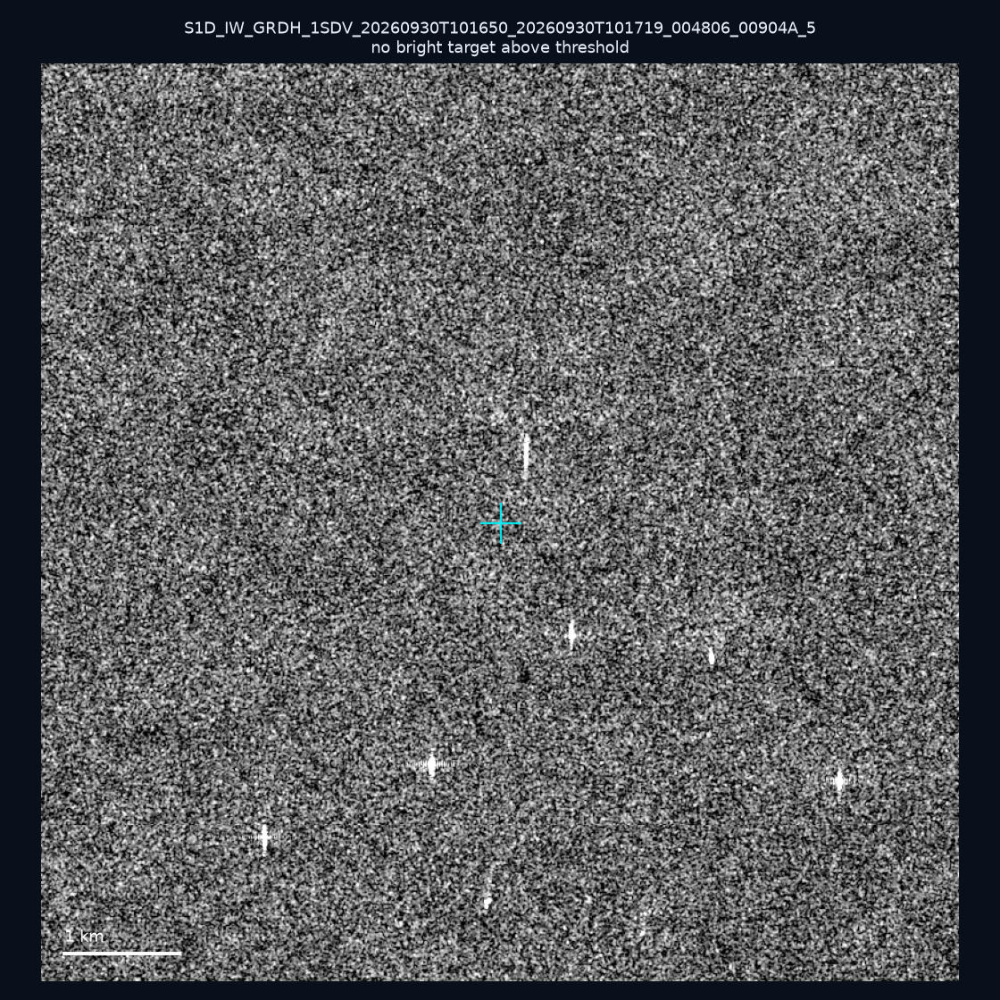
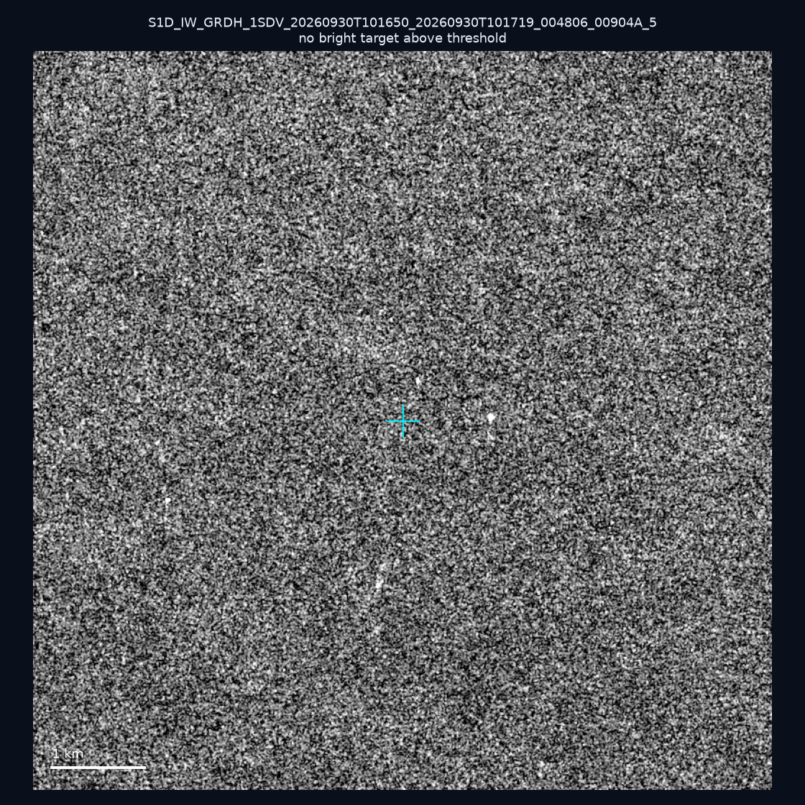
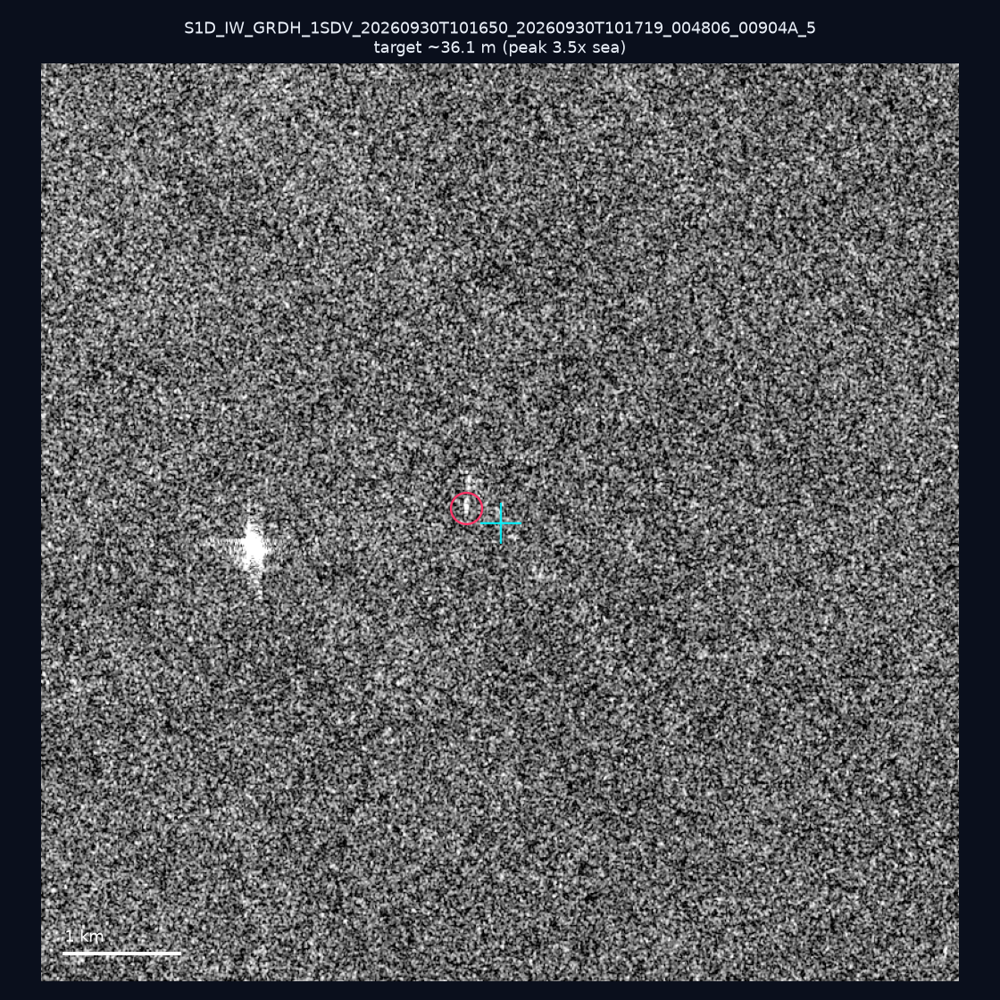
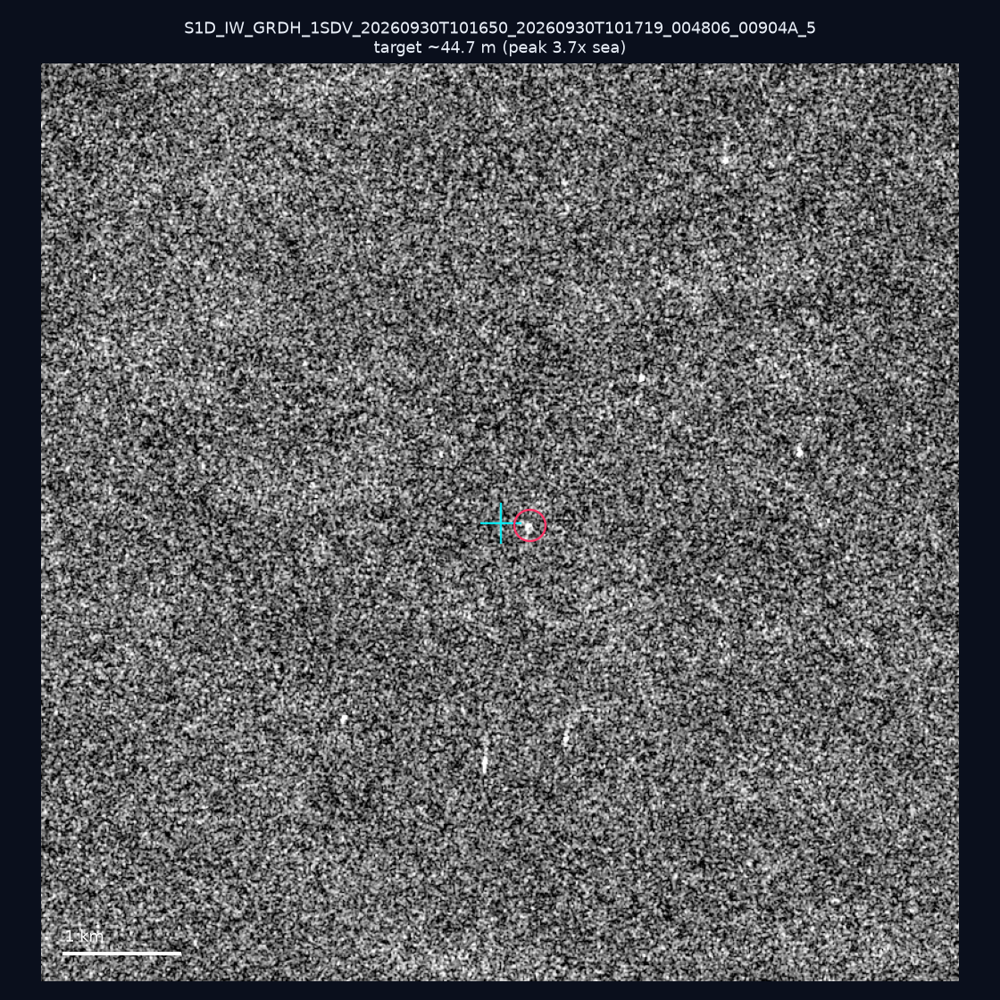
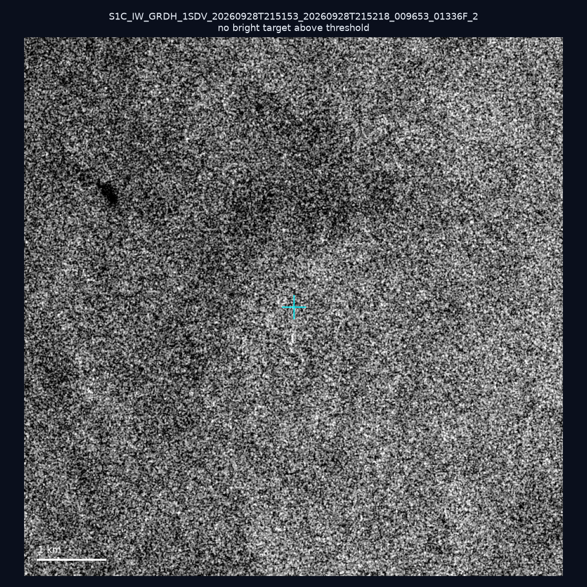

# 暗船 SAR 取證報告 — 2026-10-06

## 1. 總覽

- 執行時間：2026-10-06（GitHub Actions cron 自動執行）
- 線上比對摘要：暗偵測 17499 筆、殘餘暗船 13076 筆、假暗船剔除率 25.3%
- 本輪測試：10 筆
- 成功：10 筆
- 找到亮目標：3 筆
- 失敗：0 筆

## 2. 結果總表

| 日期 | 座標 | 海域 | 法域 | 成像時刻 | 判定 | 估計長度 | 峰值比 |
|------|------|------|------|----------|------|----------|--------|
| 2026-09-30 | 22.88, 117.75 | southwest | eez | 10:16:50 | ⚪ 無目標（雜訊或低RCS） | — | — |
| 2026-09-30 | 22.95, 118.09 | southwest | eez | 10:16:50 | ⚪ 無目標（雜訊或低RCS） | — | — |
| 2026-09-30 | 23.45, 118.1 | southwest | eez | 10:16:50 | 🟡 弱目標 | ~14.1 m | 3.0× |
| 2026-09-30 | 23.5, 117.05 | southwest | eez | 10:16:50 | ⚪ 無目標（雜訊或低RCS） | — | — |
| 2026-09-30 | 23.3, 118.42 | southwest | eez | 10:16:50 | ⚪ 無目標（雜訊或低RCS） | — | — |
| 2026-09-30 | 23.22, 118.22 | southwest | eez | 10:16:50 | ⚪ 無目標（雜訊或低RCS） | — | — |
| 2026-09-30 | 23.07, 118.08 | southwest | eez | 10:16:50 | ⚪ 無目標（雜訊或低RCS） | — | — |
| 2026-09-30 | 23.0, 117.68 | southwest | eez | 10:16:50 | 🟡 弱目標 | ~36.1 m | 3.5× |
| 2026-09-30 | 22.95, 118.04 | southwest | eez | 10:16:50 | 🟡 弱目標 | ~44.7 m | 3.7× |
| 2026-09-28 | 22.76, 119.67 | southwest | territorial_sea | 21:51:53 | ⚪ 無目標（雜訊或低RCS） | — | — |

## 3. 逐目標段落

### 2026-09-30 (22.88, 117.75)

⚪ 無目標（雜訊或低RCS）。

### 2026-09-30 (22.95, 118.09)

⚪ 無目標（雜訊或低RCS）。

### 2026-09-30 (23.45, 118.1)

🟡 弱目標，估計長度 ~14.1 m，峰值 3.0× 海面背景（1 px）。

### 2026-09-30 (23.5, 117.05)

⚪ 無目標（雜訊或低RCS）。

### 2026-09-30 (23.3, 118.42)

⚪ 無目標（雜訊或低RCS）。

### 2026-09-30 (23.22, 118.22)

⚪ 無目標（雜訊或低RCS）。

### 2026-09-30 (23.07, 118.08)

⚪ 無目標（雜訊或低RCS）。

### 2026-09-30 (23.0, 117.68)

🟡 弱目標，估計長度 ~36.1 m，峰值 3.5× 海面背景（6 px）。

### 2026-09-30 (22.95, 118.04)

🟡 弱目標，估計長度 ~44.7 m，峰值 3.7× 海面背景（6 px）。

### 2026-09-28 (22.76, 119.67)

⚪ 無目標（雜訊或低RCS）。

## 4. 後續建議

- 累積統計：全歷史 439 筆（有效 439 筆），確認實體目標 55 筆（12.5%）

> 所有結果是研判線索，不是法律認定；無目標 ≠ 誤報（小型木殼漁船 RCS 低，SAR 可能拍不到）。
