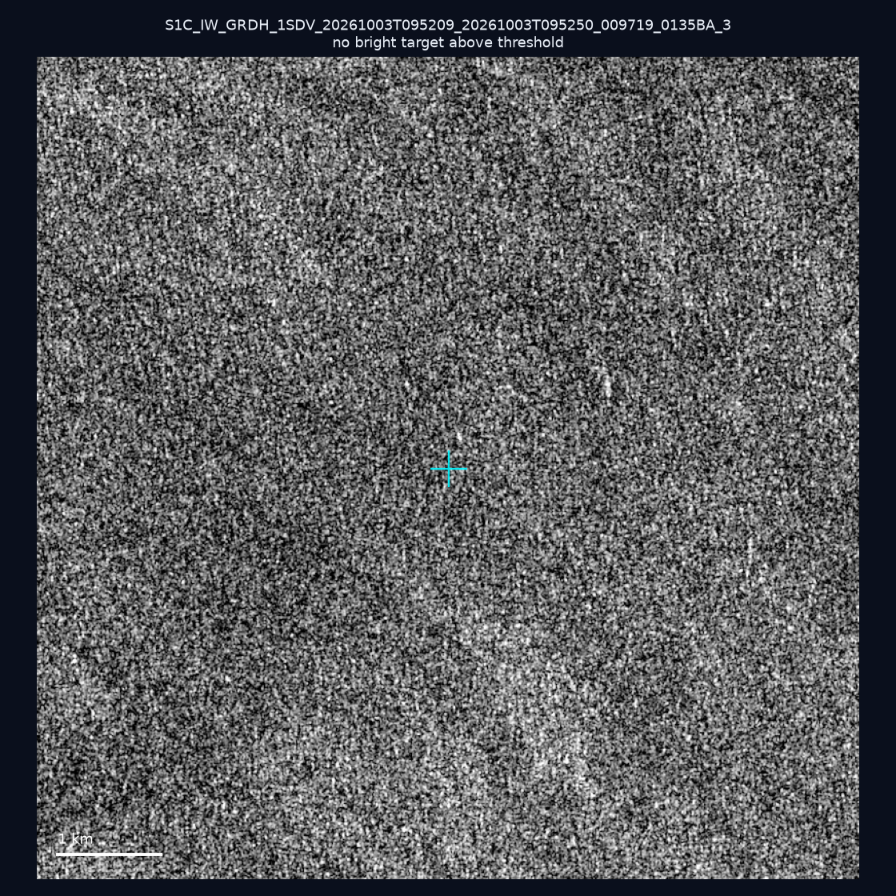
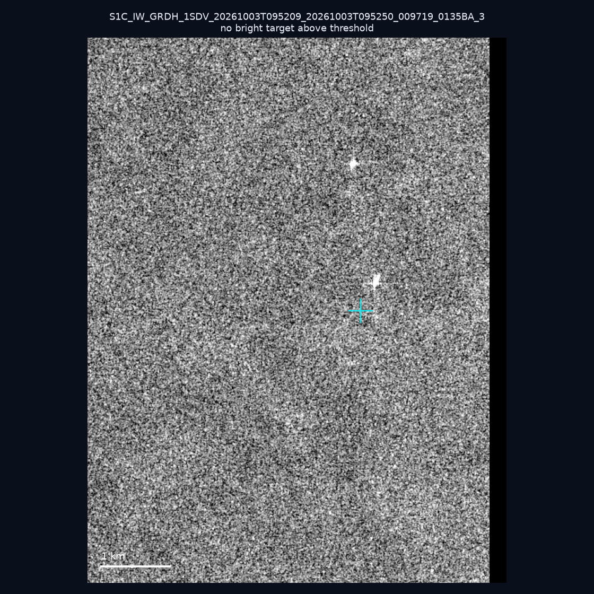
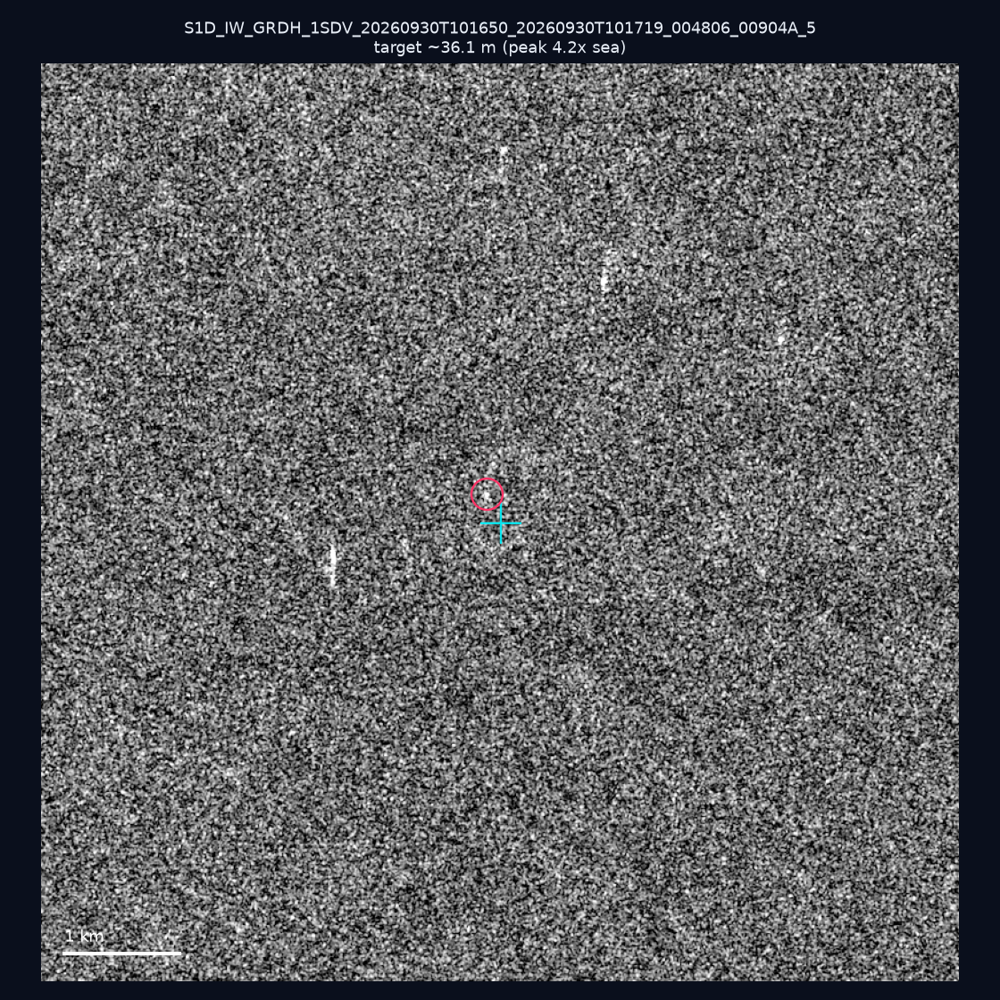
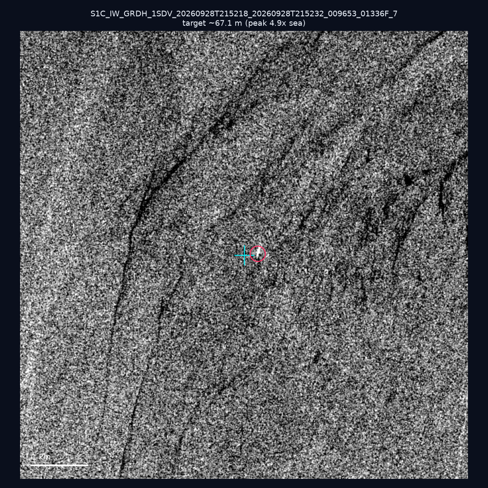
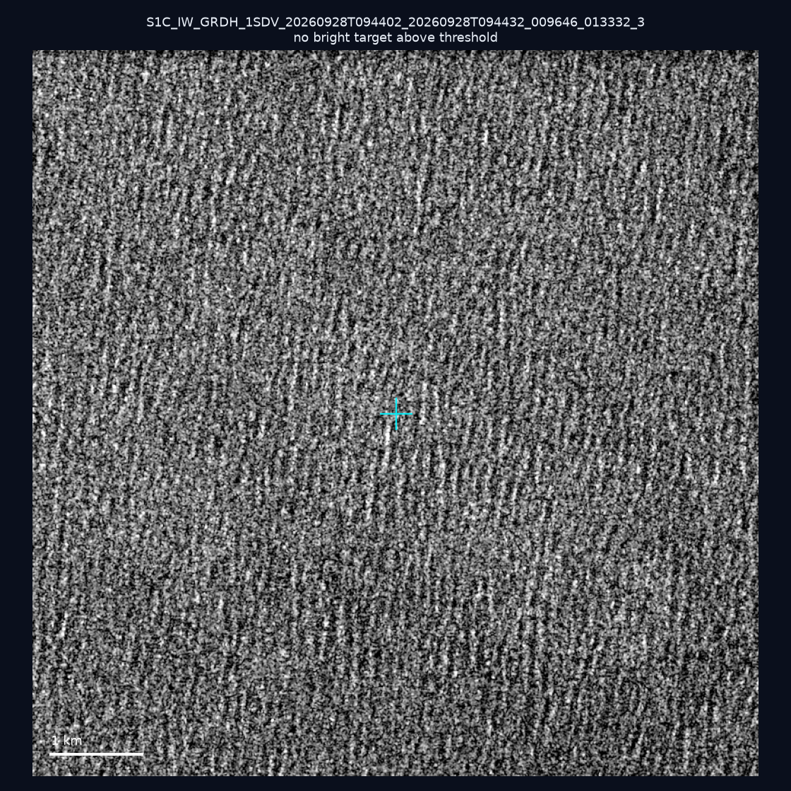
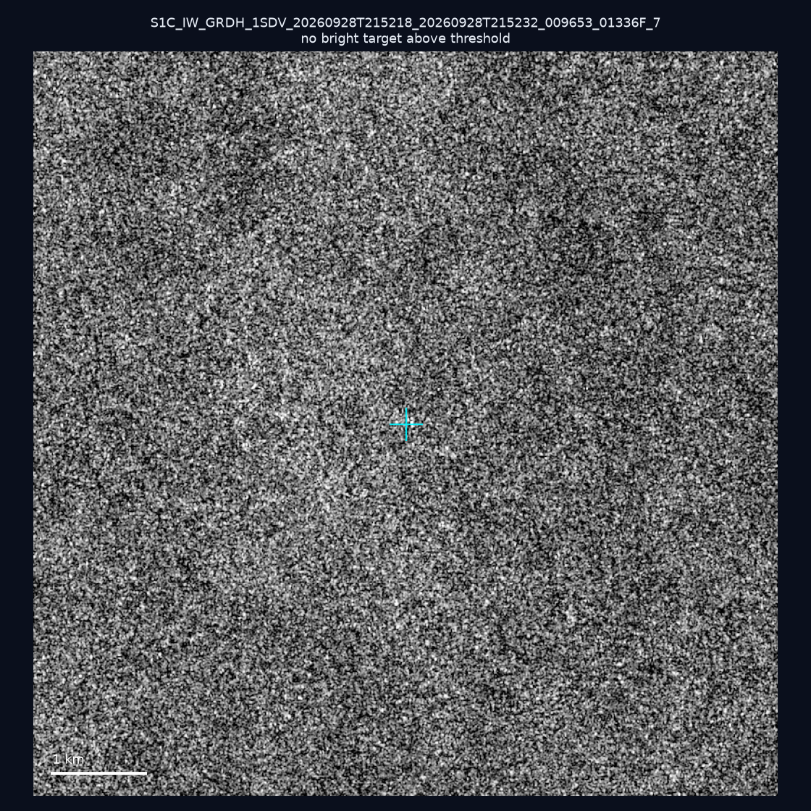
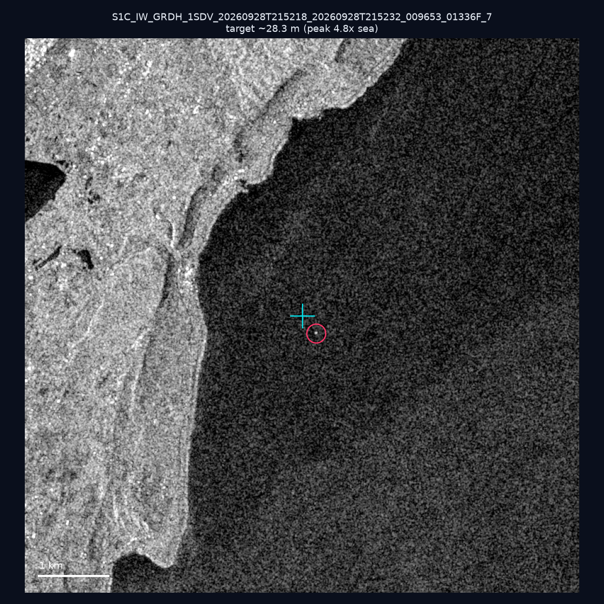
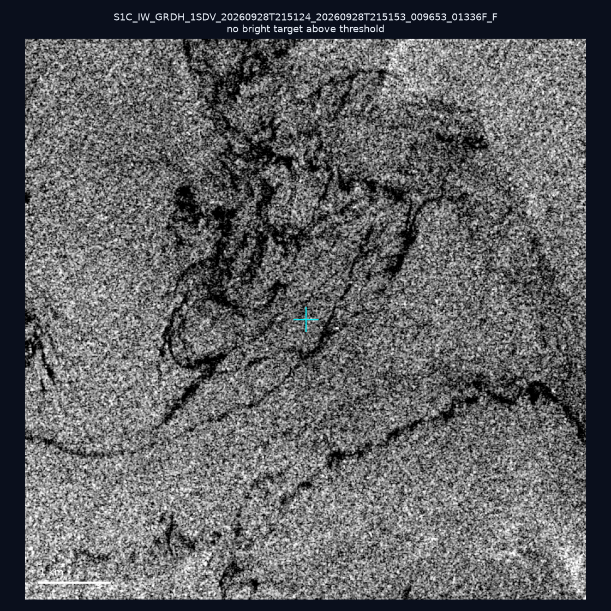
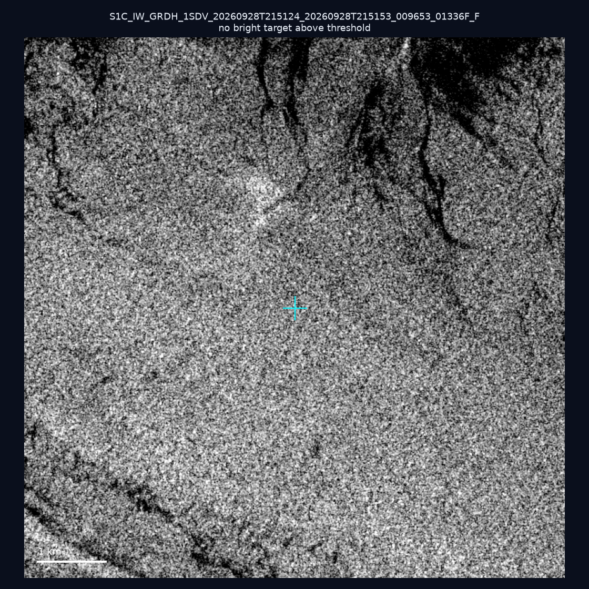
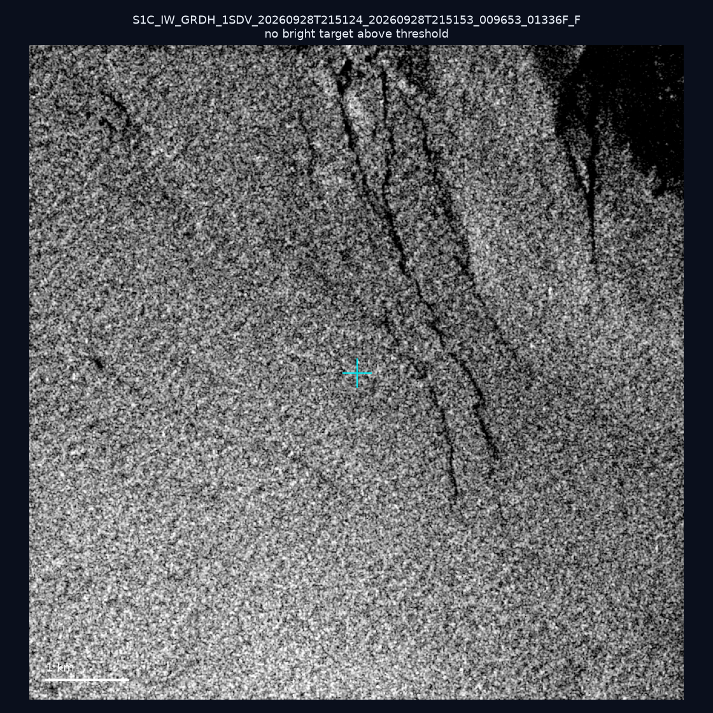

# 暗船 SAR 取證報告 — 2026-10-07

## 1. 總覽

- 執行時間：2026-10-07（GitHub Actions cron 自動執行）
- 線上比對摘要：暗偵測 18662 筆、殘餘暗船 13538 筆、假暗船剔除率 27.5%
- 本輪測試：10 筆
- 成功：10 筆
- 找到亮目標：3 筆
- 失敗：0 筆

## 2. 結果總表

| 日期 | 座標 | 海域 | 法域 | 成像時刻 | 判定 | 估計長度 | 峰值比 |
|------|------|------|------|----------|------|----------|--------|
| 2026-10-03 | 25.46, 122.18 | east | territorial_sea | 09:52:09 | ⚪ 無目標（雜訊或低RCS） | — | — |
| 2026-10-03 | 24.68, 124.34 | east | eez | 09:52:09 | ⚪ 無目標（雜訊或低RCS） | — | — |
| 2026-09-30 | 23.16, 118.08 | southwest | eez | 10:16:50 | 🟡 弱目標 | ~36.1 m | 4.2× |
| 2026-09-28 | 22.12, 120.63 | southwest | internal_waters | 21:52:18 | 🟡 弱目標 | ~67.1 m | 4.9× |
| 2026-09-28 | 23.7, 124.41 | east | eez | 09:44:02 | ⚪ 無目標（雜訊或低RCS） | — | — |
| 2026-09-28 | 22.02, 119.59 | southwest | eez | 21:52:18 | ⚪ 無目標（雜訊或低RCS） | — | — |
| 2026-09-28 | 21.97, 120.7 | southwest | internal_waters | 21:52:18 | 🟡 弱目標 | ~28.3 m | 4.8× |
| 2026-09-28 | 24.84, 122.11 | east | territorial_sea | 21:51:24 | ⚪ 無目標（雜訊或低RCS） | — | — |
| 2026-09-28 | 24.77, 121.97 | east | territorial_sea | 21:51:24 | ⚪ 無目標（雜訊或低RCS） | — | — |
| 2026-09-28 | 25.08, 122.0 | east | internal_waters | 21:51:24 | ⚪ 無目標（雜訊或低RCS） | — | — |

## 3. 逐目標段落

### 2026-10-03 (25.46, 122.18)

⚪ 無目標（雜訊或低RCS）。

### 2026-10-03 (24.68, 124.34)

⚪ 無目標（雜訊或低RCS）。

### 2026-09-30 (23.16, 118.08)

🟡 弱目標，估計長度 ~36.1 m，峰值 4.2× 海面背景（5 px）。

### 2026-09-28 (22.12, 120.63)

🟡 弱目標，估計長度 ~67.1 m，峰值 4.9× 海面背景（14 px）。

### 2026-09-28 (23.7, 124.41)

⚪ 無目標（雜訊或低RCS）。

### 2026-09-28 (22.02, 119.59)

⚪ 無目標（雜訊或低RCS）。

### 2026-09-28 (21.97, 120.7)

🟡 弱目標，估計長度 ~28.3 m，峰值 4.8× 海面背景（4 px）。

### 2026-09-28 (24.84, 122.11)

⚪ 無目標（雜訊或低RCS）。

### 2026-09-28 (24.77, 121.97)

⚪ 無目標（雜訊或低RCS）。

### 2026-09-28 (25.08, 122.0)

⚪ 無目標（雜訊或低RCS）。

## 4. 後續建議

- 累積統計：全歷史 449 筆（有效 449 筆），確認實體目標 55 筆（12.2%）

> 所有結果是研判線索，不是法律認定；無目標 ≠ 誤報（小型木殼漁船 RCS 低，SAR 可能拍不到）。
