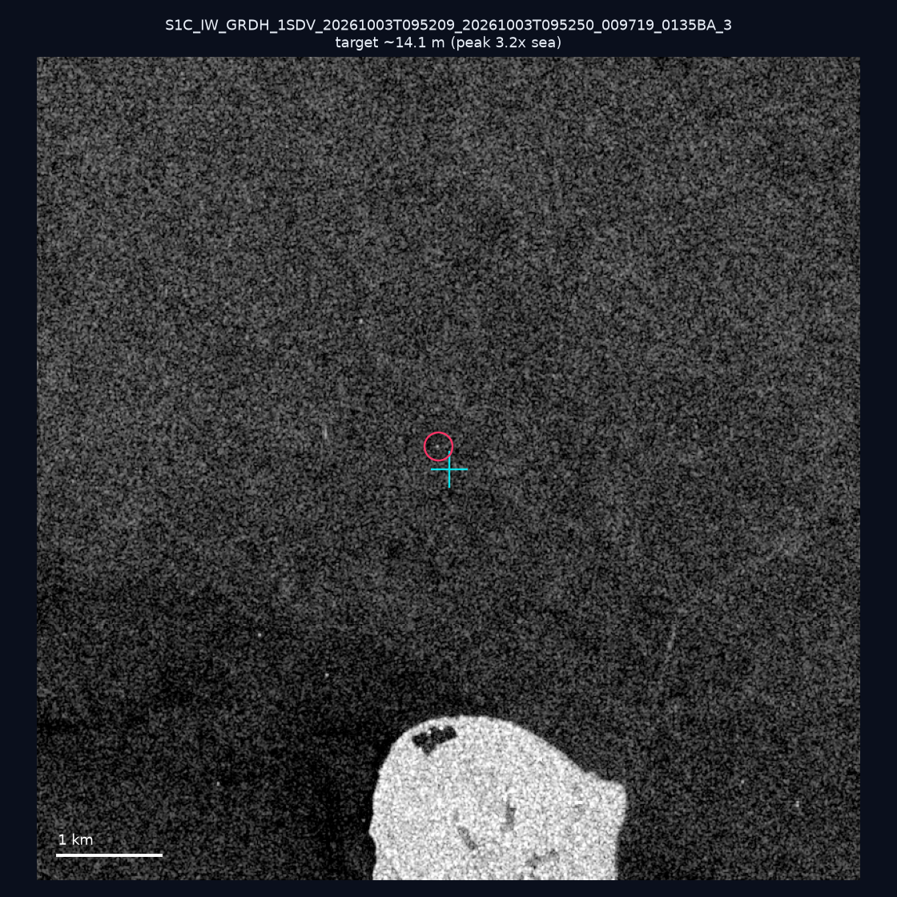
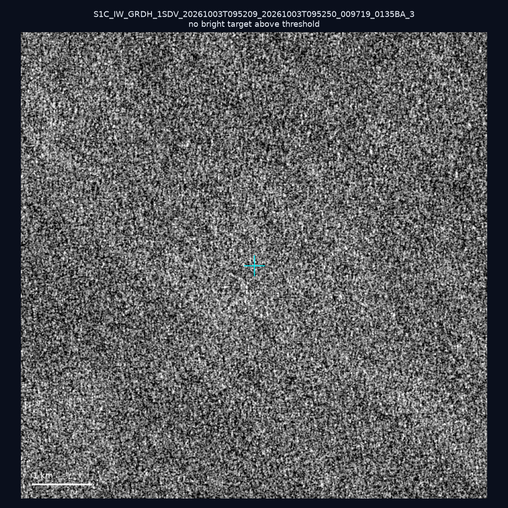
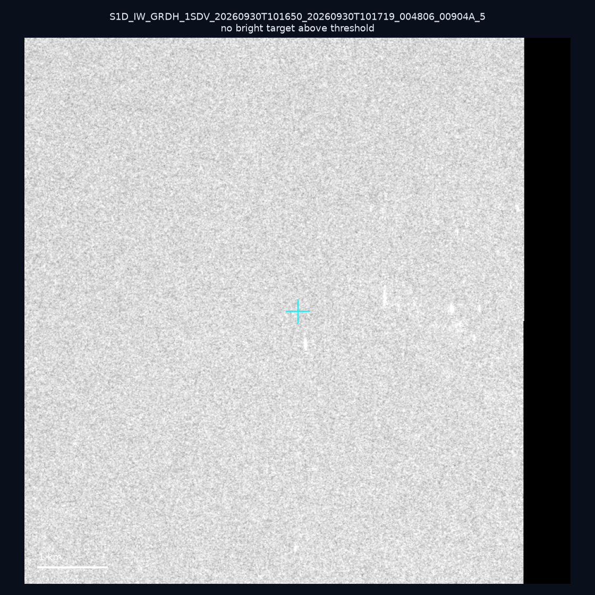
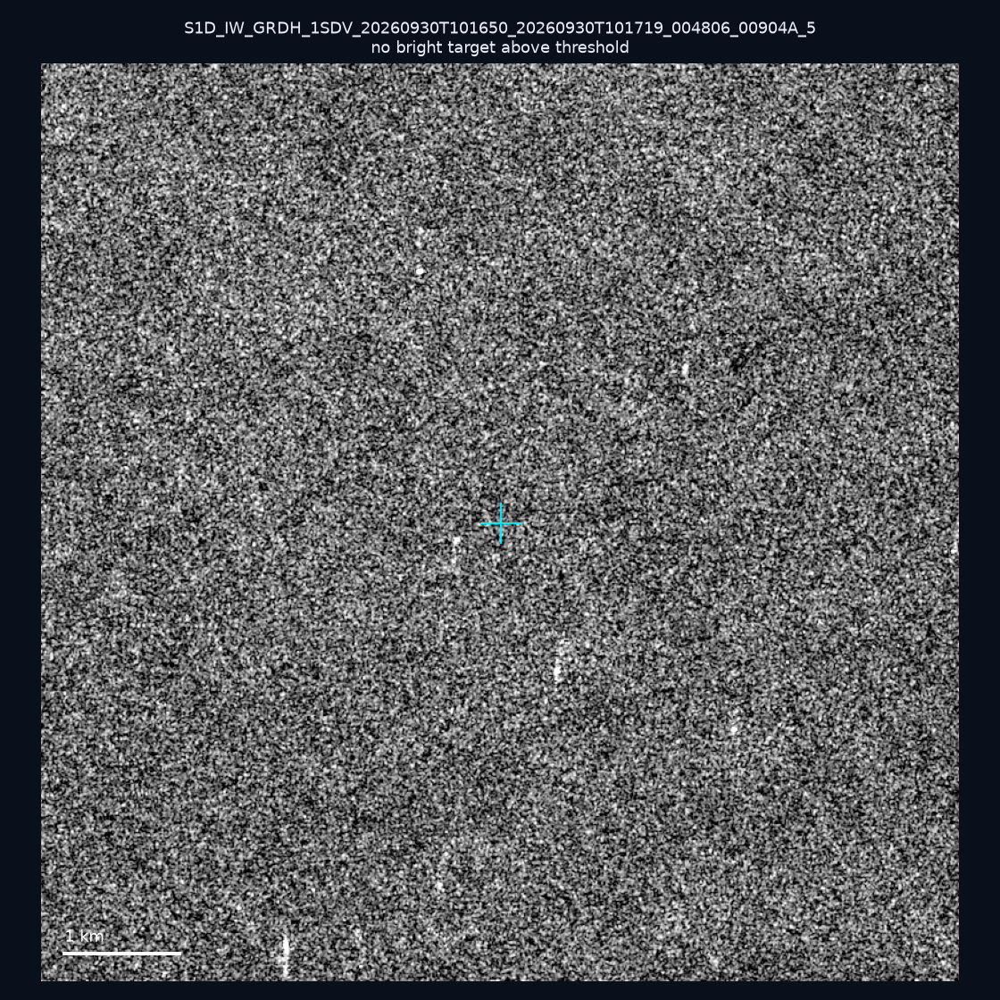
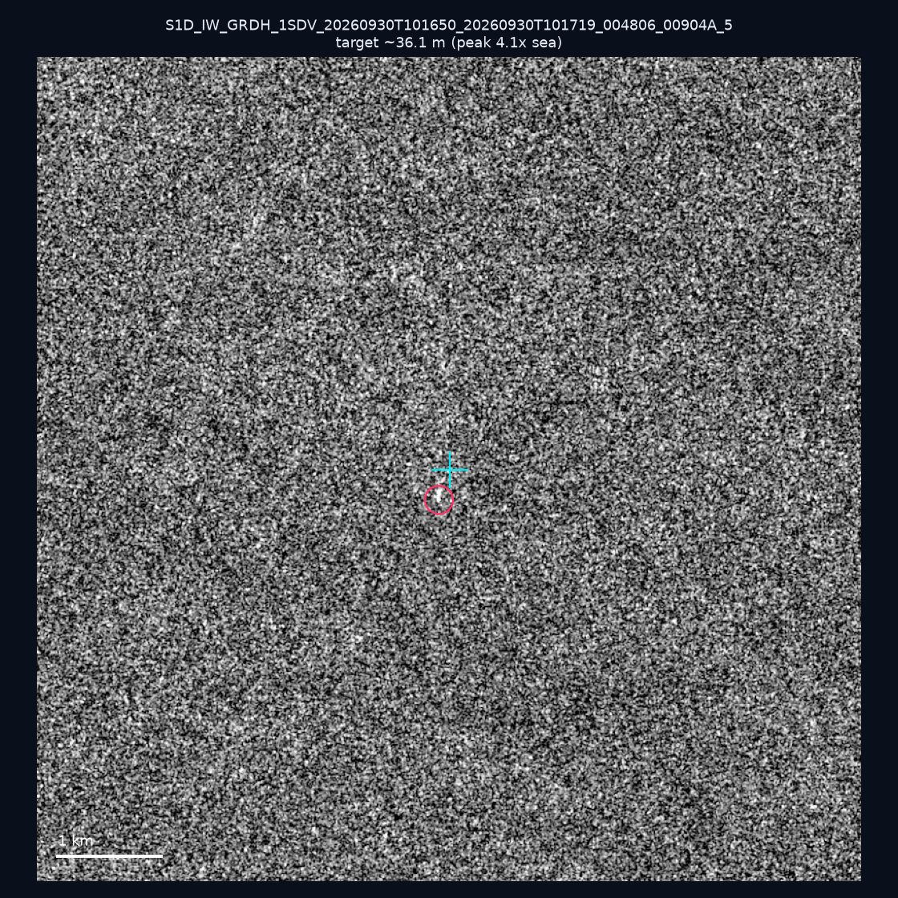
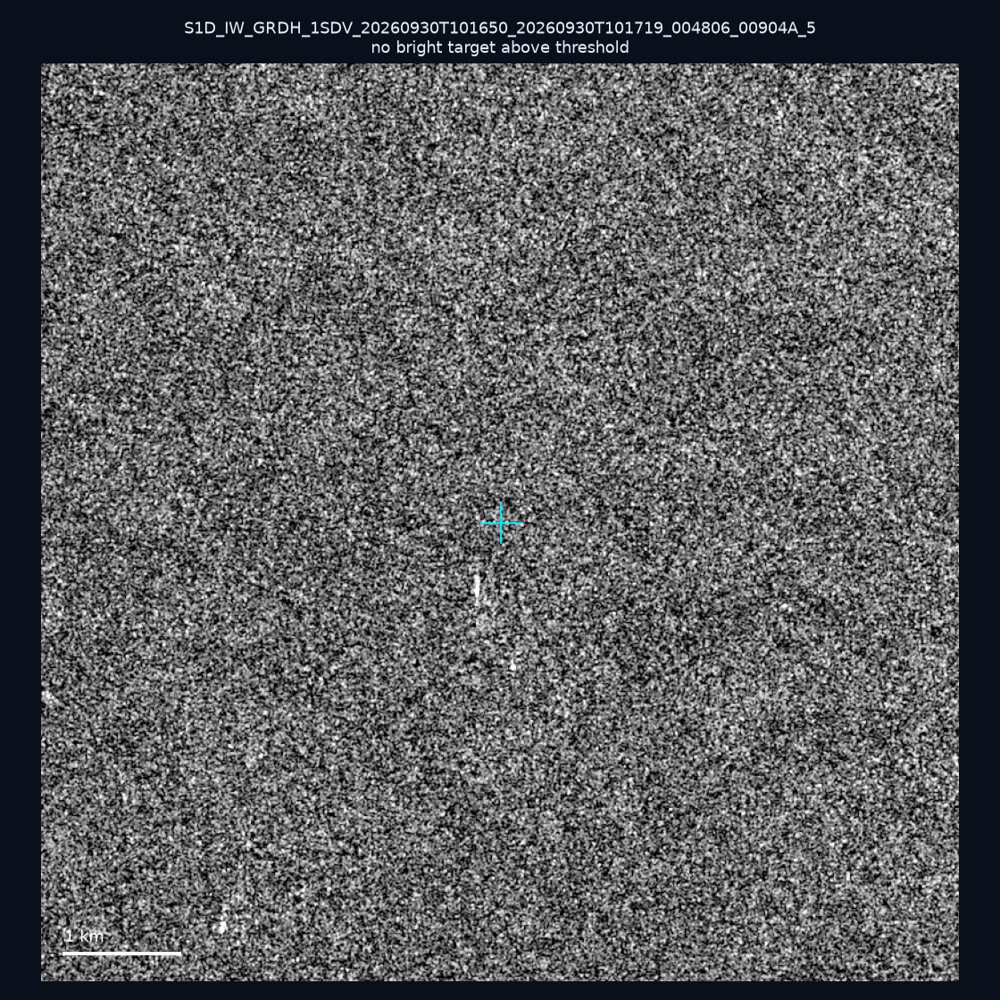
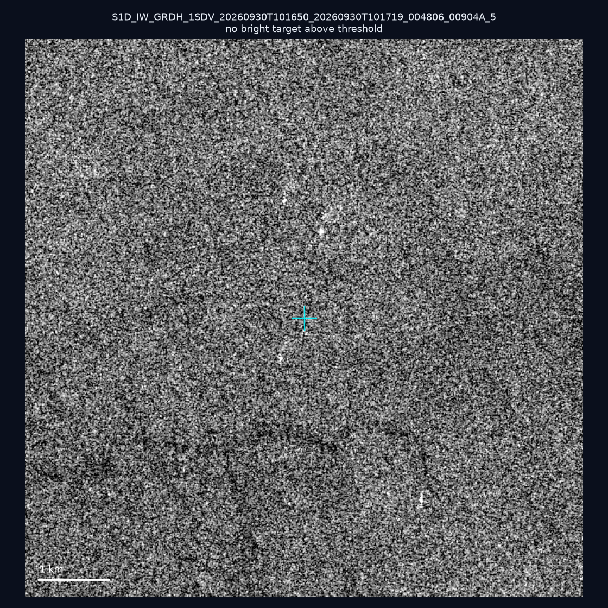
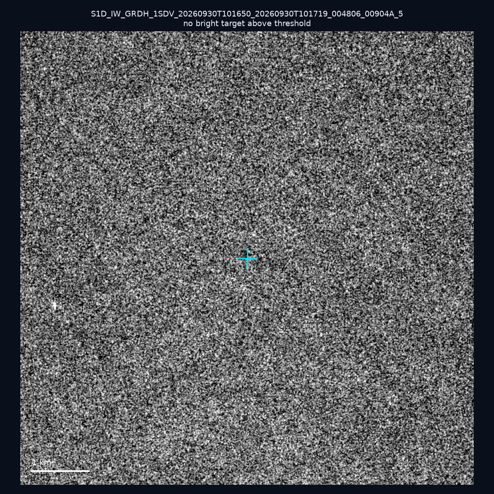
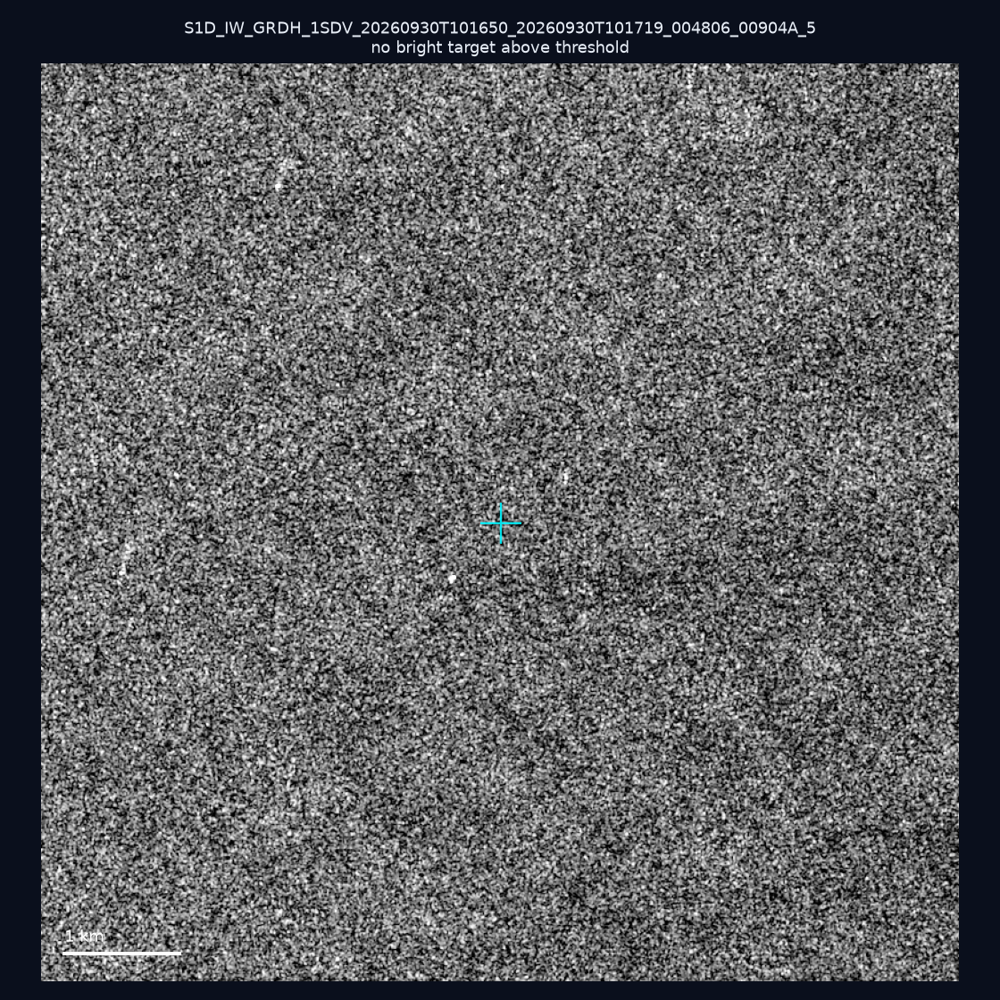
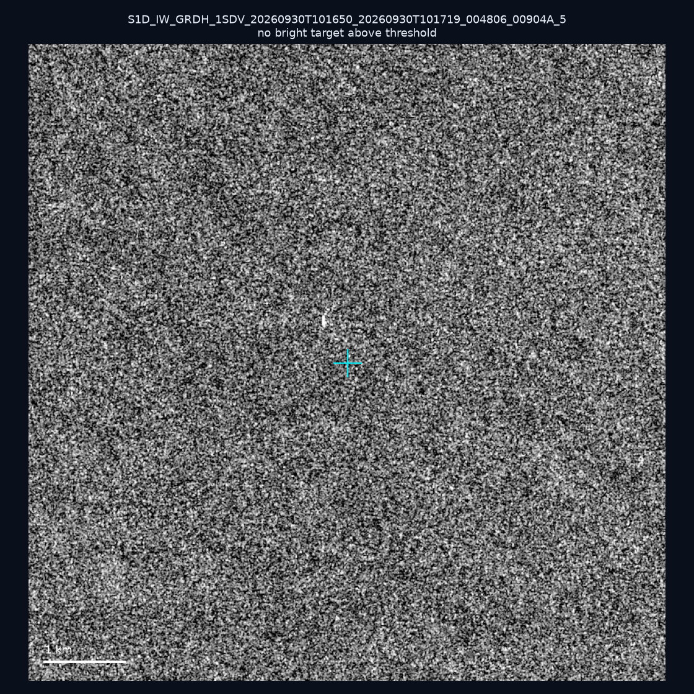

# 暗船 SAR 取證報告 — 2026-10-08

## 1. 總覽

- 執行時間：2026-10-08（GitHub Actions cron 自動執行）
- 線上比對摘要：暗偵測 18140 筆、殘餘暗船 13119 筆、假暗船剔除率 27.7%
- 本輪測試：10 筆
- 成功：10 筆
- 找到亮目標：2 筆
- 失敗：0 筆

## 2. 結果總表

| 日期 | 座標 | 海域 | 法域 | 成像時刻 | 判定 | 估計長度 | 峰值比 |
|------|------|------|------|----------|------|----------|--------|
| 2026-10-03 | 24.29, 124.09 | east | eez | 09:52:09 | 🟡 弱目標 | ~14.1 m | 3.2× |
| 2026-10-03 | 24.57, 122.28 | east | contiguous_zone | 09:52:09 | ⚪ 無目標（雜訊或低RCS） | — | — |
| 2026-09-30 | 23.38, 118.41 | southwest | eez | 10:16:50 | ⚪ 無目標（雜訊或低RCS） | — | — |
| 2026-09-30 | 23.13, 118.09 | southwest | eez | 10:16:50 | ⚪ 無目標（雜訊或低RCS） | — | — |
| 2026-09-30 | 22.96, 117.95 | southwest | eez | 10:16:50 | 🟡 弱目標 | ~36.1 m | 4.1× |
| 2026-09-30 | 23.04, 118.01 | southwest | eez | 10:16:50 | ⚪ 無目標（雜訊或低RCS） | — | — |
| 2026-09-30 | 23.28, 118.31 | southwest | eez | 10:16:50 | ⚪ 無目標（雜訊或低RCS） | — | — |
| 2026-09-30 | 22.95, 118.18 | southwest | eez | 10:16:50 | ⚪ 無目標（雜訊或低RCS） | — | — |
| 2026-09-30 | 23.14, 118.16 | southwest | eez | 10:16:50 | ⚪ 無目標（雜訊或低RCS） | — | — |
| 2026-09-30 | 23.03, 118.27 | southwest | eez | 10:16:50 | ⚪ 無目標（雜訊或低RCS） | — | — |

## 3. 逐目標段落

### 2026-10-03 (24.29, 124.09)

🟡 弱目標，估計長度 ~14.1 m，峰值 3.2× 海面背景（1 px）。

### 2026-10-03 (24.57, 122.28)

⚪ 無目標（雜訊或低RCS）。

### 2026-09-30 (23.38, 118.41)

⚪ 無目標（雜訊或低RCS）。

### 2026-09-30 (23.13, 118.09)

⚪ 無目標（雜訊或低RCS）。

### 2026-09-30 (22.96, 117.95)

🟡 弱目標，估計長度 ~36.1 m，峰值 4.1× 海面背景（6 px）。

### 2026-09-30 (23.04, 118.01)

⚪ 無目標（雜訊或低RCS）。

### 2026-09-30 (23.28, 118.31)

⚪ 無目標（雜訊或低RCS）。

### 2026-09-30 (22.95, 118.18)

⚪ 無目標（雜訊或低RCS）。

### 2026-09-30 (23.14, 118.16)

⚪ 無目標（雜訊或低RCS）。

### 2026-09-30 (23.03, 118.27)

⚪ 無目標（雜訊或低RCS）。

## 4. 後續建議

- 累積統計：全歷史 459 筆（有效 459 筆），確認實體目標 55 筆（12.0%）

> 所有結果是研判線索，不是法律認定；無目標 ≠ 誤報（小型木殼漁船 RCS 低，SAR 可能拍不到）。
