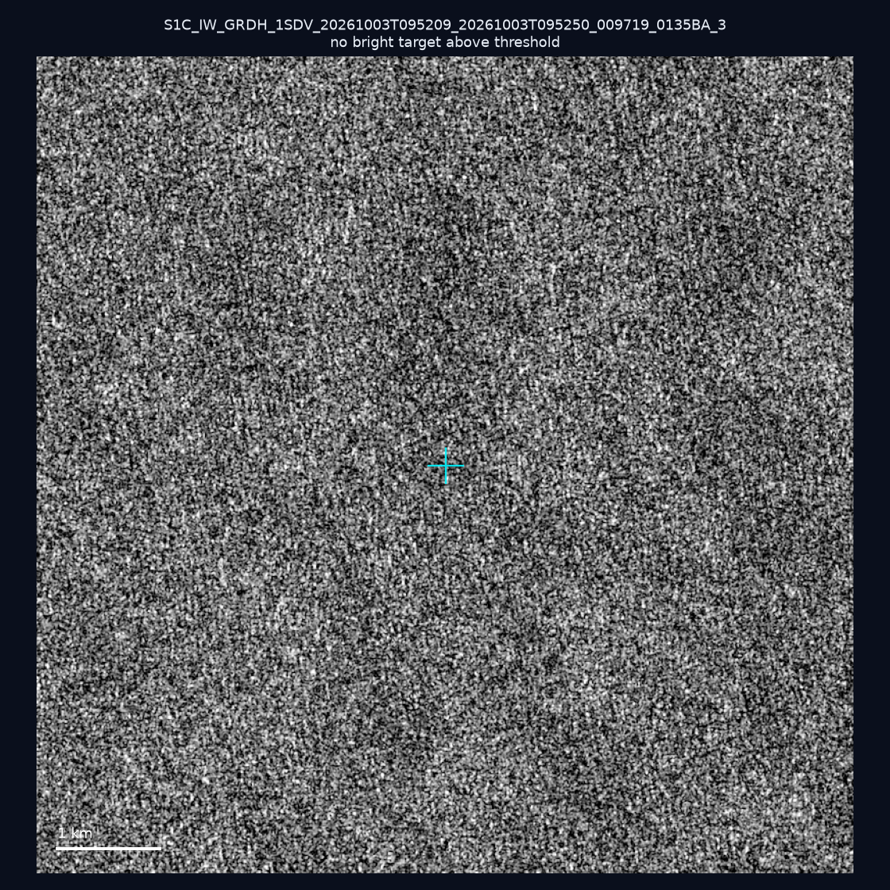
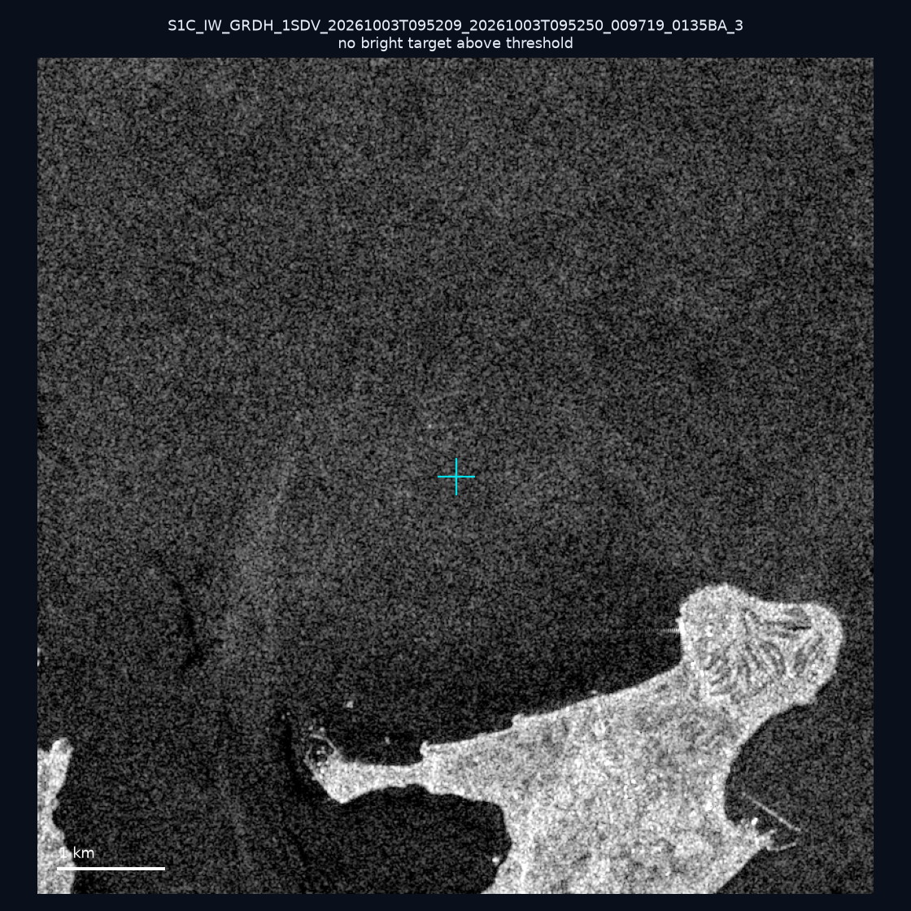
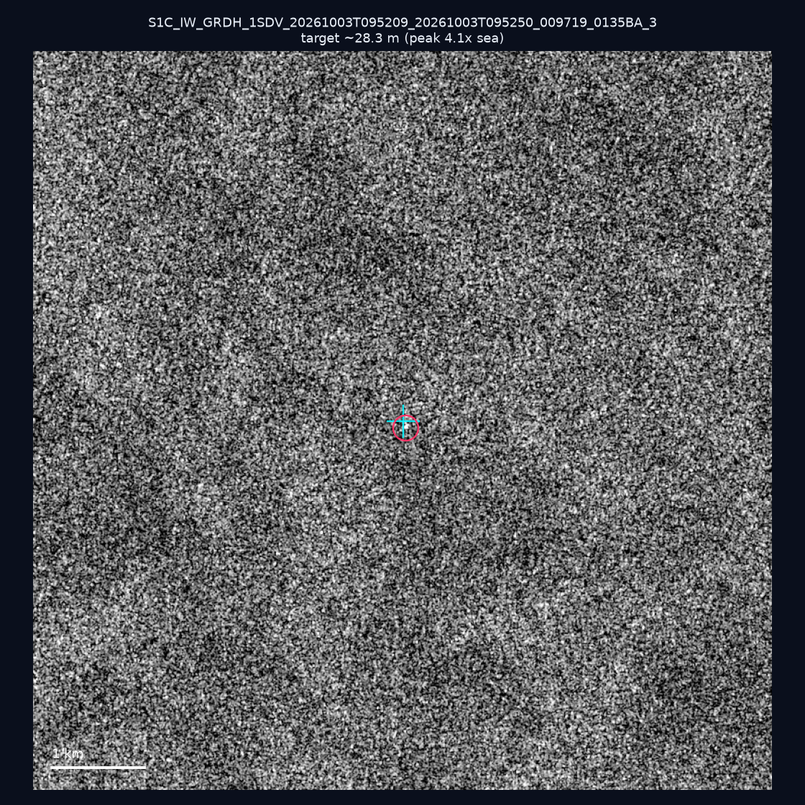
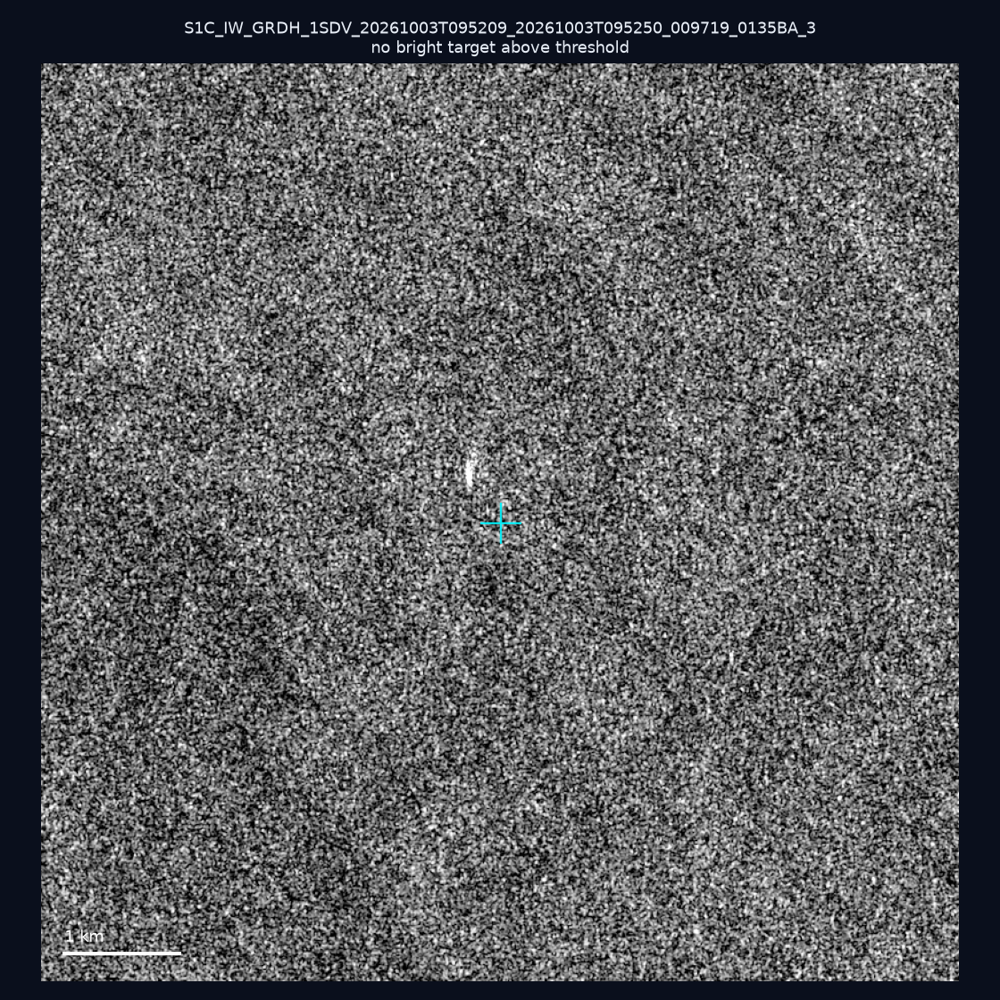
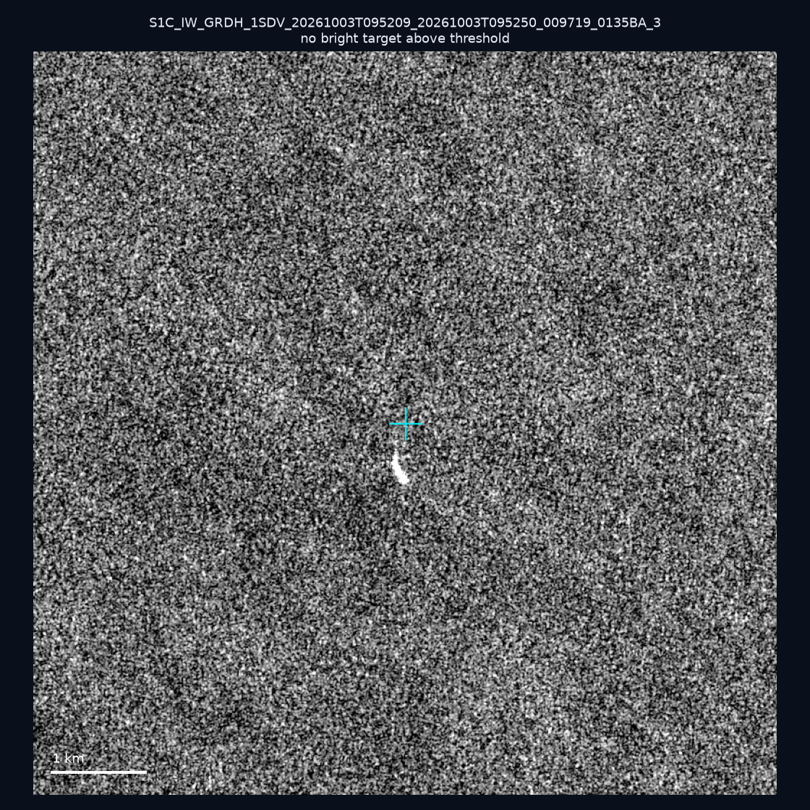
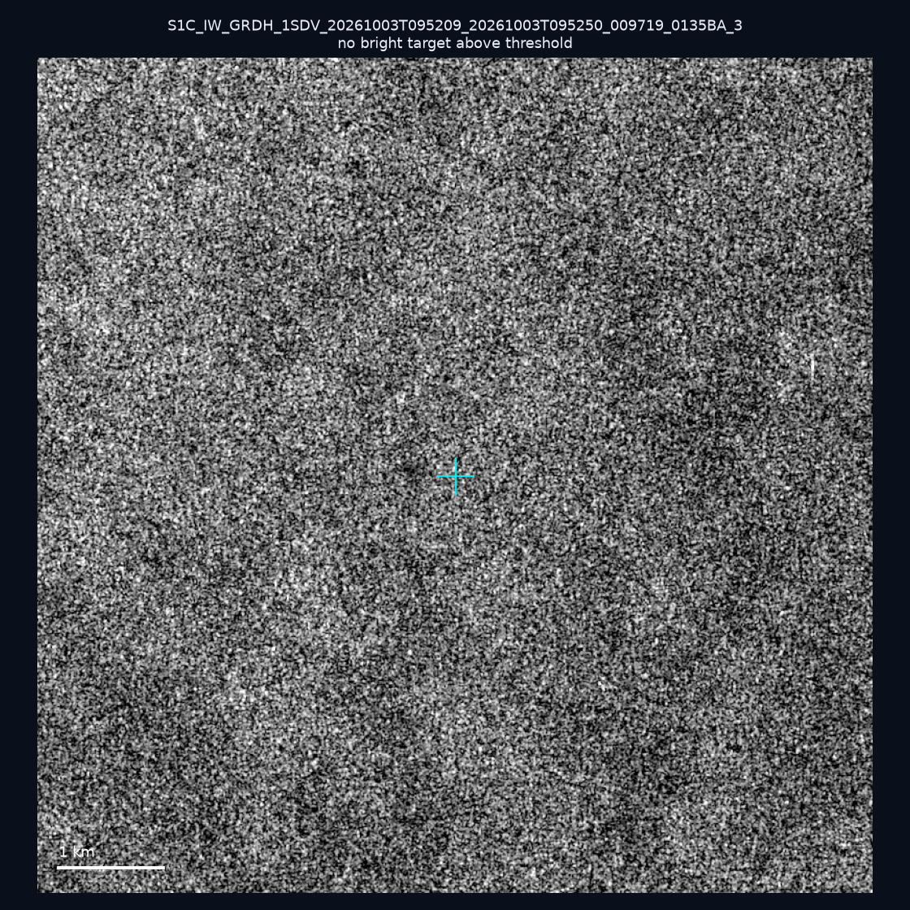
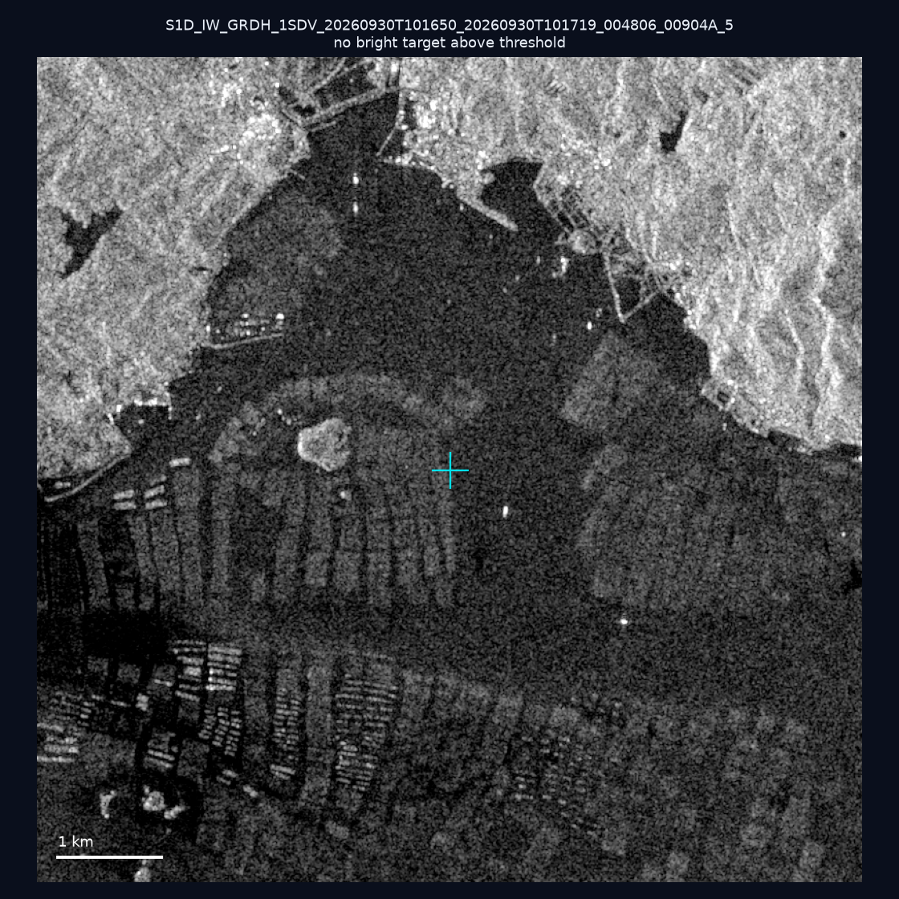
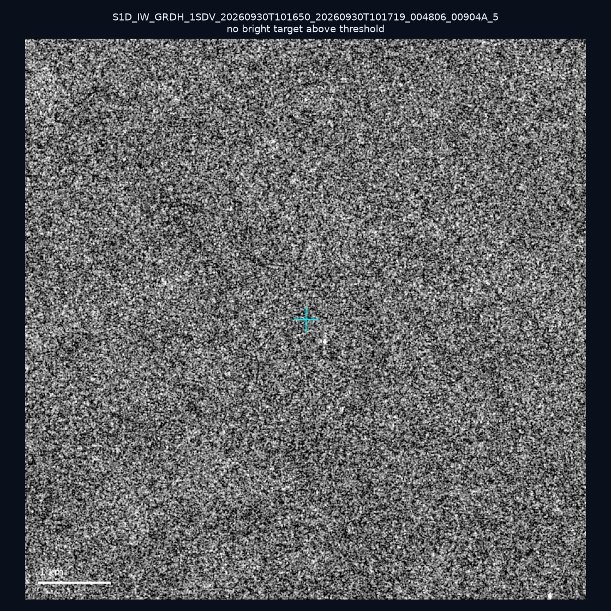
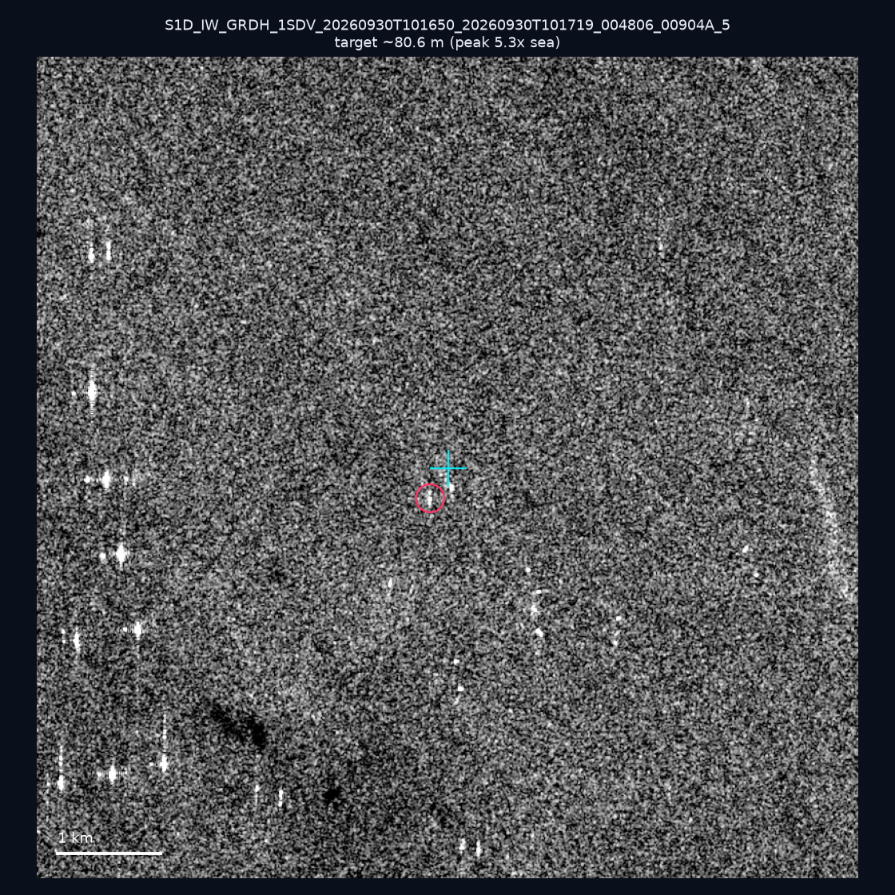
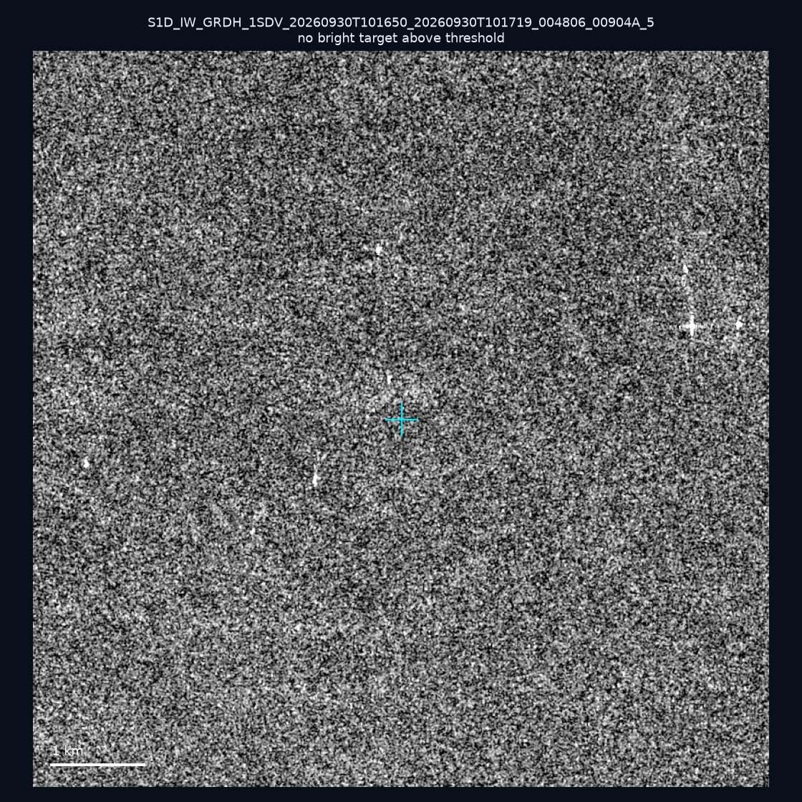

# 暗船 SAR 取證報告 — 2026-10-09

## 1. 總覽

- 執行時間：2026-10-09（GitHub Actions cron 自動執行）
- 線上比對摘要：暗偵測 18405 筆、殘餘暗船 13290 筆、假暗船剔除率 27.8%
- 本輪測試：10 筆
- 成功：10 筆
- 找到亮目標：2 筆
- 失敗：0 筆

## 2. 結果總表

| 日期 | 座標 | 海域 | 法域 | 成像時刻 | 判定 | 估計長度 | 峰值比 |
|------|------|------|------|----------|------|----------|--------|
| 2026-10-03 | 25.13, 122.9 | east | eez | 09:52:09 | ⚪ 無目標（雜訊或低RCS） | — | — |
| 2026-10-03 | 24.31, 123.97 | east | eez | 09:52:09 | ⚪ 無目標（雜訊或低RCS） | — | — |
| 2026-10-03 | 24.66, 124.22 | east | eez | 09:52:09 | 🟡 弱目標 | ~28.3 m | 4.1× |
| 2026-10-03 | 25.1, 123.57 | east | eez | 09:52:09 | ⚪ 無目標（雜訊或低RCS） | — | — |
| 2026-10-03 | 24.77, 122.77 | east | eez | 09:52:09 | ⚪ 無目標（雜訊或低RCS） | — | — |
| 2026-10-03 | 24.52, 123.71 | east | eez | 09:52:09 | ⚪ 無目標（雜訊或低RCS） | — | — |
| 2026-09-30 | 23.47, 117.02 | southwest | eez | 10:16:50 | ⚪ 無目標（雜訊或低RCS） | — | — |
| 2026-09-30 | 23.18, 118.27 | southwest | eez | 10:16:50 | ⚪ 無目標（雜訊或低RCS） | — | — |
| 2026-09-30 | 23.26, 117.12 | southwest | eez | 10:16:50 | 🟡 弱目標 | ~80.6 m | 5.3× |
| 2026-09-30 | 22.95, 118.1 | southwest | eez | 10:16:50 | ⚪ 無目標（雜訊或低RCS） | — | — |

## 3. 逐目標段落

### 2026-10-03 (25.13, 122.9)

⚪ 無目標（雜訊或低RCS）。

### 2026-10-03 (24.31, 123.97)

⚪ 無目標（雜訊或低RCS）。

### 2026-10-03 (24.66, 124.22)

🟡 弱目標，估計長度 ~28.3 m，峰值 4.1× 海面背景（4 px）。

### 2026-10-03 (25.1, 123.57)

⚪ 無目標（雜訊或低RCS）。

### 2026-10-03 (24.77, 122.77)

⚪ 無目標（雜訊或低RCS）。

### 2026-10-03 (24.52, 123.71)

⚪ 無目標（雜訊或低RCS）。

### 2026-09-30 (23.47, 117.02)

⚪ 無目標（雜訊或低RCS）。

### 2026-09-30 (23.18, 118.27)

⚪ 無目標（雜訊或低RCS）。

### 2026-09-30 (23.26, 117.12)

🟡 弱目標，估計長度 ~80.6 m，峰值 5.3× 海面背景（16 px）。

### 2026-09-30 (22.95, 118.1)

⚪ 無目標（雜訊或低RCS）。

## 4. 後續建議

- 累積統計：全歷史 469 筆（有效 469 筆），確認實體目標 55 筆（11.7%）

> 所有結果是研判線索，不是法律認定；無目標 ≠ 誤報（小型木殼漁船 RCS 低，SAR 可能拍不到）。
