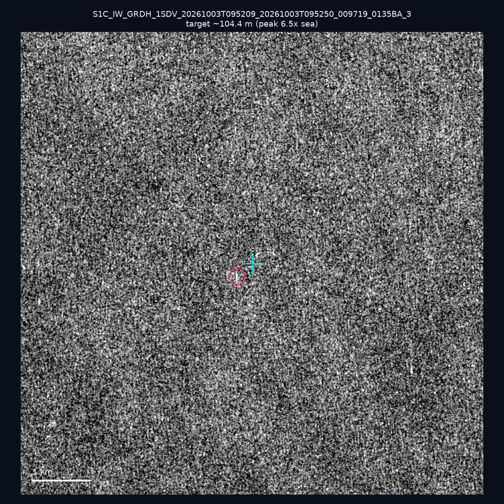
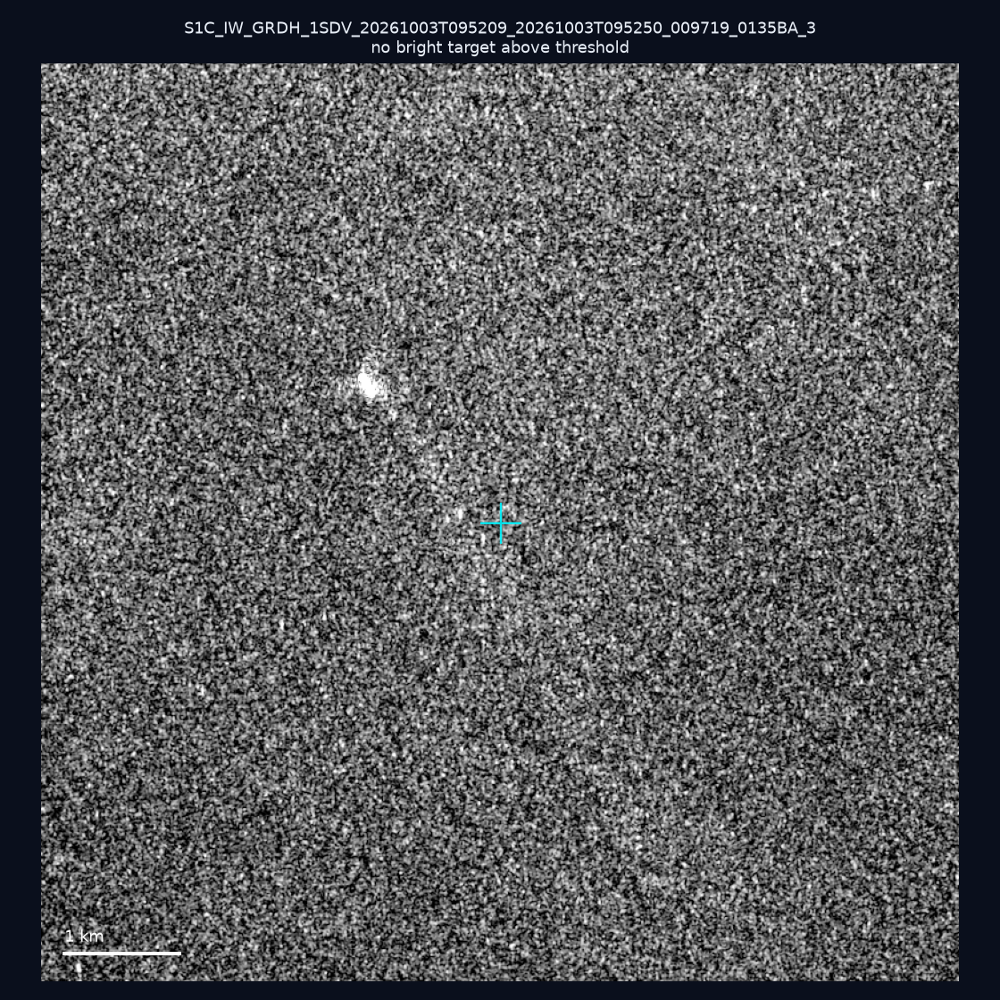
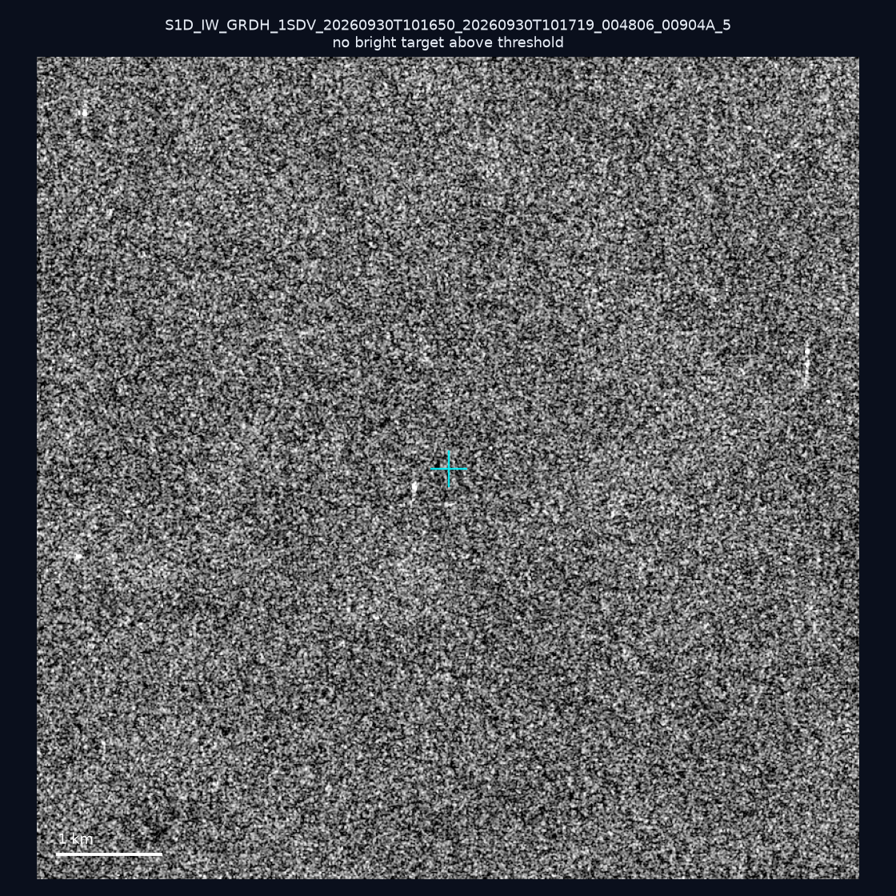
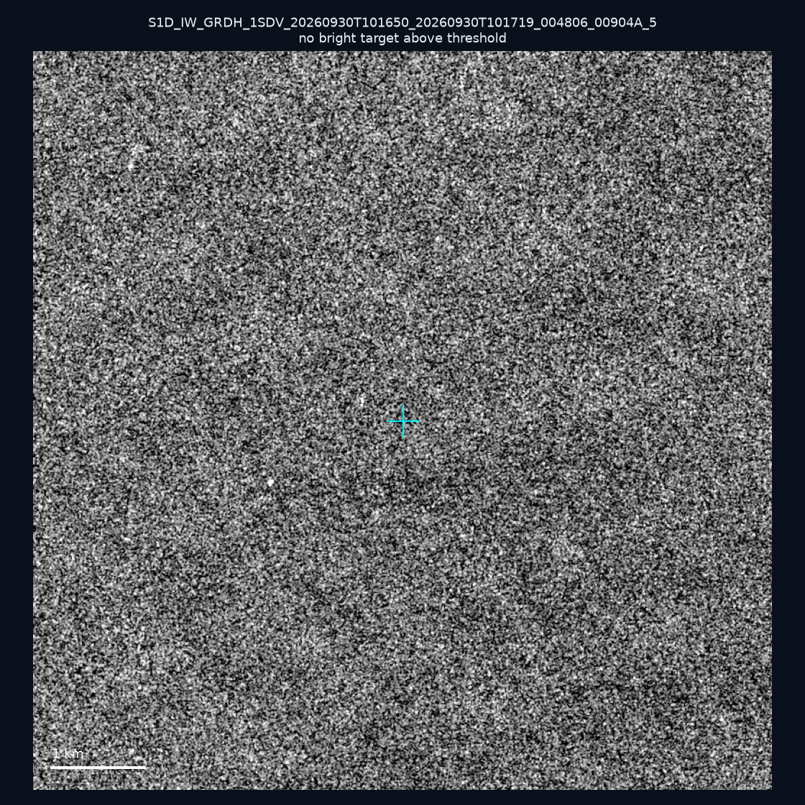
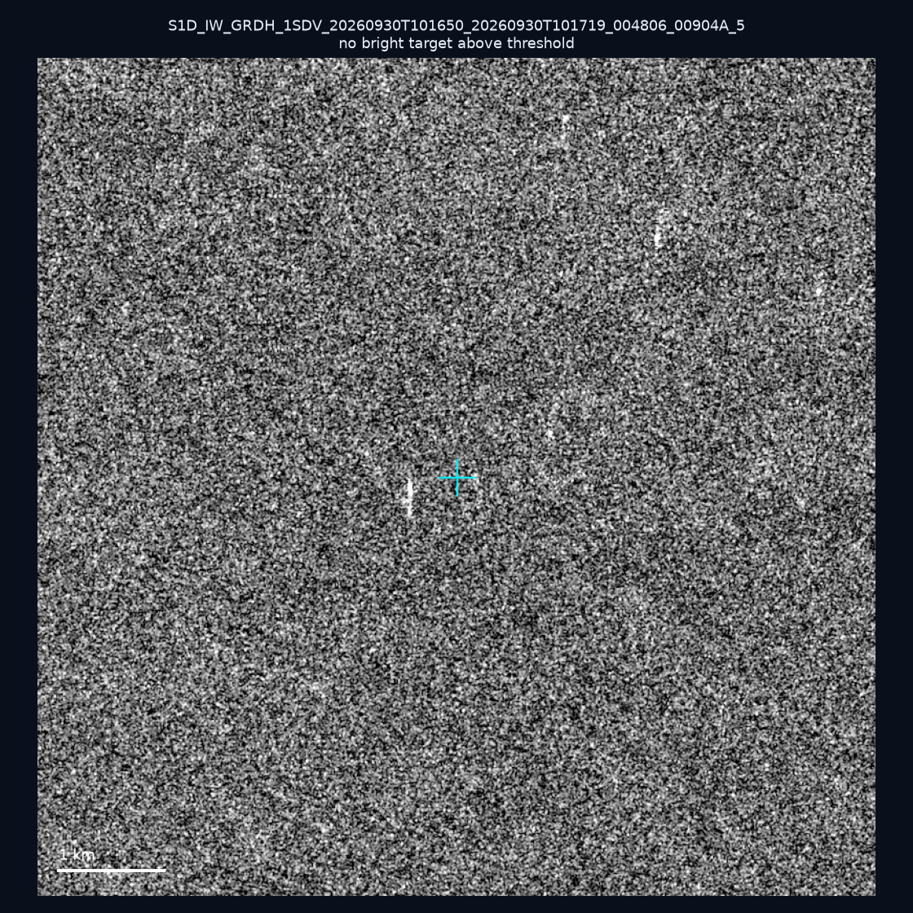
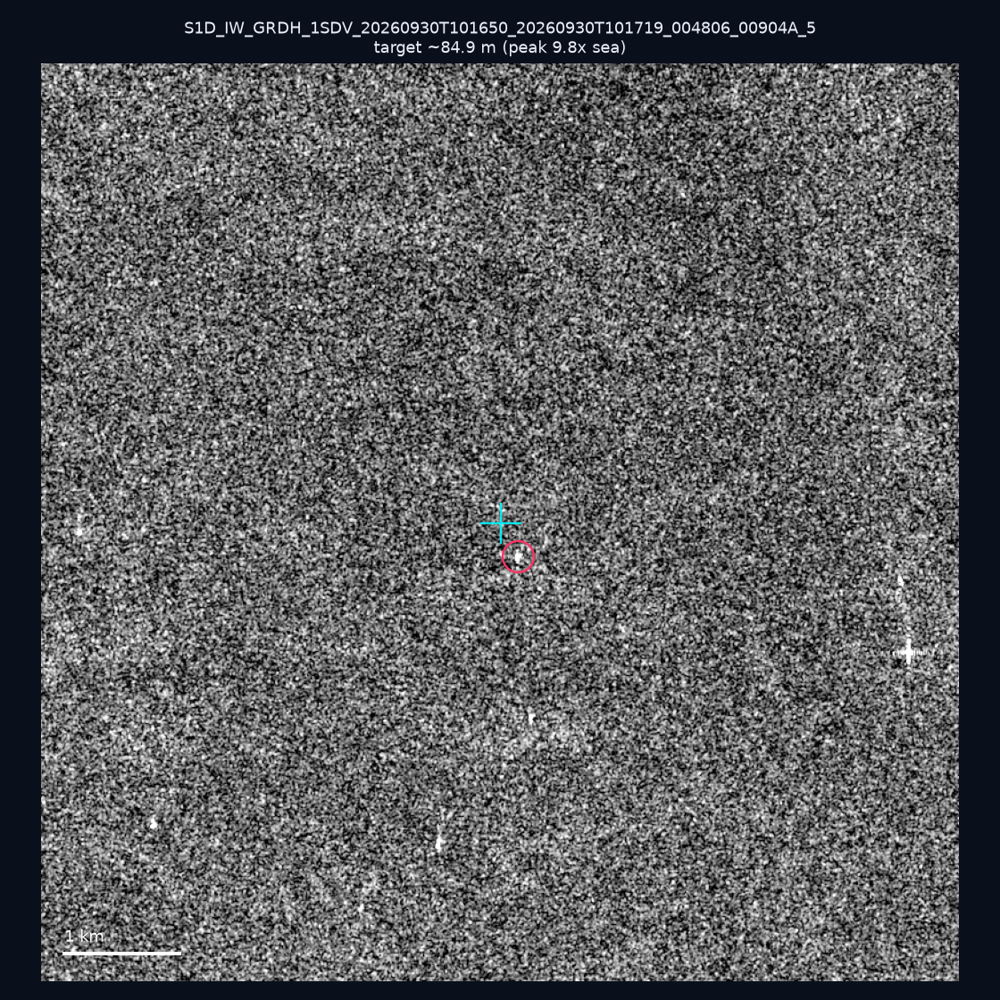
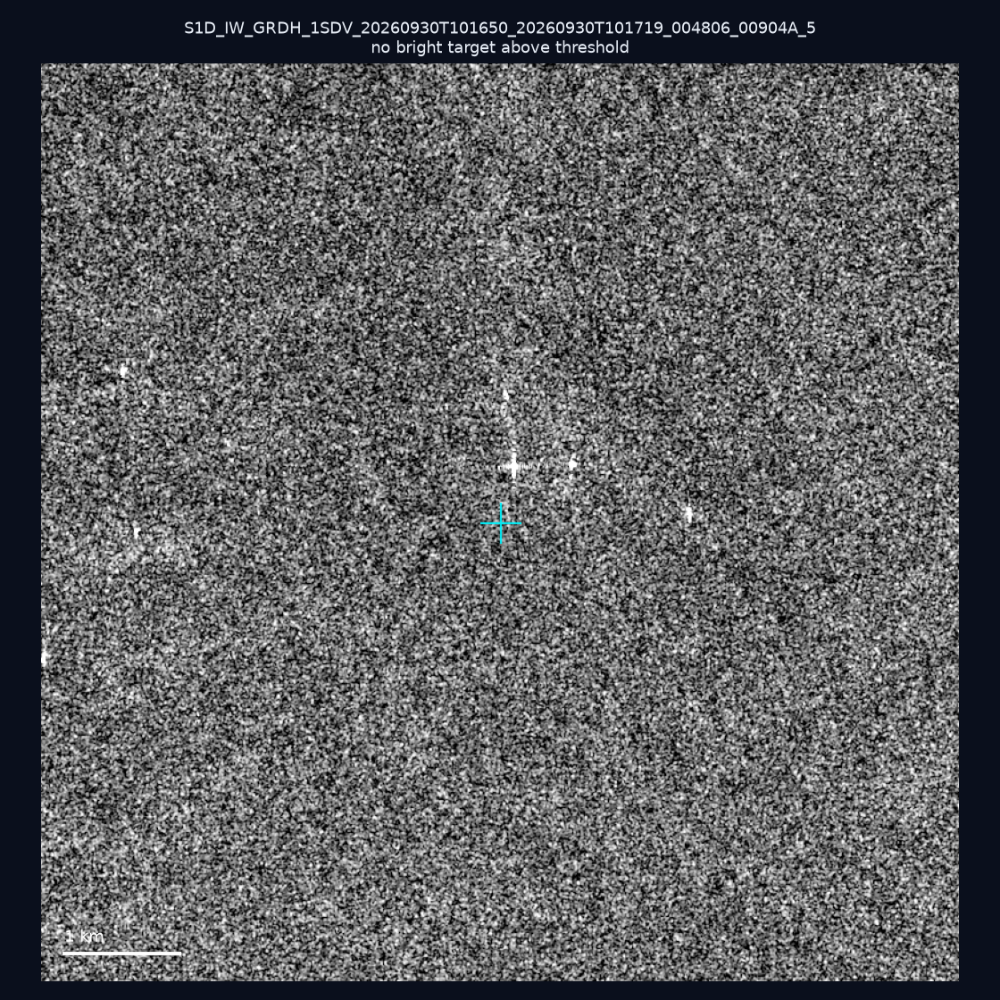
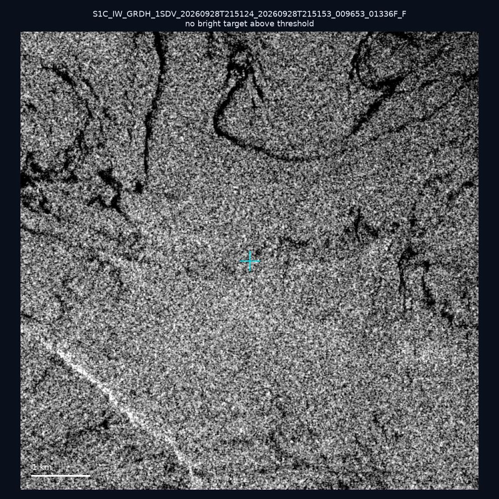
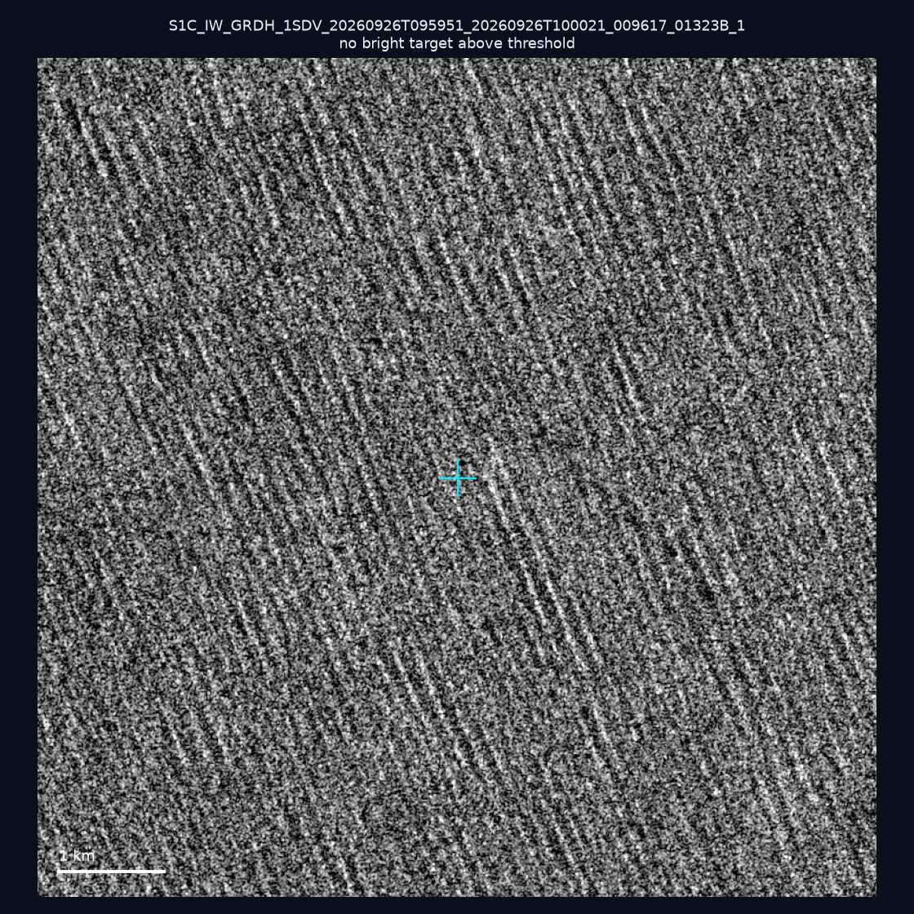
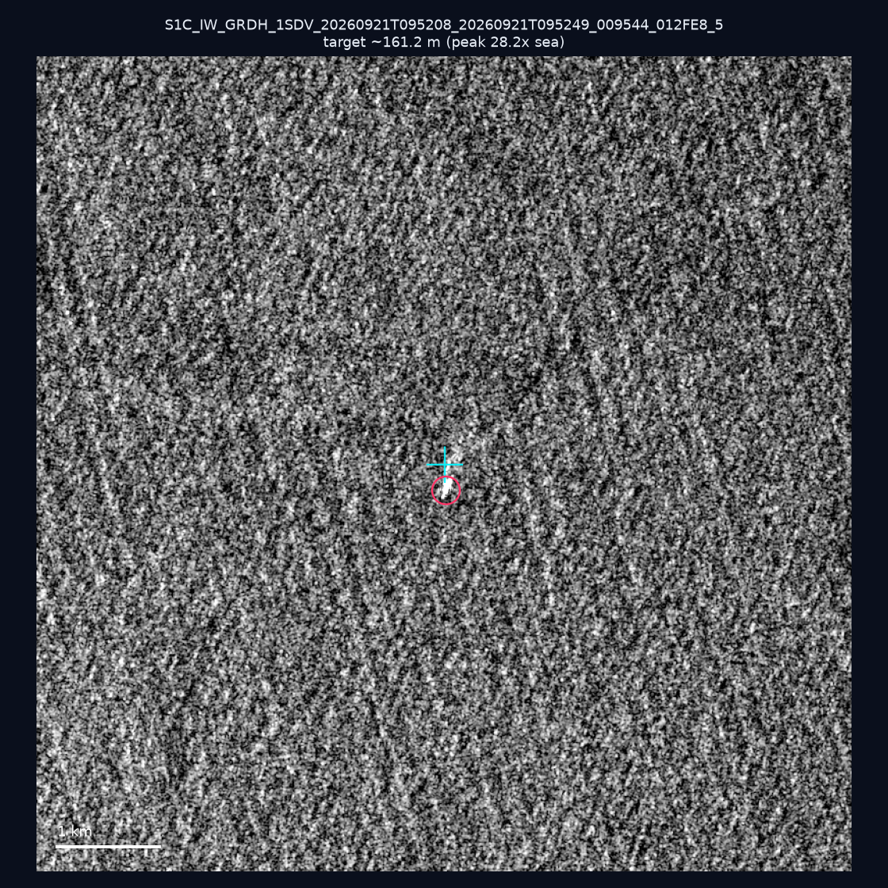

# 暗船 SAR 取證報告 — 2026-10-10

## 1. 總覽

- 執行時間：2026-10-10（GitHub Actions cron 自動執行）
- 線上比對摘要：暗偵測 17444 筆、殘餘暗船 12521 筆、假暗船剔除率 28.2%
- 本輪測試：10 筆
- 成功：10 筆
- 找到亮目標：3 筆
- 失敗：0 筆

## 2. 結果總表

| 日期 | 座標 | 海域 | 法域 | 成像時刻 | 判定 | 估計長度 | 峰值比 |
|------|------|------|------|----------|------|----------|--------|
| 2026-10-03 | 25.35, 123.37 | east | eez | 09:52:09 | 🟡 弱目標 | ~104.4 m | 6.5× |
| 2026-10-03 | 23.36, 122.31 | east | eez | 09:52:09 | ⚪ 無目標（雜訊或低RCS） | — | — |
| 2026-09-30 | 23.22, 118.3 | southwest | eez | 10:16:50 | ⚪ 無目標（雜訊或低RCS） | — | — |
| 2026-09-30 | 23.14, 118.17 | southwest | eez | 10:16:50 | ⚪ 無目標（雜訊或低RCS） | — | — |
| 2026-09-30 | 23.16, 118.07 | southwest | eez | 10:16:50 | ⚪ 無目標（雜訊或低RCS） | — | — |
| 2026-09-30 | 22.93, 118.1 | southwest | eez | 10:16:50 | 🟡 弱目標 | ~84.9 m | 9.8× |
| 2026-09-30 | 22.95, 118.13 | southwest | eez | 10:16:50 | ⚪ 無目標（雜訊或低RCS） | — | — |
| 2026-09-28 | 24.8, 122.14 | east | territorial_sea | 21:51:24 | ⚪ 無目標（雜訊或低RCS） | — | — |
| 2026-09-26 | 22.86, 122.45 | east | eez | 09:59:51 | ⚪ 無目標（雜訊或低RCS） | — | — |
| 2026-09-21 | 25.32, 121.9 | east | internal_waters | 09:52:08 | ✅ 確認實體目標 | ~161.2 m | 28.2× |

## 3. 逐目標段落

### 2026-10-03 (25.35, 123.37)

🟡 弱目標，估計長度 ~104.4 m，峰值 6.5× 海面背景（26 px）。

### 2026-10-03 (23.36, 122.31)

⚪ 無目標（雜訊或低RCS）。

### 2026-09-30 (23.22, 118.3)

⚪ 無目標（雜訊或低RCS）。

### 2026-09-30 (23.14, 118.17)

⚪ 無目標（雜訊或低RCS）。

### 2026-09-30 (23.16, 118.07)

⚪ 無目標（雜訊或低RCS）。

### 2026-09-30 (22.93, 118.1)

🟡 弱目標，估計長度 ~84.9 m，峰值 9.8× 海面背景（26 px）。

### 2026-09-30 (22.95, 118.13)

⚪ 無目標（雜訊或低RCS）。

### 2026-09-28 (24.8, 122.14)

⚪ 無目標（雜訊或低RCS）。

### 2026-09-26 (22.86, 122.45)

⚪ 無目標（雜訊或低RCS）。

### 2026-09-21 (25.32, 121.9)

✅ 確認實體目標，估計長度 ~161.2 m，峰值 28.2× 海面背景（65 px）。

## 4. 後續建議

- 值得人工深查（確認實體目標且長度 ≥ 50m）：
  - 2026-09-21 (25.32, 121.9) ~161.2 m — 建議比對周邊 AIS 船長
- 累積統計：全歷史 479 筆（有效 479 筆），確認實體目標 56 筆（11.7%）

> 所有結果是研判線索，不是法律認定；無目標 ≠ 誤報（小型木殼漁船 RCS 低，SAR 可能拍不到）。
