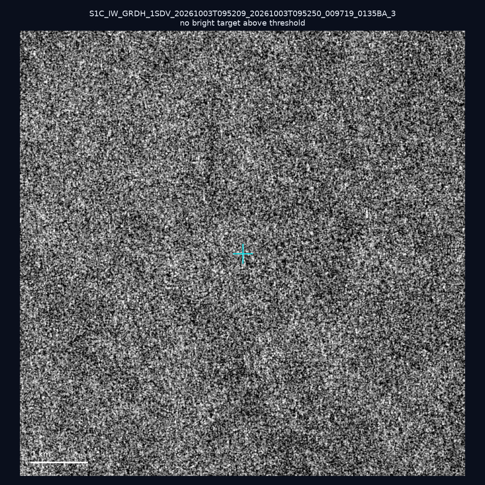
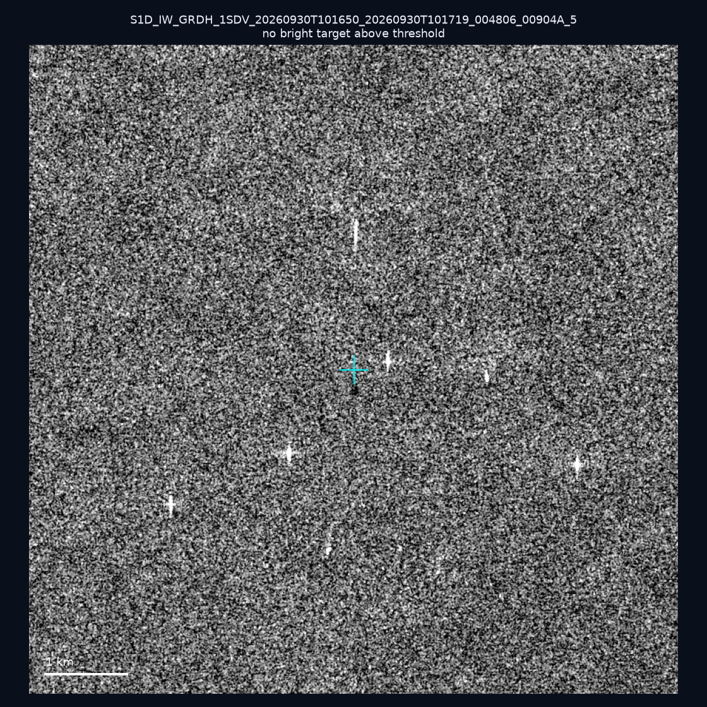
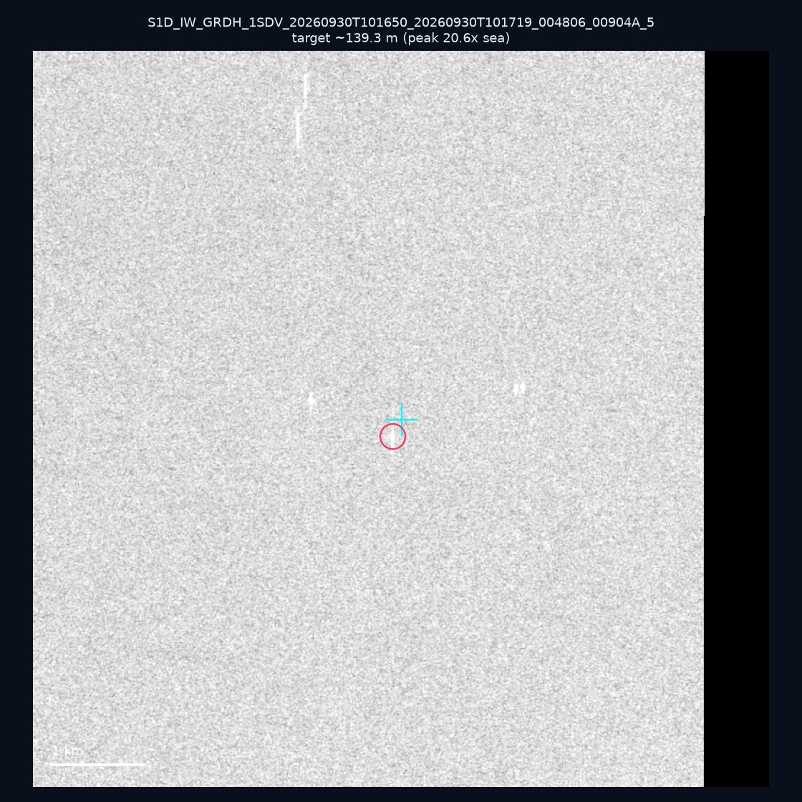
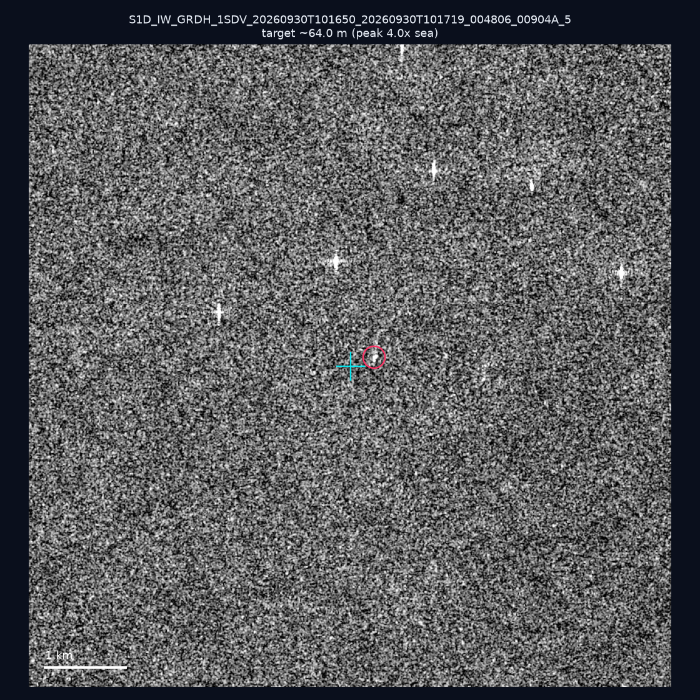
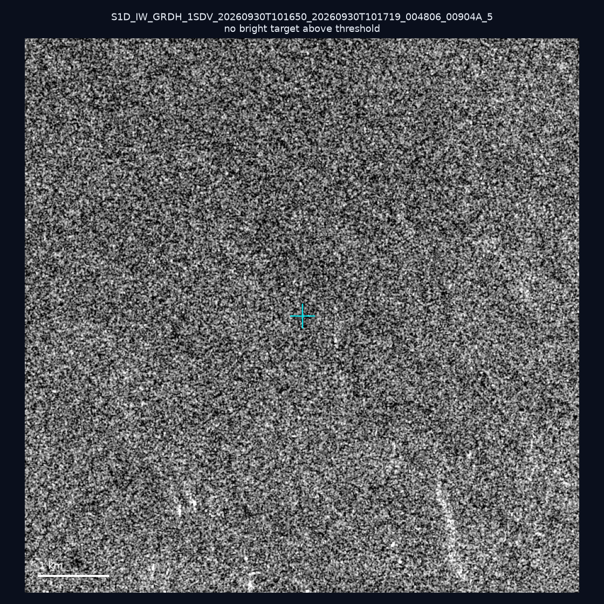
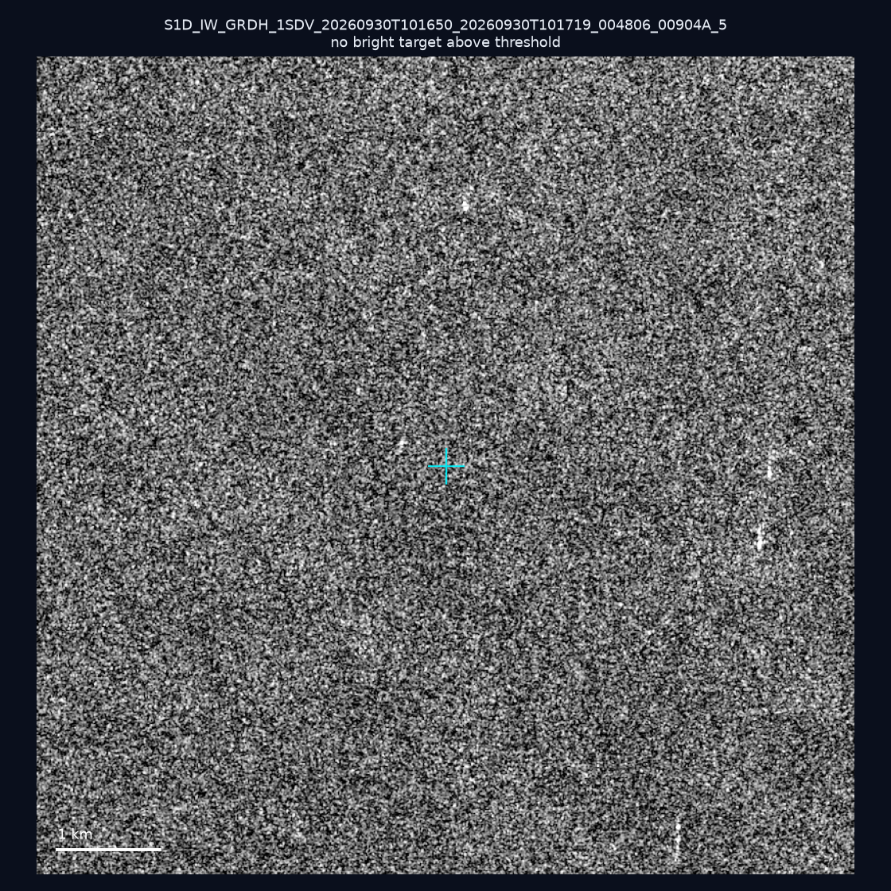
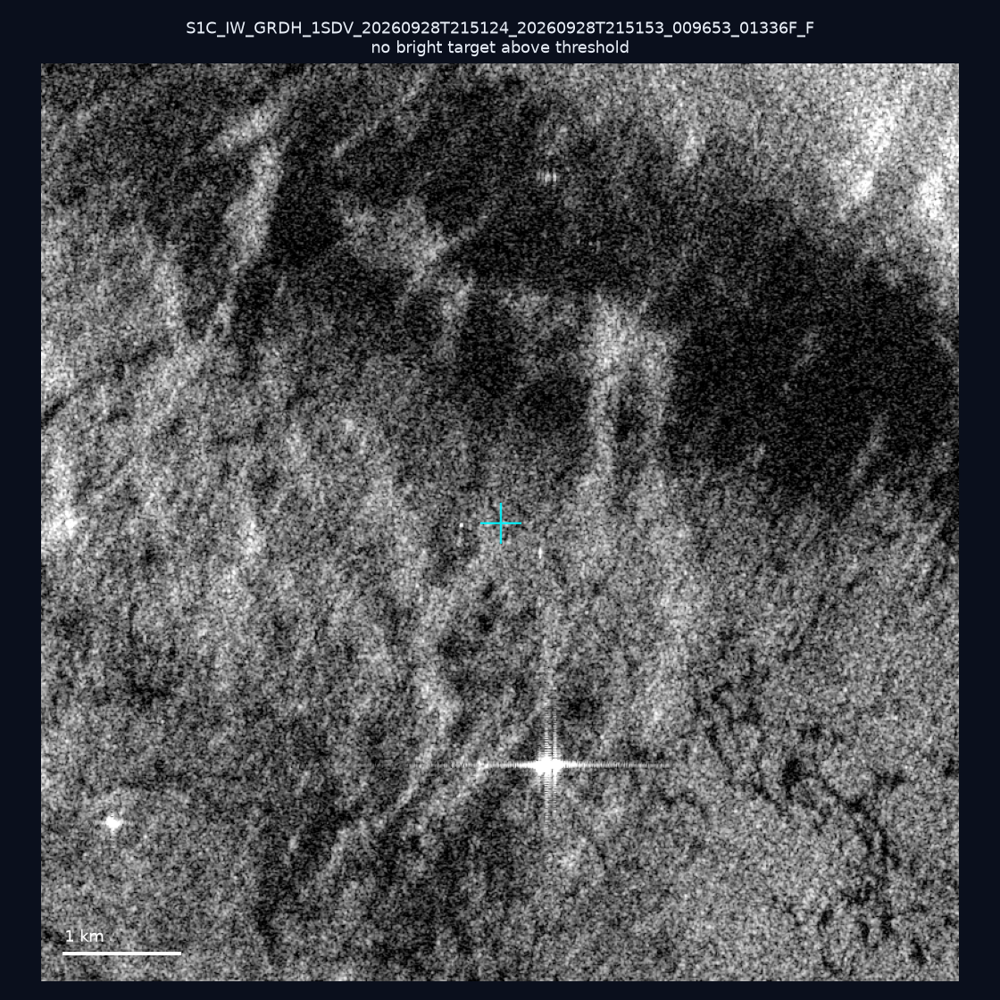
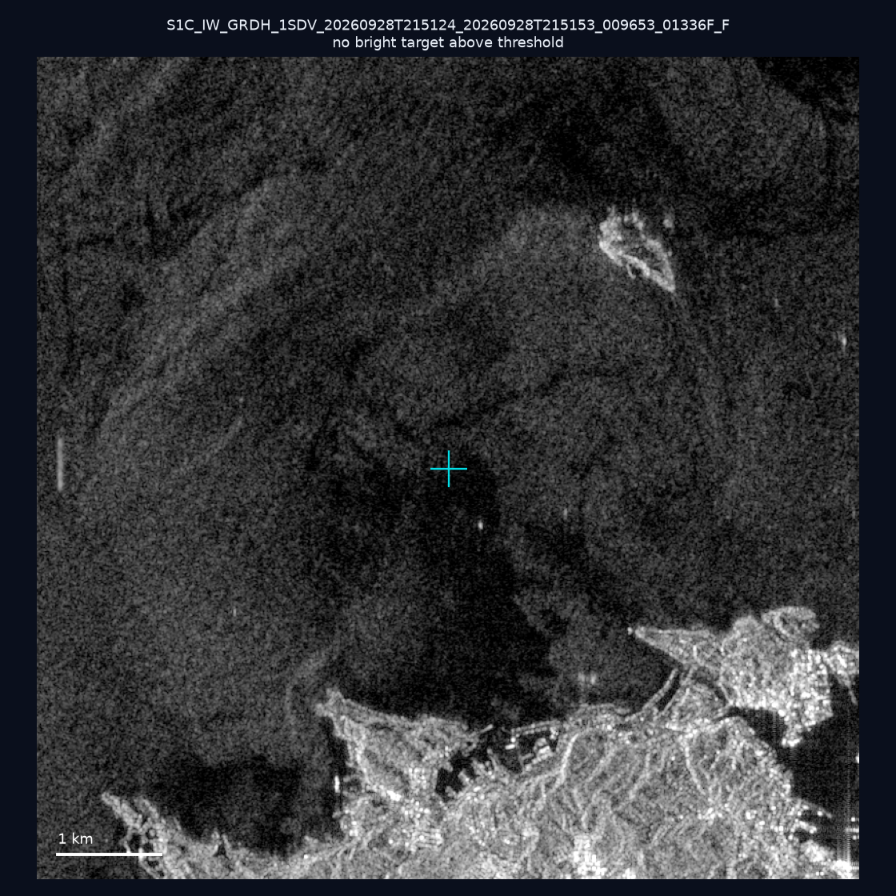
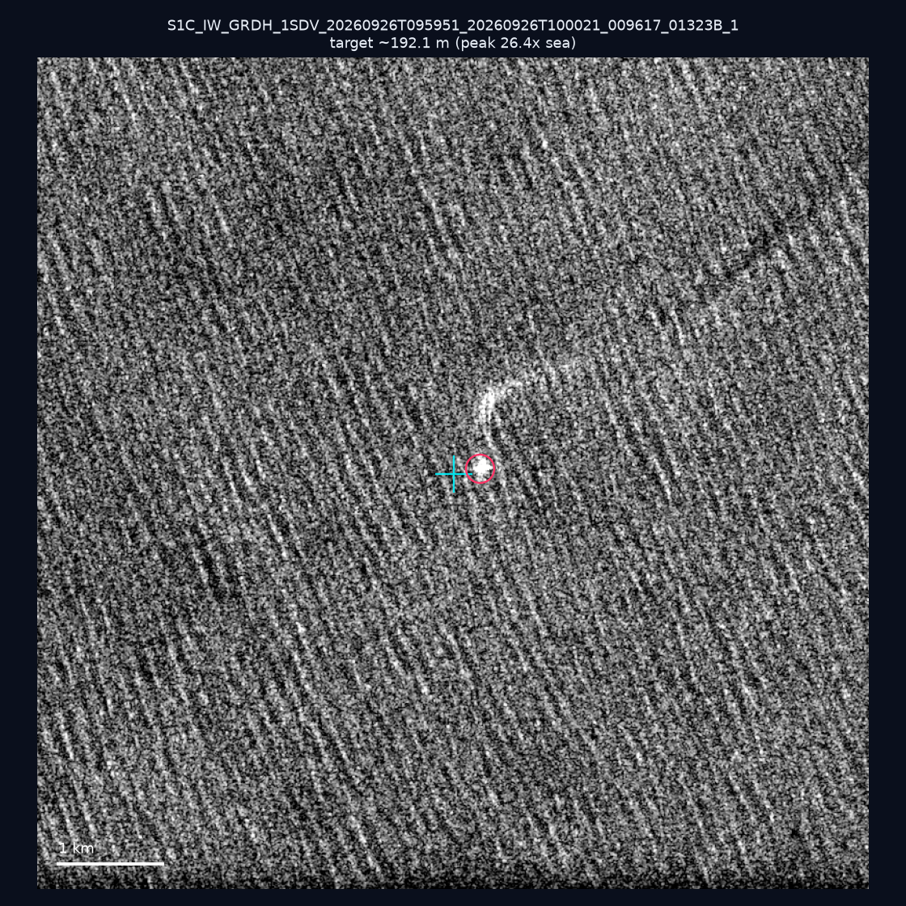
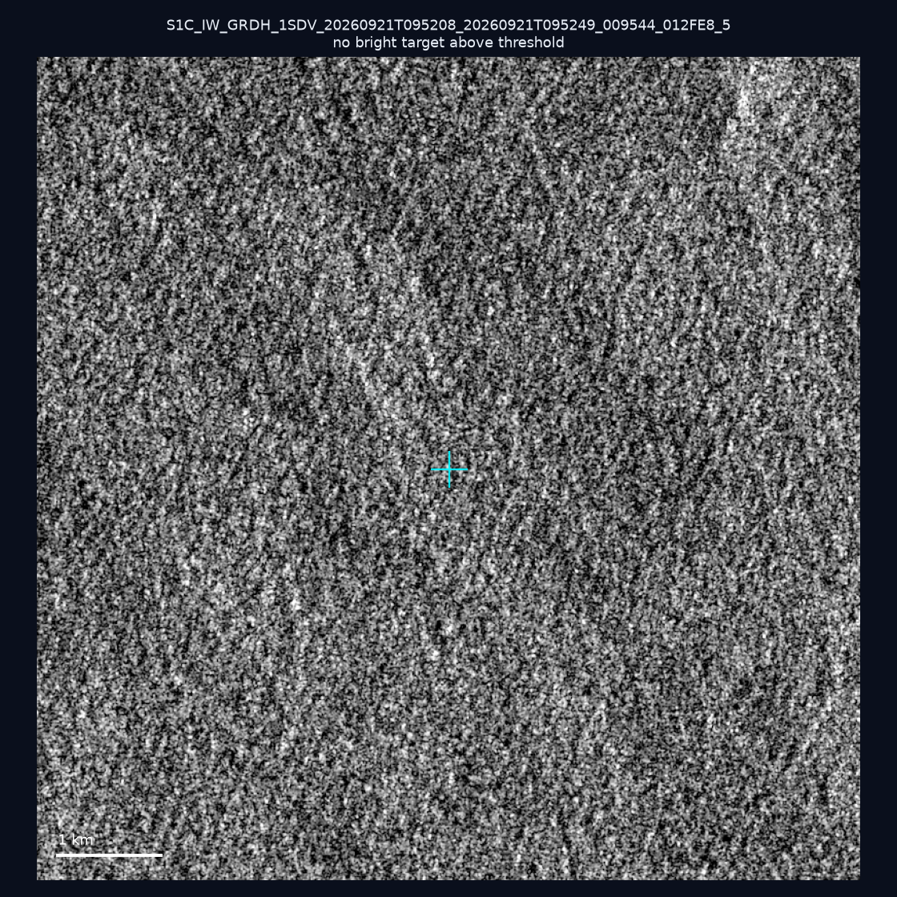

# 暗船 SAR 取證報告 — 2026-10-11

## 1. 總覽

- 執行時間：2026-10-11（GitHub Actions cron 自動執行）
- 線上比對摘要：暗偵測 16019 筆、殘餘暗船 11564 筆、假暗船剔除率 27.8%
- 本輪測試：10 筆
- 成功：10 筆
- 找到亮目標：3 筆
- 失敗：0 筆

## 2. 結果總表

| 日期 | 座標 | 海域 | 法域 | 成像時刻 | 判定 | 估計長度 | 峰值比 |
|------|------|------|------|----------|------|----------|--------|
| 2026-10-03 | 23.95, 123.79 | east | eez | 09:52:09 | ⚪ 無目標（雜訊或低RCS） | — | — |
| 2026-09-30 | 23.23, 118.22 | southwest | eez | 10:16:50 | ⚪ 無目標（雜訊或低RCS） | — | — |
| 2026-09-30 | 23.33, 118.42 | southwest | eez | 10:16:50 | ✅ 確認實體目標 | ~139.3 m | 20.6× |
| 2026-09-30 | 23.25, 118.21 | southwest | eez | 10:16:50 | 🟡 弱目標 | ~64.0 m | 4.0× |
| 2026-09-30 | 23.24, 117.14 | southwest | eez | 10:16:50 | ⚪ 無目標（雜訊或低RCS） | — | — |
| 2026-09-30 | 23.18, 118.32 | southwest | eez | 10:16:50 | ⚪ 無目標（雜訊或低RCS） | — | — |
| 2026-09-28 | 25.28, 121.82 | east | internal_waters | 21:51:24 | ⚪ 無目標（雜訊或低RCS） | — | — |
| 2026-09-28 | 25.17, 121.8 | east | internal_waters | 21:51:24 | ⚪ 無目標（雜訊或低RCS） | — | — |
| 2026-09-26 | 23.41, 122.39 | east | eez | 09:59:51 | ✅ 確認實體目標 | ~192.1 m | 26.4× |
| 2026-09-21 | 25.45, 121.89 | east | internal_waters | 09:52:08 | ⚪ 無目標（雜訊或低RCS） | — | — |

## 3. 逐目標段落

### 2026-10-03 (23.95, 123.79)

⚪ 無目標（雜訊或低RCS）。

### 2026-09-30 (23.23, 118.22)

⚪ 無目標（雜訊或低RCS）。

### 2026-09-30 (23.33, 118.42)

✅ 確認實體目標，估計長度 ~139.3 m，峰值 20.6× 海面背景（41 px）。

### 2026-09-30 (23.25, 118.21)

🟡 弱目標，估計長度 ~64.0 m，峰值 4.0× 海面背景（15 px）。

### 2026-09-30 (23.24, 117.14)

⚪ 無目標（雜訊或低RCS）。

### 2026-09-30 (23.18, 118.32)

⚪ 無目標（雜訊或低RCS）。

### 2026-09-28 (25.28, 121.82)

⚪ 無目標（雜訊或低RCS）。

### 2026-09-28 (25.17, 121.8)

⚪ 無目標（雜訊或低RCS）。

### 2026-09-26 (23.41, 122.39)

✅ 確認實體目標，估計長度 ~192.1 m，峰值 26.4× 海面背景（91 px）。

### 2026-09-21 (25.45, 121.89)

⚪ 無目標（雜訊或低RCS）。

## 4. 後續建議

- 值得人工深查（確認實體目標且長度 ≥ 50m）：
  - 2026-09-30 (23.33, 118.42) ~139.3 m — 建議比對周邊 AIS 船長
  - 2026-09-26 (23.41, 122.39) ~192.1 m — 建議比對周邊 AIS 船長
- 累積統計：全歷史 489 筆（有效 489 筆），確認實體目標 58 筆（11.9%）

> 所有結果是研判線索，不是法律認定；無目標 ≠ 誤報（小型木殼漁船 RCS 低，SAR 可能拍不到）。
