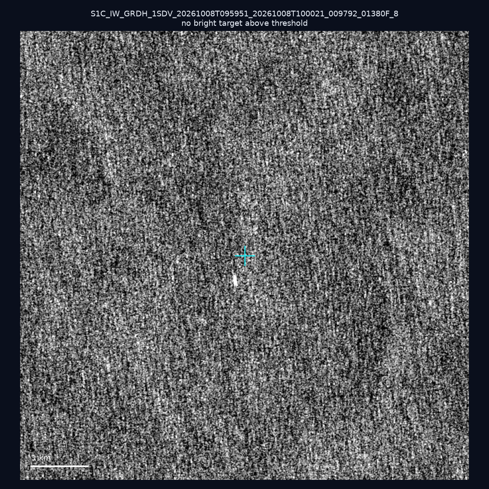
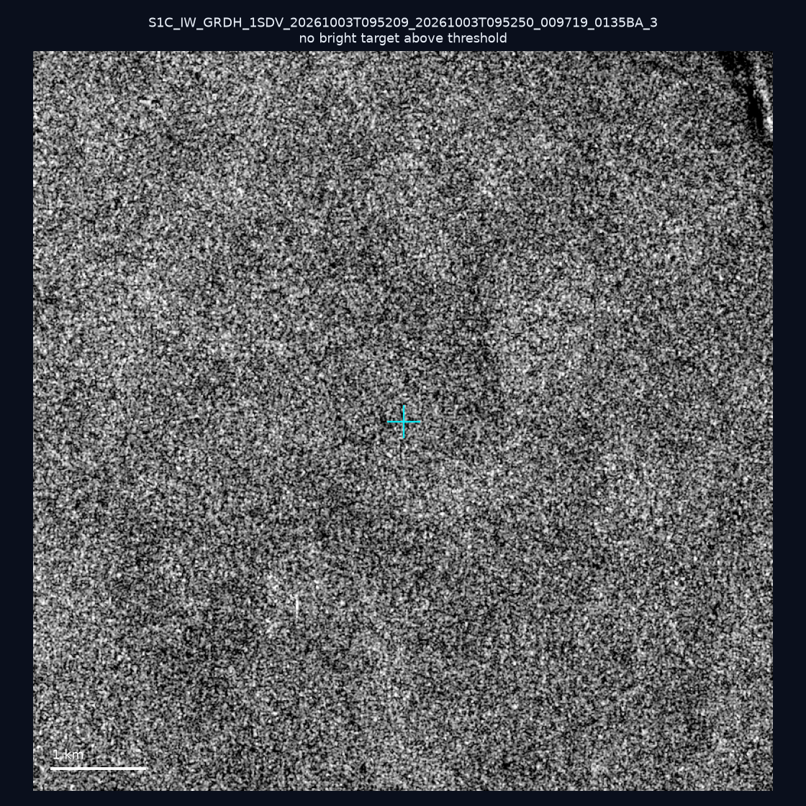
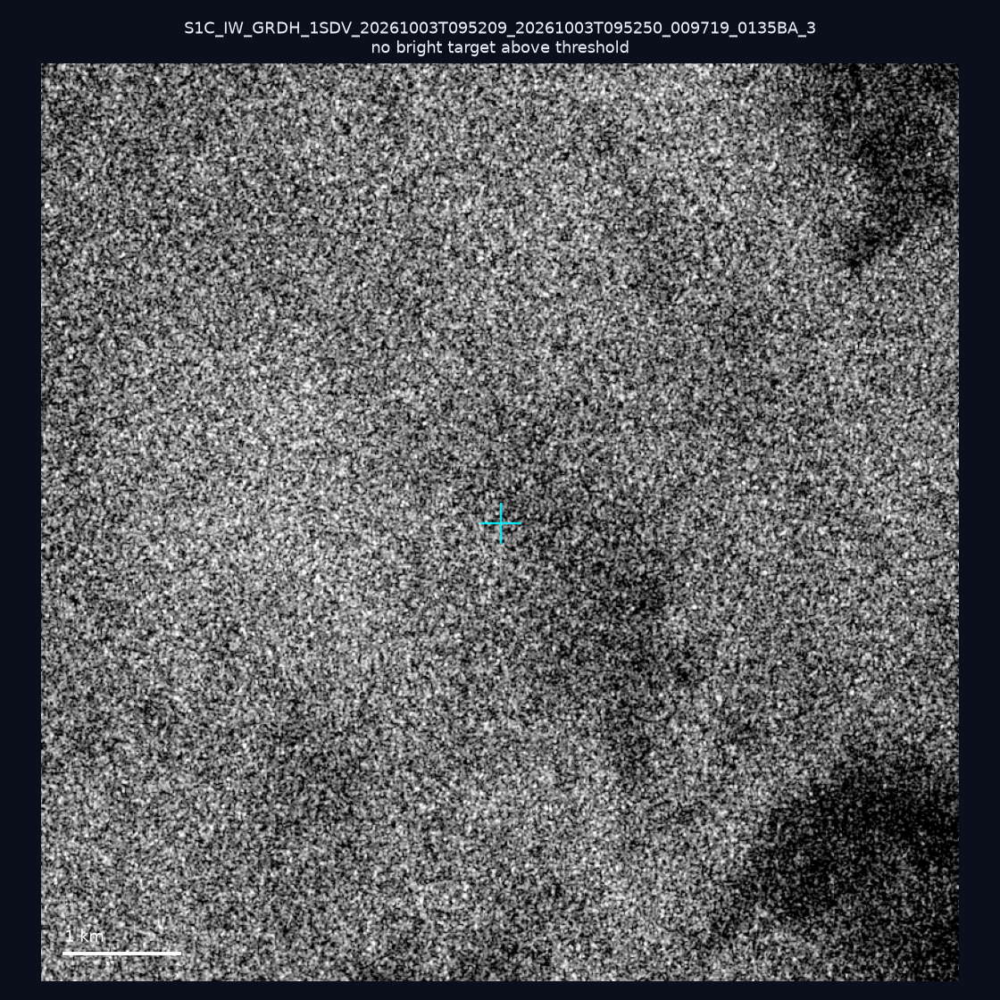
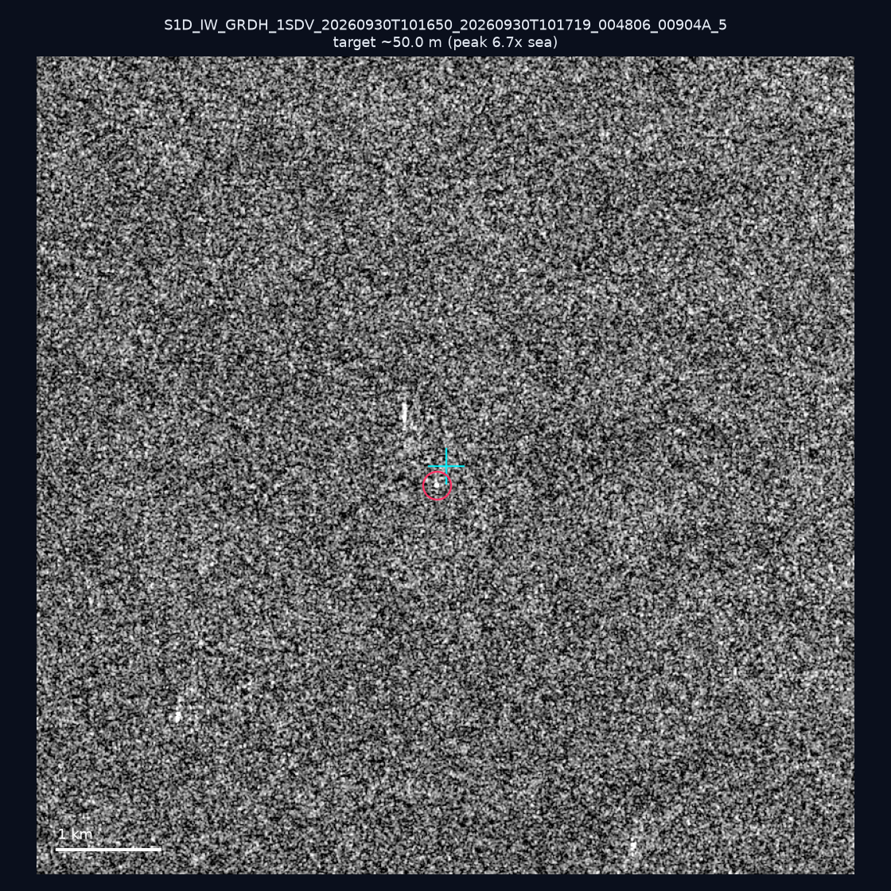
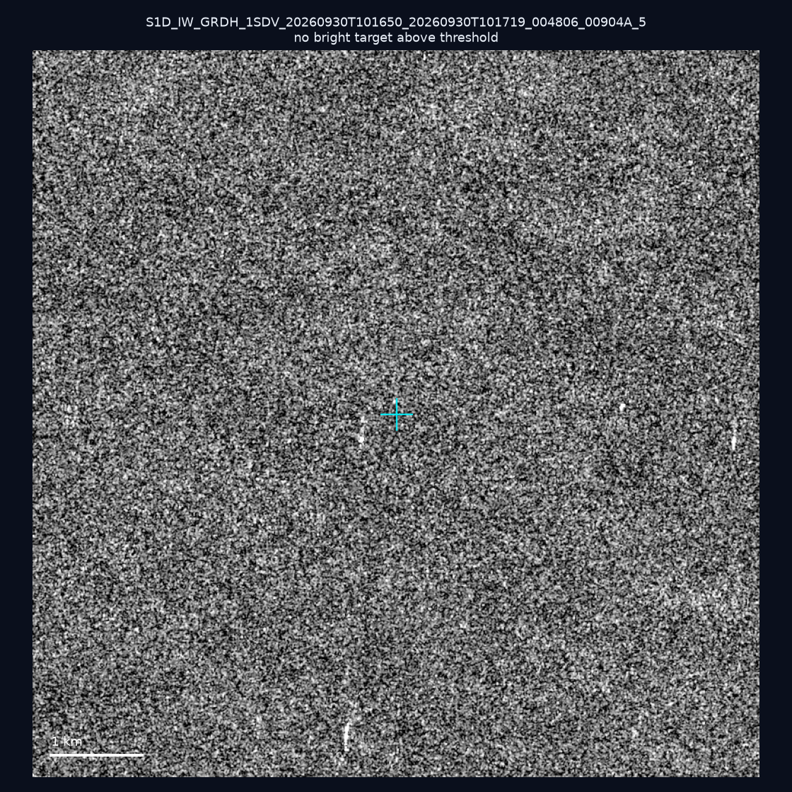
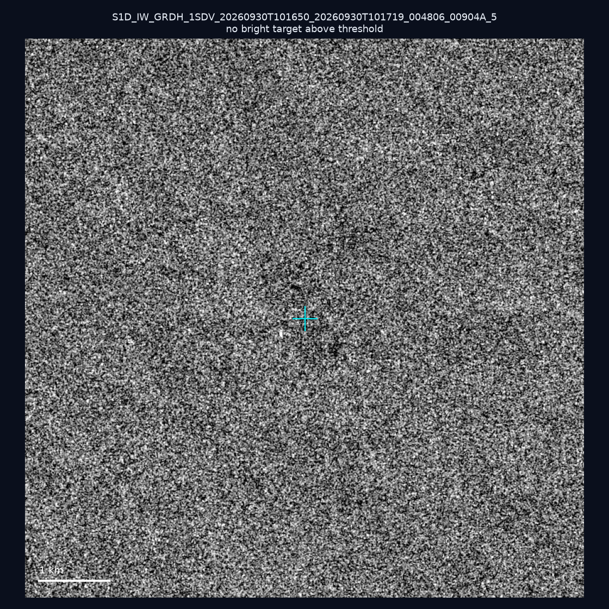
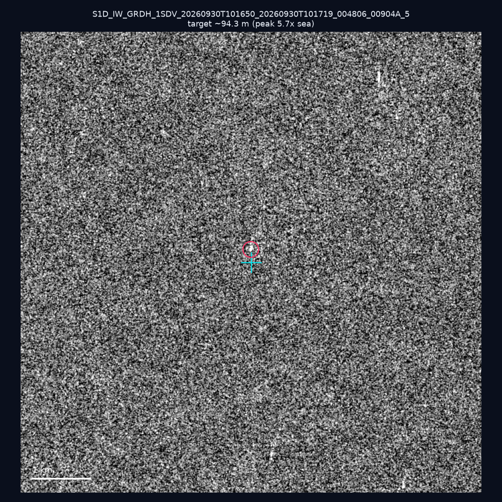
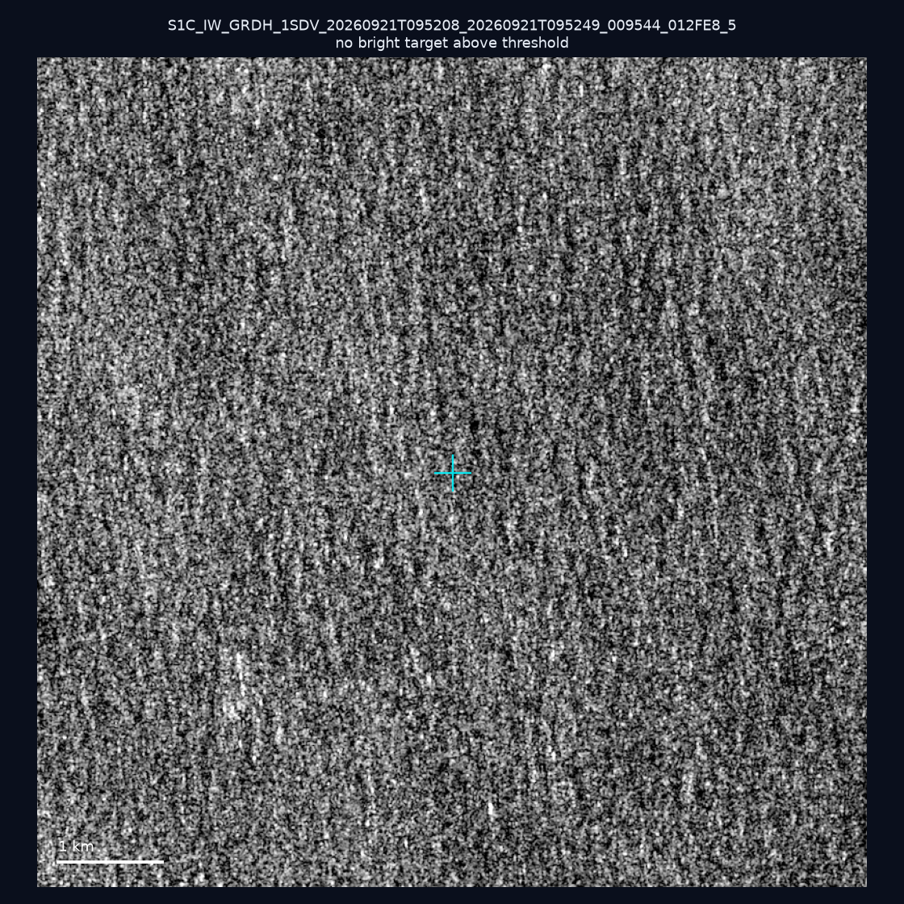
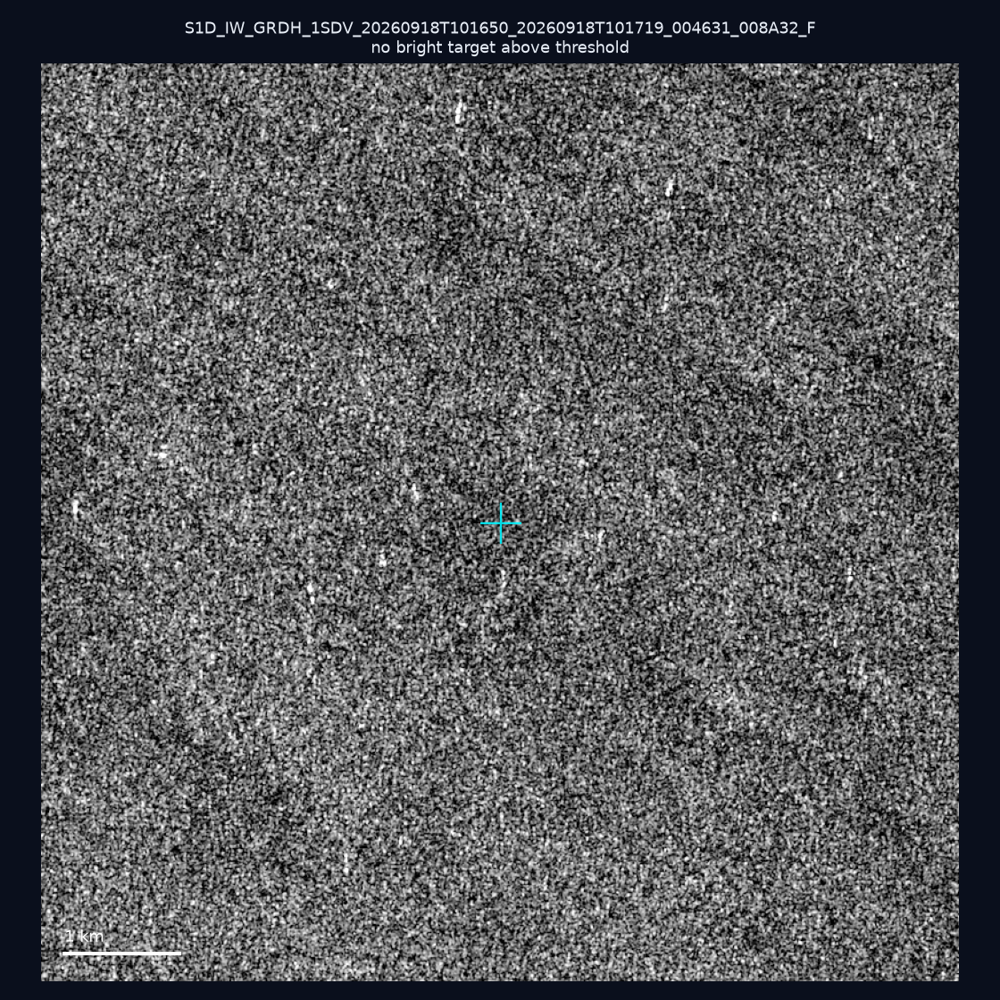
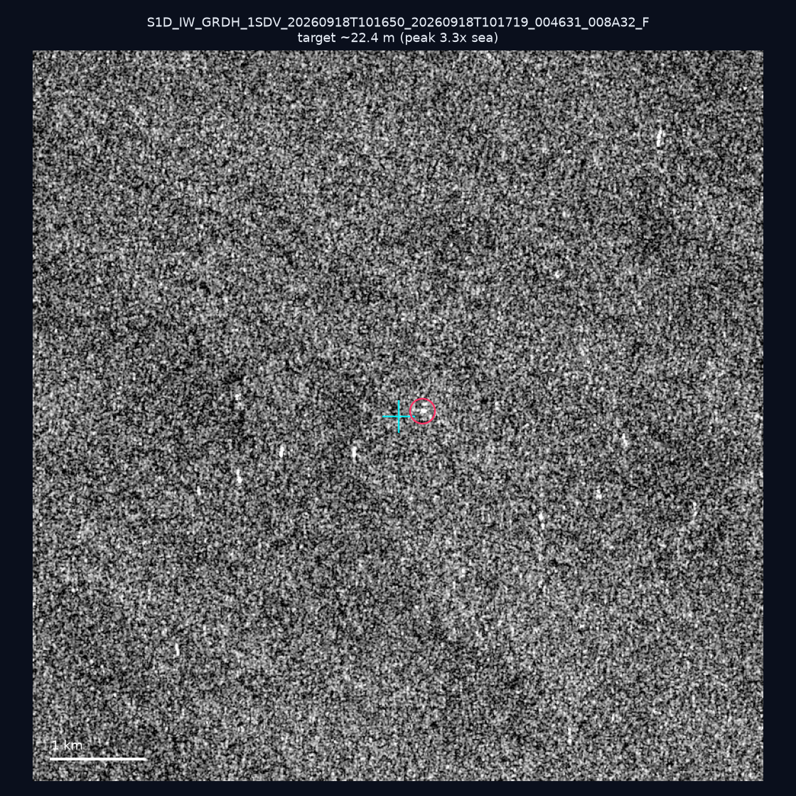

# 暗船 SAR 取證報告 — 2026-10-12

## 1. 總覽

- 執行時間：2026-10-12（GitHub Actions cron 自動執行）
- 線上比對摘要：暗偵測 16170 筆、殘餘暗船 11578 筆、假暗船剔除率 28.4%
- 本輪測試：10 筆
- 成功：10 筆
- 找到亮目標：3 筆
- 失敗：0 筆

## 2. 結果總表

| 日期 | 座標 | 海域 | 法域 | 成像時刻 | 判定 | 估計長度 | 峰值比 |
|------|------|------|------|----------|------|----------|--------|
| 2026-10-08 | 22.42, 122.08 | east | eez | 09:59:51 | ⚪ 無目標（雜訊或低RCS） | — | — |
| 2026-10-03 | 24.5, 123.76 | east | eez | 09:52:09 | ⚪ 無目標（雜訊或低RCS） | — | — |
| 2026-10-03 | 23.82, 122.36 | east | eez | 09:52:09 | ⚪ 無目標（雜訊或低RCS） | — | — |
| 2026-09-30 | 23.05, 118.01 | southwest | eez | 10:16:50 | 🟡 弱目標 | ~50.0 m | 6.7× |
| 2026-09-30 | 22.96, 118.0 | southwest | eez | 10:16:50 | ⚪ 無目標（雜訊或低RCS） | — | — |
| 2026-09-30 | 23.04, 118.38 | southwest | eez | 10:16:50 | ⚪ 無目標（雜訊或低RCS） | — | — |
| 2026-09-30 | 23.07, 117.98 | southwest | eez | 10:16:50 | 🟡 弱目標 | ~94.3 m | 5.7× |
| 2026-09-21 | 23.39, 122.29 | east | eez | 09:52:08 | ⚪ 無目標（雜訊或低RCS） | — | — |
| 2026-09-18 | 23.39, 118.22 | southwest | eez | 10:16:50 | ⚪ 無目標（雜訊或低RCS） | — | — |
| 2026-09-18 | 23.38, 118.19 | southwest | eez | 10:16:50 | 🟡 弱目標 | ~22.4 m | 3.3× |

## 3. 逐目標段落

### 2026-10-08 (22.42, 122.08)

⚪ 無目標（雜訊或低RCS）。

### 2026-10-03 (24.5, 123.76)

⚪ 無目標（雜訊或低RCS）。

### 2026-10-03 (23.82, 122.36)

⚪ 無目標（雜訊或低RCS）。

### 2026-09-30 (23.05, 118.01)

🟡 弱目標，估計長度 ~50.0 m，峰值 6.7× 海面背景（10 px）。

### 2026-09-30 (22.96, 118.0)

⚪ 無目標（雜訊或低RCS）。

### 2026-09-30 (23.04, 118.38)

⚪ 無目標（雜訊或低RCS）。

### 2026-09-30 (23.07, 117.98)

🟡 弱目標，估計長度 ~94.3 m，峰值 5.7× 海面背景（23 px）。

### 2026-09-21 (23.39, 122.29)

⚪ 無目標（雜訊或低RCS）。

### 2026-09-18 (23.39, 118.22)

⚪ 無目標（雜訊或低RCS）。

### 2026-09-18 (23.38, 118.19)

🟡 弱目標，估計長度 ~22.4 m，峰值 3.3× 海面背景（2 px）。

## 4. 後續建議

- 累積統計：全歷史 499 筆（有效 499 筆），確認實體目標 58 筆（11.6%）

> 所有結果是研判線索，不是法律認定；無目標 ≠ 誤報（小型木殼漁船 RCS 低，SAR 可能拍不到）。
