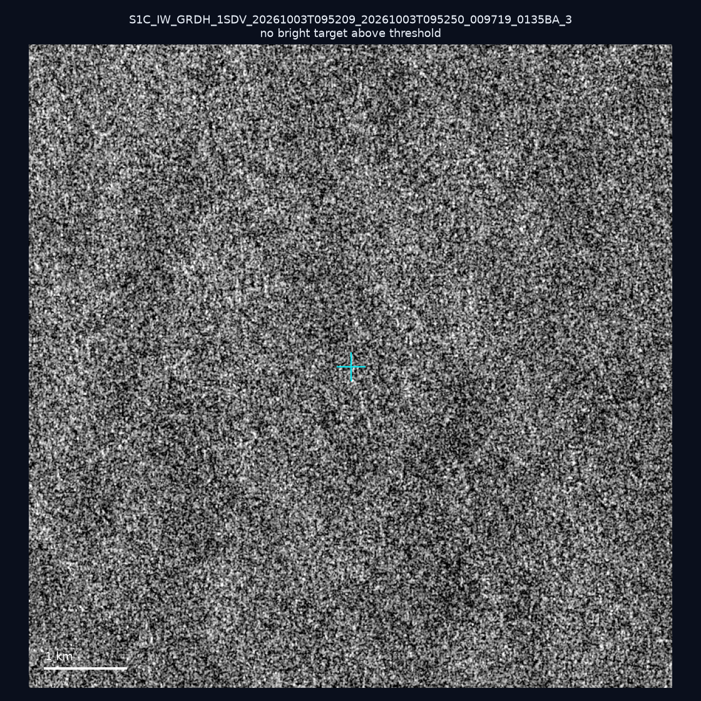
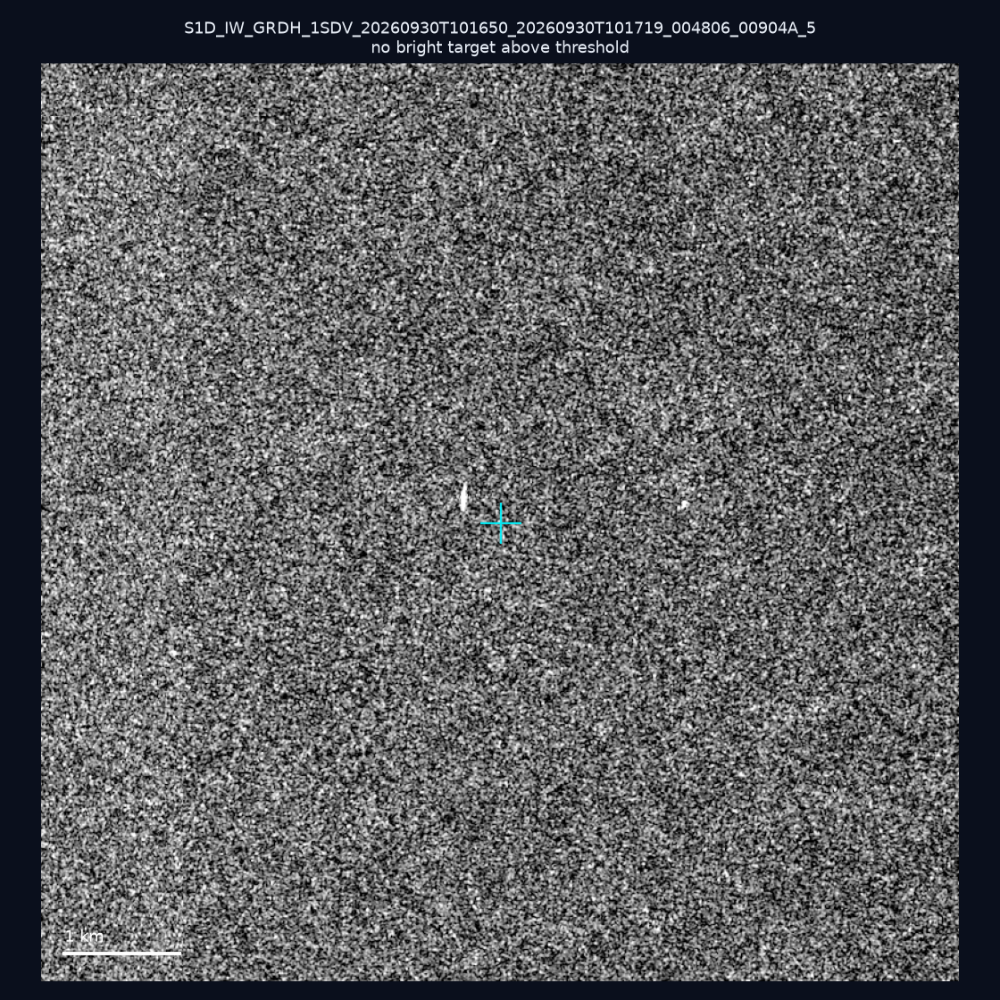
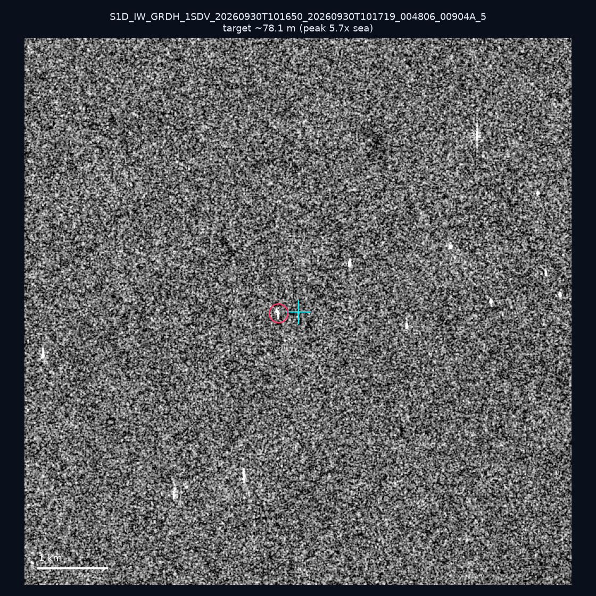
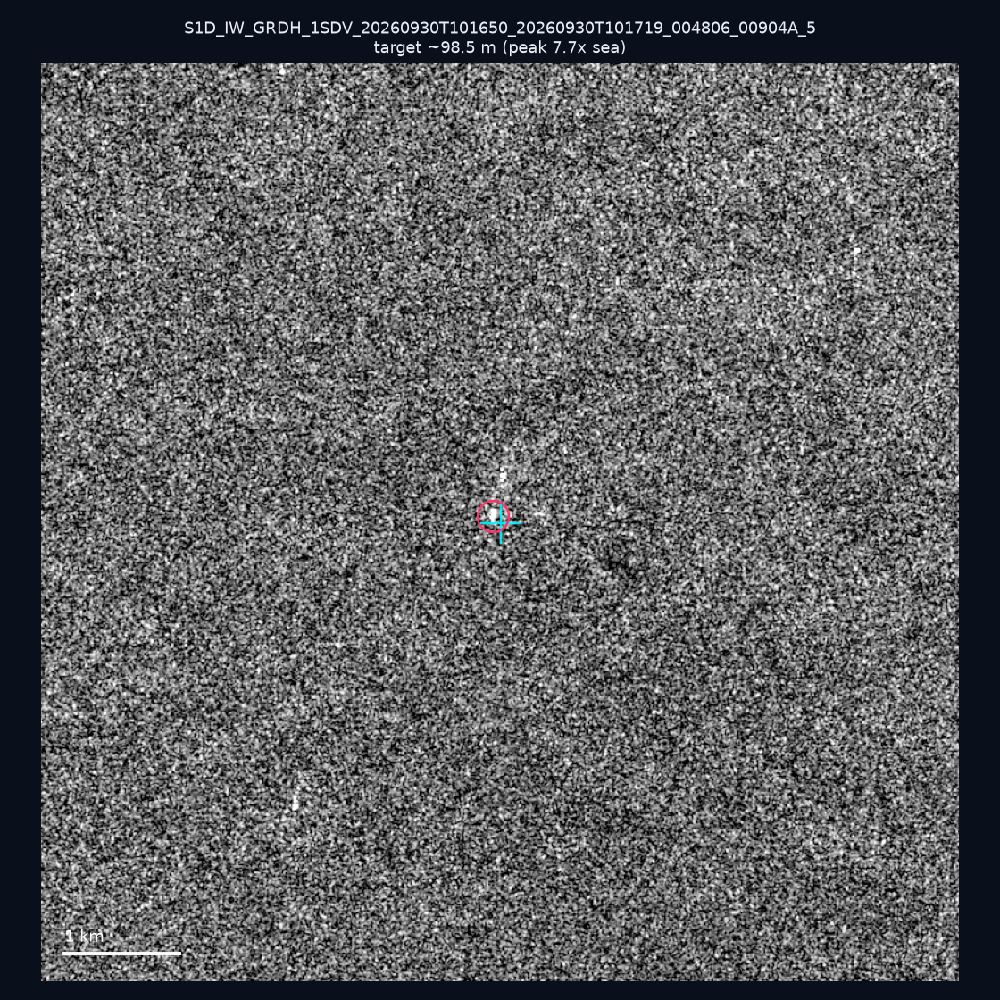
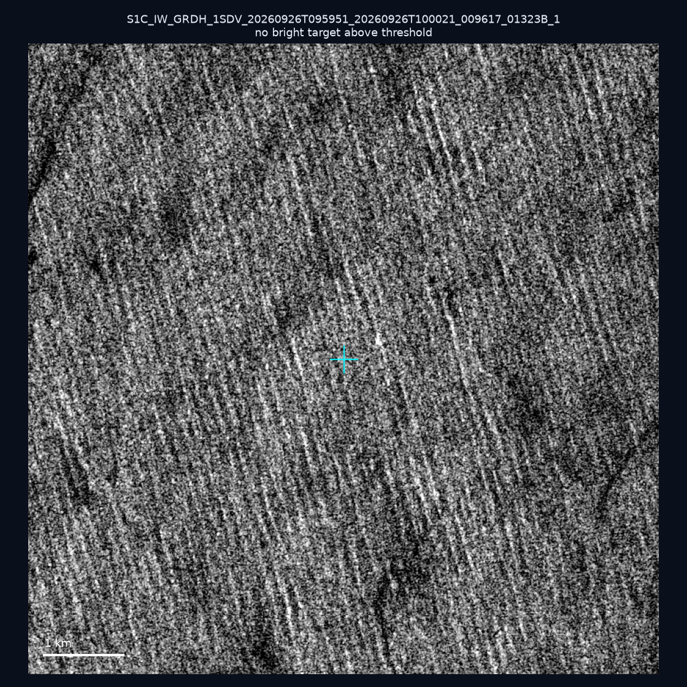
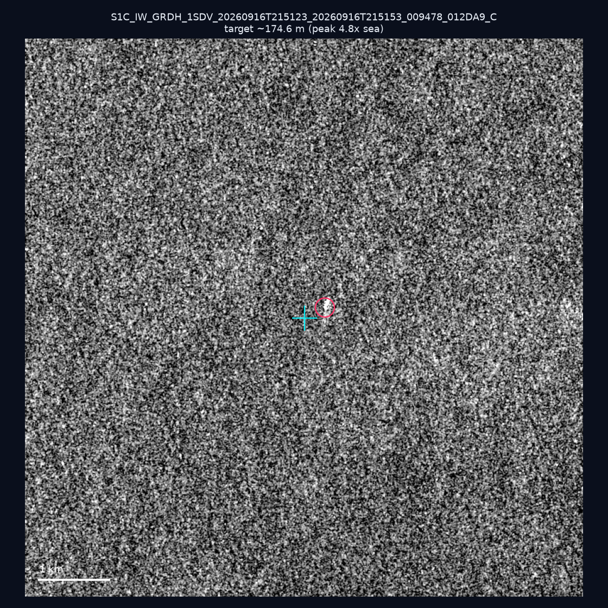
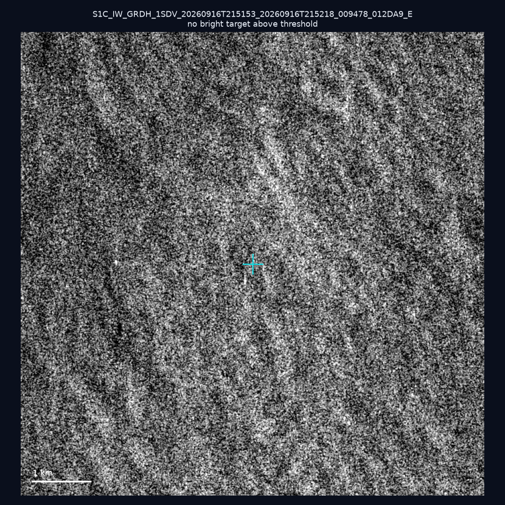
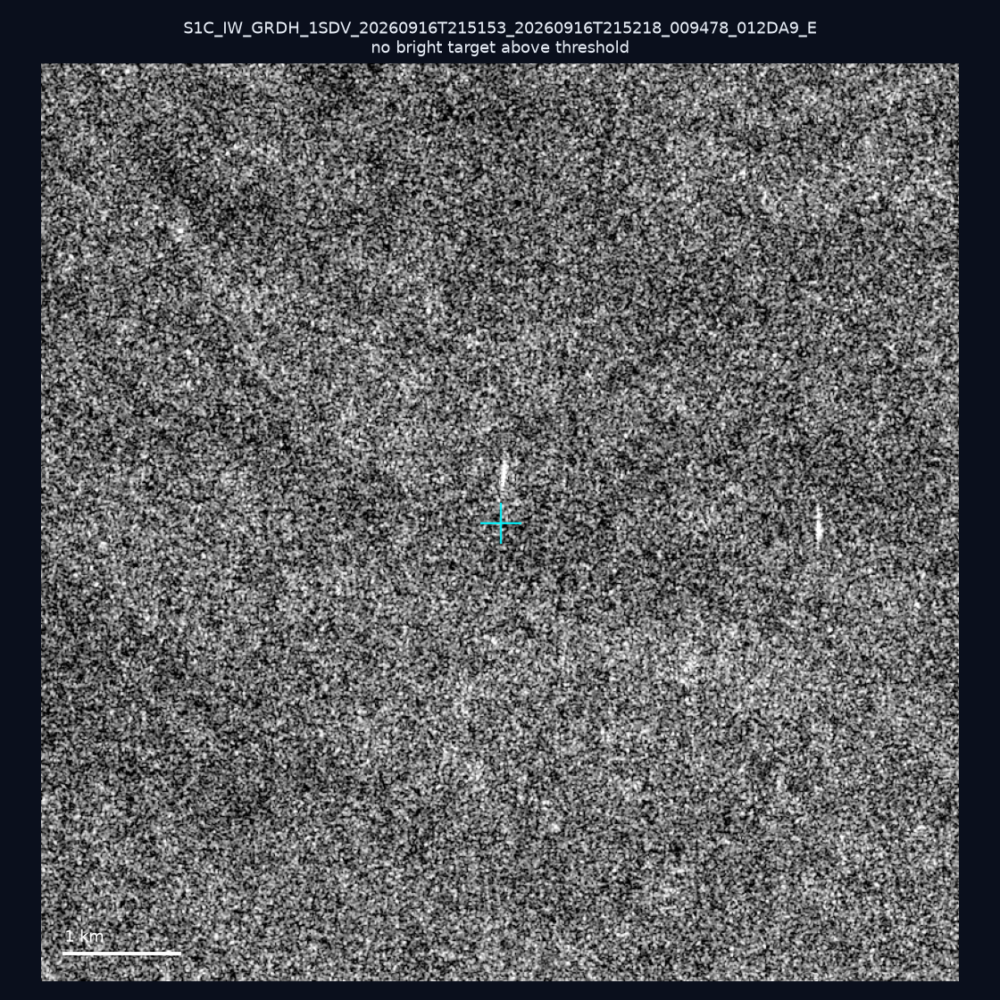
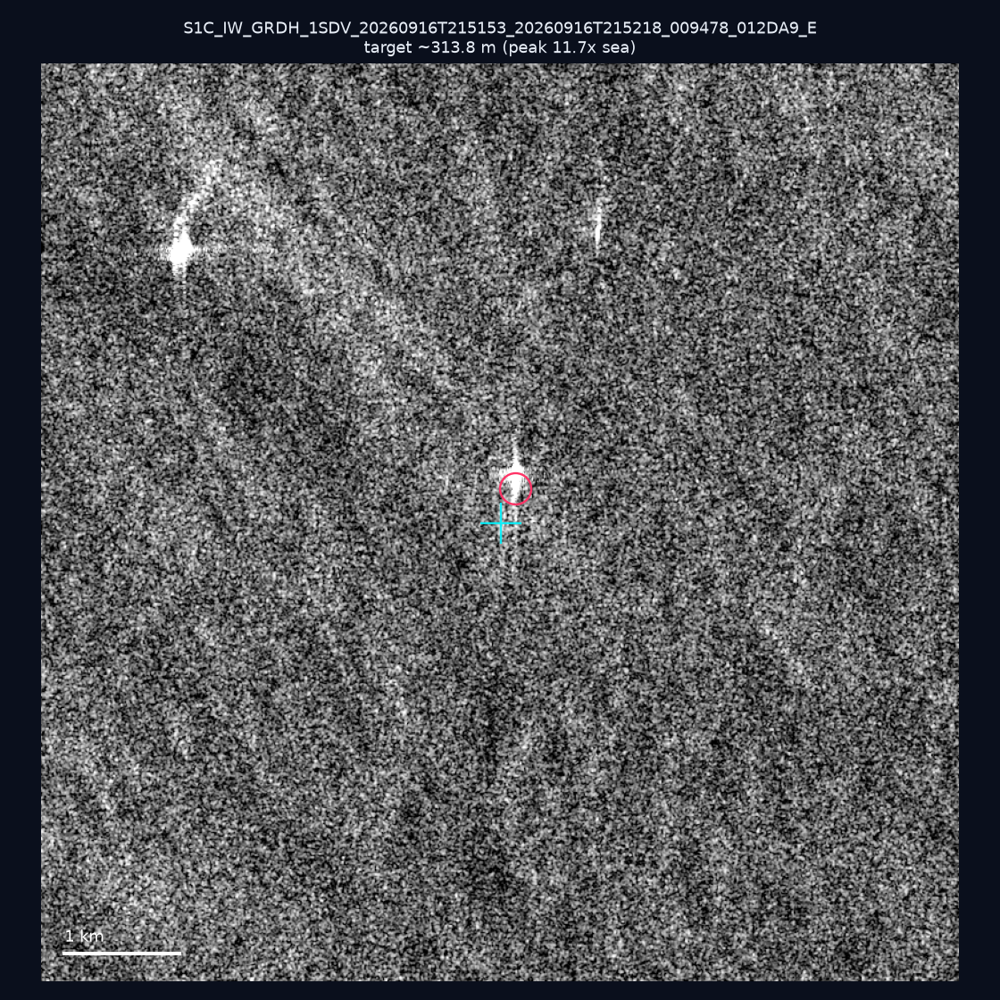

# 暗船 SAR 取證報告 — 2026-10-13

## 1. 總覽

- 執行時間：2026-10-13（GitHub Actions cron 自動執行）
- 線上比對摘要：暗偵測 18202 筆、殘餘暗船 12858 筆、假暗船剔除率 29.4%
- 本輪測試：9 筆
- 成功：9 筆
- 找到亮目標：4 筆
- 失敗：0 筆

## 2. 結果總表

| 日期 | 座標 | 海域 | 法域 | 成像時刻 | 判定 | 估計長度 | 峰值比 |
|------|------|------|------|----------|------|----------|--------|
| 2026-10-03 | 25.42, 123.25 | east | eez | 09:52:09 | ⚪ 無目標（雜訊或低RCS） | — | — |
| 2026-09-30 | 22.97, 117.77 | southwest | eez | 10:16:50 | ⚪ 無目標（雜訊或低RCS） | — | — |
| 2026-09-30 | 23.21, 117.99 | southwest | eez | 10:16:50 | 🟡 弱目標 | ~78.1 m | 5.7× |
| 2026-09-30 | 23.09, 118.02 | southwest | eez | 10:16:50 | 🟡 弱目標 | ~98.5 m | 7.7× |
| 2026-09-26 | 22.55, 122.37 | east | eez | 09:59:51 | ⚪ 無目標（雜訊或低RCS） | — | — |
| 2026-09-16 | 24.5, 121.98 | east | territorial_sea | 21:51:23 | 🟡 弱目標 | ~174.6 m | 4.8× |
| 2026-09-16 | 22.93, 119.96 | southwest | internal_waters | 21:51:53 | ⚪ 無目標（雜訊或低RCS） | — | — |
| 2026-09-16 | 22.86, 119.83 | southwest | internal_waters | 21:51:53 | ⚪ 無目標（雜訊或低RCS） | — | — |
| 2026-09-16 | 22.86, 119.92 | southwest | internal_waters | 21:51:53 | ✅ 確認實體目標 | ~313.8 m | 11.7× |

## 3. 逐目標段落

### 2026-10-03 (25.42, 123.25)

⚪ 無目標（雜訊或低RCS）。

### 2026-09-30 (22.97, 117.77)

⚪ 無目標（雜訊或低RCS）。

### 2026-09-30 (23.21, 117.99)

🟡 弱目標，估計長度 ~78.1 m，峰值 5.7× 海面背景（19 px）。

### 2026-09-30 (23.09, 118.02)

🟡 弱目標，估計長度 ~98.5 m，峰值 7.7× 海面背景（22 px）。

### 2026-09-26 (22.55, 122.37)

⚪ 無目標（雜訊或低RCS）。

### 2026-09-16 (24.5, 121.98)

🟡 弱目標，估計長度 ~174.6 m，峰值 4.8× 海面背景（48 px）。

### 2026-09-16 (22.93, 119.96)

⚪ 無目標（雜訊或低RCS）。

### 2026-09-16 (22.86, 119.83)

⚪ 無目標（雜訊或低RCS）。

### 2026-09-16 (22.86, 119.92)

✅ 確認實體目標，估計長度 ~313.8 m，峰值 11.7× 海面背景（175 px）。

## 4. 後續建議

- 值得人工深查（確認實體目標且長度 ≥ 50m）：
  - 2026-09-16 (22.86, 119.92) ~313.8 m — 建議比對周邊 AIS 船長
- 累積統計：全歷史 508 筆（有效 508 筆），確認實體目標 59 筆（11.6%）

> 所有結果是研判線索，不是法律認定；無目標 ≠ 誤報（小型木殼漁船 RCS 低，SAR 可能拍不到）。
