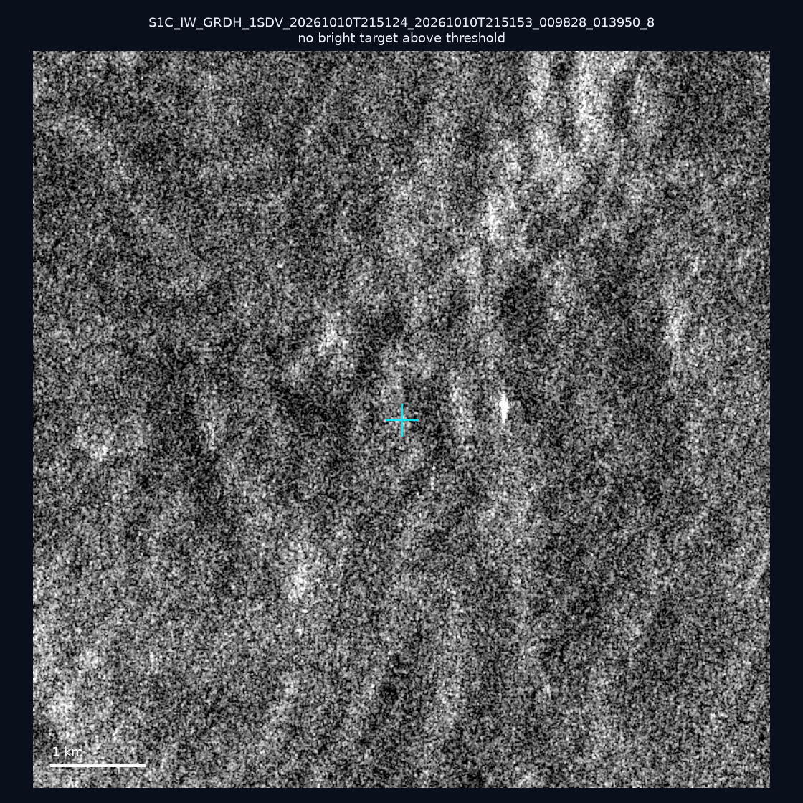
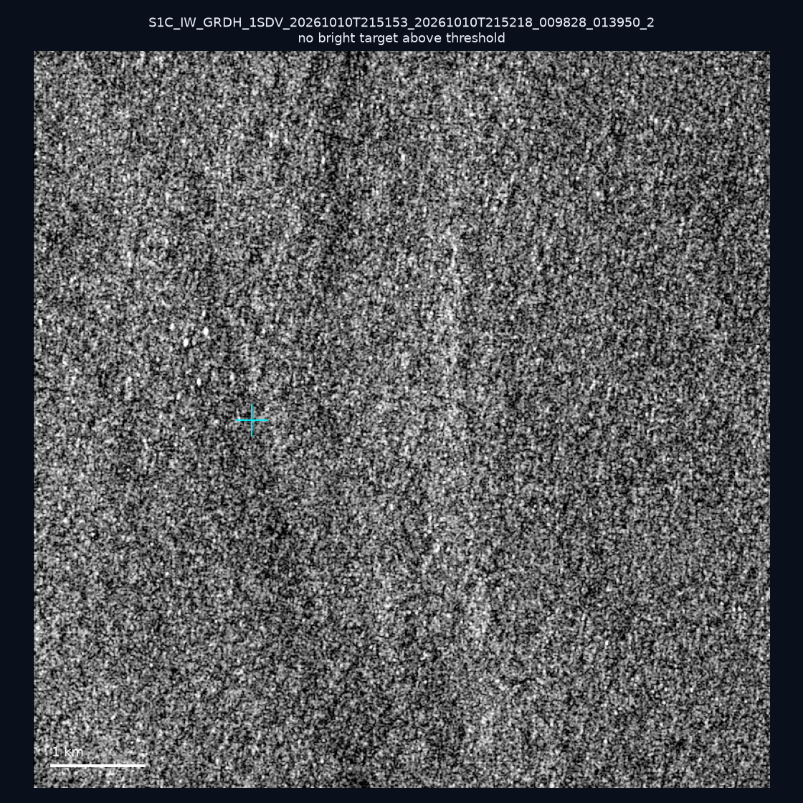
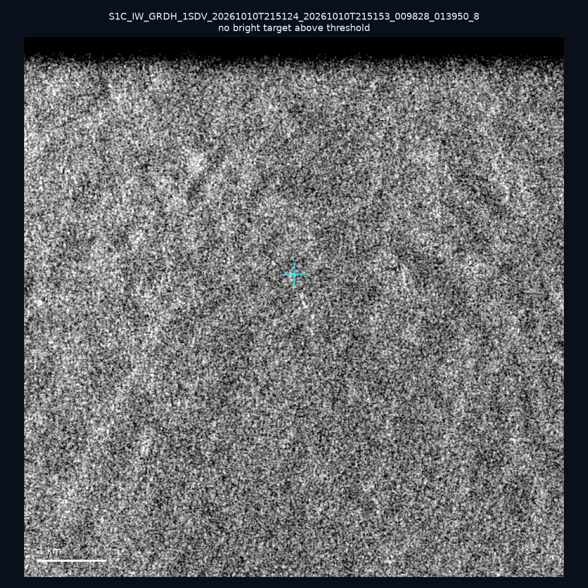
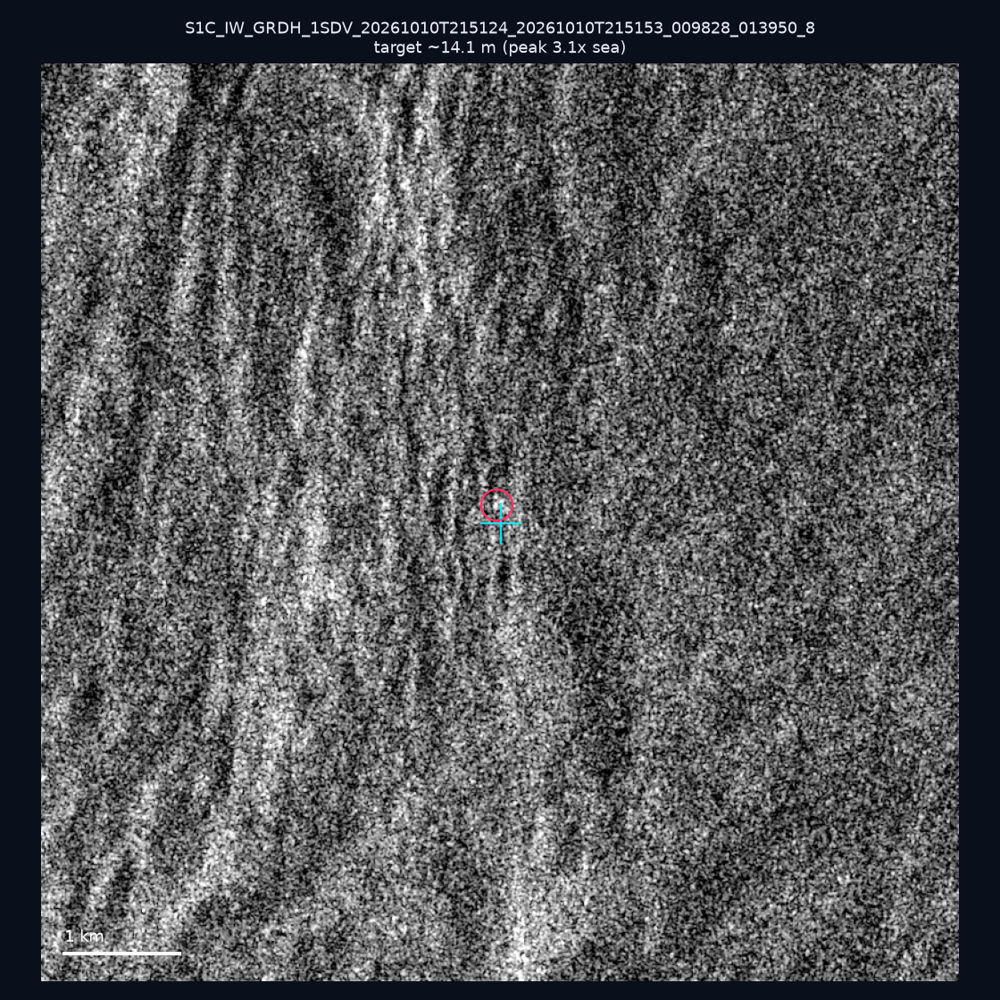
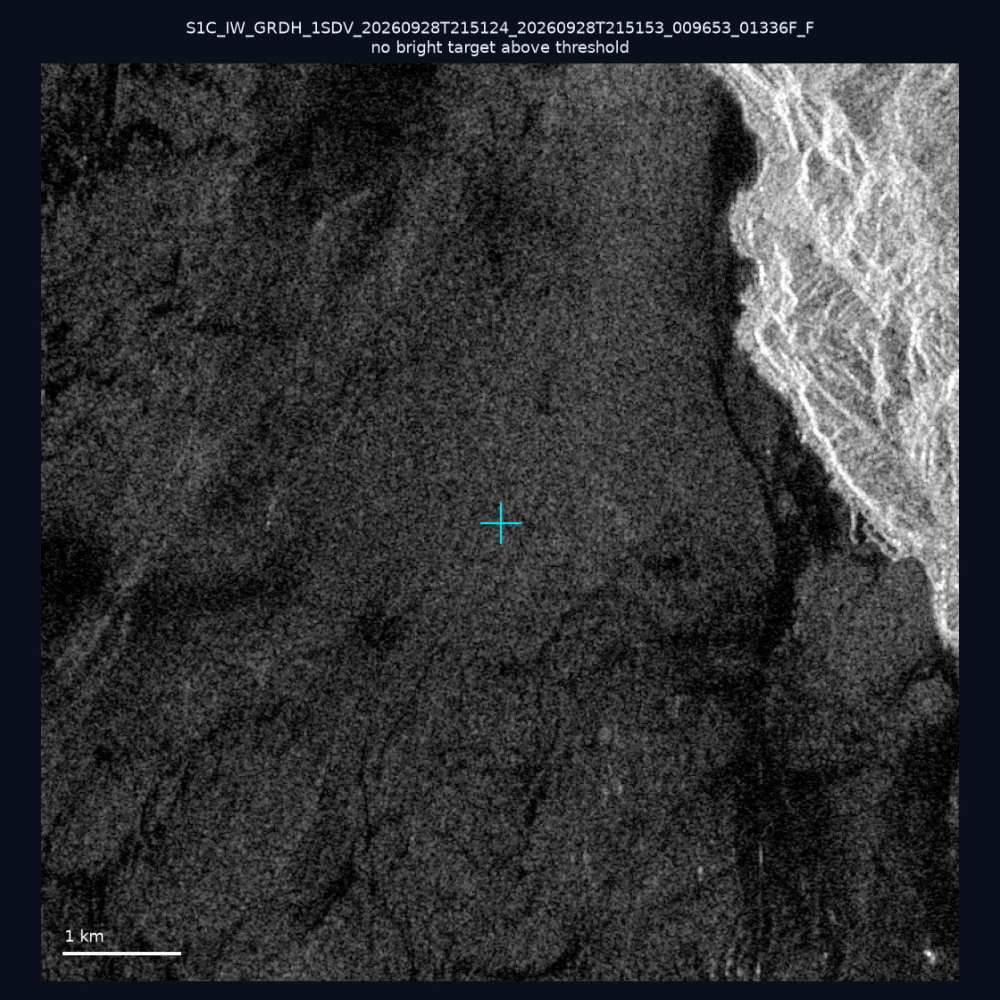

# 暗船 SAR 取證報告 — 2026-10-14

## 1. 總覽

- 執行時間：2026-10-14（GitHub Actions cron 自動執行）
- 線上比對摘要：暗偵測 18927 筆、殘餘暗船 13089 筆、假暗船剔除率 30.8%
- 本輪測試：6 筆
- 成功：5 筆
- 找到亮目標：1 筆
- 失敗：1 筆

## 2. 結果總表

| 日期 | 座標 | 海域 | 法域 | 成像時刻 | 判定 | 估計長度 | 峰值比 |
|------|------|------|------|----------|------|----------|--------|
| 2026-10-10 | 25.3, 121.81 | east | internal_waters | 21:51:24 | ⚪ 無目標（雜訊或低RCS） | — | — |
| 2026-10-10 | 22.32, 121.72 | east | territorial_sea | 21:51:53 | ⚪ 無目標（雜訊或低RCS） | — | — |
| 2026-10-10 | 25.43, 122.27 | east | territorial_sea | 21:51:24 | ⚪ 無目標（雜訊或低RCS） | — | — |
| 2026-10-10 | 25.05, 122.11 | east | territorial_sea | 21:51:24 | 🟡 弱目標 | ~14.1 m | 3.1× |
| 2026-10-10 | 25.2, 121.96 | east | internal_waters | 21:51:24 | ❌ 失敗 | — | — |
| 2026-09-28 | 24.9, 121.9 | east | internal_waters | 21:51:24 | ⚪ 無目標（雜訊或低RCS） | — | — |

## 3. 逐目標段落

### 2026-10-10 (25.3, 121.81)

⚪ 無目標（雜訊或低RCS）。

### 2026-10-10 (22.32, 121.72)

⚪ 無目標（雜訊或低RCS）。

### 2026-10-10 (25.43, 122.27)

⚪ 無目標（雜訊或低RCS）。

### 2026-10-10 (25.05, 122.11)

🟡 弱目標，估計長度 ~14.1 m，峰值 3.1× 海面背景（1 px）。

### 2026-10-10 (25.2, 121.96)
❌ 失敗：crash: rasterio.errors.RasterioIOError: DB scan query failed

### 2026-09-28 (24.9, 121.9)

⚪ 無目標（雜訊或低RCS）。

## 4. 後續建議

- 累積統計：全歷史 514 筆（有效 513 筆），確認實體目標 59 筆（11.5%）

> 所有結果是研判線索，不是法律認定；無目標 ≠ 誤報（小型木殼漁船 RCS 低，SAR 可能拍不到）。
