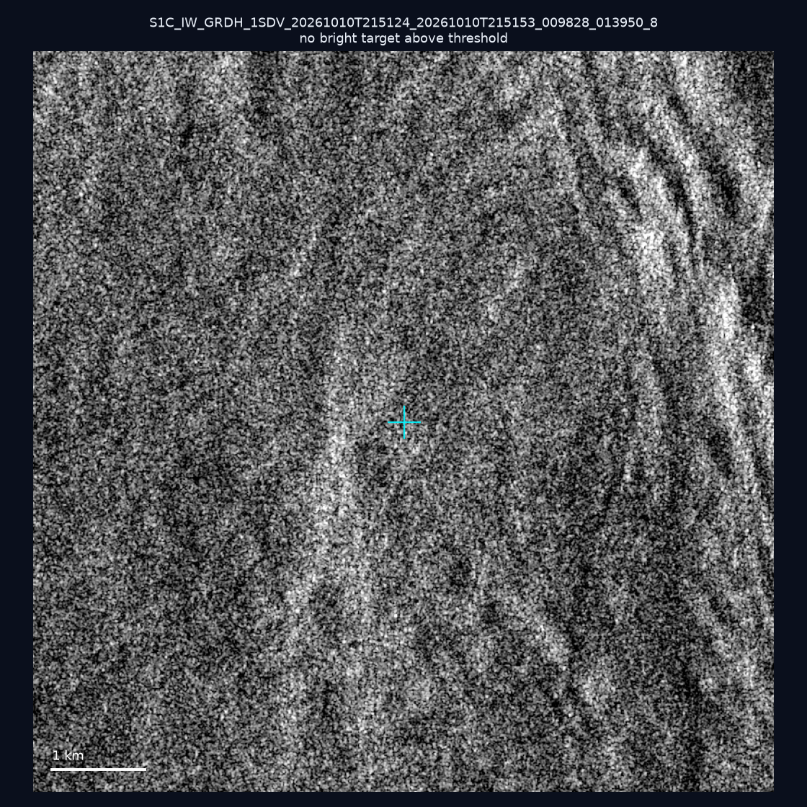
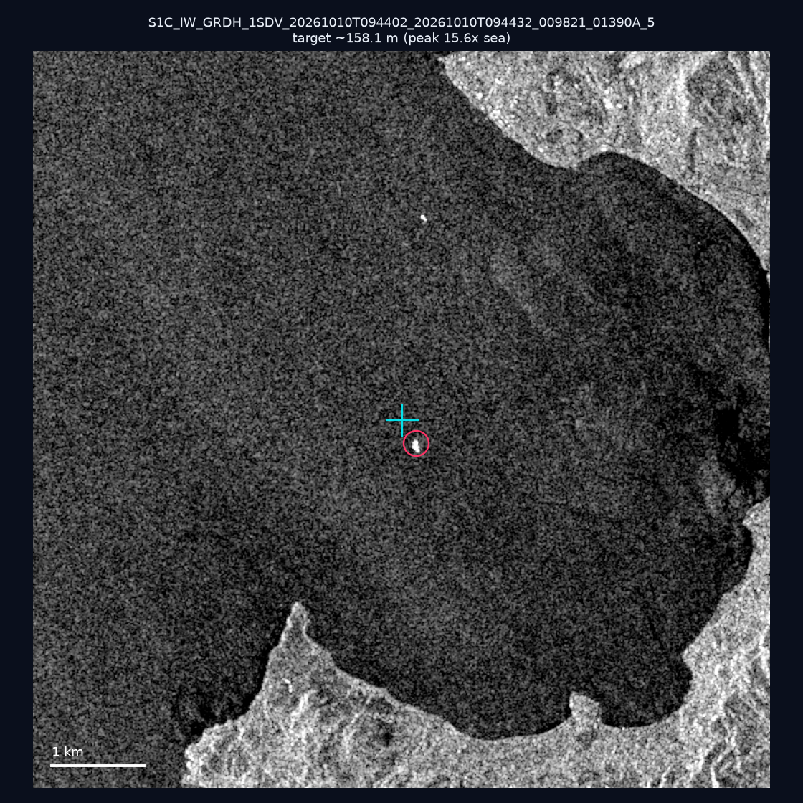
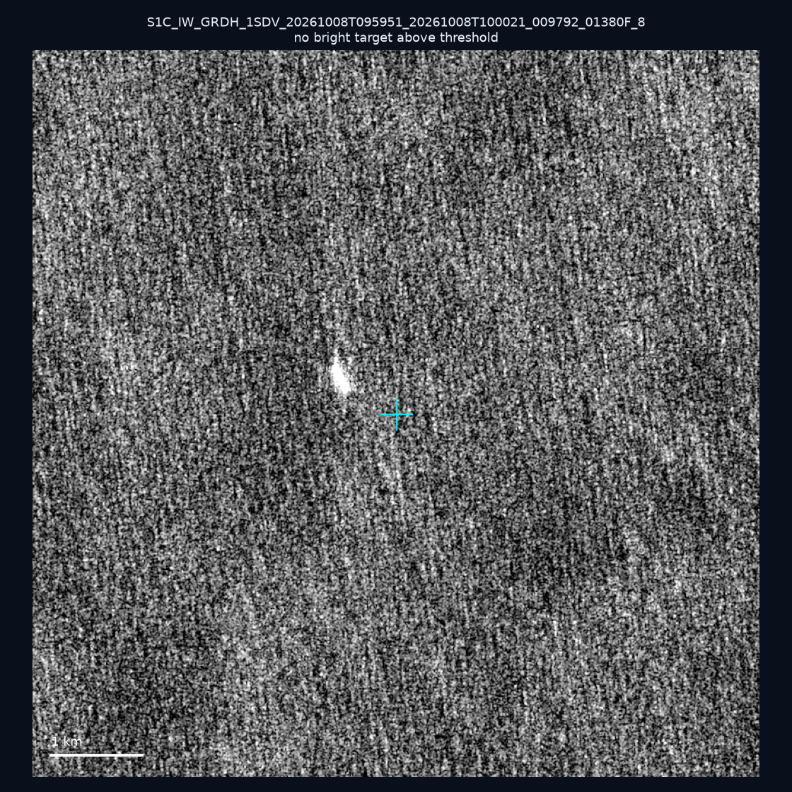
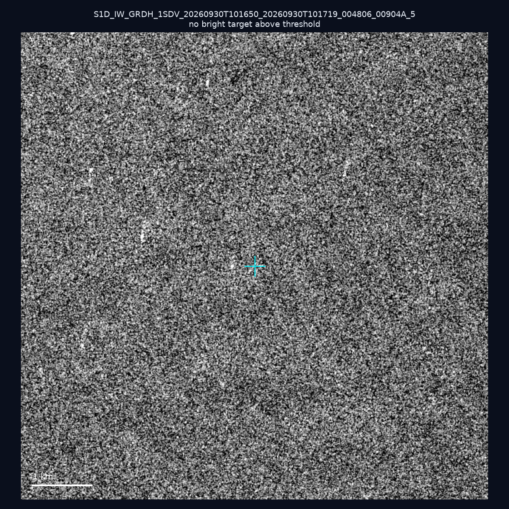
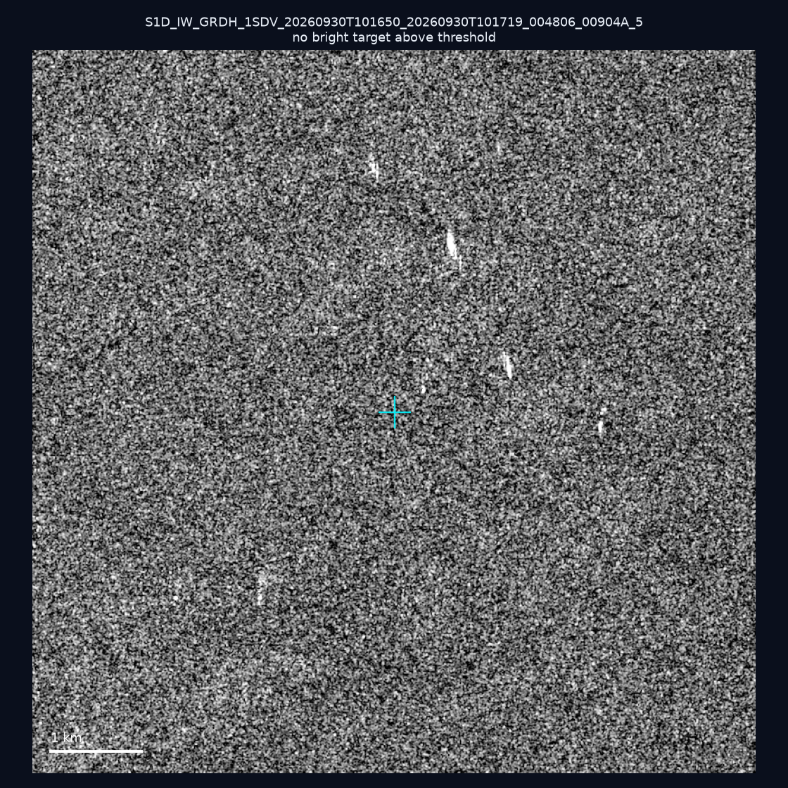
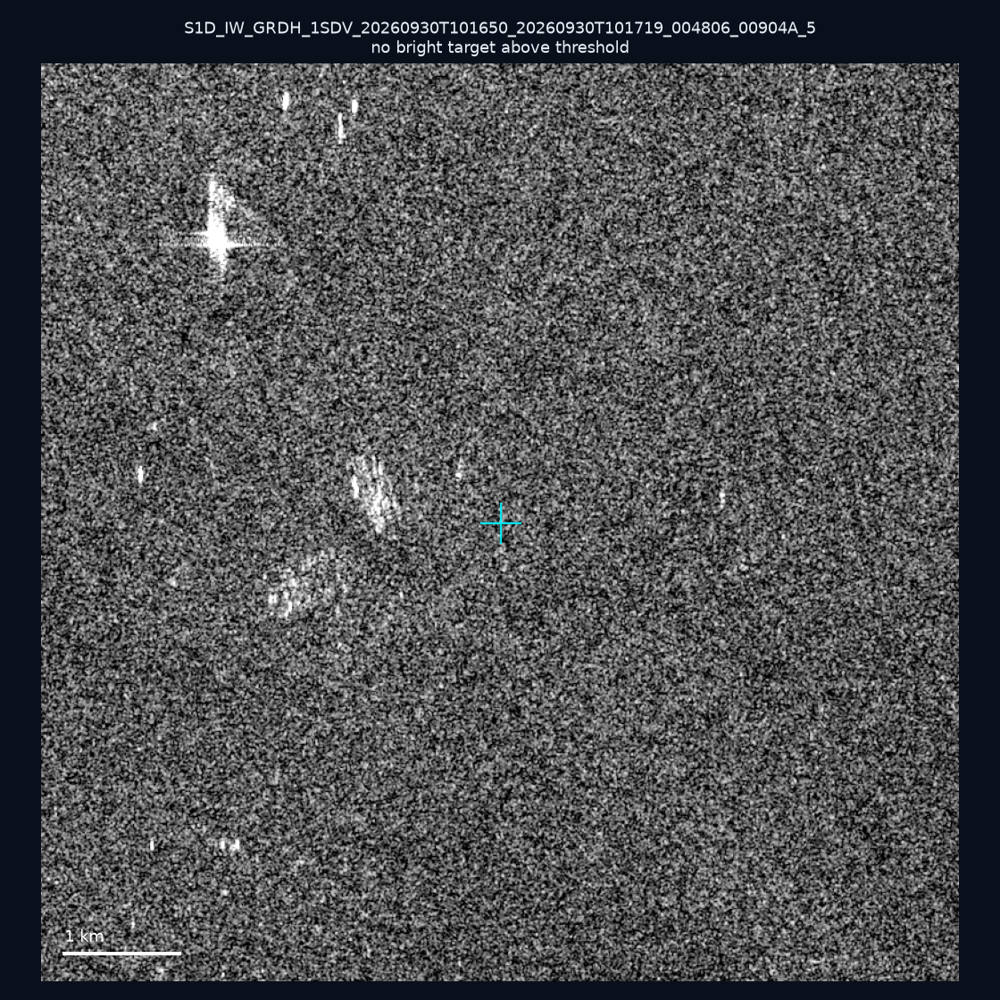
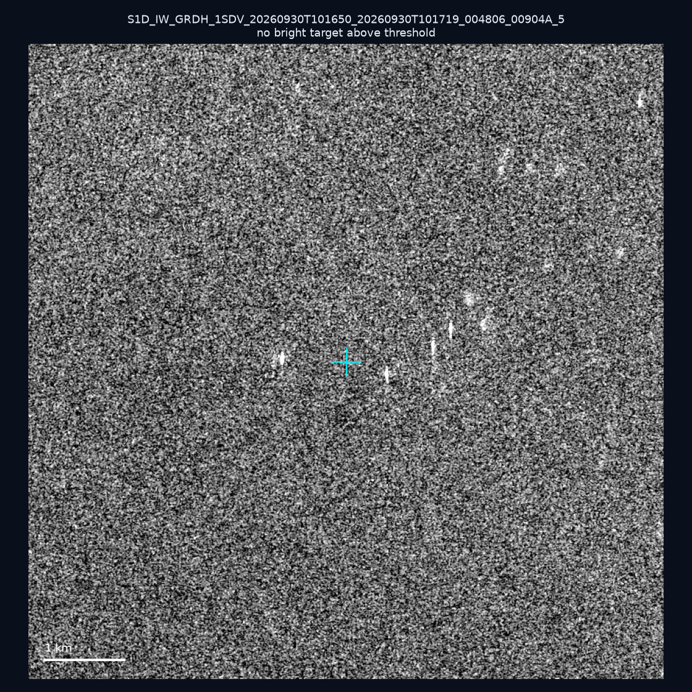
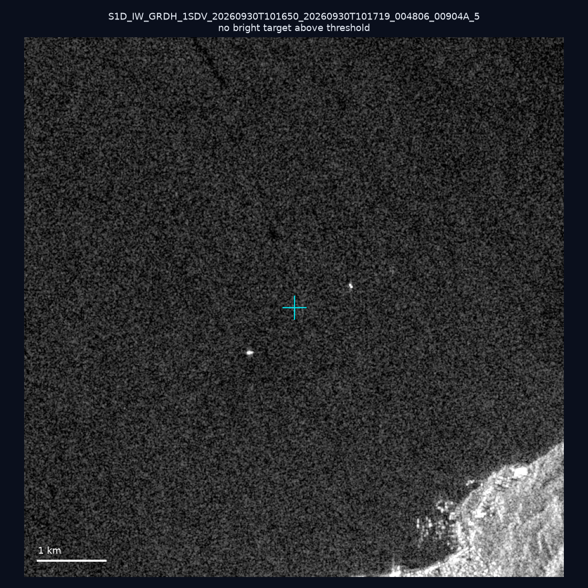
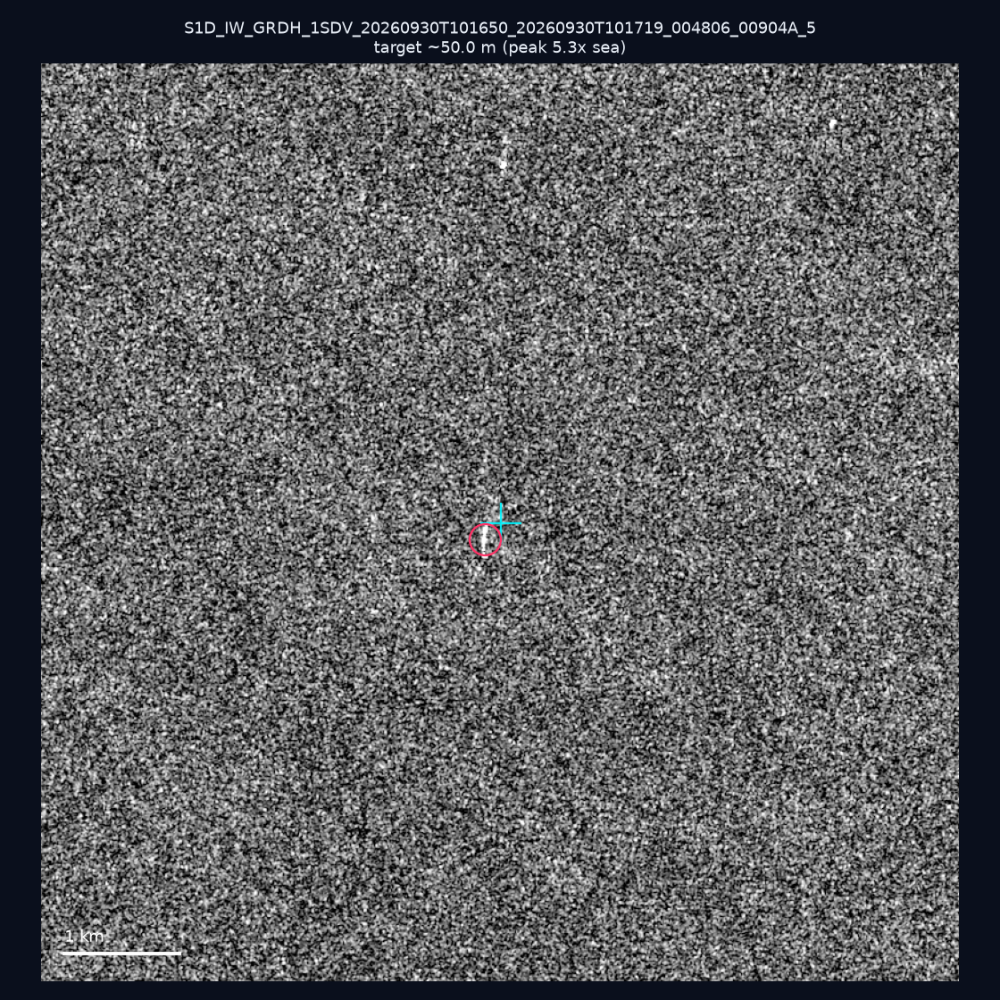
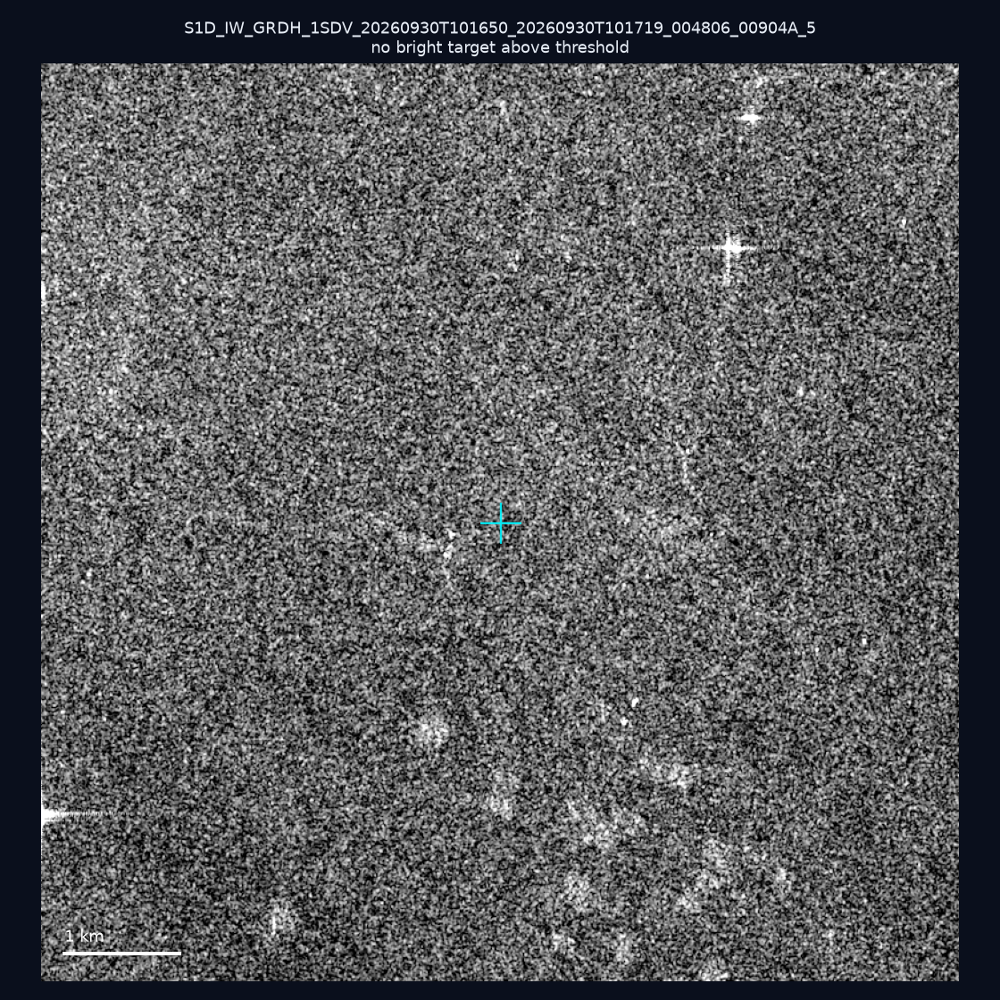

# 暗船 SAR 取證報告 — 2026-10-15

## 1. 總覽

- 執行時間：2026-10-15（GitHub Actions cron 自動執行）
- 線上比對摘要：暗偵測 18576 筆、殘餘暗船 12836 筆、假暗船剔除率 30.9%
- 本輪測試：10 筆
- 成功：10 筆
- 找到亮目標：2 筆
- 失敗：0 筆

## 2. 結果總表

| 日期 | 座標 | 海域 | 法域 | 成像時刻 | 判定 | 估計長度 | 峰值比 |
|------|------|------|------|----------|------|----------|--------|
| 2026-10-10 | 24.97, 122.12 | east | territorial_sea | 21:51:24 | ⚪ 無目標（雜訊或低RCS） | — | — |
| 2026-10-10 | 24.4, 124.1 | east | eez | 09:44:02 | ✅ 確認實體目標 | ~158.1 m | 15.6× |
| 2026-10-08 | 22.73, 122.2 | east | eez | 09:59:51 | ⚪ 無目標（雜訊或低RCS） | — | — |
| 2026-09-30 | 23.15, 118.11 | southwest | eez | 10:16:50 | ⚪ 無目標（雜訊或低RCS） | — | — |
| 2026-09-30 | 23.02, 117.86 | southwest | eez | 10:16:50 | ⚪ 無目標（雜訊或低RCS） | — | — |
| 2026-09-30 | 23.45, 118.11 | southwest | eez | 10:16:50 | ⚪ 無目標（雜訊或低RCS） | — | — |
| 2026-09-30 | 23.25, 118.41 | southwest | eez | 10:16:50 | ⚪ 無目標（雜訊或低RCS） | — | — |
| 2026-09-30 | 23.38, 117.01 | southwest | eez | 10:16:50 | ⚪ 無目標（雜訊或低RCS） | — | — |
| 2026-09-30 | 22.99, 117.99 | southwest | eez | 10:16:50 | 🟡 弱目標 | ~50.0 m | 5.3× |
| 2026-09-30 | 23.48, 117.22 | southwest | eez | 10:16:50 | ⚪ 無目標（雜訊或低RCS） | — | — |

## 3. 逐目標段落

### 2026-10-10 (24.97, 122.12)

⚪ 無目標（雜訊或低RCS）。

### 2026-10-10 (24.4, 124.1)

✅ 確認實體目標，估計長度 ~158.1 m，峰值 15.6× 海面背景（70 px）。

### 2026-10-08 (22.73, 122.2)

⚪ 無目標（雜訊或低RCS）。

### 2026-09-30 (23.15, 118.11)

⚪ 無目標（雜訊或低RCS）。

### 2026-09-30 (23.02, 117.86)

⚪ 無目標（雜訊或低RCS）。

### 2026-09-30 (23.45, 118.11)

⚪ 無目標（雜訊或低RCS）。

### 2026-09-30 (23.25, 118.41)

⚪ 無目標（雜訊或低RCS）。

### 2026-09-30 (23.38, 117.01)

⚪ 無目標（雜訊或低RCS）。

### 2026-09-30 (22.99, 117.99)

🟡 弱目標，估計長度 ~50.0 m，峰值 5.3× 海面背景（9 px）。

### 2026-09-30 (23.48, 117.22)

⚪ 無目標（雜訊或低RCS）。

## 4. 後續建議

- 值得人工深查（確認實體目標且長度 ≥ 50m）：
  - 2026-10-10 (24.4, 124.1) ~158.1 m — 建議比對周邊 AIS 船長
- 累積統計：全歷史 524 筆（有效 523 筆），確認實體目標 60 筆（11.5%）

> 所有結果是研判線索，不是法律認定；無目標 ≠ 誤報（小型木殼漁船 RCS 低，SAR 可能拍不到）。
