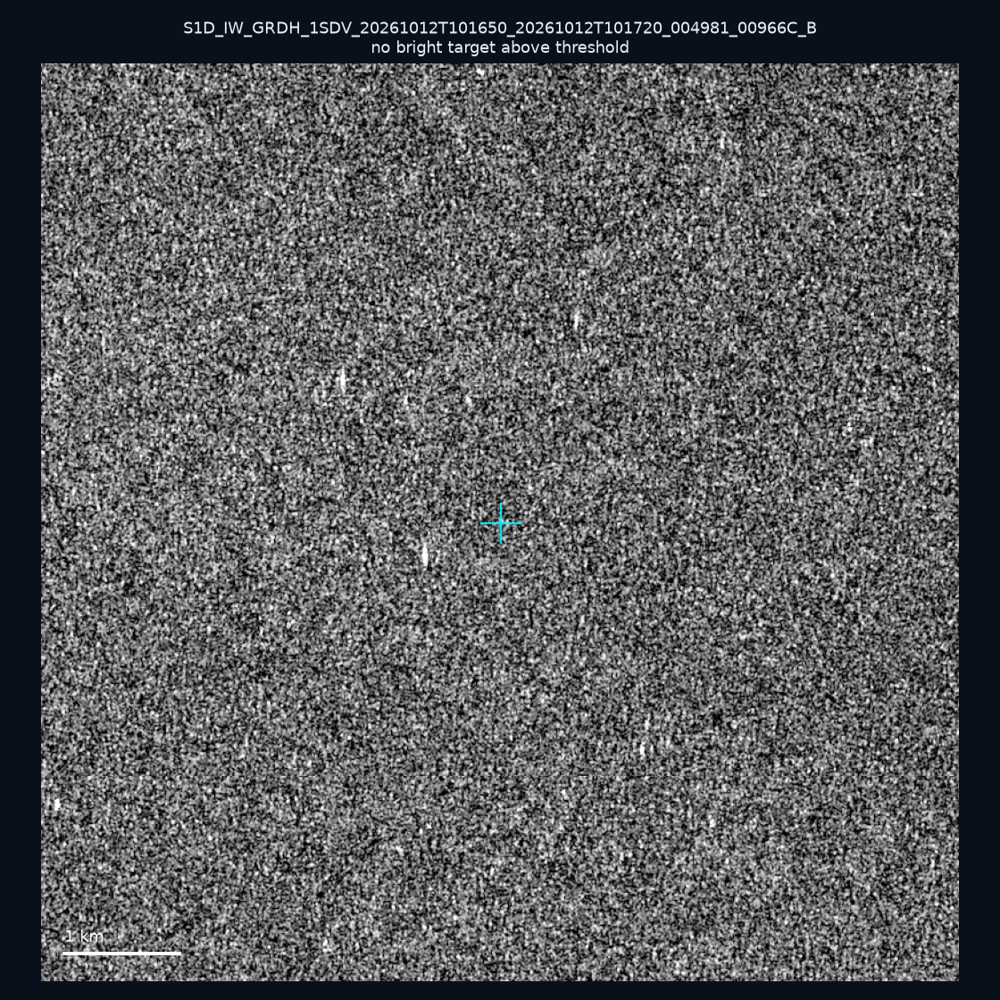
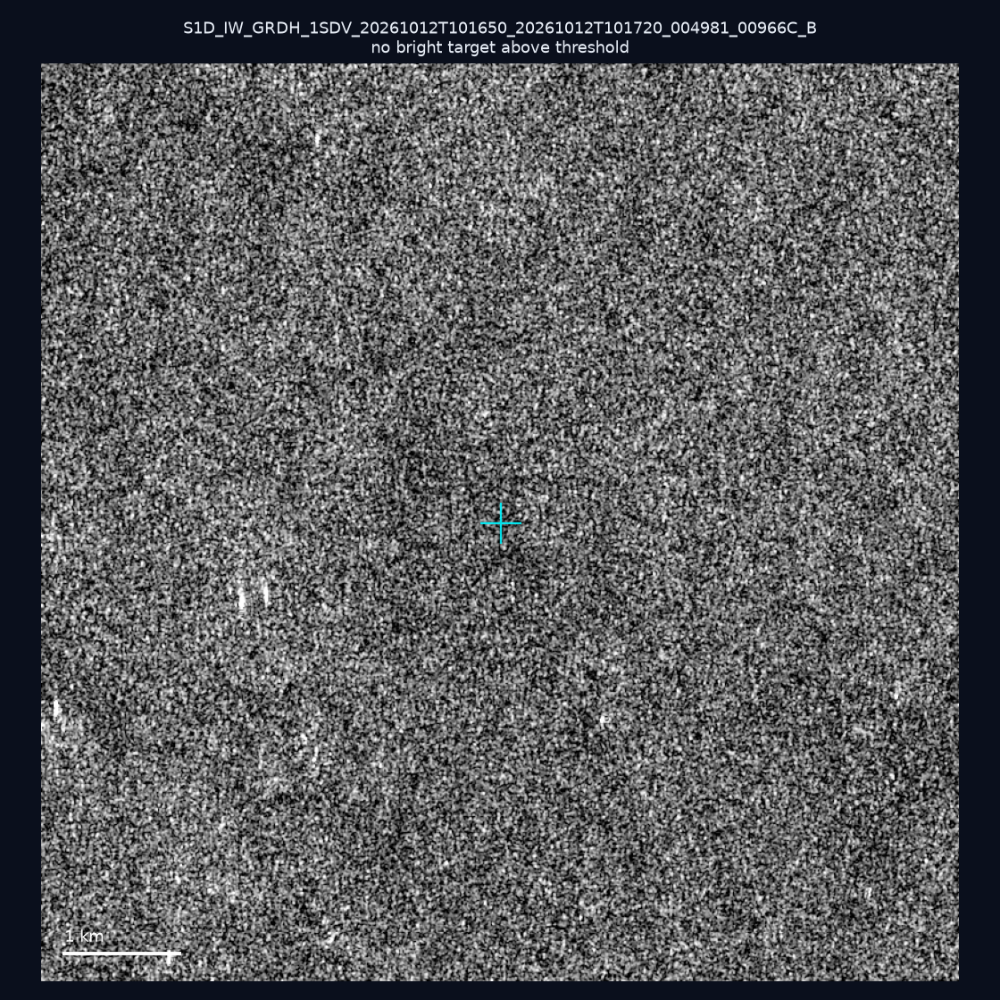
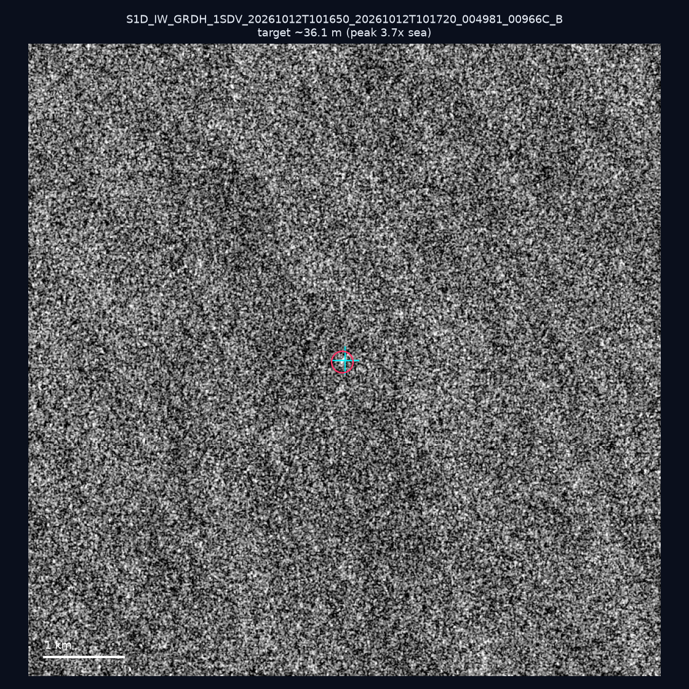
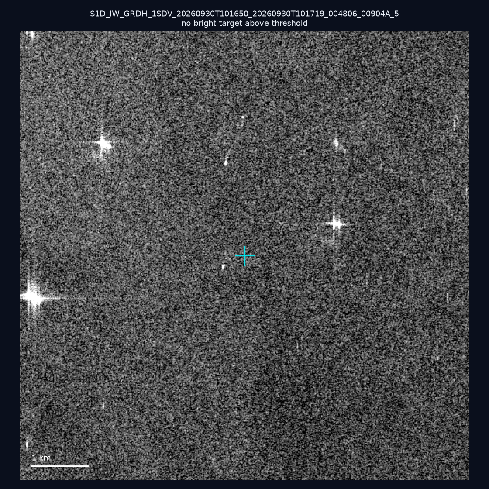
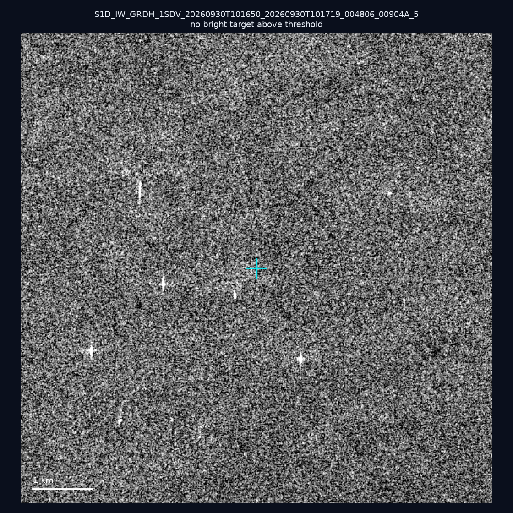
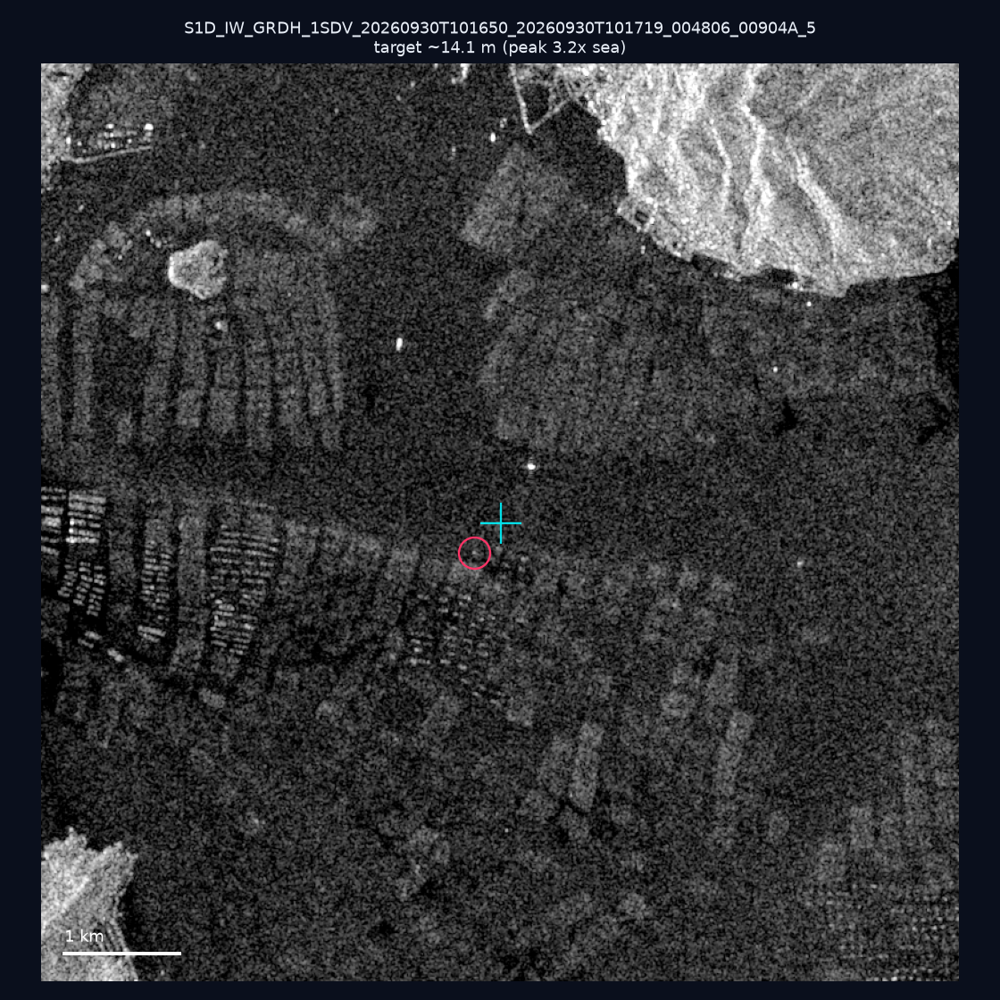
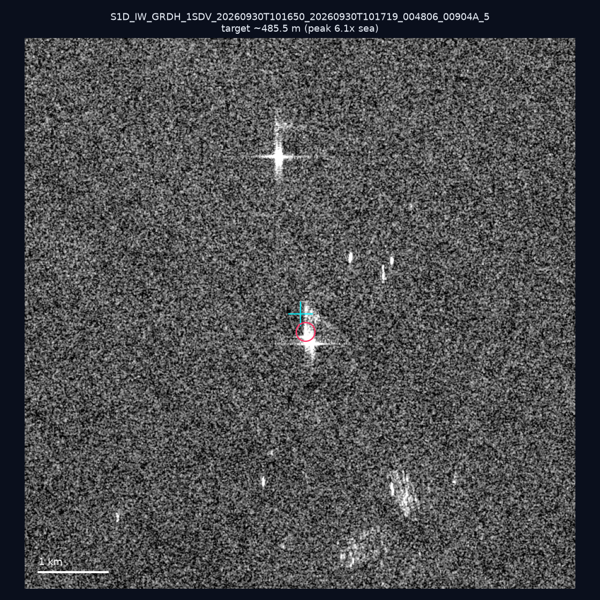
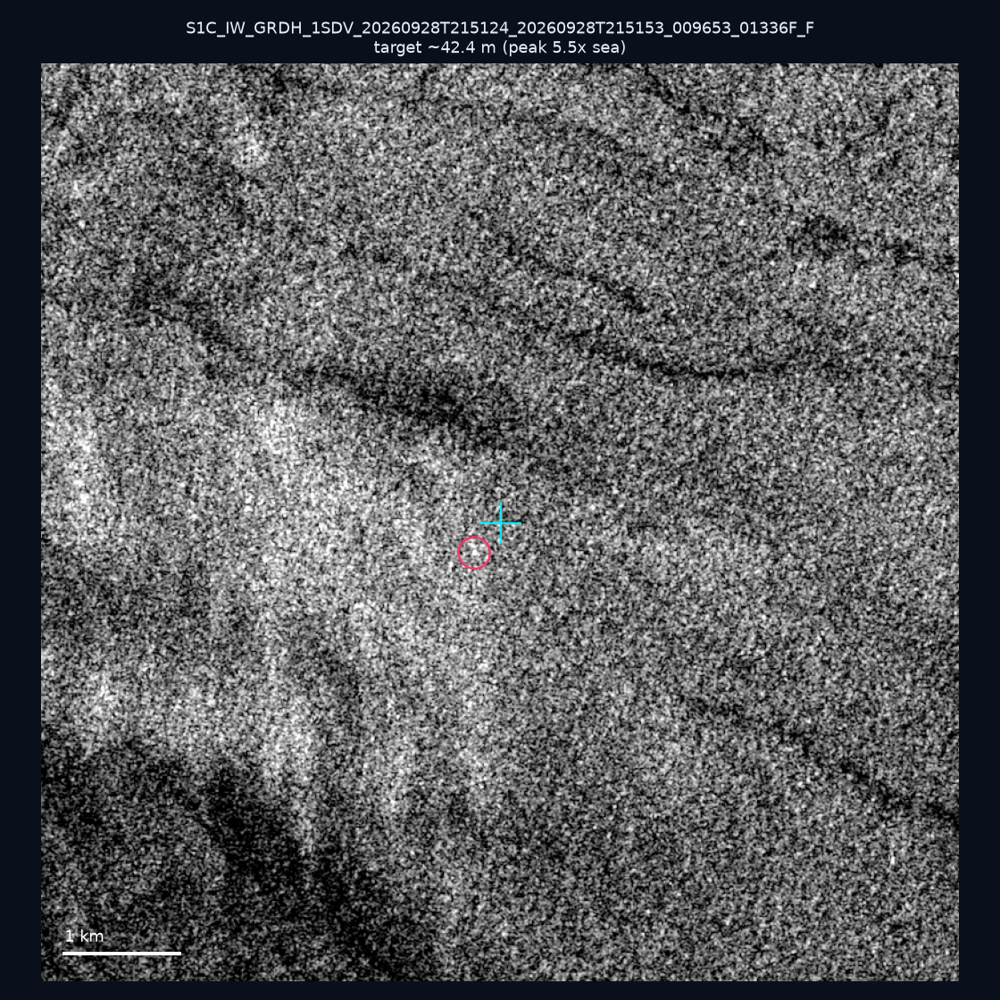
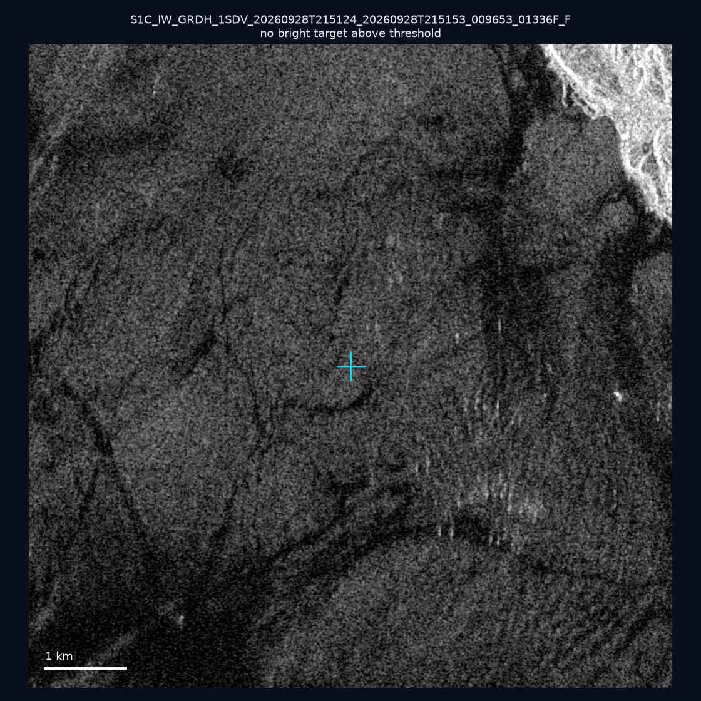
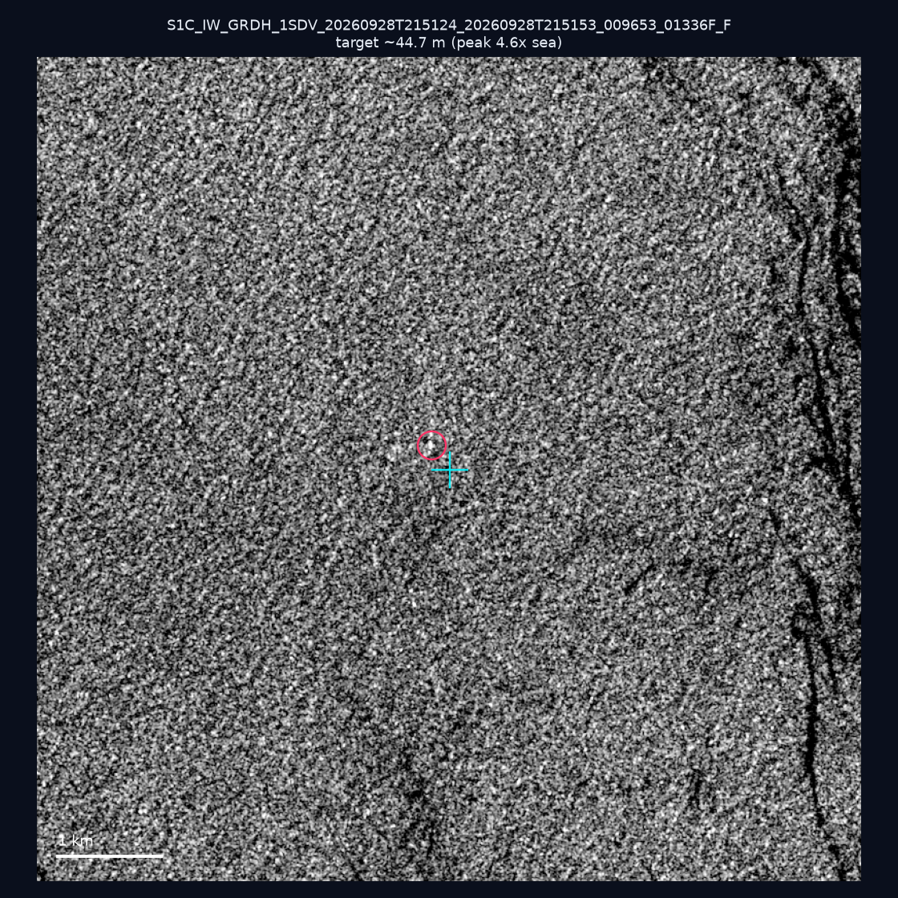

# 暗船 SAR 取證報告 — 2026-10-16

## 1. 總覽

- 執行時間：2026-10-16（GitHub Actions cron 自動執行）
- 線上比對摘要：暗偵測 19048 筆、殘餘暗船 13228 筆、假暗船剔除率 30.6%
- 本輪測試：10 筆
- 成功：10 筆
- 找到亮目標：5 筆
- 失敗：0 筆

## 2. 結果總表

| 日期 | 座標 | 海域 | 法域 | 成像時刻 | 判定 | 估計長度 | 峰值比 |
|------|------|------|------|----------|------|----------|--------|
| 2026-10-12 | 23.05, 117.54 | southwest | eez | 10:16:50 | ⚪ 無目標（雜訊或低RCS） | — | — |
| 2026-10-12 | 23.33, 117.24 | southwest | eez | 10:16:50 | ⚪ 無目標（雜訊或低RCS） | — | — |
| 2026-10-12 | 23.08, 118.32 | southwest | eez | 10:16:50 | 🟡 弱目標 | ~36.1 m | 3.7× |
| 2026-09-30 | 23.31, 117.69 | southwest | eez | 10:16:50 | ⚪ 無目標（雜訊或低RCS） | — | — |
| 2026-09-30 | 23.23, 118.24 | southwest | eez | 10:16:50 | ⚪ 無目標（雜訊或低RCS） | — | — |
| 2026-09-30 | 23.49, 117.03 | southwest | eez | 10:16:50 | 🟡 弱目標 | ~14.1 m | 3.2× |
| 2026-09-30 | 23.42, 118.09 | southwest | eez | 10:16:50 | 🟡 弱目標 | ~485.5 m | 6.1× |
| 2026-09-28 | 24.72, 122.15 | east | territorial_sea | 21:51:24 | 🟡 弱目標 | ~42.4 m | 5.5× |
| 2026-09-28 | 24.87, 121.89 | east | internal_waters | 21:51:24 | ⚪ 無目標（雜訊或低RCS） | — | — |
| 2026-09-28 | 24.66, 121.97 | east | territorial_sea | 21:51:24 | 🟡 弱目標 | ~44.7 m | 4.6× |

## 3. 逐目標段落

### 2026-10-12 (23.05, 117.54)

⚪ 無目標（雜訊或低RCS）。

### 2026-10-12 (23.33, 117.24)

⚪ 無目標（雜訊或低RCS）。

### 2026-10-12 (23.08, 118.32)

🟡 弱目標，估計長度 ~36.1 m，峰值 3.7× 海面背景（5 px）。

### 2026-09-30 (23.31, 117.69)

⚪ 無目標（雜訊或低RCS）。

### 2026-09-30 (23.23, 118.24)

⚪ 無目標（雜訊或低RCS）。

### 2026-09-30 (23.49, 117.03)

🟡 弱目標，估計長度 ~14.1 m，峰值 3.2× 海面背景（1 px）。

### 2026-09-30 (23.42, 118.09)

🟡 弱目標，估計長度 ~485.5 m，峰值 6.1× 海面背景（341 px）。

### 2026-09-28 (24.72, 122.15)

🟡 弱目標，估計長度 ~42.4 m，峰值 5.5× 海面背景（8 px）。

### 2026-09-28 (24.87, 121.89)

⚪ 無目標（雜訊或低RCS）。

### 2026-09-28 (24.66, 121.97)

🟡 弱目標，估計長度 ~44.7 m，峰值 4.6× 海面背景（8 px）。

## 4. 後續建議

- 累積統計：全歷史 534 筆（有效 533 筆），確認實體目標 60 筆（11.3%）

> 所有結果是研判線索，不是法律認定；無目標 ≠ 誤報（小型木殼漁船 RCS 低，SAR 可能拍不到）。
