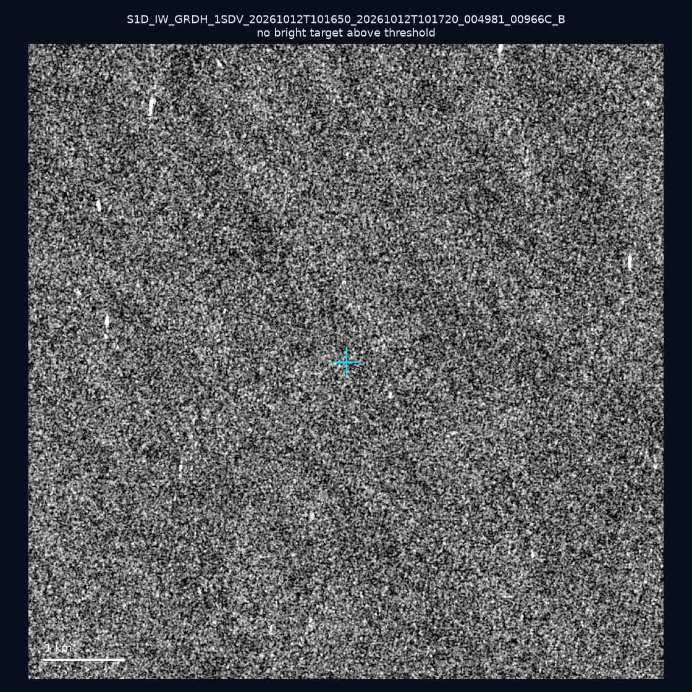
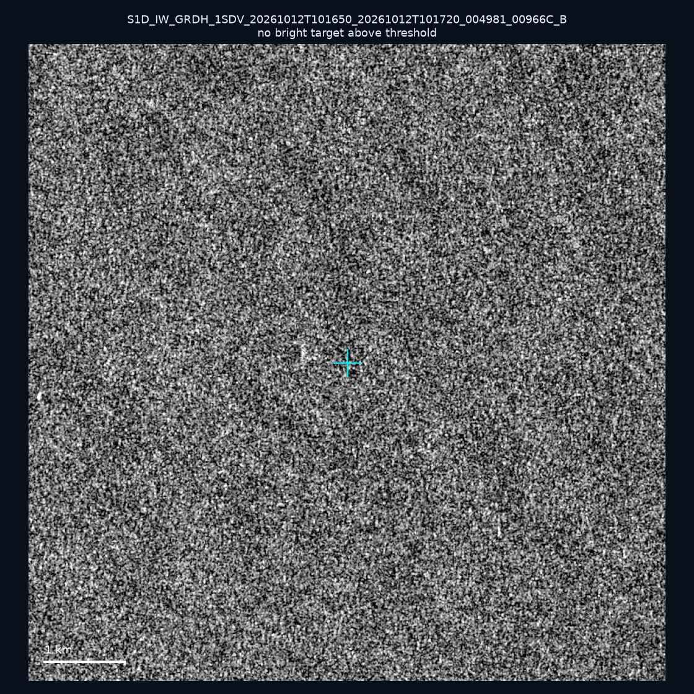
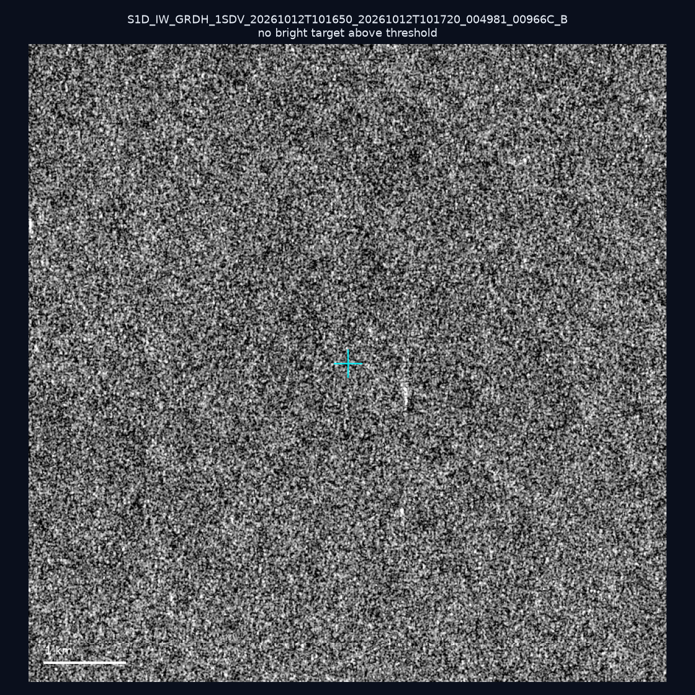
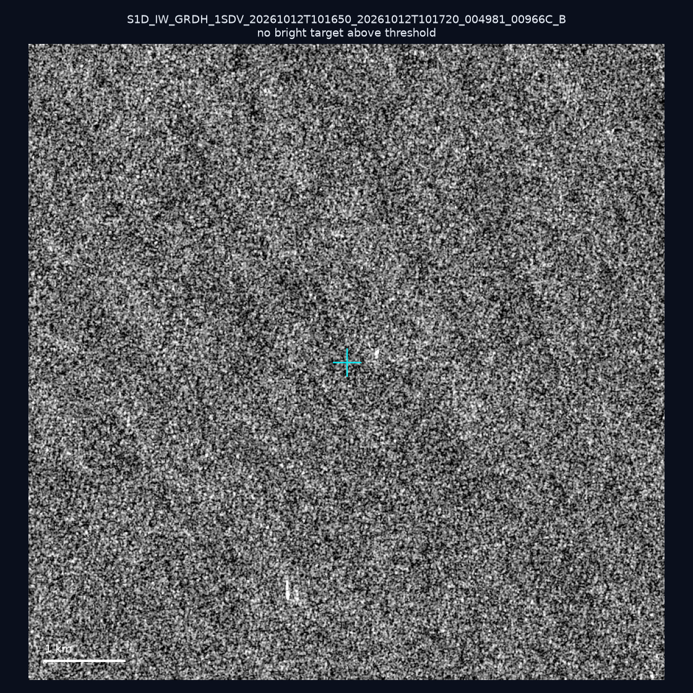
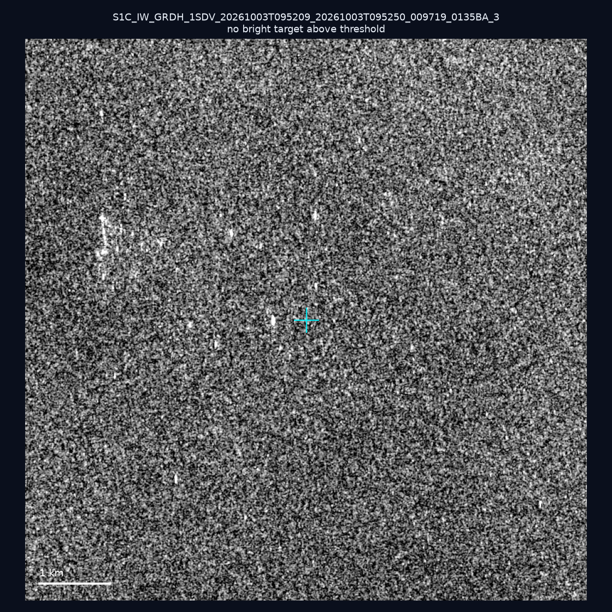
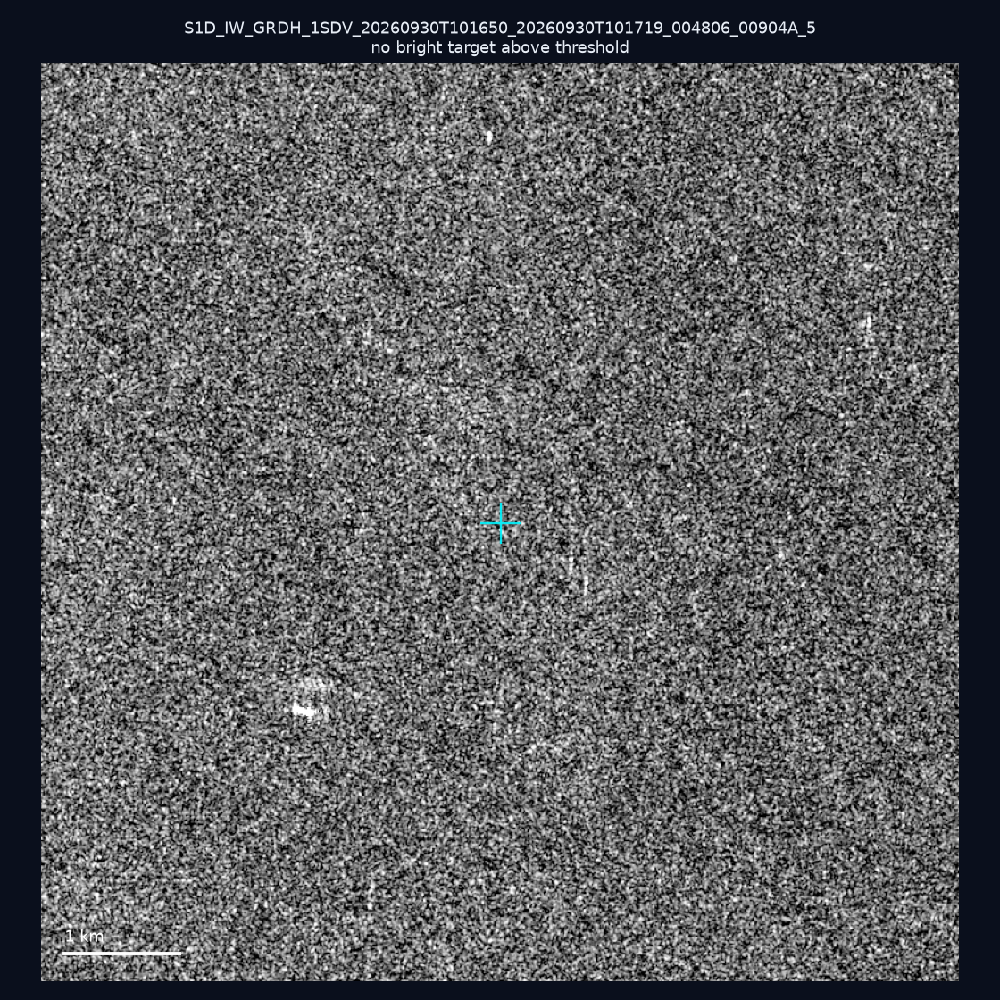
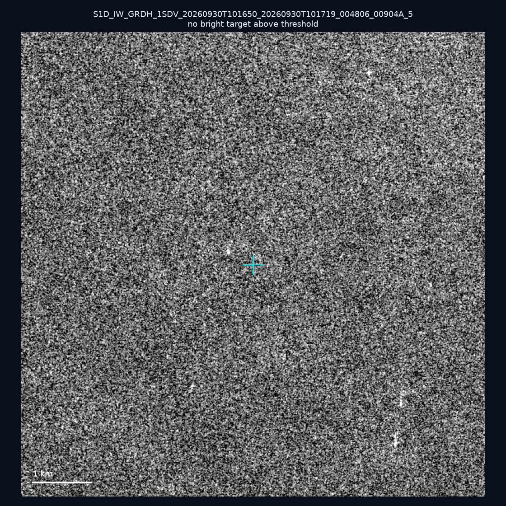
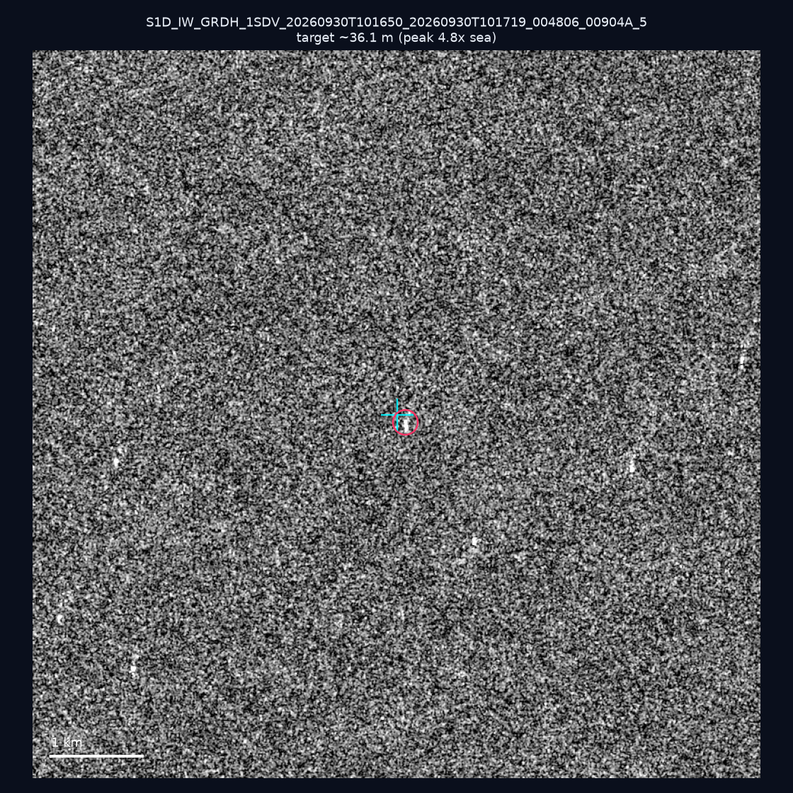
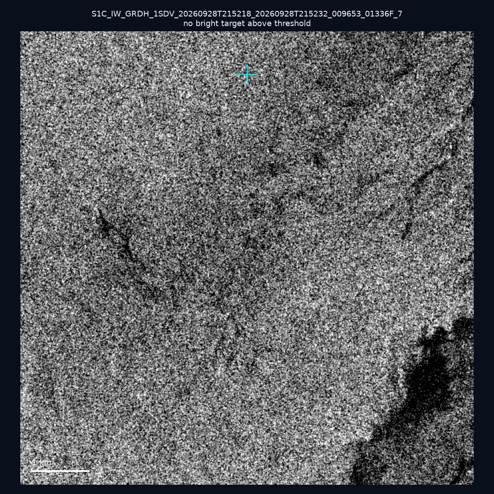
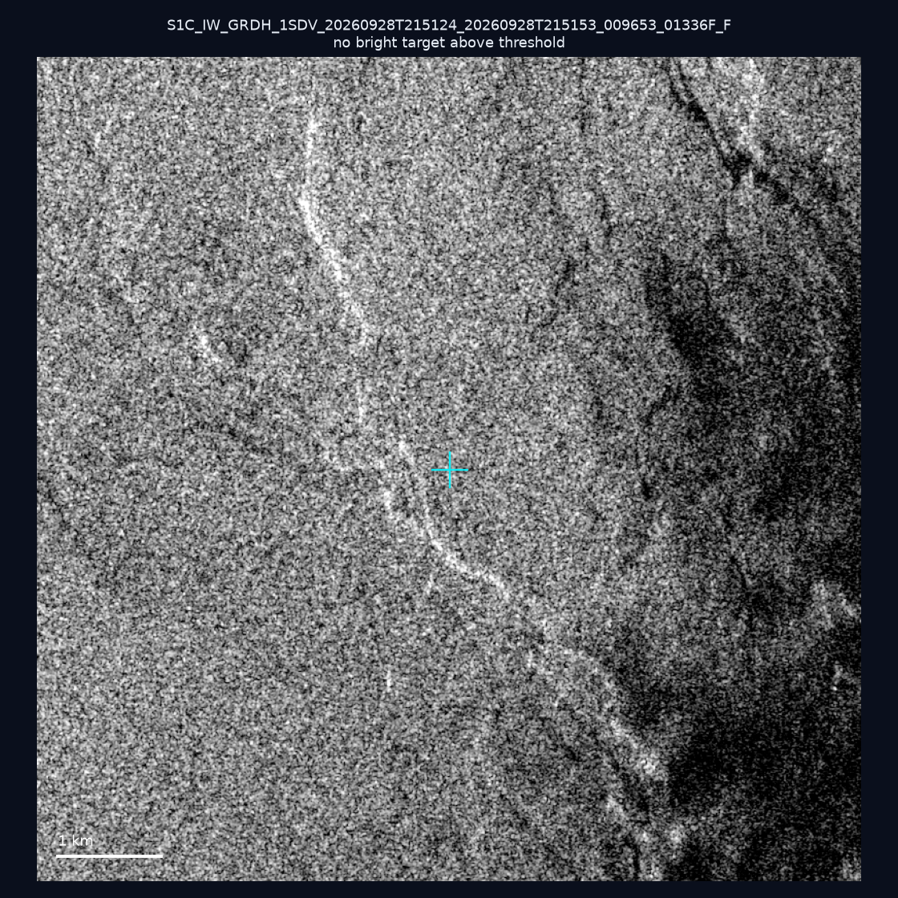

# 暗船 SAR 取證報告 — 2026-10-17

## 1. 總覽

- 執行時間：2026-10-17（GitHub Actions cron 自動執行）
- 線上比對摘要：暗偵測 16888 筆、殘餘暗船 11698 筆、假暗船剔除率 30.7%
- 本輪測試：10 筆
- 成功：10 筆
- 找到亮目標：1 筆
- 失敗：0 筆

## 2. 結果總表

| 日期 | 座標 | 海域 | 法域 | 成像時刻 | 判定 | 估計長度 | 峰值比 |
|------|------|------|------|----------|------|----------|--------|
| 2026-10-12 | 23.22, 118.29 | southwest | eez | 10:16:50 | ⚪ 無目標（雜訊或低RCS） | — | — |
| 2026-10-12 | 22.8, 117.31 | southwest | eez | 10:16:50 | ⚪ 無目標（雜訊或低RCS） | — | — |
| 2026-10-12 | 23.06, 117.67 | southwest | eez | 10:16:50 | ⚪ 無目標（雜訊或低RCS） | — | — |
| 2026-10-12 | 23.2, 118.2 | southwest | eez | 10:16:50 | ⚪ 無目標（雜訊或低RCS） | — | — |
| 2026-10-03 | 23.42, 122.29 | east | eez | 09:52:09 | ⚪ 無目標（雜訊或低RCS） | — | — |
| 2026-09-30 | 23.18, 117.1 | southwest | eez | 10:16:50 | ⚪ 無目標（雜訊或低RCS） | — | — |
| 2026-09-30 | 23.16, 118.33 | southwest | eez | 10:16:50 | ⚪ 無目標（雜訊或低RCS） | — | — |
| 2026-09-30 | 23.1, 117.94 | southwest | eez | 10:16:50 | 🟡 弱目標 | ~36.1 m | 4.8× |
| 2026-09-28 | 22.4, 120.32 | southwest | internal_waters | 21:52:18 | ⚪ 無目標（雜訊或低RCS） | — | — |
| 2026-09-28 | 24.94, 122.03 | east | territorial_sea | 21:51:24 | ⚪ 無目標（雜訊或低RCS） | — | — |

## 3. 逐目標段落

### 2026-10-12 (23.22, 118.29)

⚪ 無目標（雜訊或低RCS）。

### 2026-10-12 (22.8, 117.31)

⚪ 無目標（雜訊或低RCS）。

### 2026-10-12 (23.06, 117.67)

⚪ 無目標（雜訊或低RCS）。

### 2026-10-12 (23.2, 118.2)

⚪ 無目標（雜訊或低RCS）。

### 2026-10-03 (23.42, 122.29)

⚪ 無目標（雜訊或低RCS）。

### 2026-09-30 (23.18, 117.1)

⚪ 無目標（雜訊或低RCS）。

### 2026-09-30 (23.16, 118.33)

⚪ 無目標（雜訊或低RCS）。

### 2026-09-30 (23.1, 117.94)

🟡 弱目標，估計長度 ~36.1 m，峰值 4.8× 海面背景（6 px）。

### 2026-09-28 (22.4, 120.32)

⚪ 無目標（雜訊或低RCS）。

### 2026-09-28 (24.94, 122.03)

⚪ 無目標（雜訊或低RCS）。

## 4. 後續建議

- 累積統計：全歷史 544 筆（有效 543 筆），確認實體目標 60 筆（11.0%）

> 所有結果是研判線索，不是法律認定；無目標 ≠ 誤報（小型木殼漁船 RCS 低，SAR 可能拍不到）。
