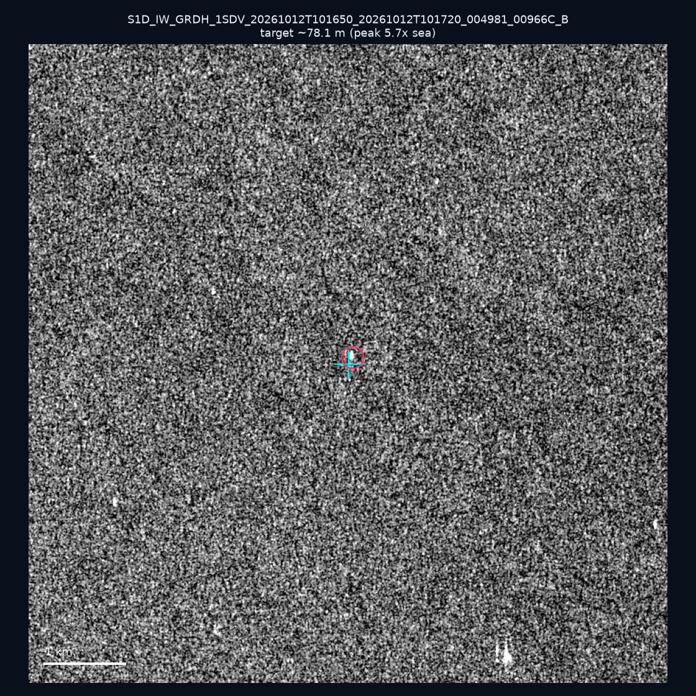
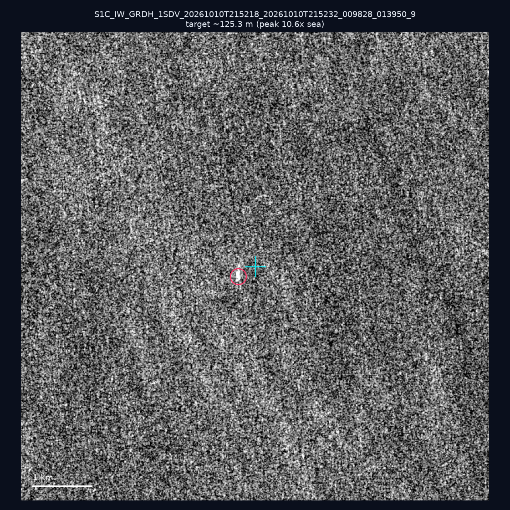
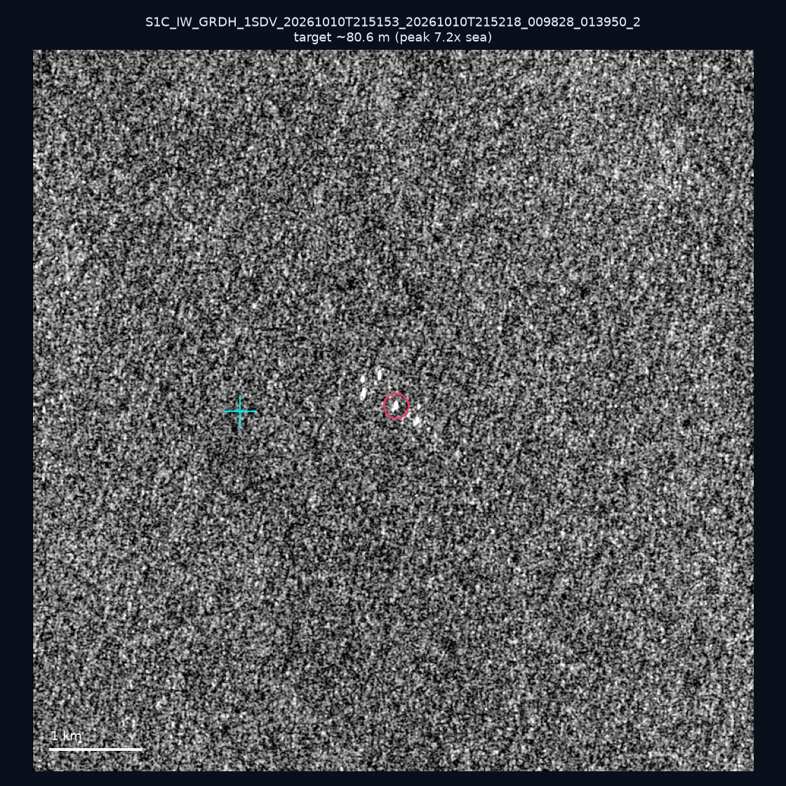
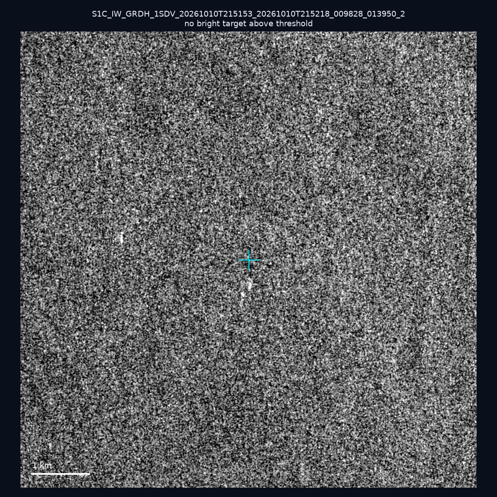
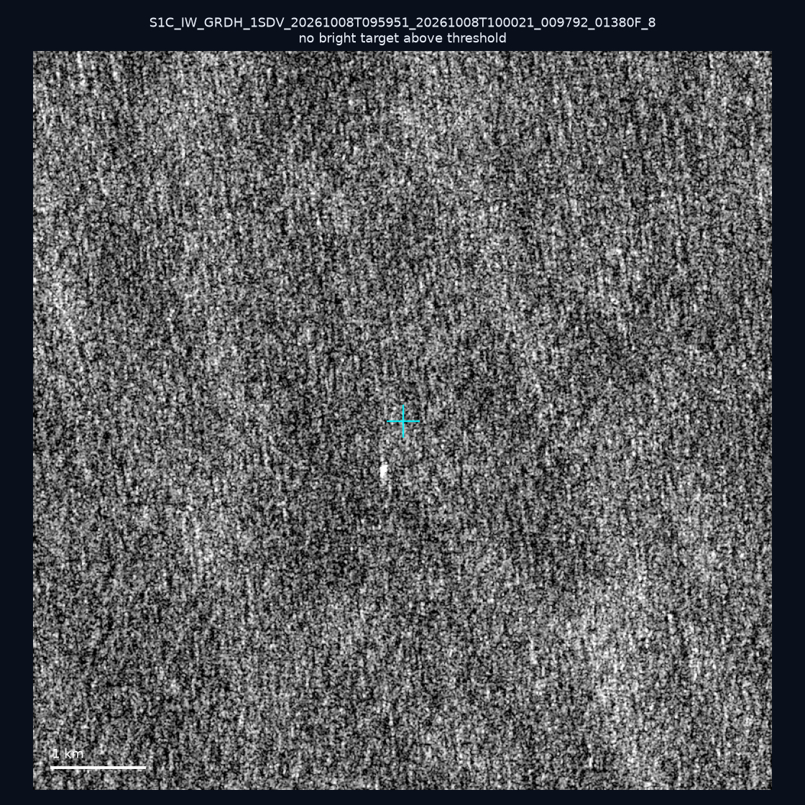
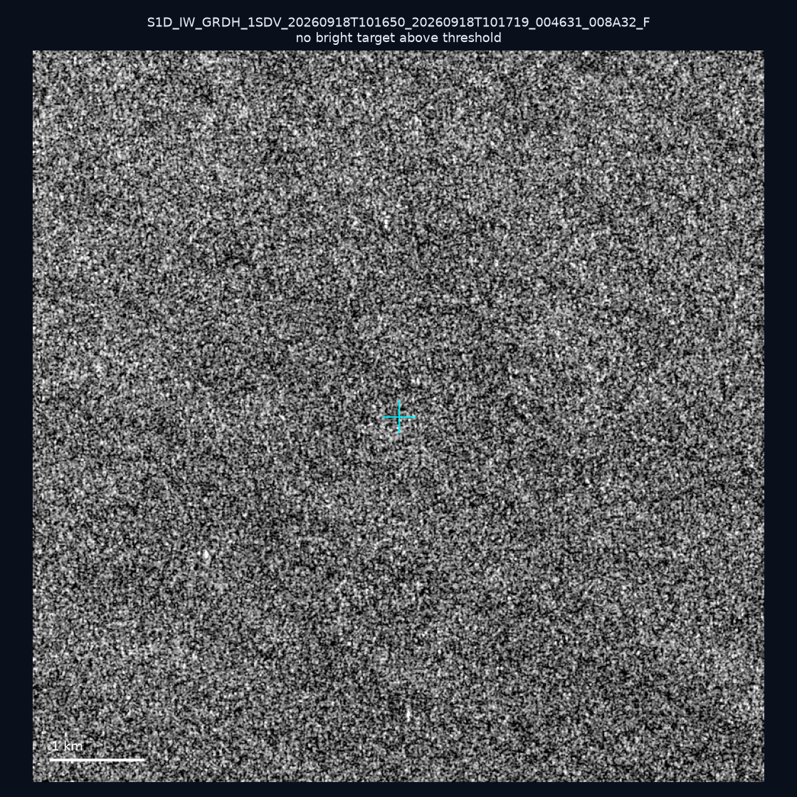
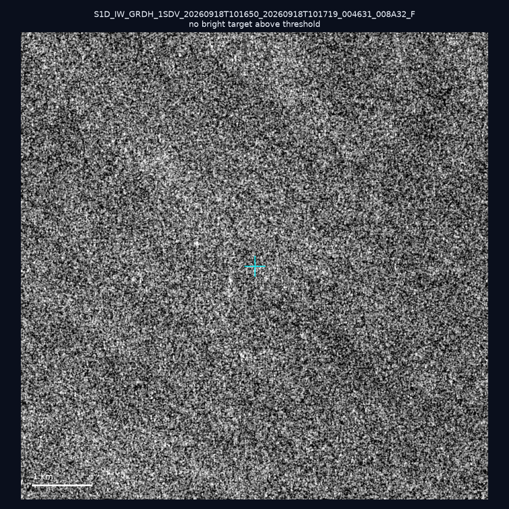
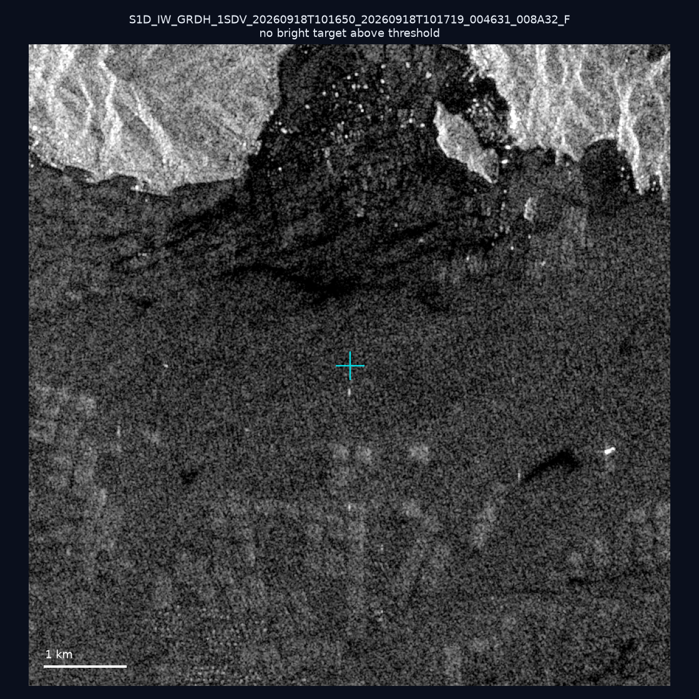
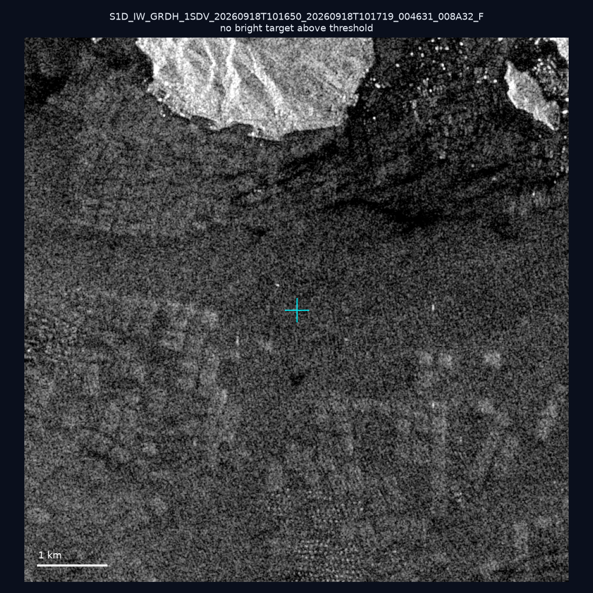
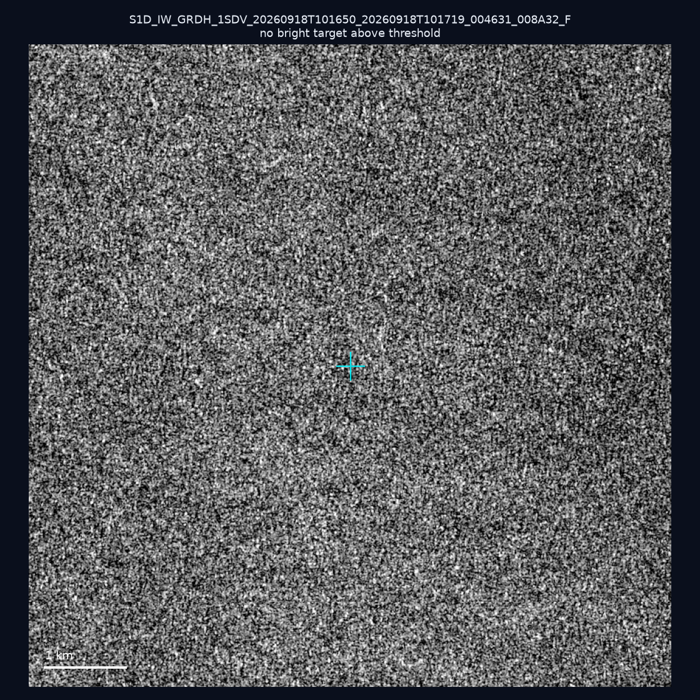

# 暗船 SAR 取證報告 — 2026-10-17

## 1. 總覽

- 執行時間：2026-10-17（GitHub Actions cron 自動執行）
- 線上比對摘要：暗偵測 15743 筆、殘餘暗船 10446 筆、假暗船剔除率 33.6%
- 本輪測試：10 筆
- 成功：10 筆
- 找到亮目標：3 筆
- 失敗：0 筆

## 2. 結果總表

| 日期 | 座標 | 海域 | 法域 | 成像時刻 | 判定 | 估計長度 | 峰值比 |
|------|------|------|------|----------|------|----------|--------|
| 2026-10-12 | 22.87, 117.37 | southwest | eez | 10:16:50 | 🟡 弱目標 | ~78.1 m | 5.7× |
| 2026-10-10 | 21.99, 119.67 | southwest | eez | 21:52:18 | ✅ 確認實體目標 | ~125.3 m | 10.6× |
| 2026-10-10 | 22.46, 121.75 | east | territorial_sea | 21:51:53 | 🟡 弱目標 | ~80.6 m | 7.2× |
| 2026-10-10 | 22.73, 119.58 | southwest | contiguous_zone | 21:51:53 | ⚪ 無目標（雜訊或低RCS） | — | — |
| 2026-10-08 | 22.79, 122.17 | east | eez | 09:59:51 | ⚪ 無目標（雜訊或低RCS） | — | — |
| 2026-09-18 | 23.08, 117.86 | southwest | eez | 10:16:50 | ⚪ 無目標（雜訊或低RCS） | — | — |
| 2026-09-18 | 23.1, 118.2 | southwest | eez | 10:16:50 | ⚪ 無目標（雜訊或低RCS） | — | — |
| 2026-09-18 | 23.5, 117.08 | southwest | eez | 10:16:50 | ⚪ 無目標（雜訊或低RCS） | — | — |
| 2026-09-18 | 23.5, 117.06 | southwest | eez | 10:16:50 | ⚪ 無目標（雜訊或低RCS） | — | — |
| 2026-09-18 | 23.33, 117.86 | southwest | eez | 10:16:50 | ⚪ 無目標（雜訊或低RCS） | — | — |

## 3. 逐目標段落

### 2026-10-12 (22.87, 117.37)

🟡 弱目標，估計長度 ~78.1 m，峰值 5.7× 海面背景（17 px）。

### 2026-10-10 (21.99, 119.67)

✅ 確認實體目標，估計長度 ~125.3 m，峰值 10.6× 海面背景（44 px）。

### 2026-10-10 (22.46, 121.75)

🟡 弱目標，估計長度 ~80.6 m，峰值 7.2× 海面背景（22 px）。

### 2026-10-10 (22.73, 119.58)

⚪ 無目標（雜訊或低RCS）。

### 2026-10-08 (22.79, 122.17)

⚪ 無目標（雜訊或低RCS）。

### 2026-09-18 (23.08, 117.86)

⚪ 無目標（雜訊或低RCS）。

### 2026-09-18 (23.1, 118.2)

⚪ 無目標（雜訊或低RCS）。

### 2026-09-18 (23.5, 117.08)

⚪ 無目標（雜訊或低RCS）。

### 2026-09-18 (23.5, 117.06)

⚪ 無目標（雜訊或低RCS）。

### 2026-09-18 (23.33, 117.86)

⚪ 無目標（雜訊或低RCS）。

## 4. 後續建議

- 值得人工深查（確認實體目標且長度 ≥ 50m）：
  - 2026-10-10 (21.99, 119.67) ~125.3 m — 建議比對周邊 AIS 船長
- 累積統計：全歷史 554 筆（有效 553 筆），確認實體目標 61 筆（11.0%）

> 所有結果是研判線索，不是法律認定；無目標 ≠ 誤報（小型木殼漁船 RCS 低，SAR 可能拍不到）。
