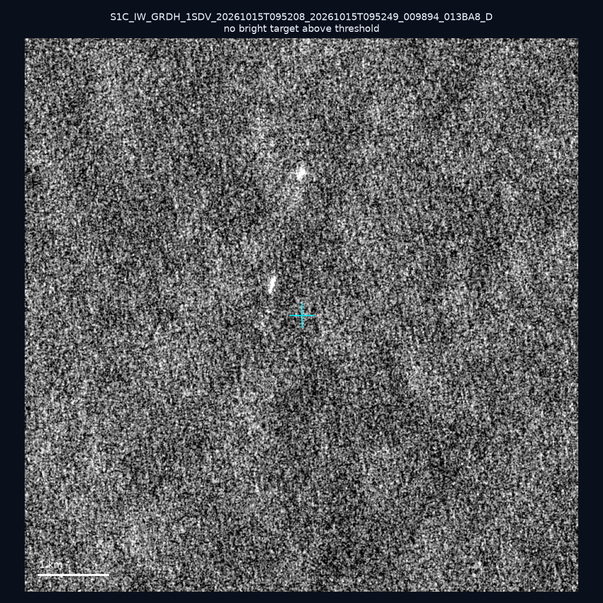
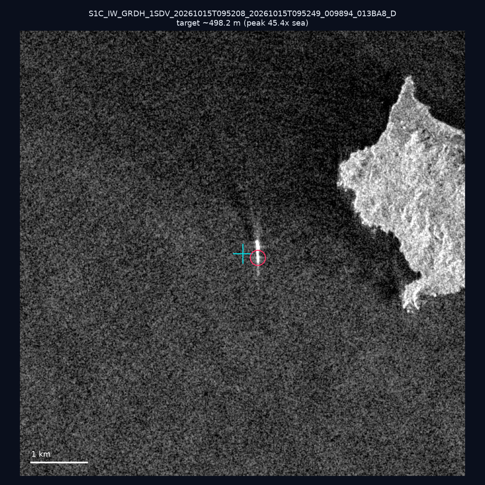
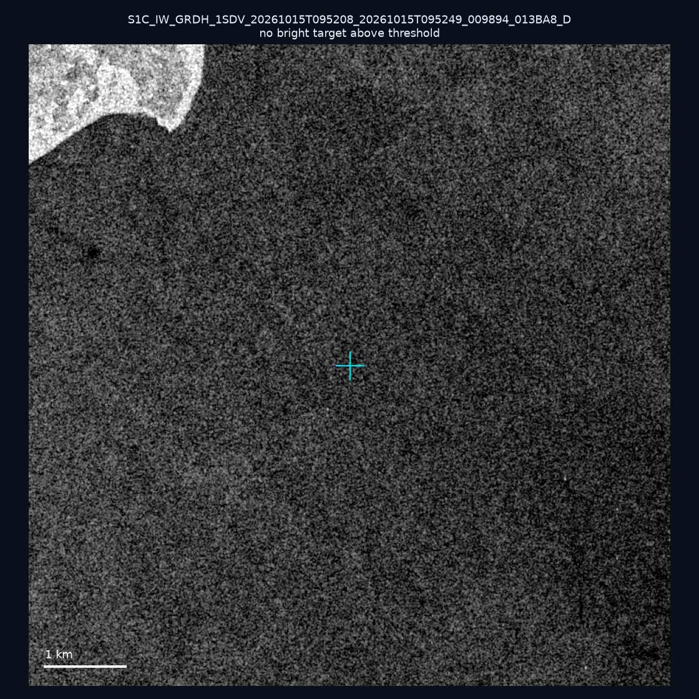
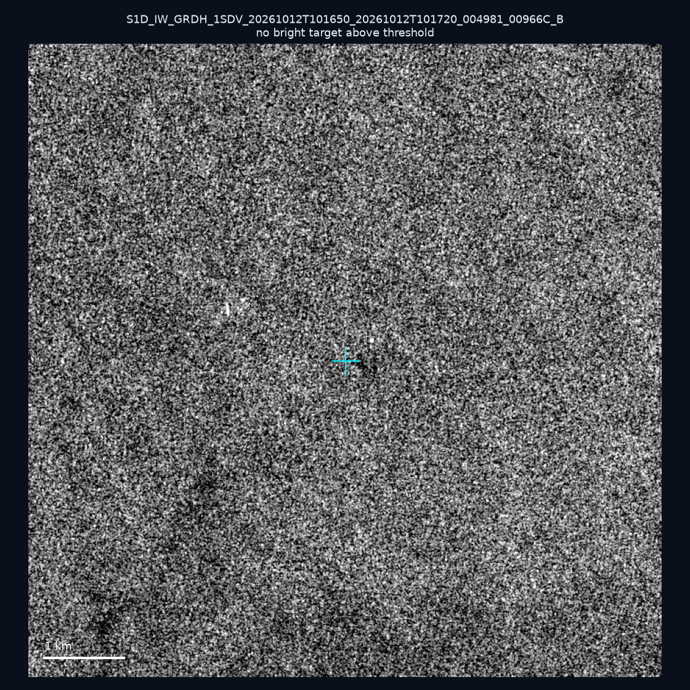
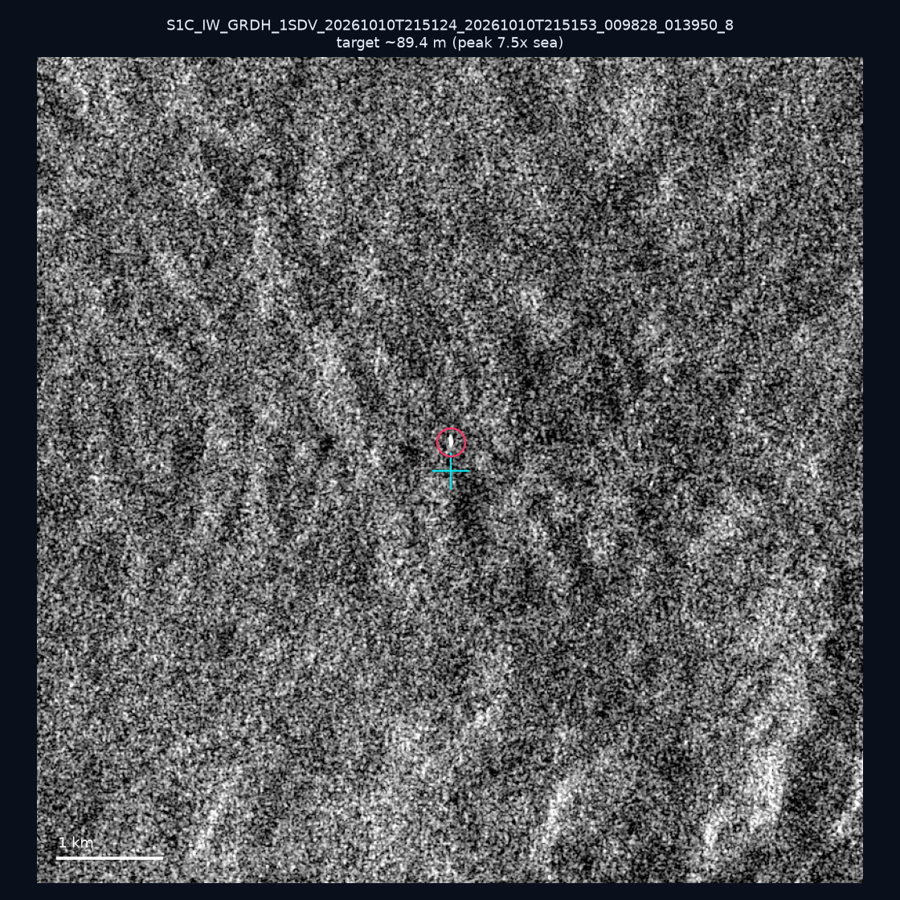
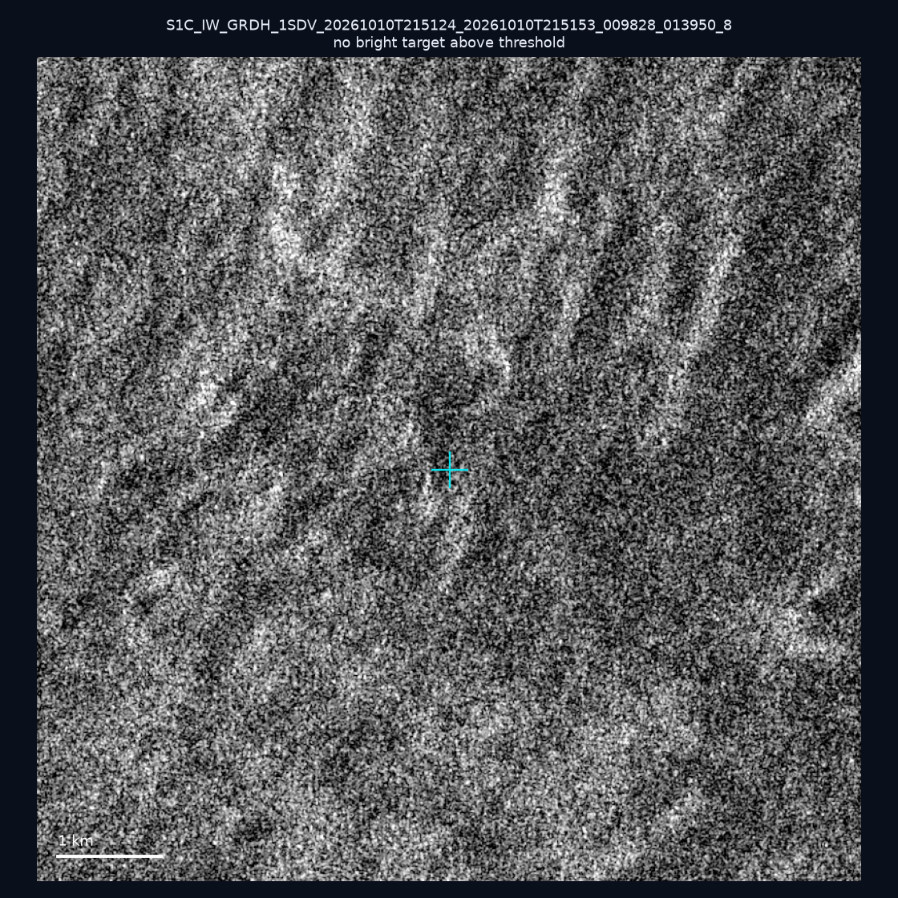
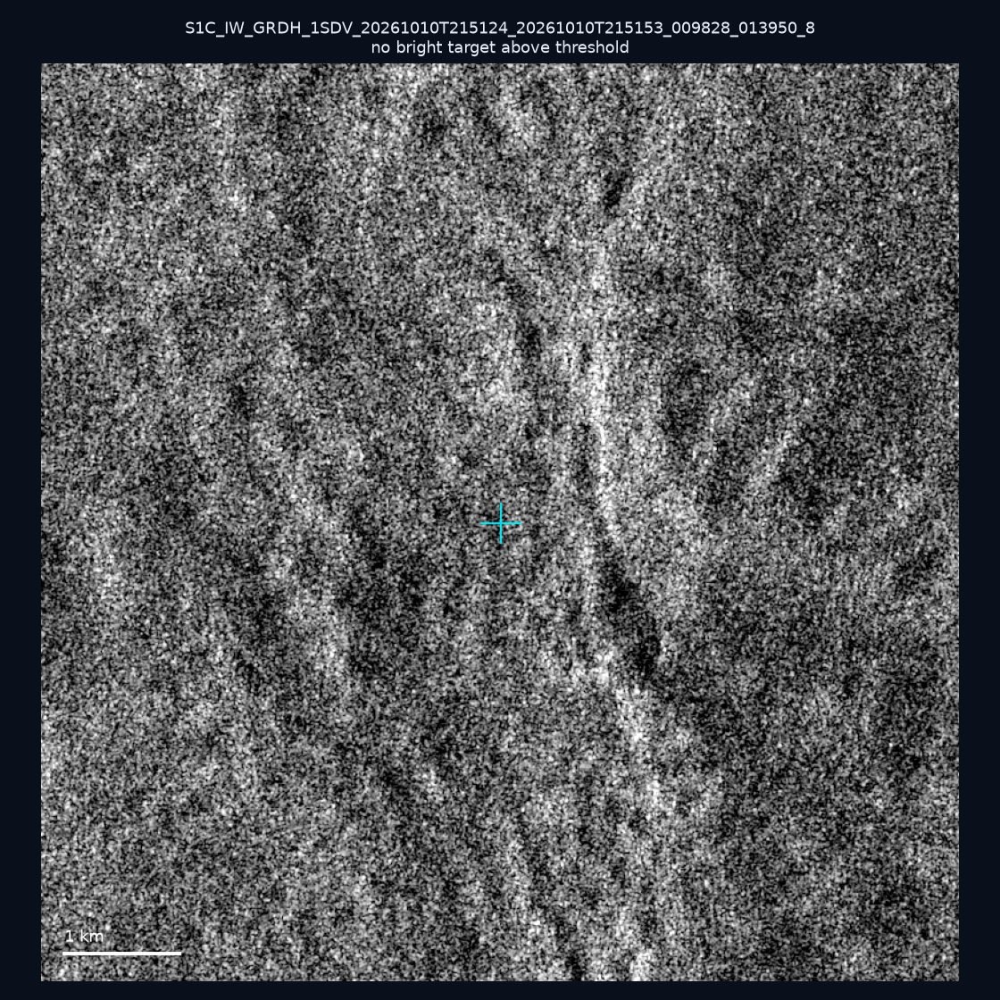
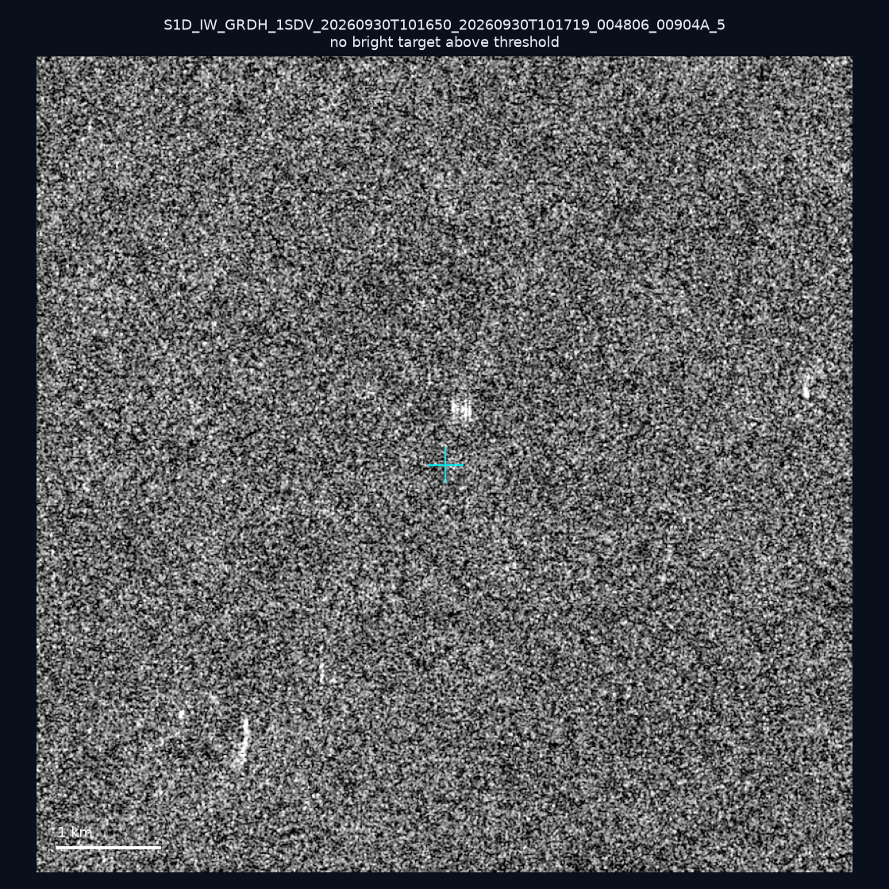
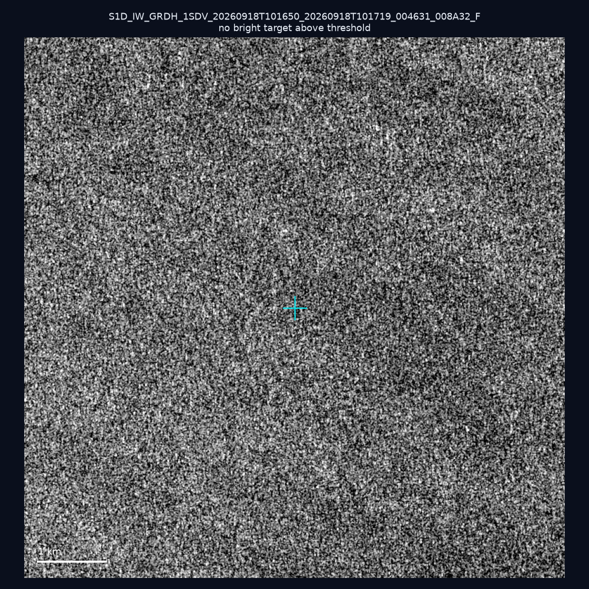

# 暗船 SAR 取證報告 — 2026-10-18

## 1. 總覽

- 執行時間：2026-10-18（GitHub Actions cron 自動執行）
- 線上比對摘要：暗偵測 16695 筆、殘餘暗船 11098 筆、假暗船剔除率 33.5%
- 本輪測試：9 筆
- 成功：9 筆
- 找到亮目標：2 筆
- 失敗：0 筆

## 2. 結果總表

| 日期 | 座標 | 海域 | 法域 | 成像時刻 | 判定 | 估計長度 | 峰值比 |
|------|------|------|------|----------|------|----------|--------|
| 2026-10-15 | 25.44, 123.34 | east | eez | 09:52:08 | ⚪ 無目標（雜訊或低RCS） | — | — |
| 2026-10-15 | 24.44, 124.05 | east | eez | 09:52:08 | ✅ 確認實體目標 | ~498.2 m | 45.4× |
| 2026-10-15 | 24.28, 124.04 | east | eez | 09:52:08 | ⚪ 無目標（雜訊或低RCS） | — | — |
| 2026-10-12 | 23.41, 118.31 | southwest | eez | 10:16:50 | ⚪ 無目標（雜訊或低RCS） | — | — |
| 2026-10-10 | 25.42, 122.2 | east | territorial_sea | 21:51:24 | 🟡 弱目標 | ~89.4 m | 7.5× |
| 2026-10-10 | 25.33, 121.93 | east | internal_waters | 21:51:24 | ⚪ 無目標（雜訊或低RCS） | — | — |
| 2026-10-10 | 25.2, 121.98 | east | internal_waters | 21:51:24 | ⚪ 無目標（雜訊或低RCS） | — | — |
| 2026-09-30 | 23.24, 117.9 | southwest | eez | 10:16:50 | ⚪ 無目標（雜訊或低RCS） | — | — |
| 2026-09-18 | 23.05, 117.54 | southwest | eez | 10:16:50 | ⚪ 無目標（雜訊或低RCS） | — | — |

## 3. 逐目標段落

### 2026-10-15 (25.44, 123.34)

⚪ 無目標（雜訊或低RCS）。

### 2026-10-15 (24.44, 124.05)

✅ 確認實體目標，估計長度 ~498.2 m，峰值 45.4× 海面背景（259 px）。

### 2026-10-15 (24.28, 124.04)

⚪ 無目標（雜訊或低RCS）。

### 2026-10-12 (23.41, 118.31)

⚪ 無目標（雜訊或低RCS）。

### 2026-10-10 (25.42, 122.2)

🟡 弱目標，估計長度 ~89.4 m，峰值 7.5× 海面背景（24 px）。

### 2026-10-10 (25.33, 121.93)

⚪ 無目標（雜訊或低RCS）。

### 2026-10-10 (25.2, 121.98)

⚪ 無目標（雜訊或低RCS）。

### 2026-09-30 (23.24, 117.9)

⚪ 無目標（雜訊或低RCS）。

### 2026-09-18 (23.05, 117.54)

⚪ 無目標（雜訊或低RCS）。

## 4. 後續建議

- 值得人工深查（確認實體目標且長度 ≥ 50m）：
  - 2026-10-15 (24.44, 124.05) ~498.2 m — 建議比對周邊 AIS 船長
- 累積統計：全歷史 563 筆（有效 562 筆），確認實體目標 62 筆（11.0%）

> 所有結果是研判線索，不是法律認定；無目標 ≠ 誤報（小型木殼漁船 RCS 低，SAR 可能拍不到）。
