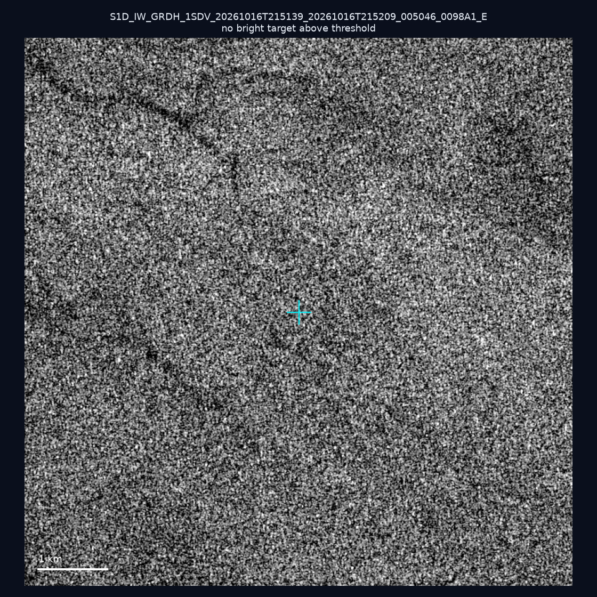
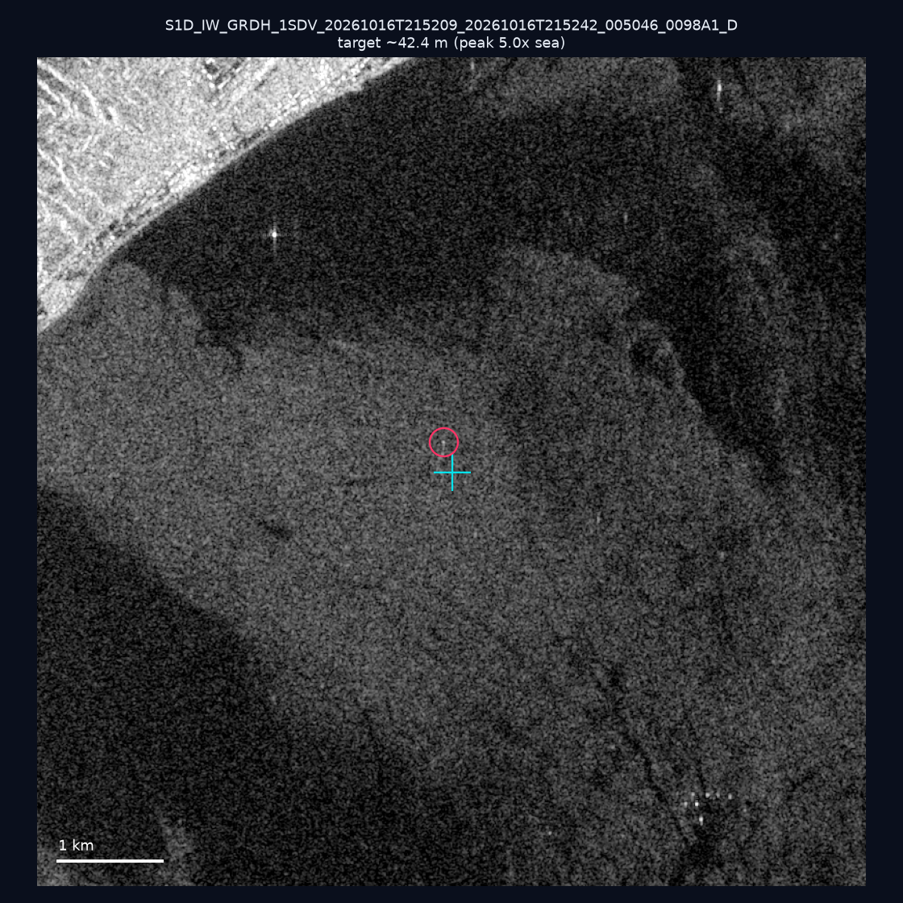
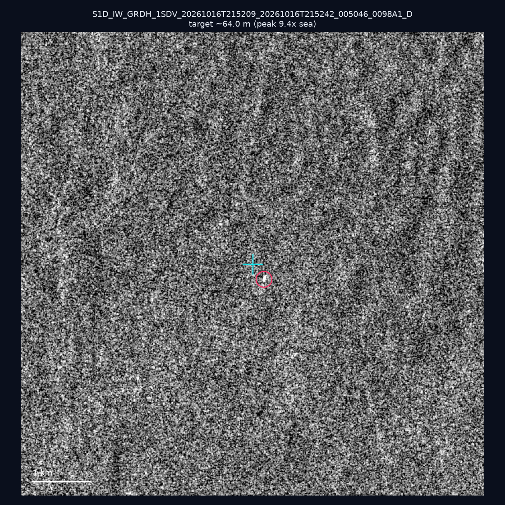
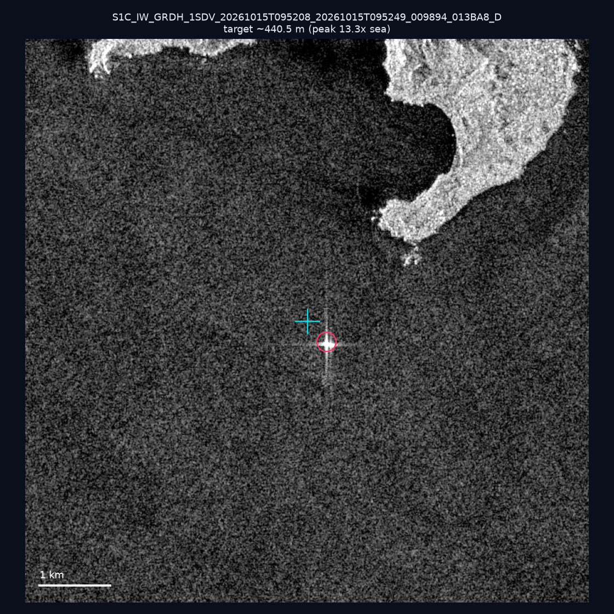
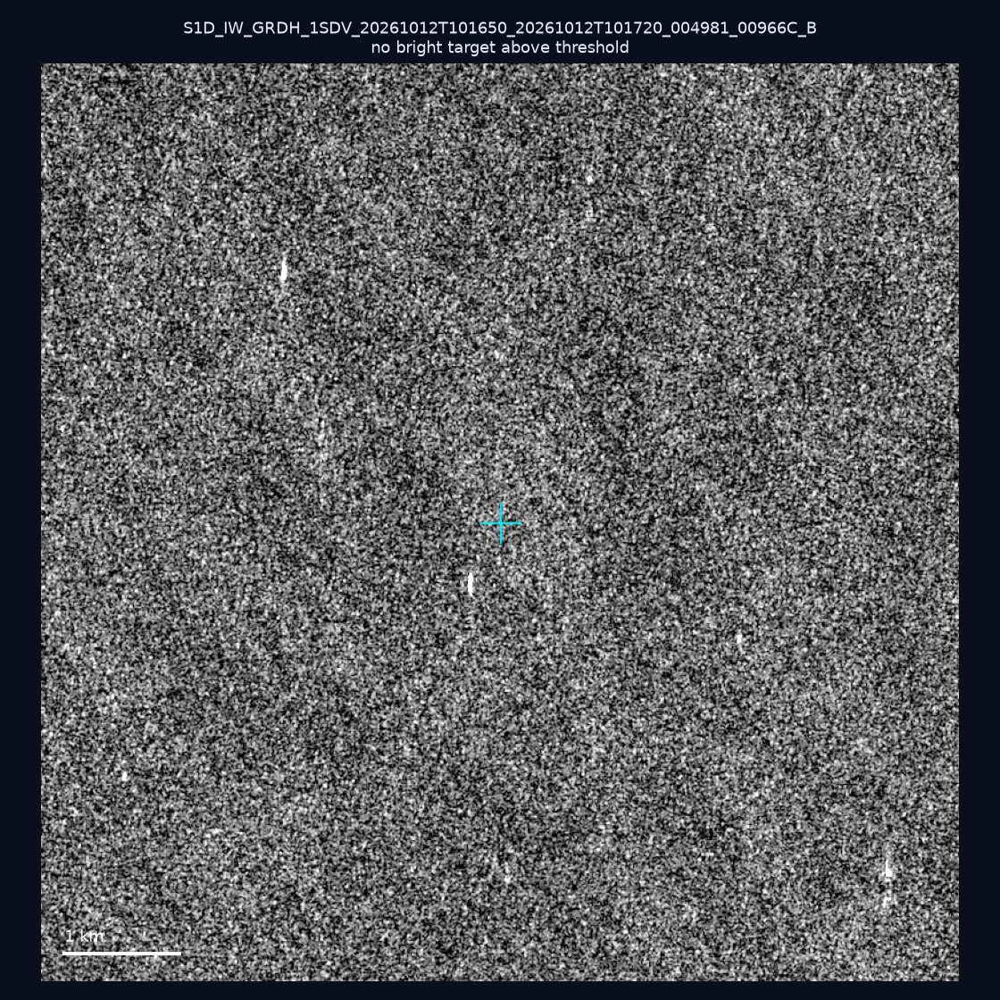
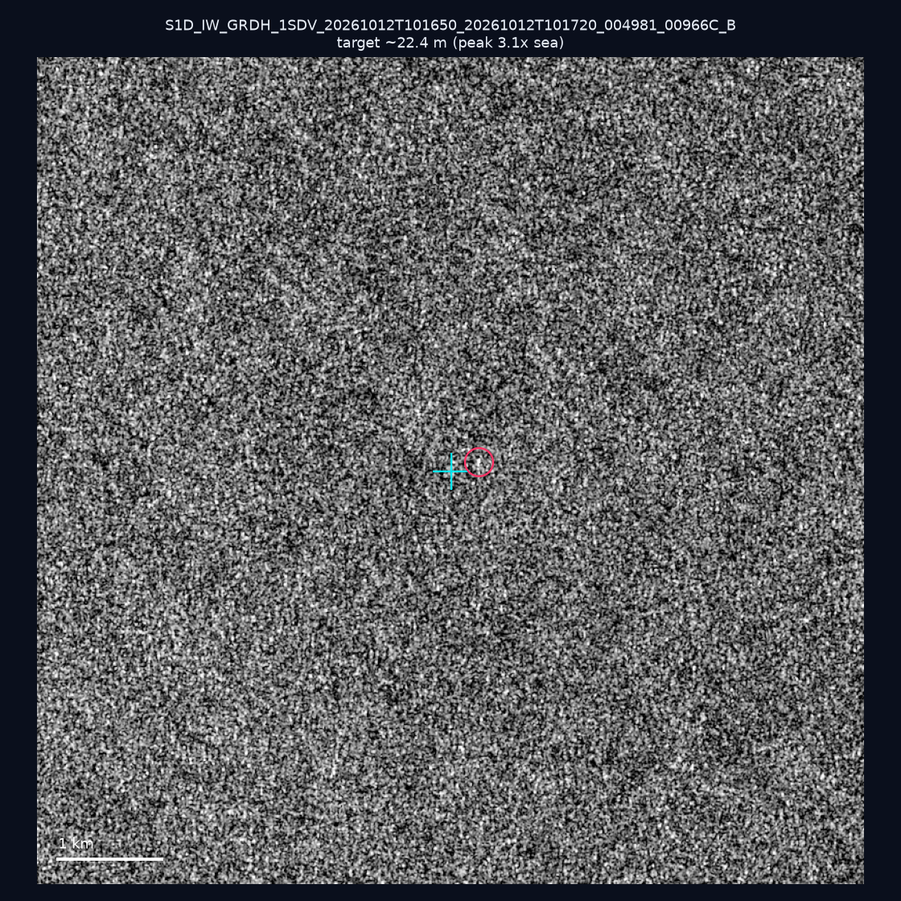
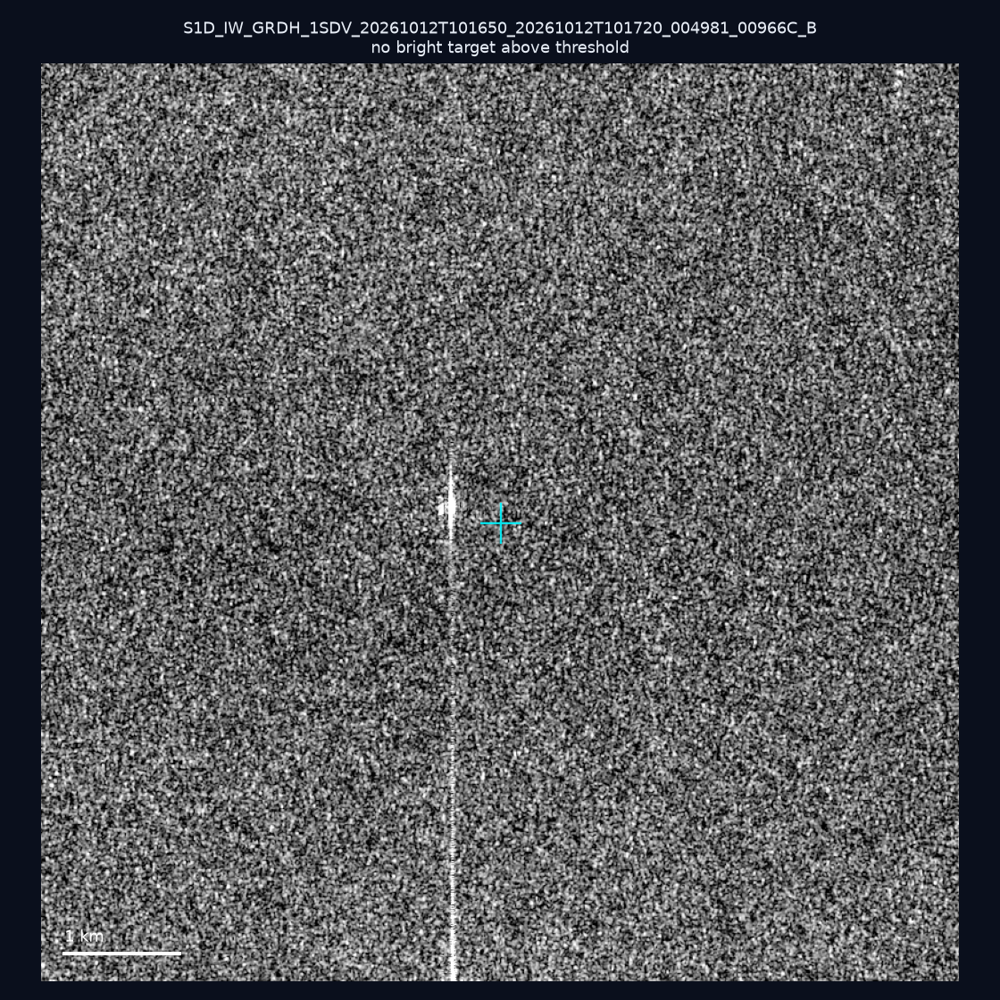
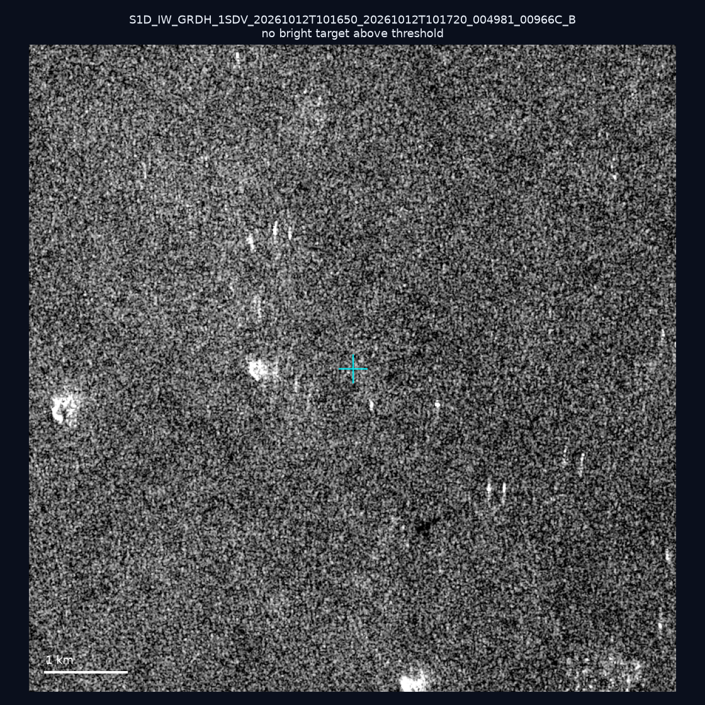
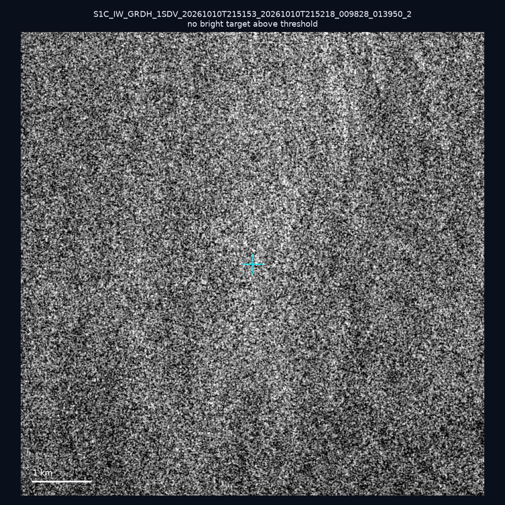
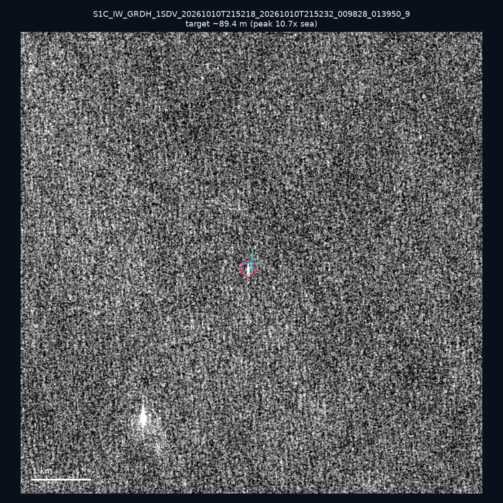

# 暗船 SAR 取證報告 — 2026-10-20

## 1. 總覽

- 執行時間：2026-10-20（GitHub Actions cron 自動執行）
- 線上比對摘要：暗偵測 16707 筆、殘餘暗船 11015 筆、假暗船剔除率 34.1%
- 本輪測試：10 筆
- 成功：10 筆
- 找到亮目標：5 筆
- 失敗：0 筆

## 2. 結果總表

| 日期 | 座標 | 海域 | 法域 | 成像時刻 | 判定 | 估計長度 | 峰值比 |
|------|------|------|------|----------|------|----------|--------|
| 2026-10-16 | 24.53, 122.11 | east | contiguous_zone | 21:51:39 | ⚪ 無目標（雜訊或低RCS） | — | — |
| 2026-10-16 | 22.3, 120.6 | southwest | internal_waters | 21:52:09 | 🟡 弱目標 | ~42.4 m | 5.0× |
| 2026-10-16 | 22.78, 119.64 | southwest | territorial_sea | 21:52:09 | 🟡 弱目標 | ~64.0 m | 9.4× |
| 2026-10-15 | 24.49, 124.1 | east | eez | 09:52:08 | ✅ 確認實體目標 | ~440.5 m | 13.3× |
| 2026-10-12 | 23.21, 118.33 | southwest | eez | 10:16:50 | ⚪ 無目標（雜訊或低RCS） | — | — |
| 2026-10-12 | 22.79, 117.23 | southwest | eez | 10:16:50 | 🟡 弱目標 | ~22.4 m | 3.1× |
| 2026-10-12 | 23.05, 117.18 | southwest | eez | 10:16:50 | ⚪ 無目標（雜訊或低RCS） | — | — |
| 2026-10-12 | 23.32, 117.13 | southwest | eez | 10:16:50 | ⚪ 無目標（雜訊或低RCS） | — | — |
| 2026-10-10 | 23.2, 119.98 | southwest | internal_waters | 21:51:53 | ⚪ 無目標（雜訊或低RCS） | — | — |
| 2026-10-10 | 21.8, 119.36 | southwest | eez | 21:52:18 | ✅ 確認實體目標 | ~89.4 m | 10.7× |

## 3. 逐目標段落

### 2026-10-16 (24.53, 122.11)

⚪ 無目標（雜訊或低RCS）。

### 2026-10-16 (22.3, 120.6)

🟡 弱目標，估計長度 ~42.4 m，峰值 5.0× 海面背景（7 px）。

### 2026-10-16 (22.78, 119.64)

🟡 弱目標，估計長度 ~64.0 m，峰值 9.4× 海面背景（14 px）。

### 2026-10-15 (24.49, 124.1)

✅ 確認實體目標，估計長度 ~440.5 m，峰值 13.3× 海面背景（240 px）。

### 2026-10-12 (23.21, 118.33)

⚪ 無目標（雜訊或低RCS）。

### 2026-10-12 (22.79, 117.23)

🟡 弱目標，估計長度 ~22.4 m，峰值 3.1× 海面背景（2 px）。

### 2026-10-12 (23.05, 117.18)

⚪ 無目標（雜訊或低RCS）。

### 2026-10-12 (23.32, 117.13)

⚪ 無目標（雜訊或低RCS）。

### 2026-10-10 (23.2, 119.98)

⚪ 無目標（雜訊或低RCS）。

### 2026-10-10 (21.8, 119.36)

✅ 確認實體目標，估計長度 ~89.4 m，峰值 10.7× 海面背景（23 px）。

## 4. 後續建議

- 值得人工深查（確認實體目標且長度 ≥ 50m）：
  - 2026-10-15 (24.49, 124.1) ~440.5 m — 建議比對周邊 AIS 船長
  - 2026-10-10 (21.8, 119.36) ~89.4 m — 建議比對周邊 AIS 船長
- 累積統計：全歷史 573 筆（有效 572 筆），確認實體目標 64 筆（11.2%）

> 所有結果是研判線索，不是法律認定；無目標 ≠ 誤報（小型木殼漁船 RCS 低，SAR 可能拍不到）。
