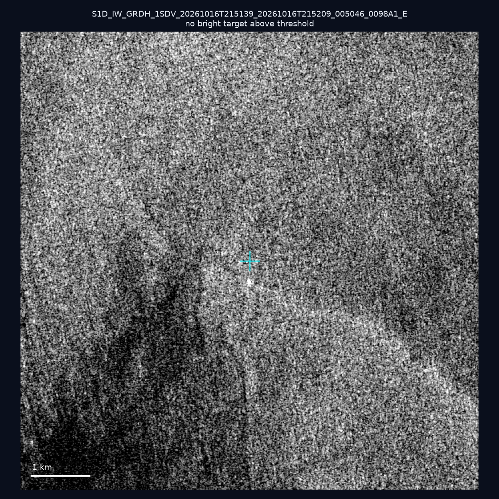
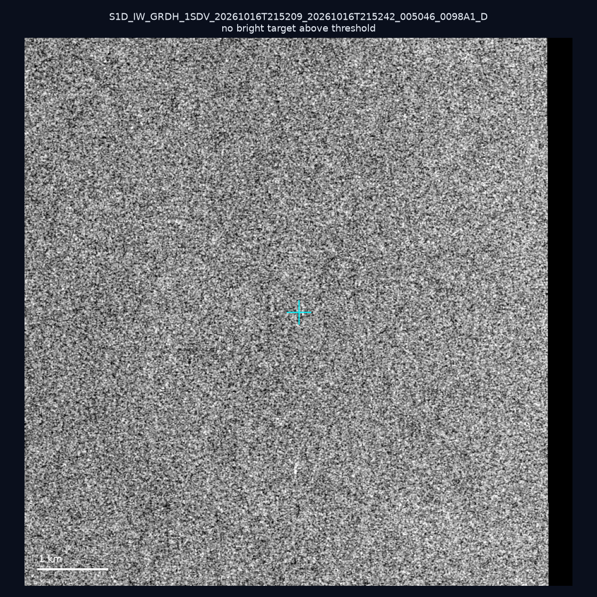
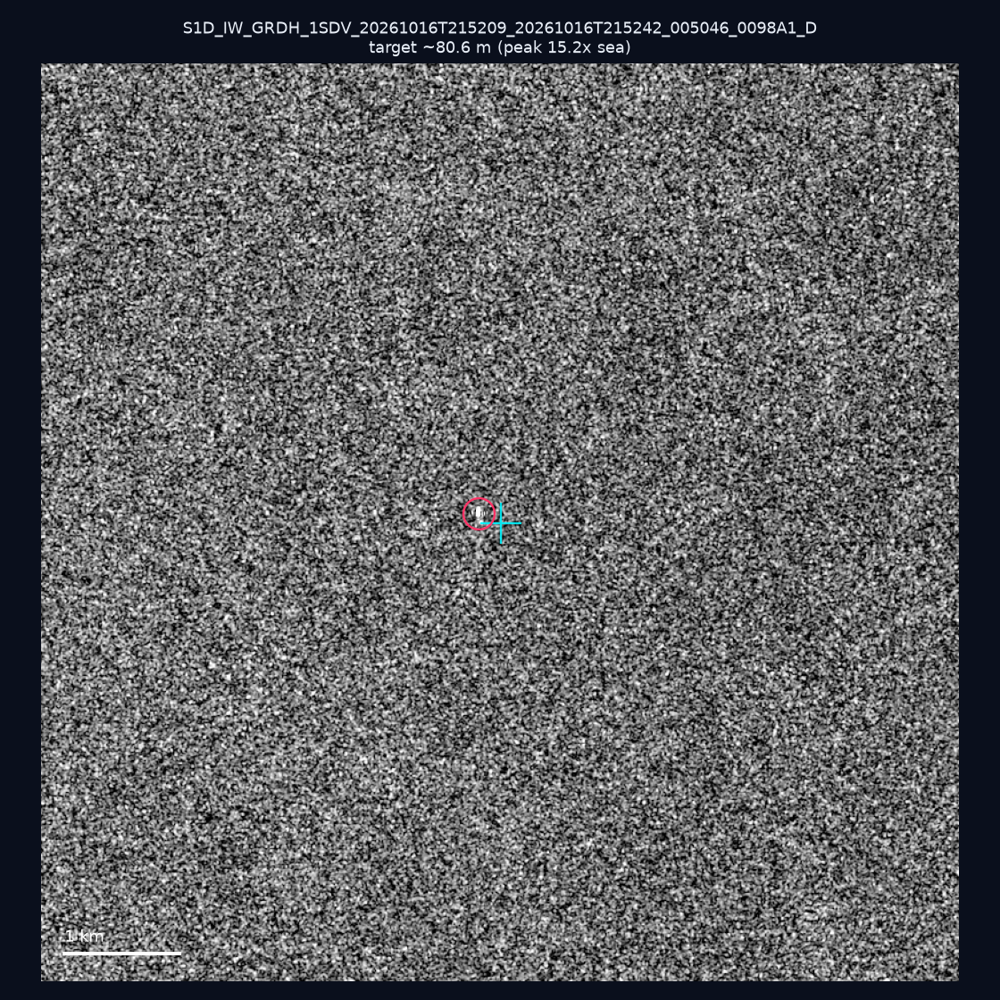
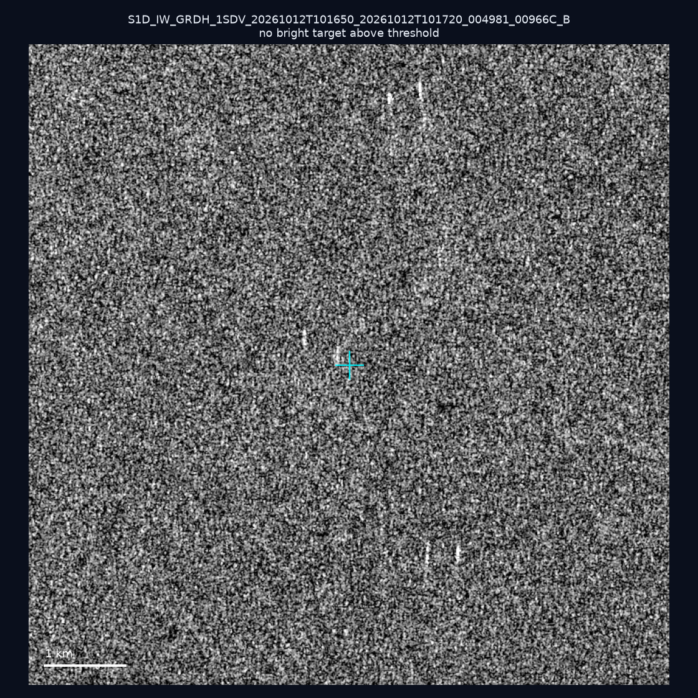
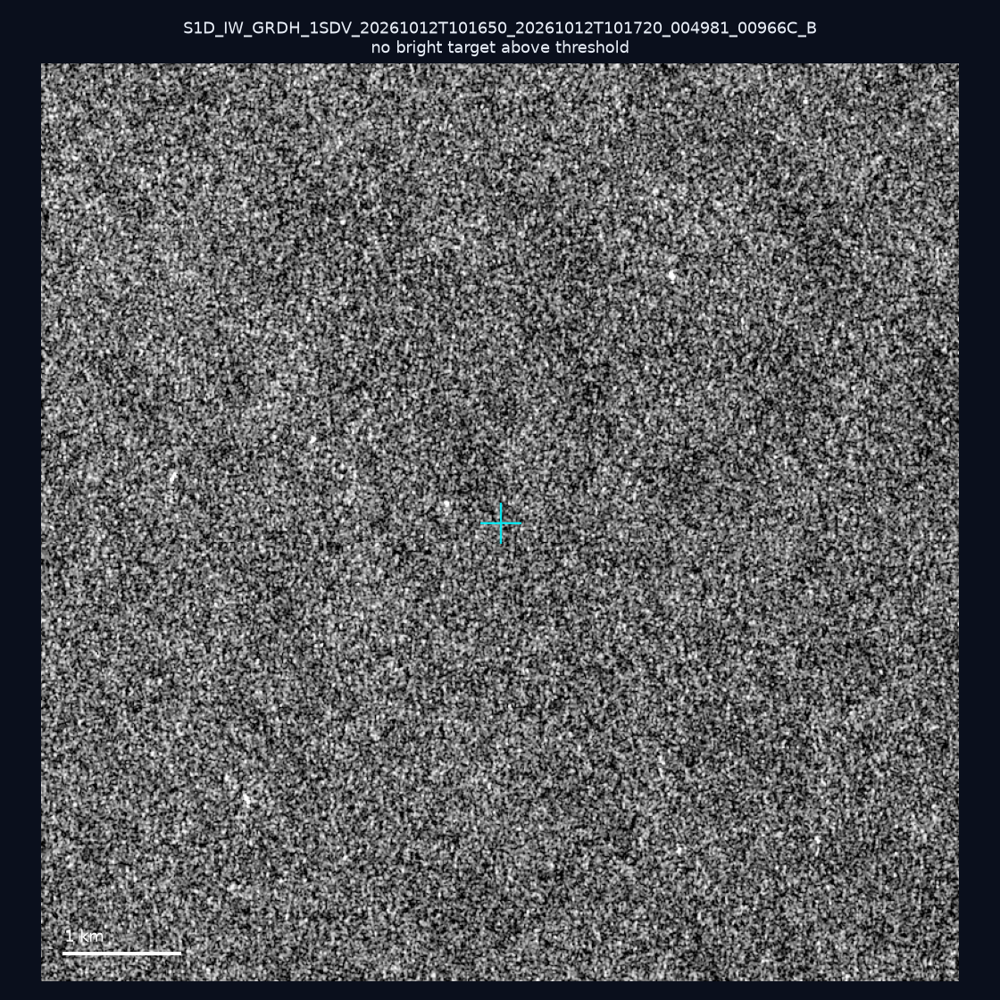
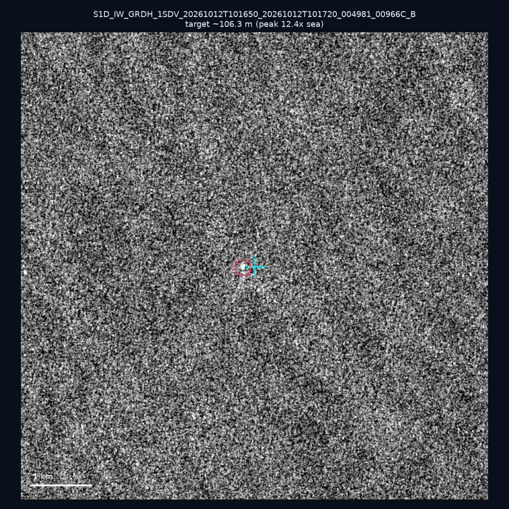
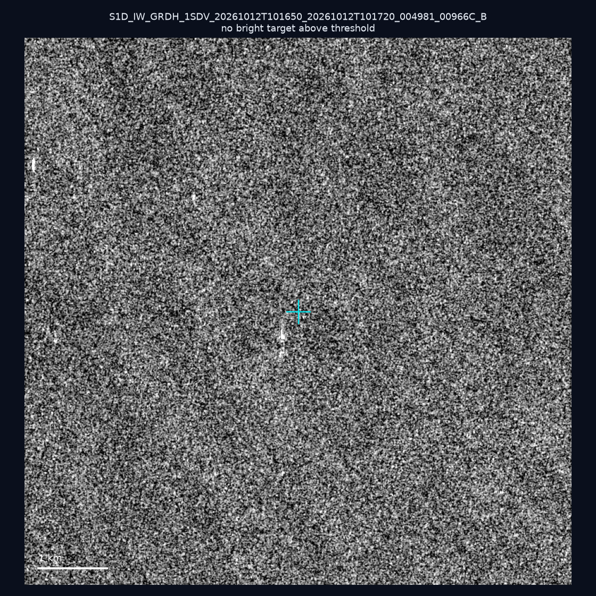
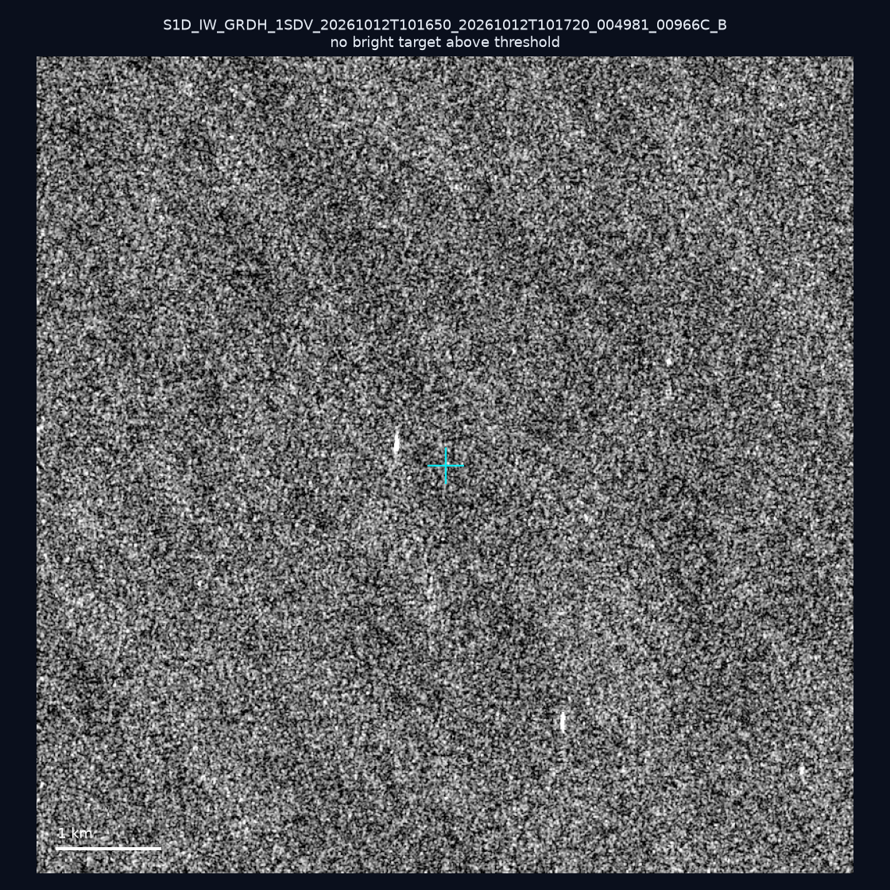
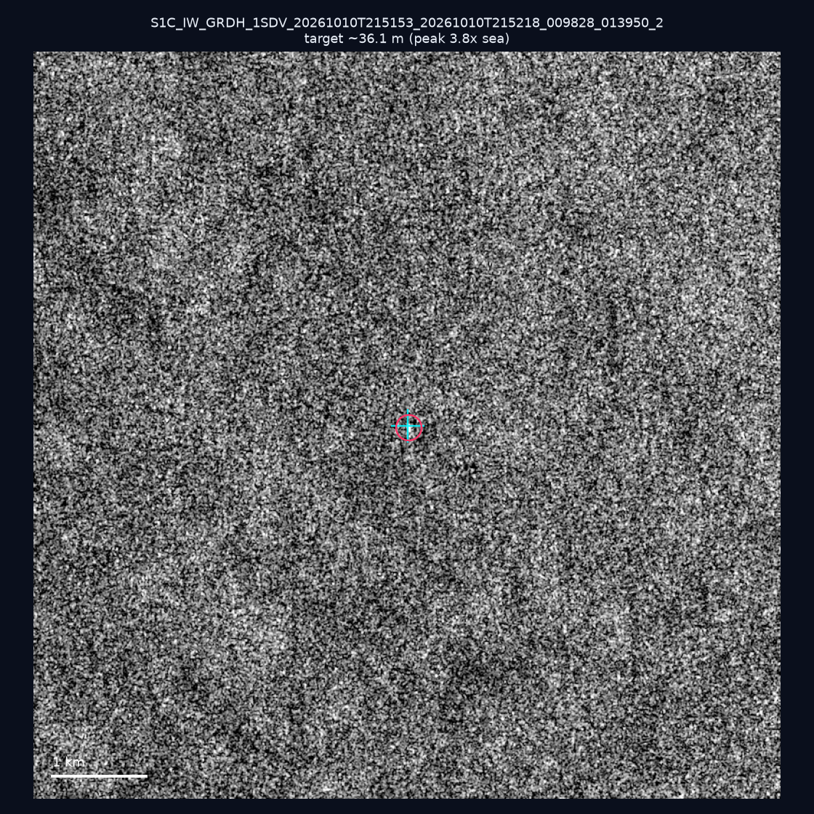
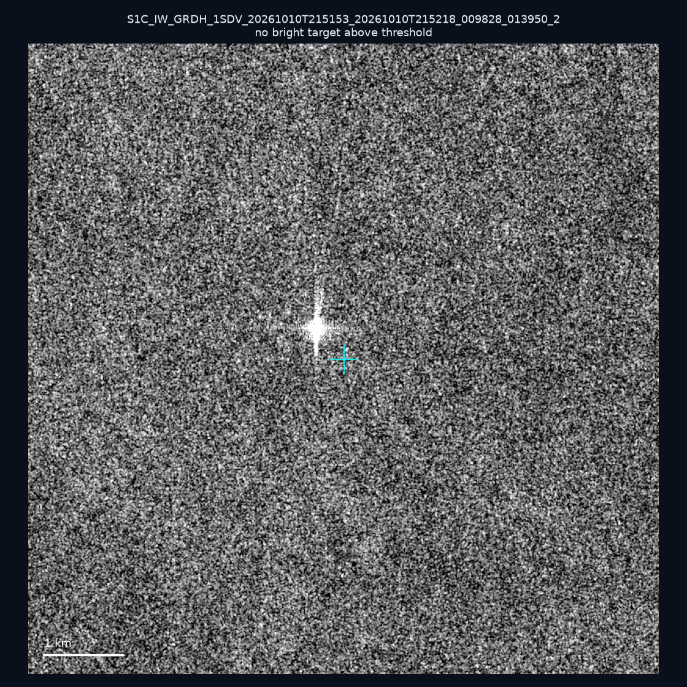

# 暗船 SAR 取證報告 — 2026-10-21

## 1. 總覽

- 執行時間：2026-10-21（GitHub Actions cron 自動執行）
- 線上比對摘要：暗偵測 16786 筆、殘餘暗船 11049 筆、假暗船剔除率 34.2%
- 本輪測試：10 筆
- 成功：10 筆
- 找到亮目標：3 筆
- 失敗：0 筆

## 2. 結果總表

| 日期 | 座標 | 海域 | 法域 | 成像時刻 | 判定 | 估計長度 | 峰值比 |
|------|------|------|------|----------|------|----------|--------|
| 2026-10-16 | 23.89, 121.91 | east | contiguous_zone | 21:51:39 | ⚪ 無目標（雜訊或低RCS） | — | — |
| 2026-10-16 | 23.11, 119.45 | southwest | territorial_sea | 21:52:09 | ⚪ 無目標（雜訊或低RCS） | — | — |
| 2026-10-16 | 22.43, 119.98 | southwest | territorial_sea | 21:52:09 | ✅ 確認實體目標 | ~80.6 m | 15.2× |
| 2026-10-12 | 22.91, 117.1 | southwest | eez | 10:16:50 | ⚪ 無目標（雜訊或低RCS） | — | — |
| 2026-10-12 | 22.89, 117.5 | southwest | eez | 10:16:50 | ⚪ 無目標（雜訊或低RCS） | — | — |
| 2026-10-12 | 23.02, 118.09 | southwest | eez | 10:16:50 | ✅ 確認實體目標 | ~106.3 m | 12.4× |
| 2026-10-12 | 23.24, 118.36 | southwest | eez | 10:16:50 | ⚪ 無目標（雜訊或低RCS） | — | — |
| 2026-10-12 | 23.19, 118.32 | southwest | eez | 10:16:50 | ⚪ 無目標（雜訊或低RCS） | — | — |
| 2026-10-10 | 23.43, 119.85 | southwest | internal_waters | 21:51:53 | 🟡 弱目標 | ~36.1 m | 3.8× |
| 2026-10-10 | 22.63, 119.79 | southwest | territorial_sea | 21:51:53 | ⚪ 無目標（雜訊或低RCS） | — | — |

## 3. 逐目標段落

### 2026-10-16 (23.89, 121.91)

⚪ 無目標（雜訊或低RCS）。

### 2026-10-16 (23.11, 119.45)

⚪ 無目標（雜訊或低RCS）。

### 2026-10-16 (22.43, 119.98)

✅ 確認實體目標，估計長度 ~80.6 m，峰值 15.2× 海面背景（21 px）。

### 2026-10-12 (22.91, 117.1)

⚪ 無目標（雜訊或低RCS）。

### 2026-10-12 (22.89, 117.5)

⚪ 無目標（雜訊或低RCS）。

### 2026-10-12 (23.02, 118.09)

✅ 確認實體目標，估計長度 ~106.3 m，峰值 12.4× 海面背景（31 px）。

### 2026-10-12 (23.24, 118.36)

⚪ 無目標（雜訊或低RCS）。

### 2026-10-12 (23.19, 118.32)

⚪ 無目標（雜訊或低RCS）。

### 2026-10-10 (23.43, 119.85)

🟡 弱目標，估計長度 ~36.1 m，峰值 3.8× 海面背景（5 px）。

### 2026-10-10 (22.63, 119.79)

⚪ 無目標（雜訊或低RCS）。

## 4. 後續建議

- 值得人工深查（確認實體目標且長度 ≥ 50m）：
  - 2026-10-16 (22.43, 119.98) ~80.6 m — 建議比對周邊 AIS 船長
  - 2026-10-12 (23.02, 118.09) ~106.3 m — 建議比對周邊 AIS 船長
- 累積統計：全歷史 583 筆（有效 582 筆），確認實體目標 66 筆（11.3%）

> 所有結果是研判線索，不是法律認定；無目標 ≠ 誤報（小型木殼漁船 RCS 低，SAR 可能拍不到）。
