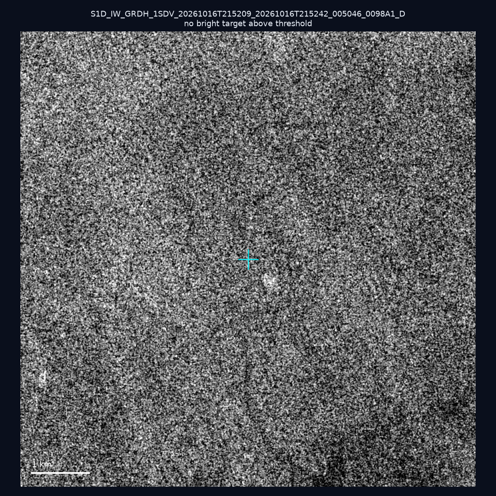
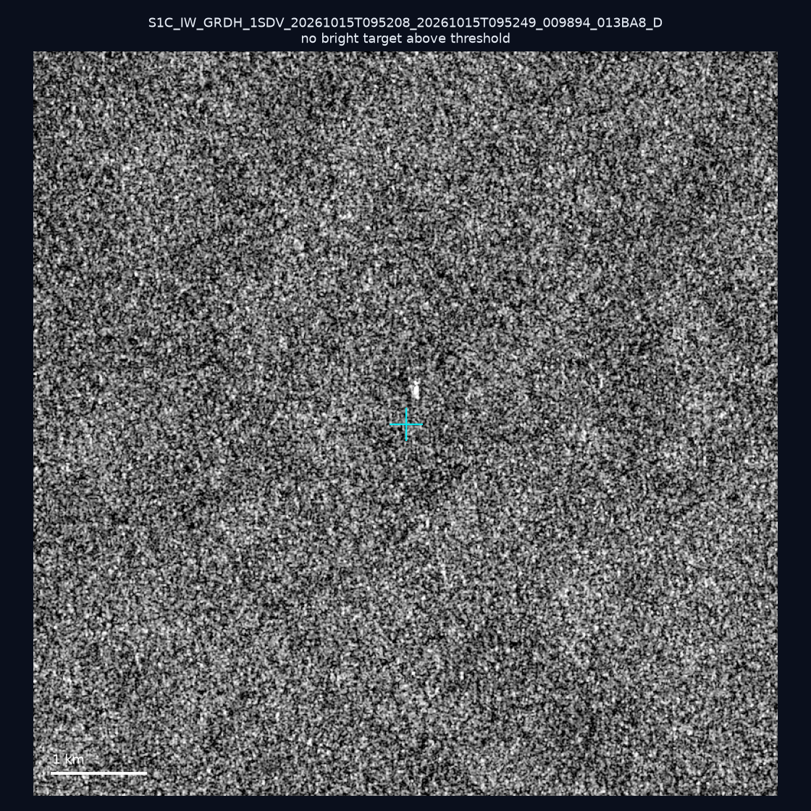
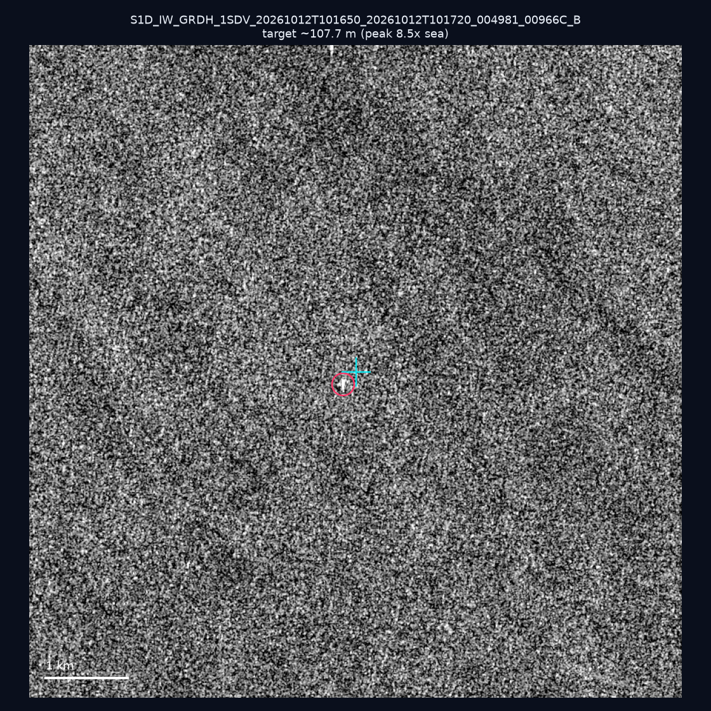
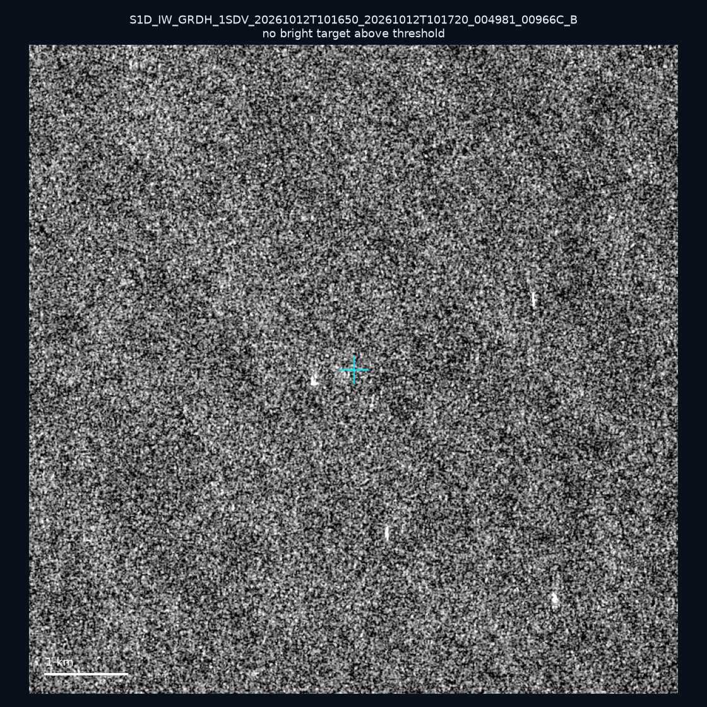
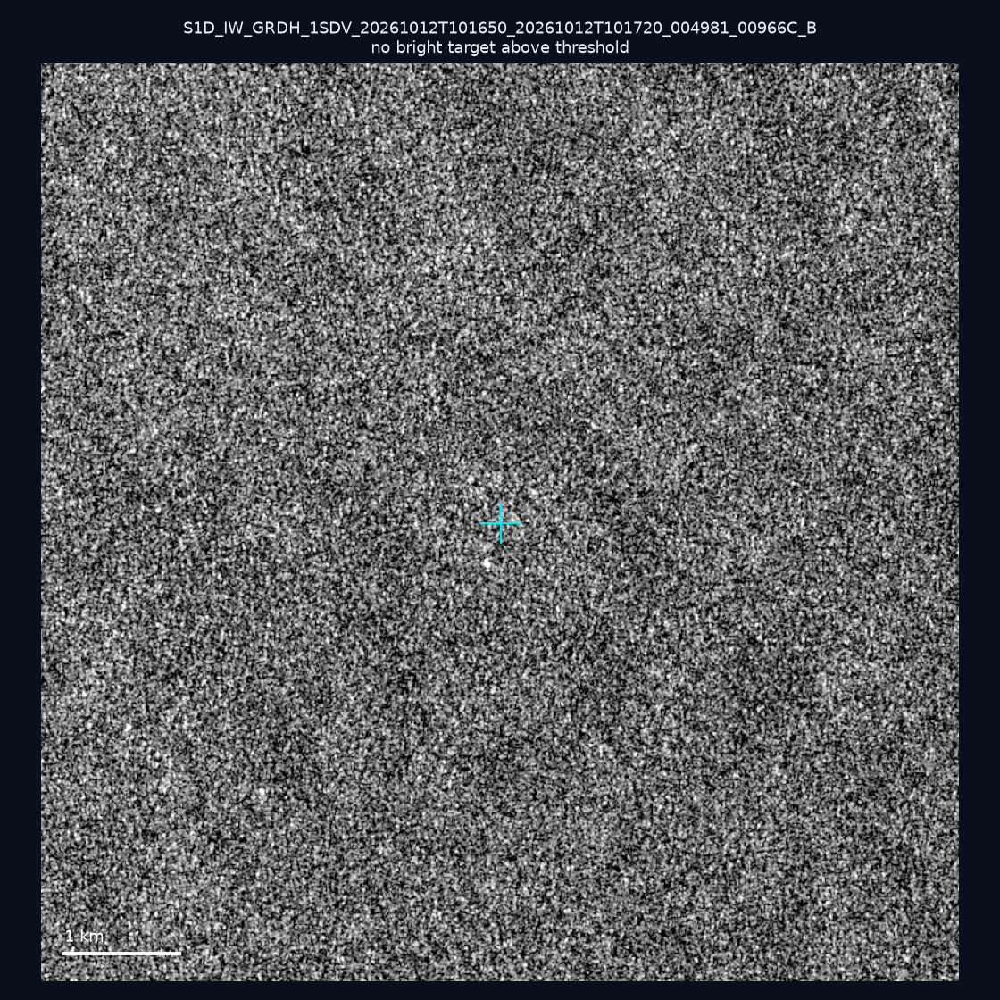
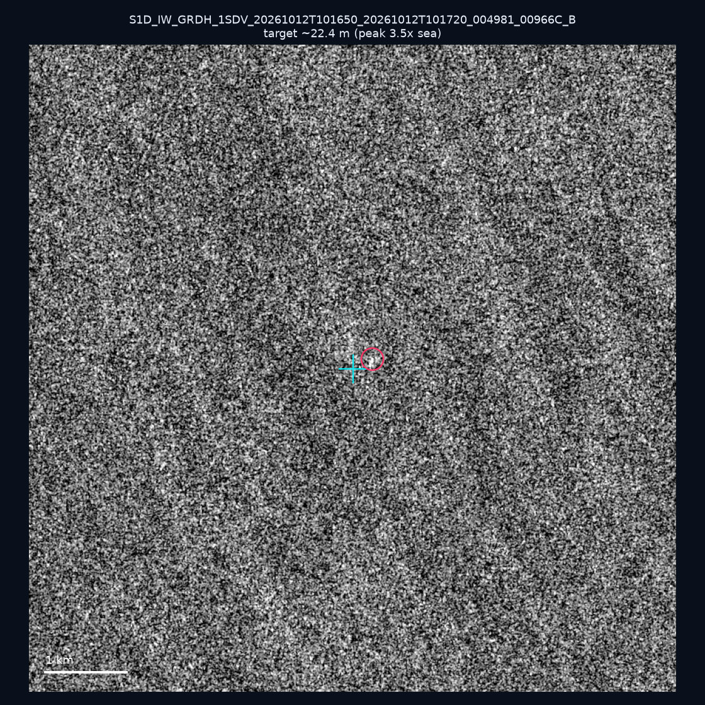
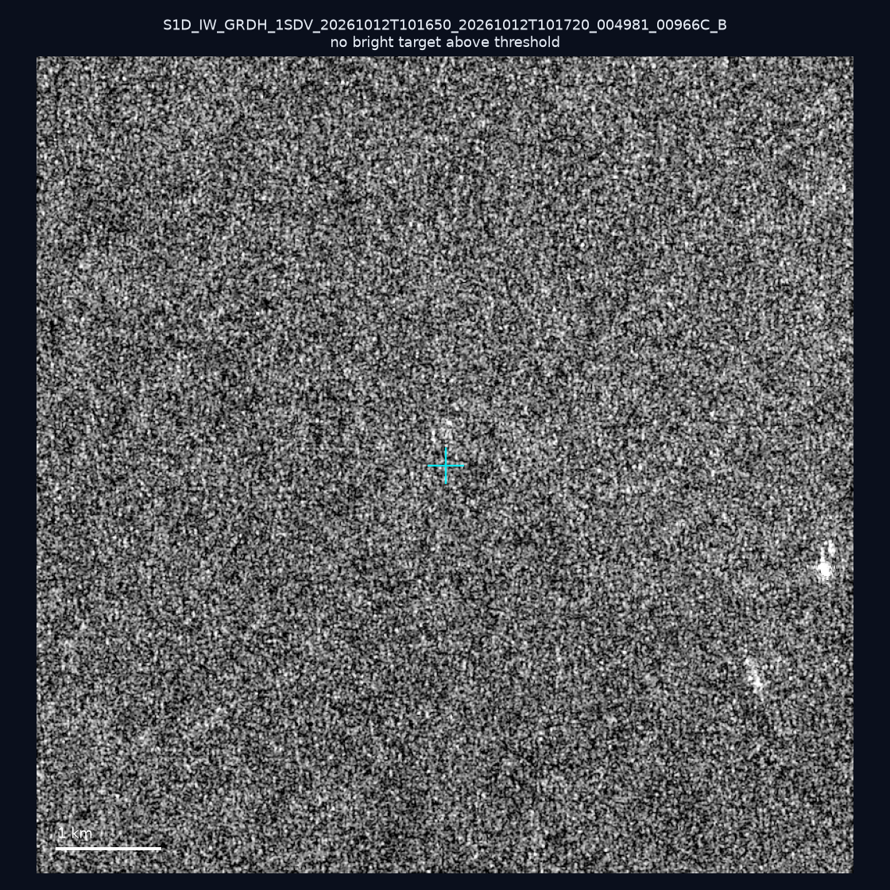
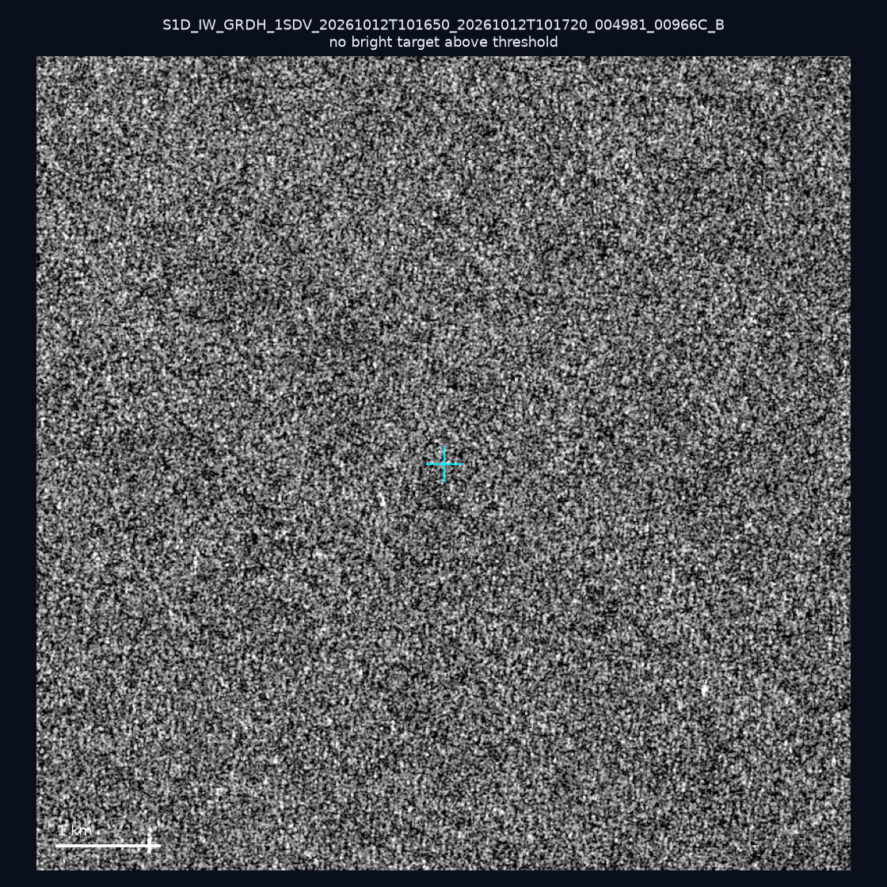
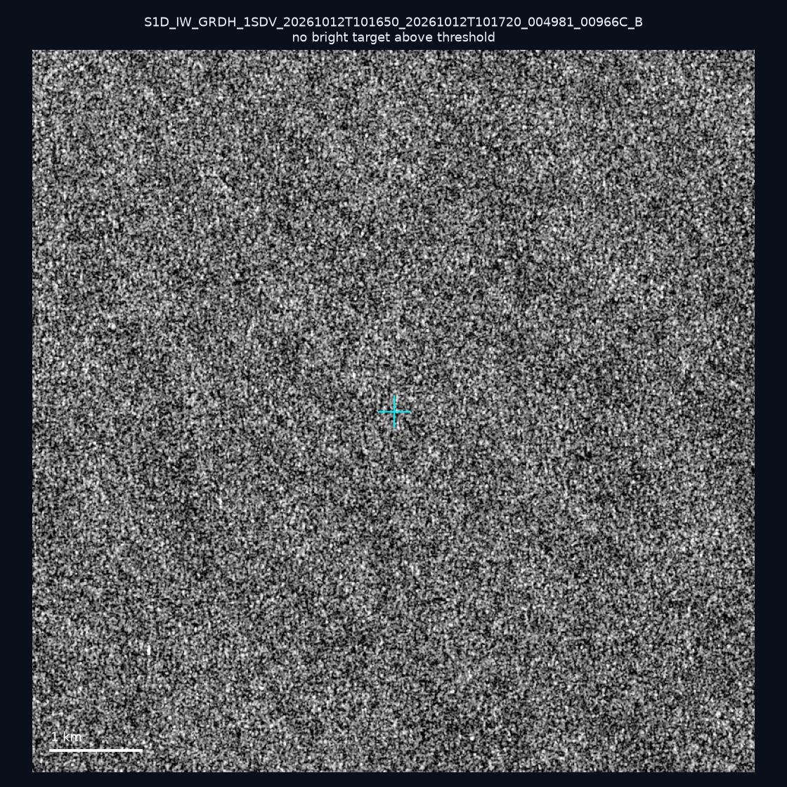
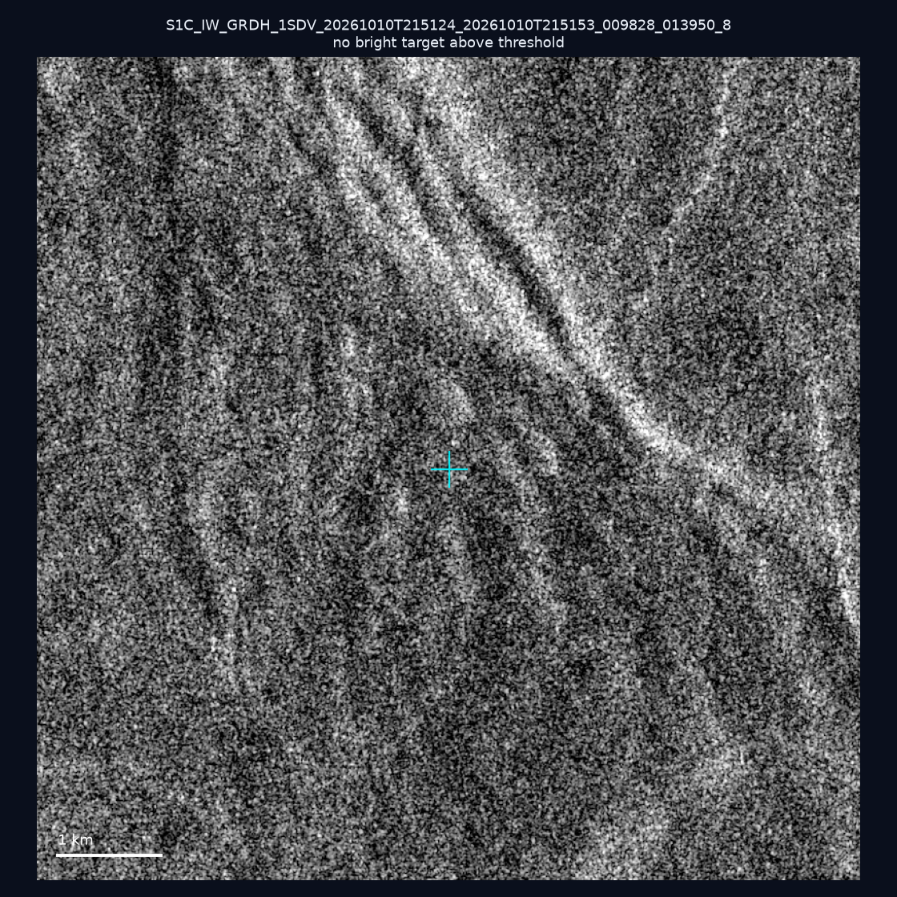

# 暗船 SAR 取證報告 — 2026-10-22

## 1. 總覽

- 執行時間：2026-10-22（GitHub Actions cron 自動執行）
- 線上比對摘要：暗偵測 15824 筆、殘餘暗船 10439 筆、假暗船剔除率 34.0%
- 本輪測試：10 筆
- 成功：10 筆
- 找到亮目標：2 筆
- 失敗：0 筆

## 2. 結果總表

| 日期 | 座標 | 海域 | 法域 | 成像時刻 | 判定 | 估計長度 | 峰值比 |
|------|------|------|------|----------|------|----------|--------|
| 2026-10-16 | 22.18, 119.73 | southwest | eez | 21:52:09 | ⚪ 無目標（雜訊或低RCS） | — | — |
| 2026-10-15 | 25.43, 121.84 | east | internal_waters | 09:52:08 | ⚪ 無目標（雜訊或低RCS） | — | — |
| 2026-10-12 | 23.34, 118.32 | southwest | eez | 10:16:50 | 🟡 弱目標 | ~107.7 m | 8.5× |
| 2026-10-12 | 22.98, 117.86 | southwest | eez | 10:16:50 | ⚪ 無目標（雜訊或低RCS） | — | — |
| 2026-10-12 | 22.87, 117.52 | southwest | eez | 10:16:50 | ⚪ 無目標（雜訊或低RCS） | — | — |
| 2026-10-12 | 23.12, 118.33 | southwest | eez | 10:16:50 | 🟡 弱目標 | ~22.4 m | 3.5× |
| 2026-10-12 | 23.07, 117.05 | southwest | eez | 10:16:50 | ⚪ 無目標（雜訊或低RCS） | — | — |
| 2026-10-12 | 22.72, 117.02 | southwest | eez | 10:16:50 | ⚪ 無目標（雜訊或低RCS） | — | — |
| 2026-10-12 | 22.83, 117.49 | southwest | eez | 10:16:50 | ⚪ 無目標（雜訊或低RCS） | — | — |
| 2026-10-10 | 24.92, 122.05 | east | territorial_sea | 21:51:24 | ⚪ 無目標（雜訊或低RCS） | — | — |

## 3. 逐目標段落

### 2026-10-16 (22.18, 119.73)

⚪ 無目標（雜訊或低RCS）。

### 2026-10-15 (25.43, 121.84)

⚪ 無目標（雜訊或低RCS）。

### 2026-10-12 (23.34, 118.32)

🟡 弱目標，估計長度 ~107.7 m，峰值 8.5× 海面背景（28 px）。

### 2026-10-12 (22.98, 117.86)

⚪ 無目標（雜訊或低RCS）。

### 2026-10-12 (22.87, 117.52)

⚪ 無目標（雜訊或低RCS）。

### 2026-10-12 (23.12, 118.33)

🟡 弱目標，估計長度 ~22.4 m，峰值 3.5× 海面背景（2 px）。

### 2026-10-12 (23.07, 117.05)

⚪ 無目標（雜訊或低RCS）。

### 2026-10-12 (22.72, 117.02)

⚪ 無目標（雜訊或低RCS）。

### 2026-10-12 (22.83, 117.49)

⚪ 無目標（雜訊或低RCS）。

### 2026-10-10 (24.92, 122.05)

⚪ 無目標（雜訊或低RCS）。

## 4. 後續建議

- 累積統計：全歷史 593 筆（有效 592 筆），確認實體目標 66 筆（11.1%）

> 所有結果是研判線索，不是法律認定；無目標 ≠ 誤報（小型木殼漁船 RCS 低，SAR 可能拍不到）。
