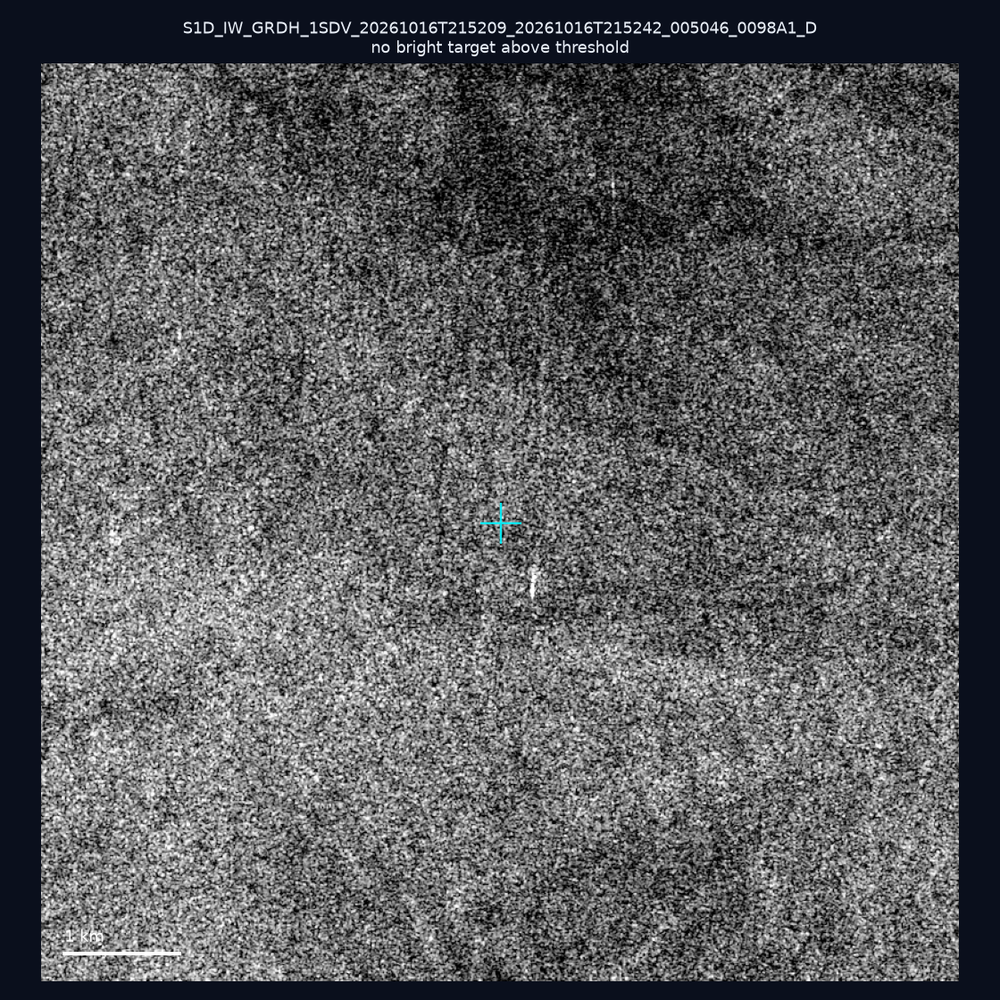
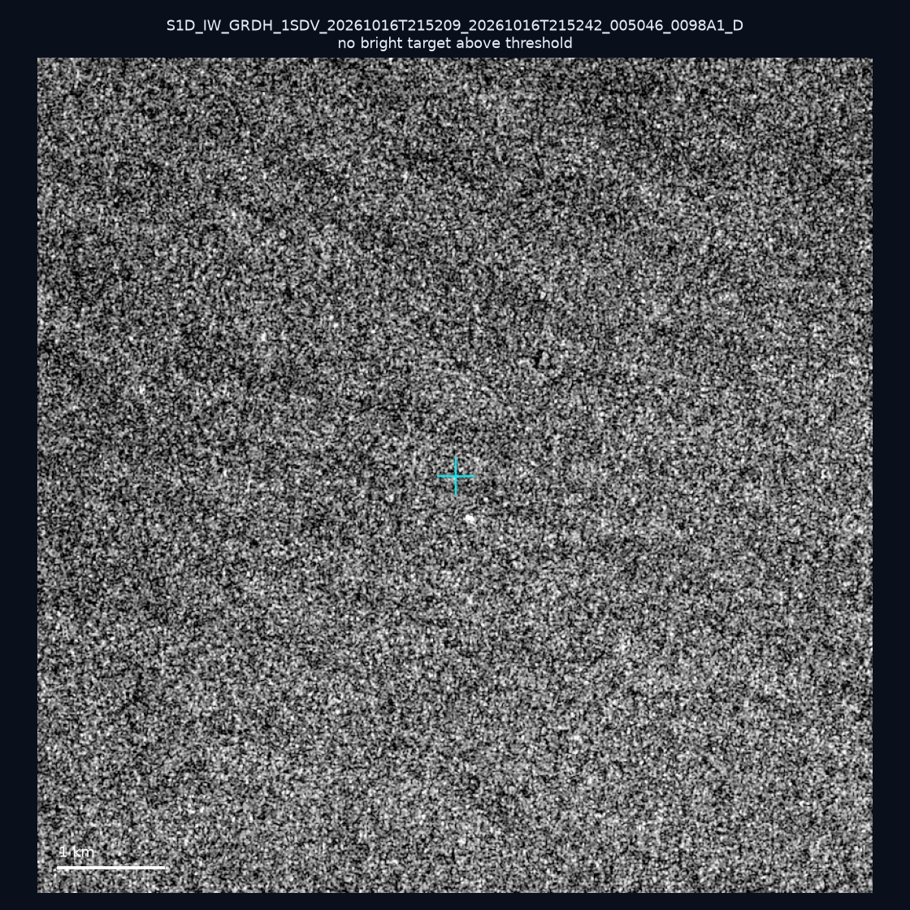
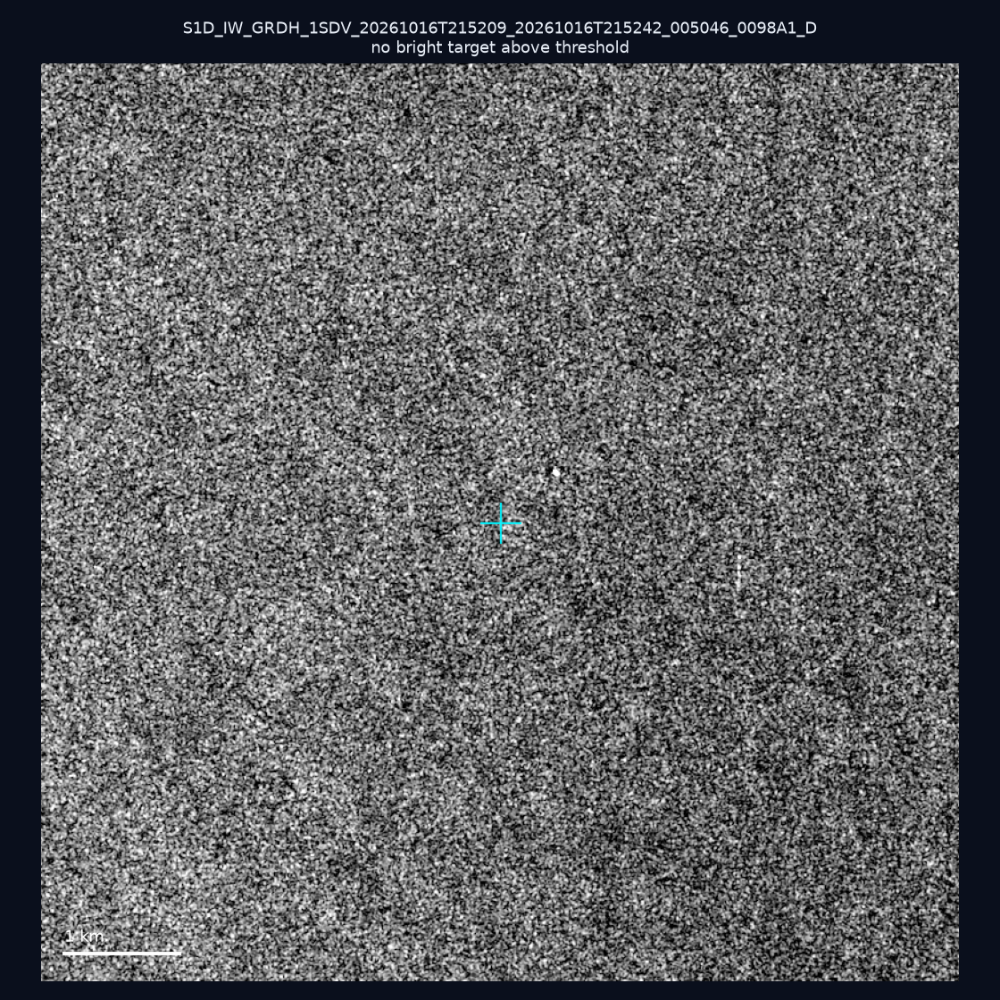
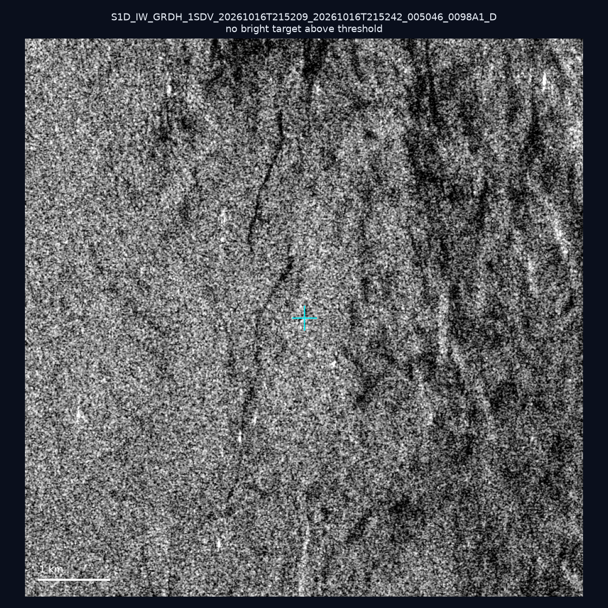
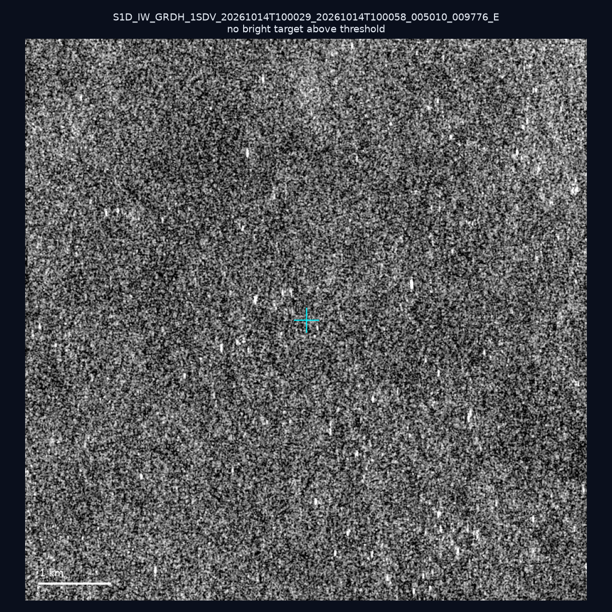
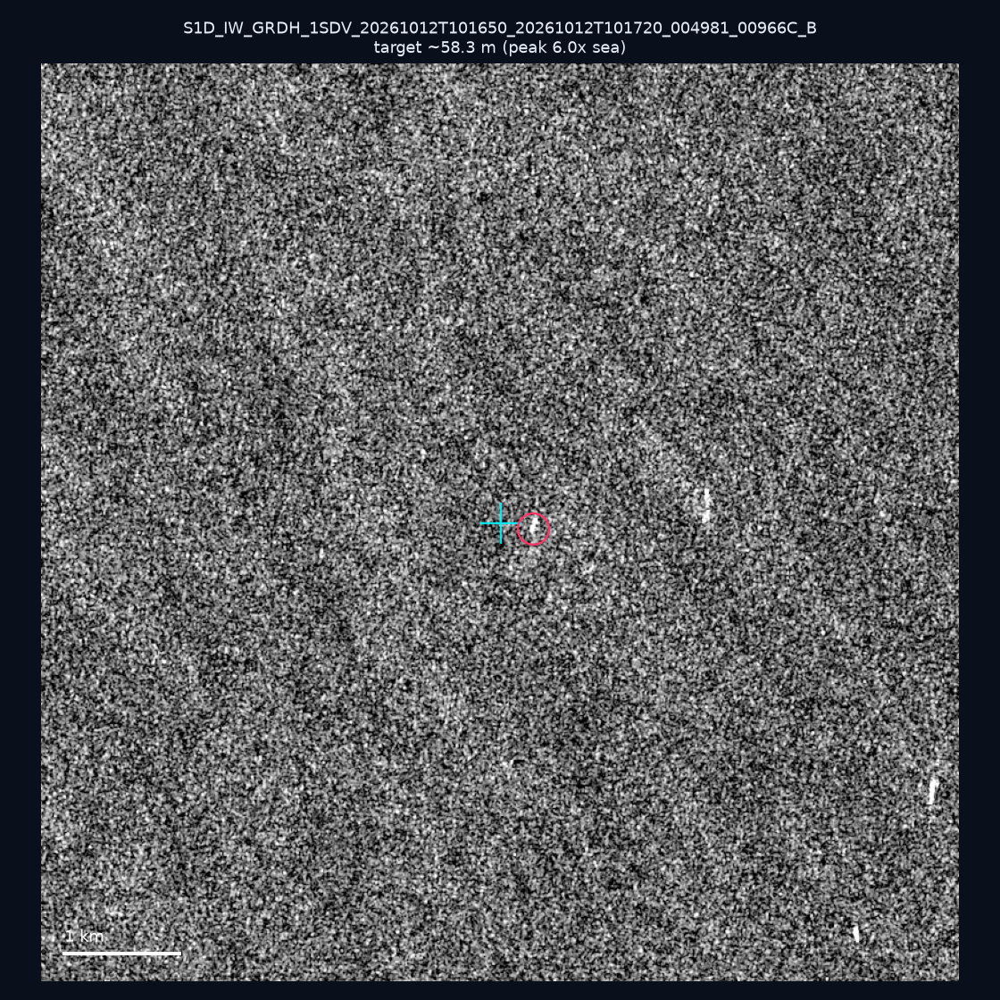
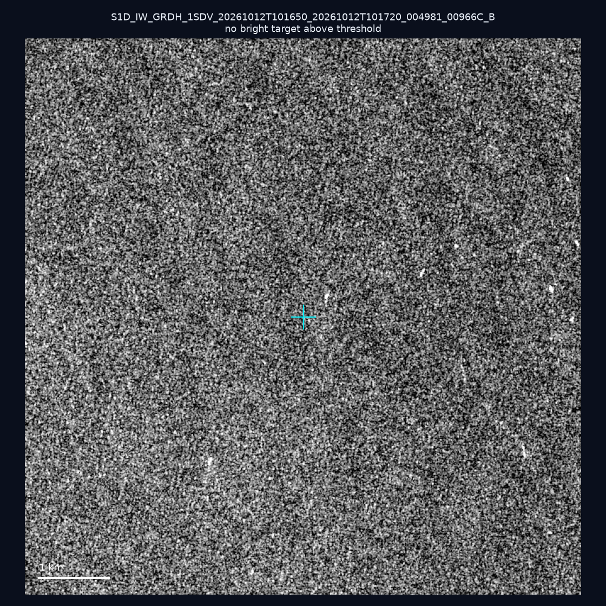
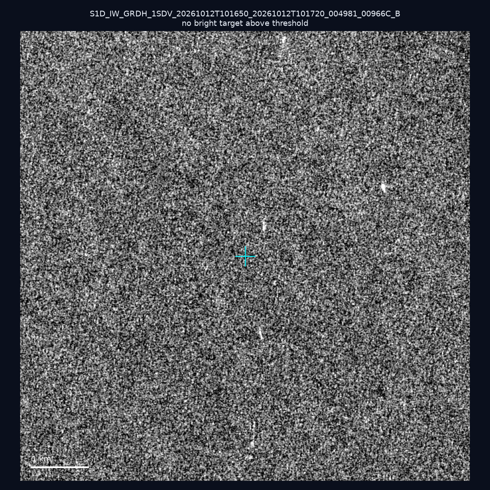
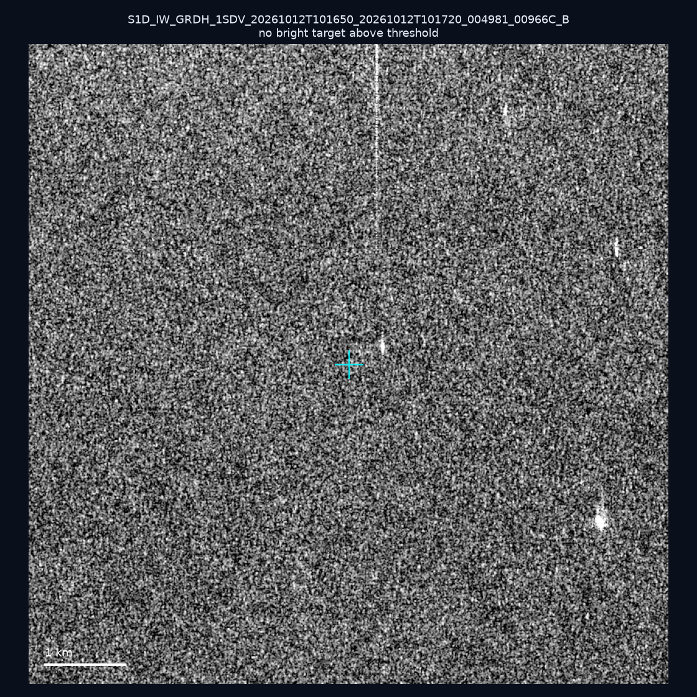
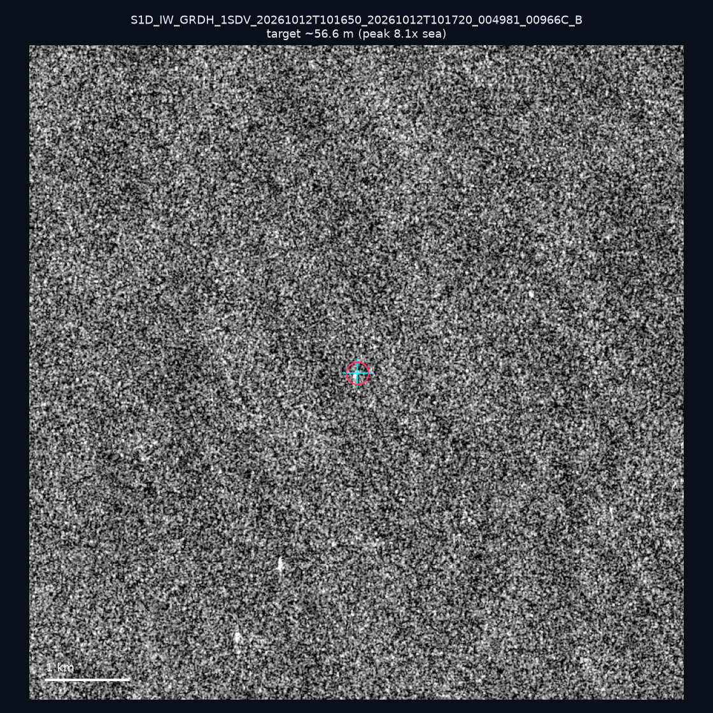

# 暗船 SAR 取證報告 — 2026-10-23

## 1. 總覽

- 執行時間：2026-10-23（GitHub Actions cron 自動執行）
- 線上比對摘要：暗偵測 14259 筆、殘餘暗船 9447 筆、假暗船剔除率 33.7%
- 本輪測試：10 筆
- 成功：10 筆
- 找到亮目標：2 筆
- 失敗：0 筆

## 2. 結果總表

| 日期 | 座標 | 海域 | 法域 | 成像時刻 | 判定 | 估計長度 | 峰值比 |
|------|------|------|------|----------|------|----------|--------|
| 2026-10-16 | 23.41, 119.62 | southwest | internal_waters | 21:52:09 | ⚪ 無目標（雜訊或低RCS） | — | — |
| 2026-10-16 | 21.87, 119.83 | southwest | eez | 21:52:09 | ⚪ 無目標（雜訊或低RCS） | — | — |
| 2026-10-16 | 22.71, 119.94 | southwest | internal_waters | 21:52:09 | ⚪ 無目標（雜訊或低RCS） | — | — |
| 2026-10-16 | 23.19, 119.98 | southwest | internal_waters | 21:52:09 | ⚪ 無目標（雜訊或低RCS） | — | — |
| 2026-10-14 | 24.34, 122.02 | east | territorial_sea | 10:00:29 | ⚪ 無目標（雜訊或低RCS） | — | — |
| 2026-10-12 | 23.16, 118.24 | southwest | eez | 10:16:50 | 🟡 弱目標 | ~58.3 m | 6.0× |
| 2026-10-12 | 23.21, 117.99 | southwest | eez | 10:16:50 | ⚪ 無目標（雜訊或低RCS） | — | — |
| 2026-10-12 | 23.26, 117.96 | southwest | eez | 10:16:50 | ⚪ 無目標（雜訊或低RCS） | — | — |
| 2026-10-12 | 23.06, 117.4 | southwest | eez | 10:16:50 | ⚪ 無目標（雜訊或低RCS） | — | — |
| 2026-10-12 | 23.02, 118.03 | southwest | eez | 10:16:50 | 🟡 弱目標 | ~56.6 m | 8.1× |

## 3. 逐目標段落

### 2026-10-16 (23.41, 119.62)

⚪ 無目標（雜訊或低RCS）。

### 2026-10-16 (21.87, 119.83)

⚪ 無目標（雜訊或低RCS）。

### 2026-10-16 (22.71, 119.94)

⚪ 無目標（雜訊或低RCS）。

### 2026-10-16 (23.19, 119.98)

⚪ 無目標（雜訊或低RCS）。

### 2026-10-14 (24.34, 122.02)

⚪ 無目標（雜訊或低RCS）。

### 2026-10-12 (23.16, 118.24)

🟡 弱目標，估計長度 ~58.3 m，峰值 6.0× 海面背景（14 px）。

### 2026-10-12 (23.21, 117.99)

⚪ 無目標（雜訊或低RCS）。

### 2026-10-12 (23.26, 117.96)

⚪ 無目標（雜訊或低RCS）。

### 2026-10-12 (23.06, 117.4)

⚪ 無目標（雜訊或低RCS）。

### 2026-10-12 (23.02, 118.03)

🟡 弱目標，估計長度 ~56.6 m，峰值 8.1× 海面背景（13 px）。

## 4. 後續建議

- 累積統計：全歷史 603 筆（有效 602 筆），確認實體目標 66 筆（11.0%）

> 所有結果是研判線索，不是法律認定；無目標 ≠ 誤報（小型木殼漁船 RCS 低，SAR 可能拍不到）。
