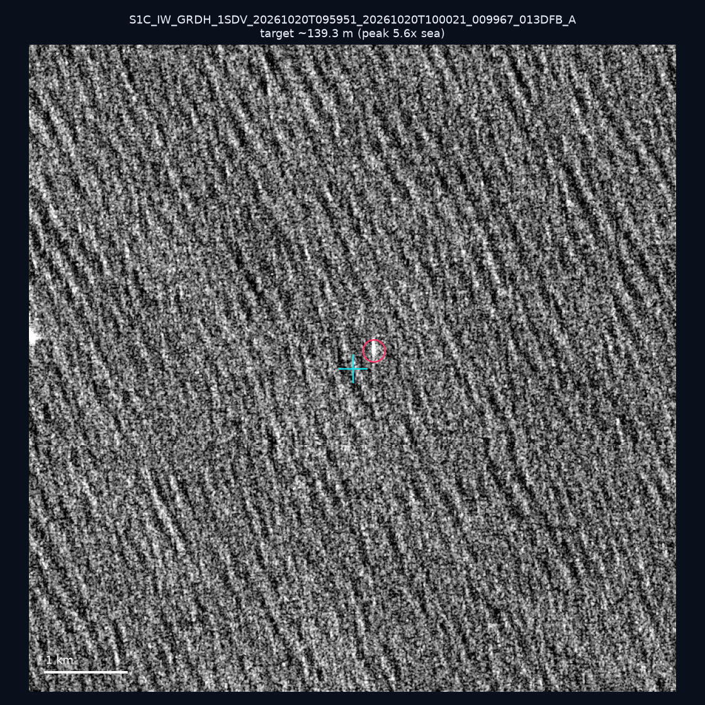
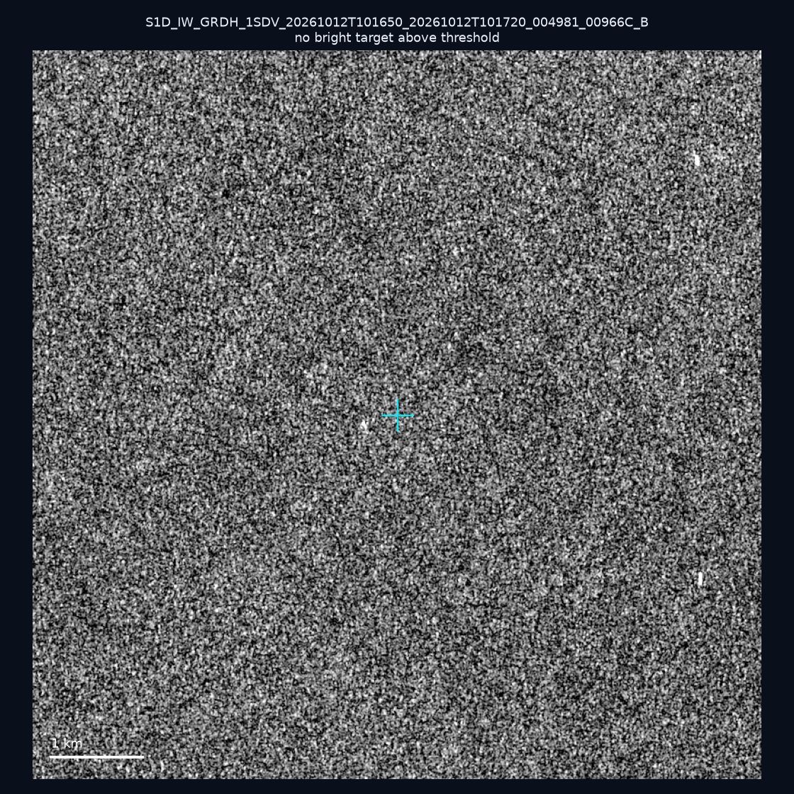
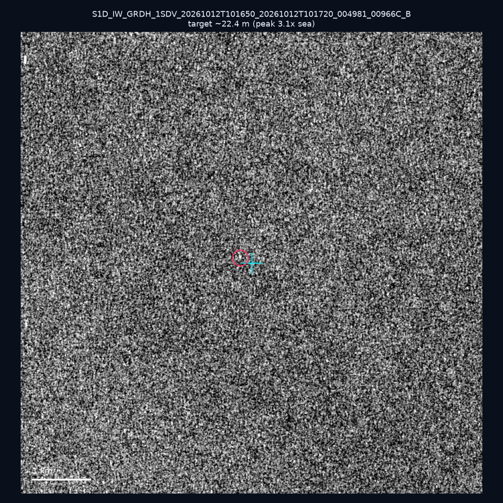
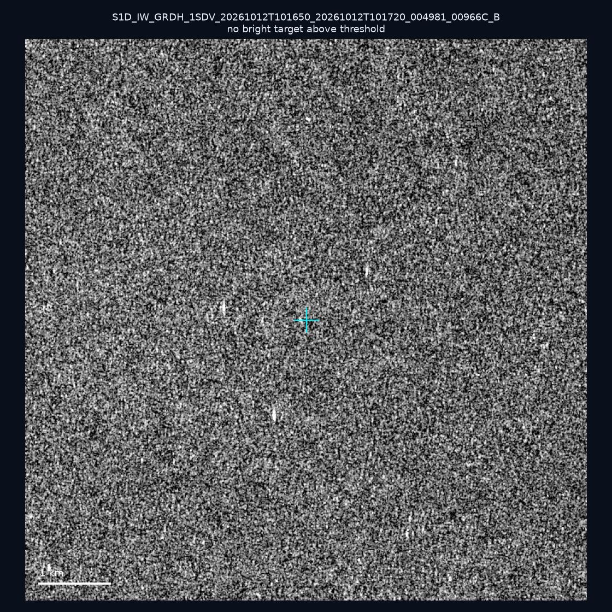
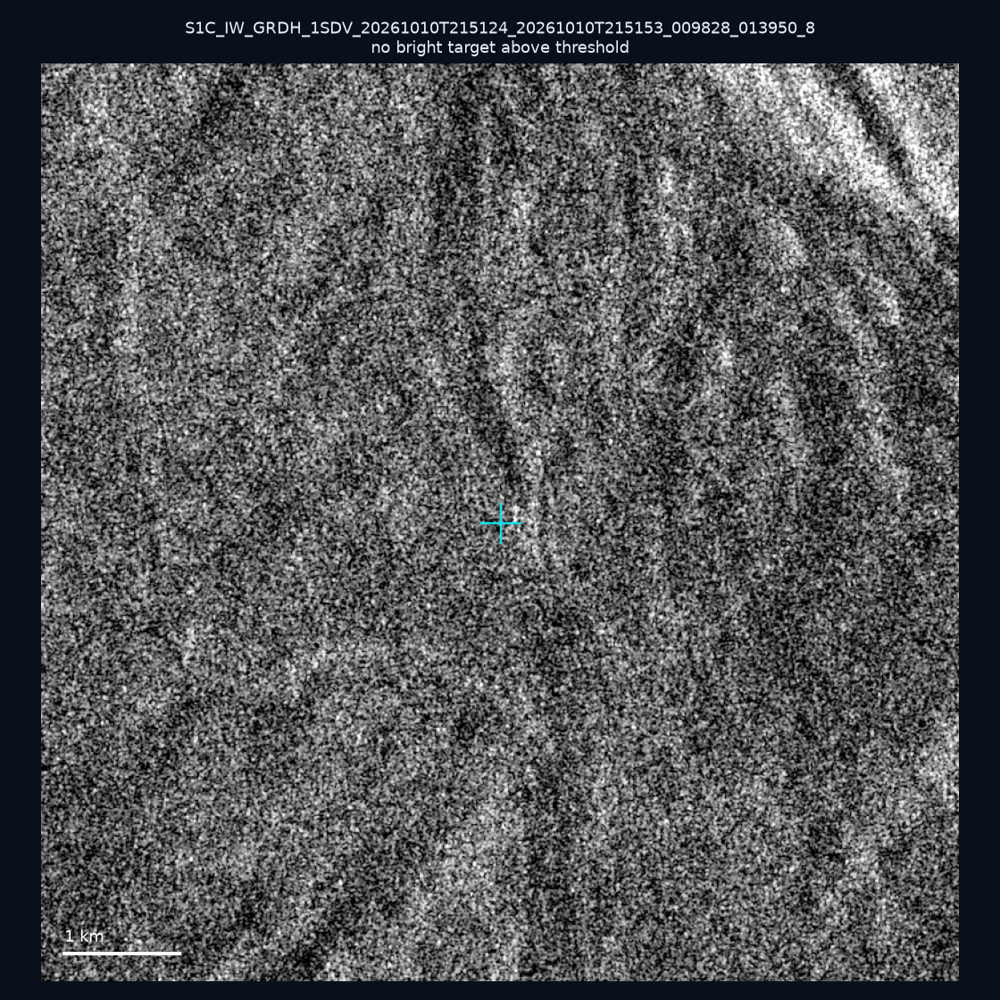
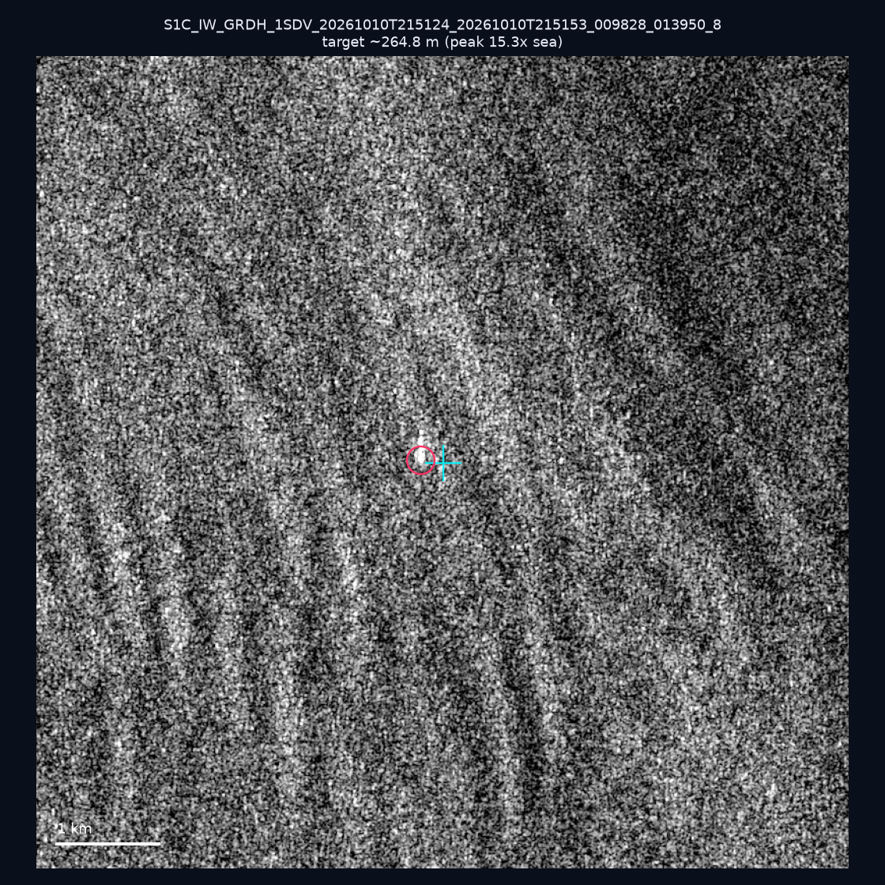
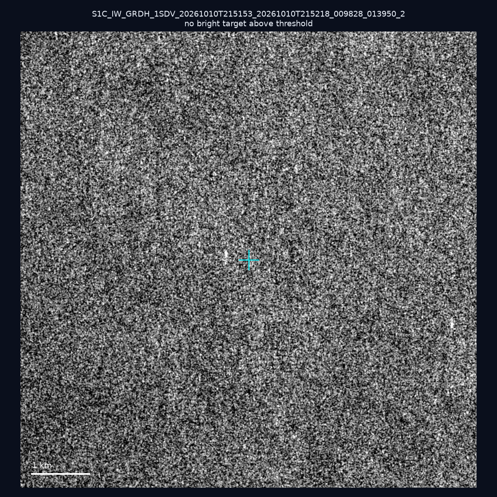
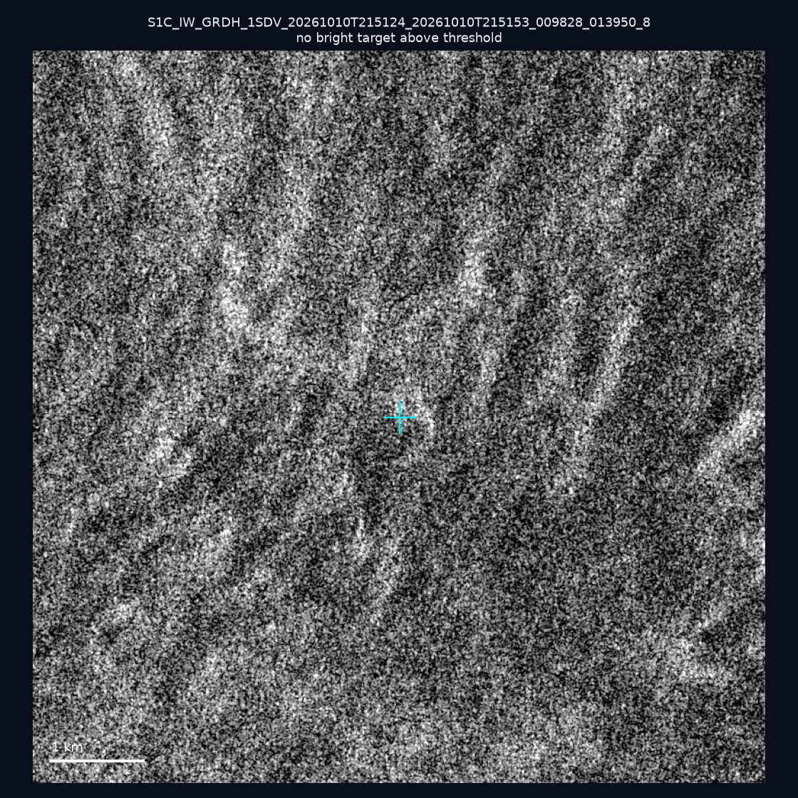
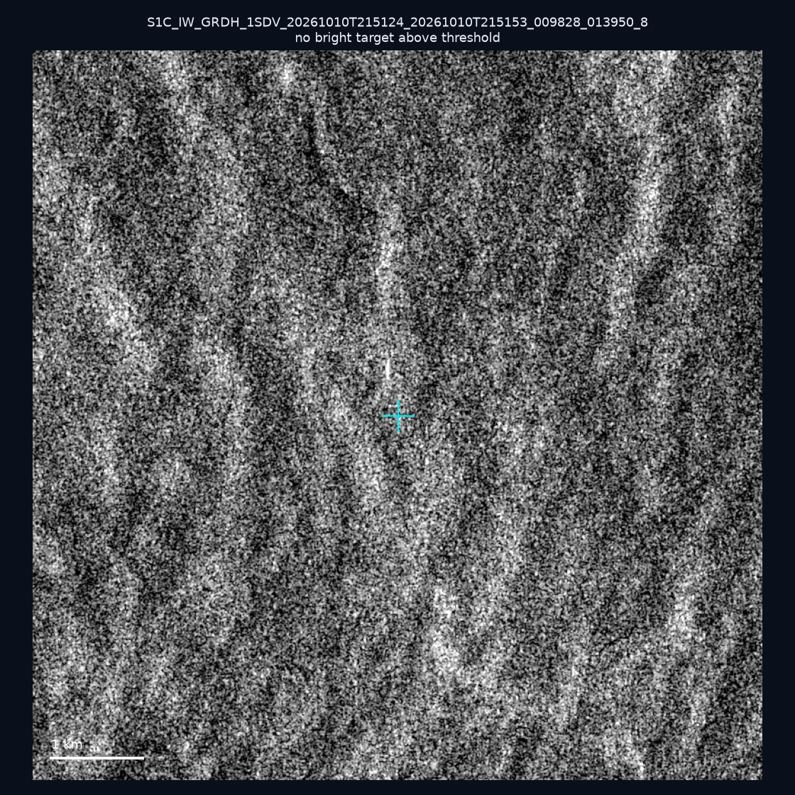
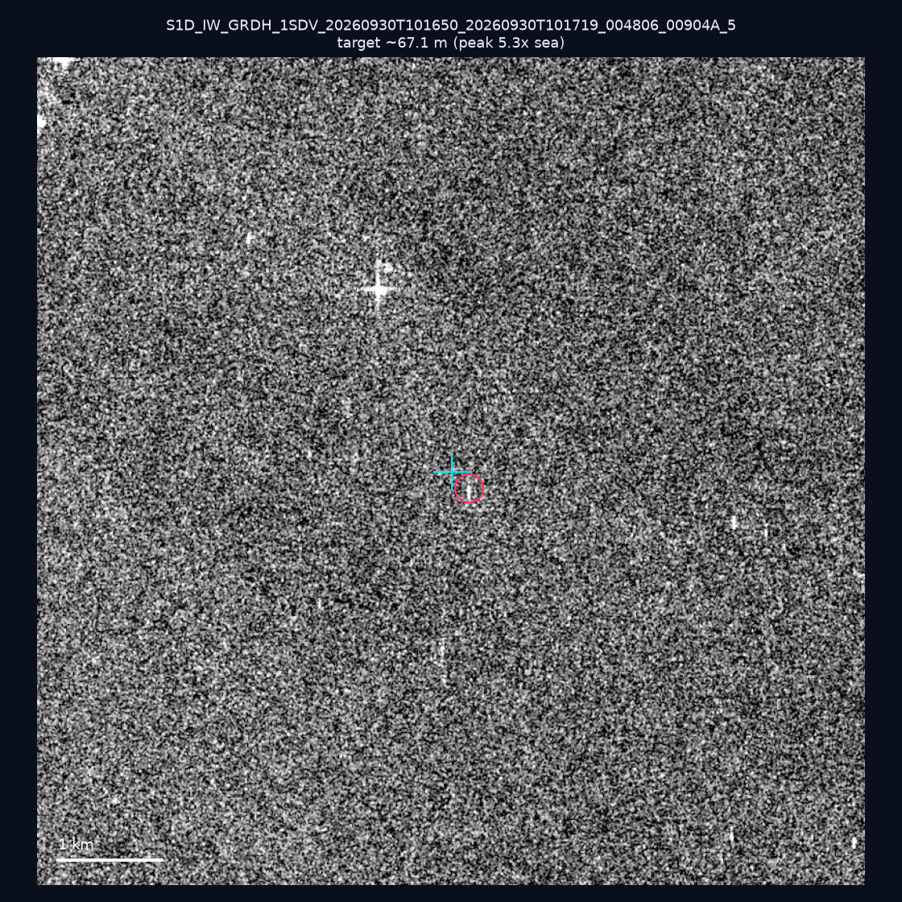

# 暗船 SAR 取證報告 — 2026-10-24

## 1. 總覽

- 執行時間：2026-10-24（GitHub Actions cron 自動執行）
- 線上比對摘要：暗偵測 14407 筆、殘餘暗船 9551 筆、假暗船剔除率 33.7%
- 本輪測試：10 筆
- 成功：10 筆
- 找到亮目標：4 筆
- 失敗：0 筆

## 2. 結果總表

| 日期 | 座標 | 海域 | 法域 | 成像時刻 | 判定 | 估計長度 | 峰值比 |
|------|------|------|------|----------|------|----------|--------|
| 2026-10-20 | 22.4, 122.37 | east | eez | 09:59:51 | 🟡 弱目標 | ~139.3 m | 5.6× |
| 2026-10-12 | 23.12, 117.36 | southwest | eez | 10:16:50 | ⚪ 無目標（雜訊或低RCS） | — | — |
| 2026-10-12 | 23.18, 117.42 | southwest | eez | 10:16:50 | 🟡 弱目標 | ~22.4 m | 3.1× |
| 2026-10-12 | 23.04, 117.54 | southwest | eez | 10:16:50 | ⚪ 無目標（雜訊或低RCS） | — | — |
| 2026-10-10 | 24.9, 122.07 | east | territorial_sea | 21:51:24 | ⚪ 無目標（雜訊或低RCS） | — | — |
| 2026-10-10 | 24.87, 122.2 | east | contiguous_zone | 21:51:24 | ✅ 確認實體目標 | ~264.8 m | 15.3× |
| 2026-10-10 | 22.78, 119.62 | southwest | territorial_sea | 21:51:53 | ⚪ 無目標（雜訊或低RCS） | — | — |
| 2026-10-10 | 25.34, 121.93 | east | internal_waters | 21:51:24 | ⚪ 無目標（雜訊或低RCS） | — | — |
| 2026-10-10 | 25.37, 121.96 | east | internal_waters | 21:51:24 | ⚪ 無目標（雜訊或低RCS） | — | — |
| 2026-09-30 | 23.4, 117.38 | southwest | eez | 10:16:50 | 🟡 弱目標 | ~67.1 m | 5.3× |

## 3. 逐目標段落

### 2026-10-20 (22.4, 122.37)

🟡 弱目標，估計長度 ~139.3 m，峰值 5.6× 海面背景（38 px）。

### 2026-10-12 (23.12, 117.36)

⚪ 無目標（雜訊或低RCS）。

### 2026-10-12 (23.18, 117.42)

🟡 弱目標，估計長度 ~22.4 m，峰值 3.1× 海面背景（2 px）。

### 2026-10-12 (23.04, 117.54)

⚪ 無目標（雜訊或低RCS）。

### 2026-10-10 (24.9, 122.07)

⚪ 無目標（雜訊或低RCS）。

### 2026-10-10 (24.87, 122.2)

✅ 確認實體目標，估計長度 ~264.8 m，峰值 15.3× 海面背景（81 px）。

### 2026-10-10 (22.78, 119.62)

⚪ 無目標（雜訊或低RCS）。

### 2026-10-10 (25.34, 121.93)

⚪ 無目標（雜訊或低RCS）。

### 2026-10-10 (25.37, 121.96)

⚪ 無目標（雜訊或低RCS）。

### 2026-09-30 (23.4, 117.38)

🟡 弱目標，估計長度 ~67.1 m，峰值 5.3× 海面背景（14 px）。

## 4. 後續建議

- 值得人工深查（確認實體目標且長度 ≥ 50m）：
  - 2026-10-10 (24.87, 122.2) ~264.8 m — 建議比對周邊 AIS 船長
- 累積統計：全歷史 613 筆（有效 612 筆），確認實體目標 67 筆（10.9%）

> 所有結果是研判線索，不是法律認定；無目標 ≠ 誤報（小型木殼漁船 RCS 低，SAR 可能拍不到）。
