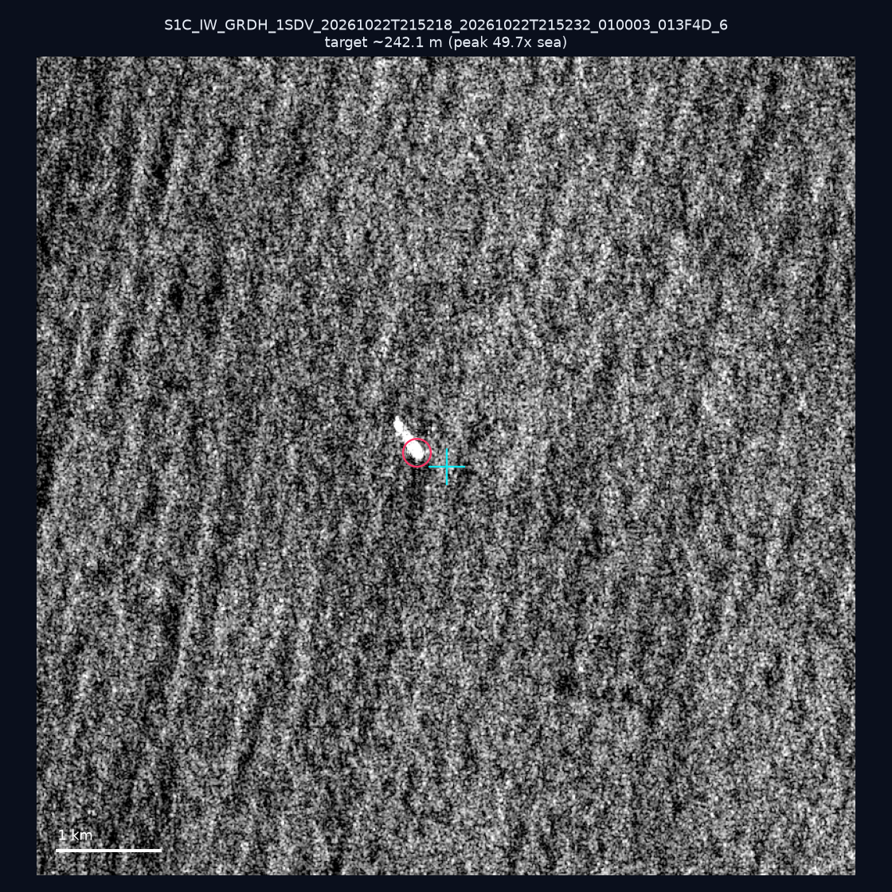
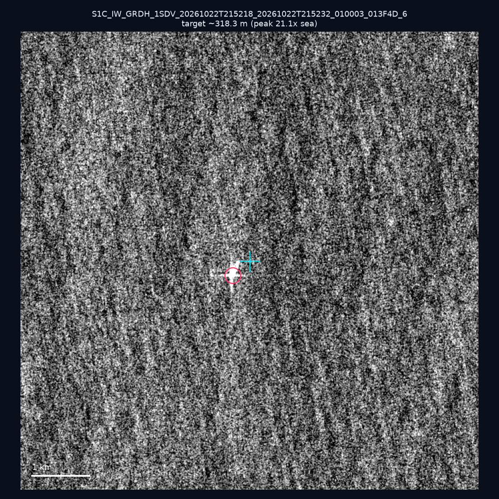
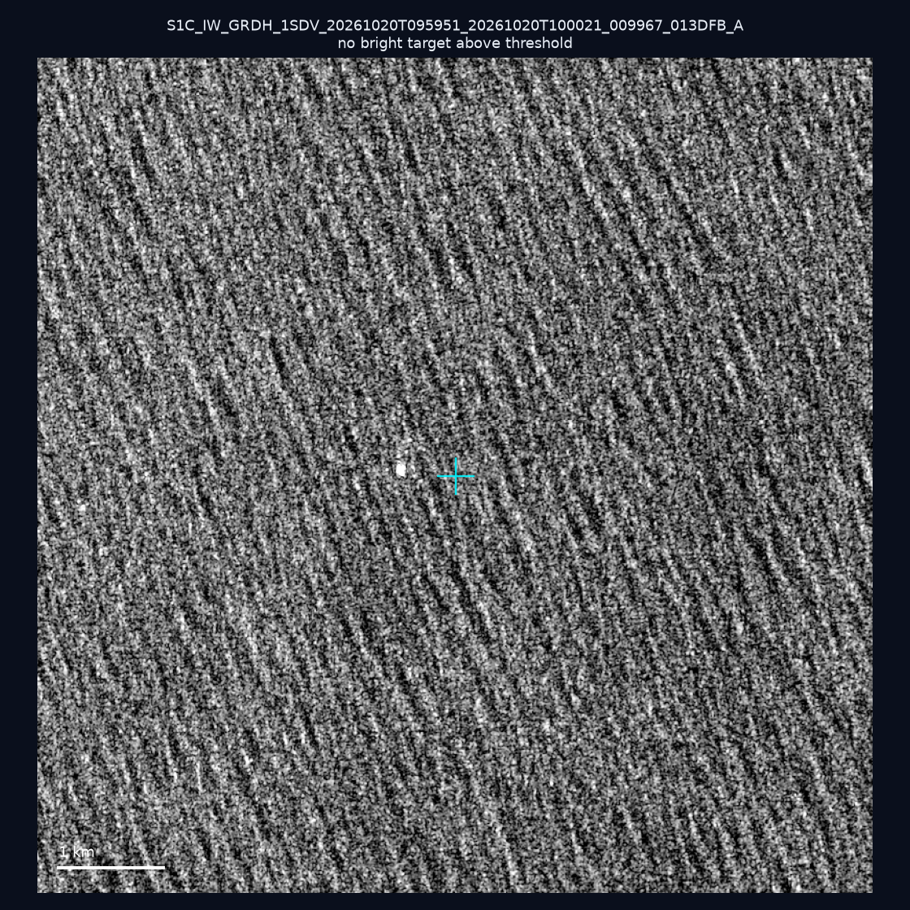
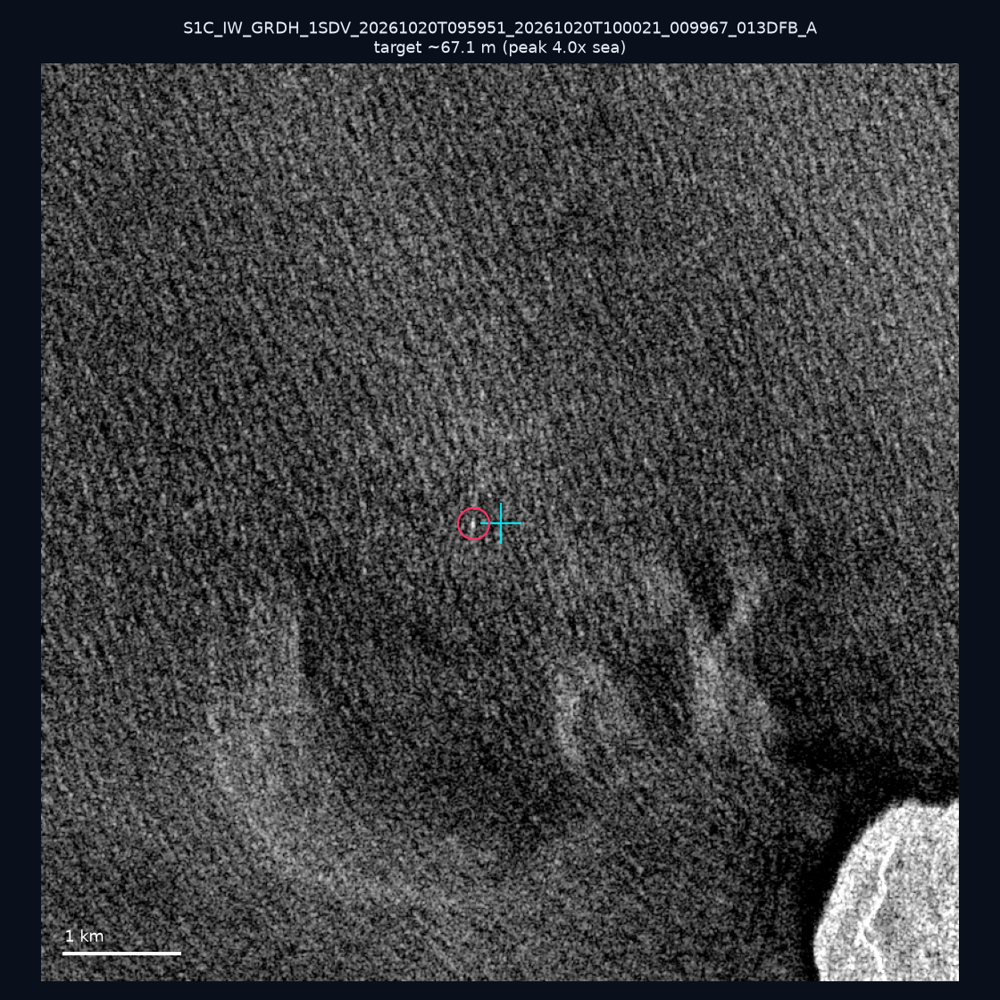
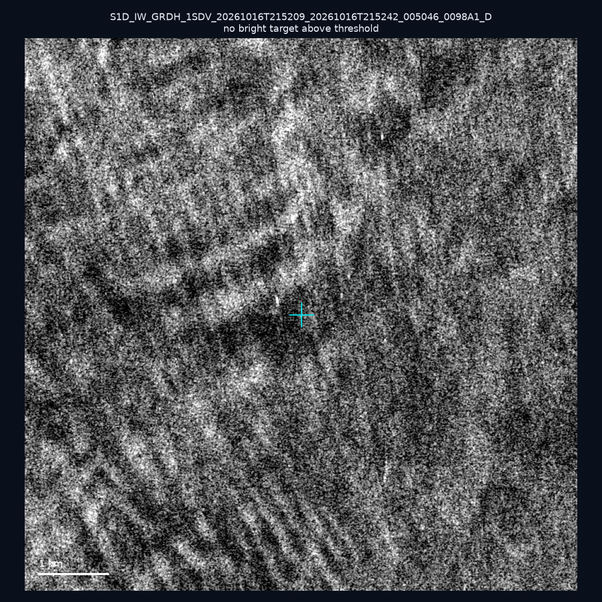
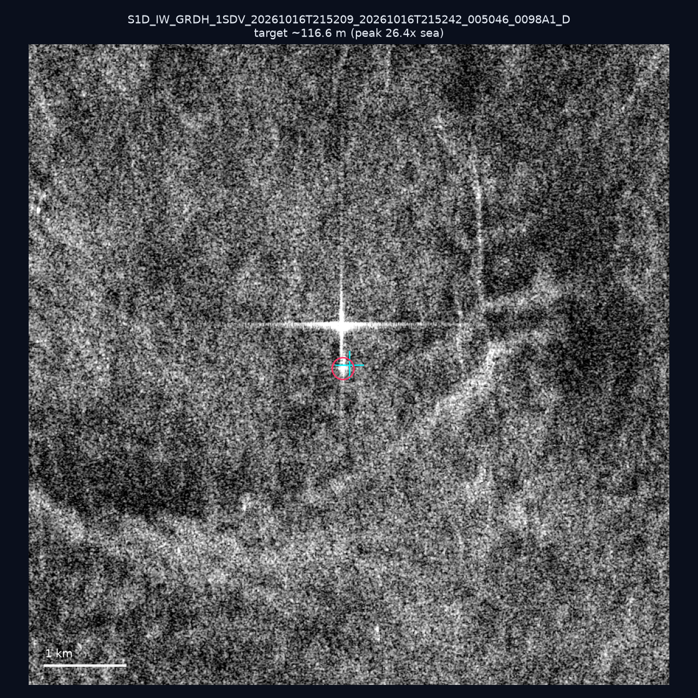
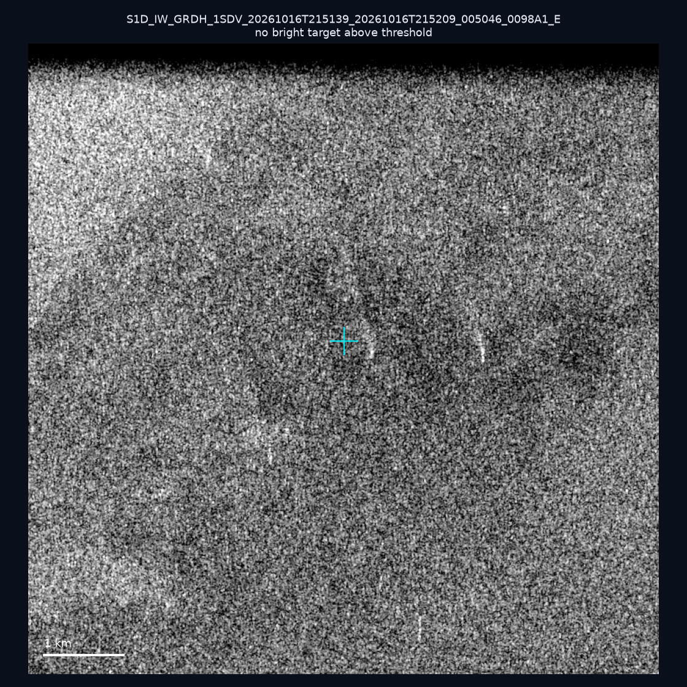
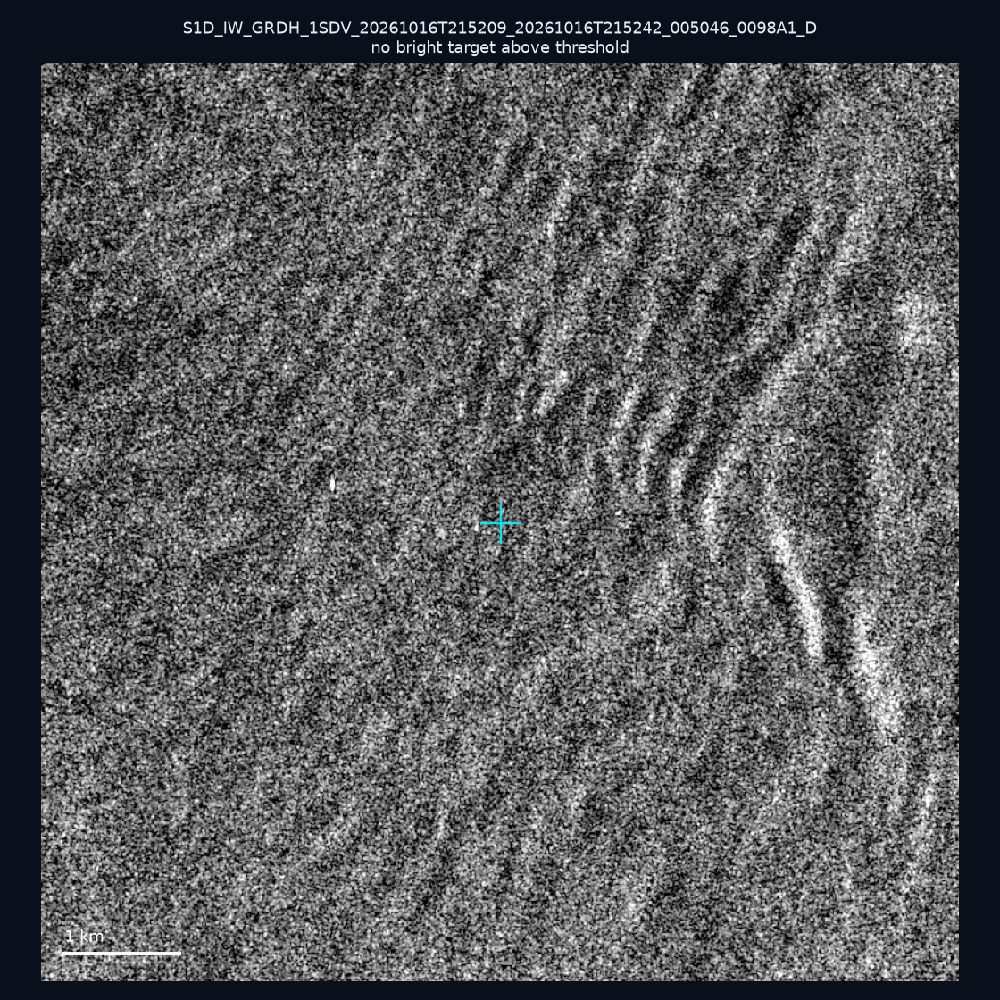
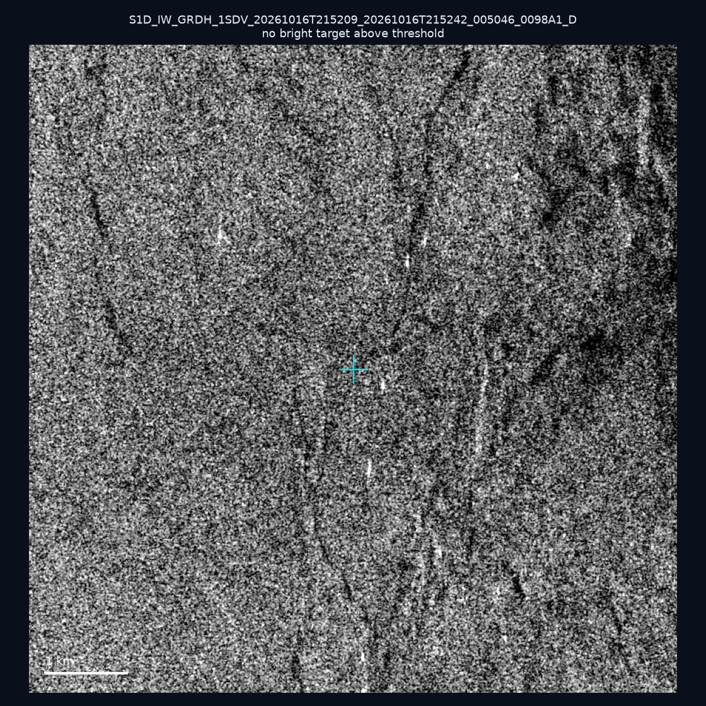
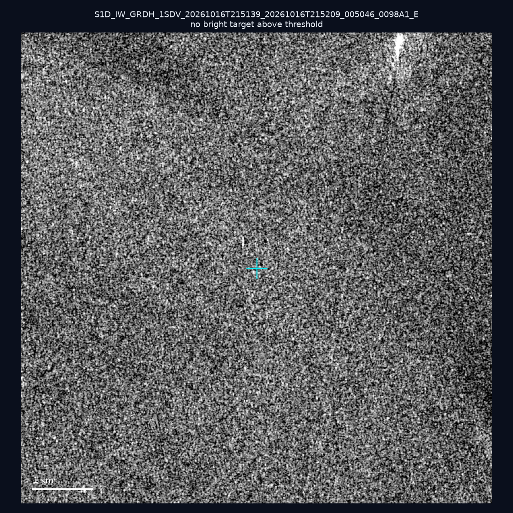

# 暗船 SAR 取證報告 — 2026-10-25

## 1. 總覽

- 執行時間：2026-10-25（GitHub Actions cron 自動執行）
- 線上比對摘要：暗偵測 15149 筆、殘餘暗船 9855 筆、假暗船剔除率 34.9%
- 本輪測試：10 筆
- 成功：10 筆
- 找到亮目標：4 筆
- 失敗：0 筆

## 2. 結果總表

| 日期 | 座標 | 海域 | 法域 | 成像時刻 | 判定 | 估計長度 | 峰值比 |
|------|------|------|------|----------|------|----------|--------|
| 2026-10-22 | 21.78, 119.61 | southwest | eez | 21:52:18 | ✅ 確認實體目標 | ~242.1 m | 49.7× |
| 2026-10-22 | 22.21, 119.42 | southwest | eez | 21:52:18 | ✅ 確認實體目標 | ~318.3 m | 21.1× |
| 2026-10-20 | 21.85, 122.09 | east | eez | 09:59:51 | ⚪ 無目標（雜訊或低RCS） | — | — |
| 2026-10-20 | 21.89, 120.7 | southwest | territorial_sea | 09:59:51 | 🟡 弱目標 | ~67.1 m | 4.0× |
| 2026-10-16 | 23.2, 119.82 | southwest | internal_waters | 21:52:09 | ⚪ 無目標（雜訊或低RCS） | — | — |
| 2026-10-16 | 23.15, 119.76 | southwest | internal_waters | 21:52:09 | ✅ 確認實體目標 | ~116.6 m | 26.4× |
| 2026-10-16 | 25.33, 121.84 | east | internal_waters | 21:51:39 | ⚪ 無目標（雜訊或低RCS） | — | — |
| 2026-10-16 | 22.88, 119.69 | southwest | territorial_sea | 21:52:09 | ⚪ 無目標（雜訊或低RCS） | — | — |
| 2026-10-16 | 23.16, 119.99 | southwest | internal_waters | 21:52:09 | ⚪ 無目標（雜訊或低RCS） | — | — |
| 2026-10-16 | 24.52, 122.05 | east | territorial_sea | 21:51:39 | ⚪ 無目標（雜訊或低RCS） | — | — |

## 3. 逐目標段落

### 2026-10-22 (21.78, 119.61)

✅ 確認實體目標，估計長度 ~242.1 m，峰值 49.7× 海面背景（131 px）。

### 2026-10-22 (22.21, 119.42)

✅ 確認實體目標，估計長度 ~318.3 m，峰值 21.1× 海面背景（222 px）。

### 2026-10-20 (21.85, 122.09)

⚪ 無目標（雜訊或低RCS）。

### 2026-10-20 (21.89, 120.7)

🟡 弱目標，估計長度 ~67.1 m，峰值 4.0× 海面背景（10 px）。

### 2026-10-16 (23.2, 119.82)

⚪ 無目標（雜訊或低RCS）。

### 2026-10-16 (23.15, 119.76)

✅ 確認實體目標，估計長度 ~116.6 m，峰值 26.4× 海面背景（50 px）。

### 2026-10-16 (25.33, 121.84)

⚪ 無目標（雜訊或低RCS）。

### 2026-10-16 (22.88, 119.69)

⚪ 無目標（雜訊或低RCS）。

### 2026-10-16 (23.16, 119.99)

⚪ 無目標（雜訊或低RCS）。

### 2026-10-16 (24.52, 122.05)

⚪ 無目標（雜訊或低RCS）。

## 4. 後續建議

- 值得人工深查（確認實體目標且長度 ≥ 50m）：
  - 2026-10-22 (21.78, 119.61) ~242.1 m — 建議比對周邊 AIS 船長
  - 2026-10-22 (22.21, 119.42) ~318.3 m — 建議比對周邊 AIS 船長
  - 2026-10-16 (23.15, 119.76) ~116.6 m — 建議比對周邊 AIS 船長
- 累積統計：全歷史 633 筆（有效 632 筆），確認實體目標 71 筆（11.2%）

> 所有結果是研判線索，不是法律認定；無目標 ≠ 誤報（小型木殼漁船 RCS 低，SAR 可能拍不到）。
