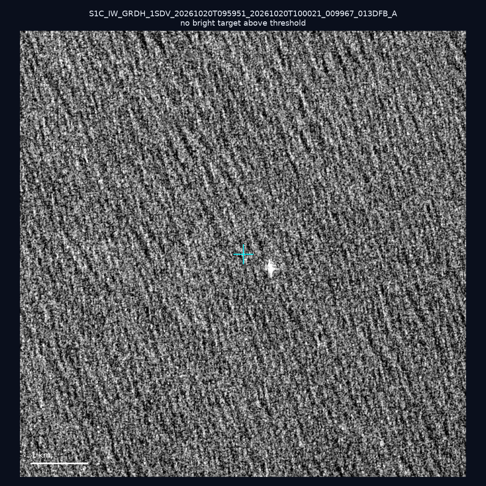
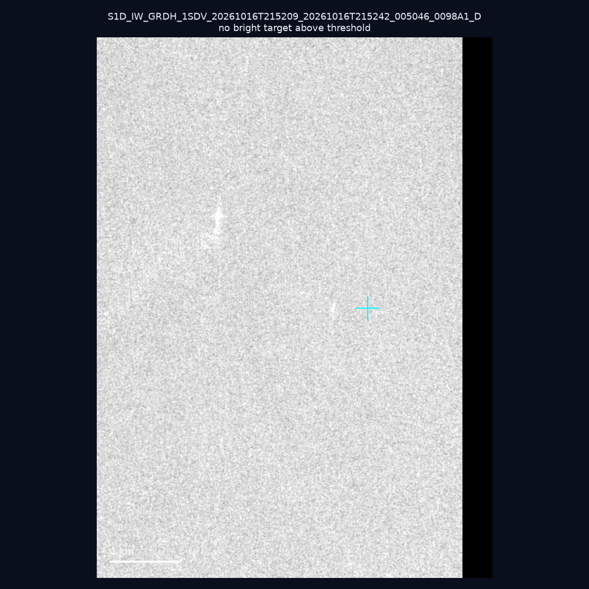
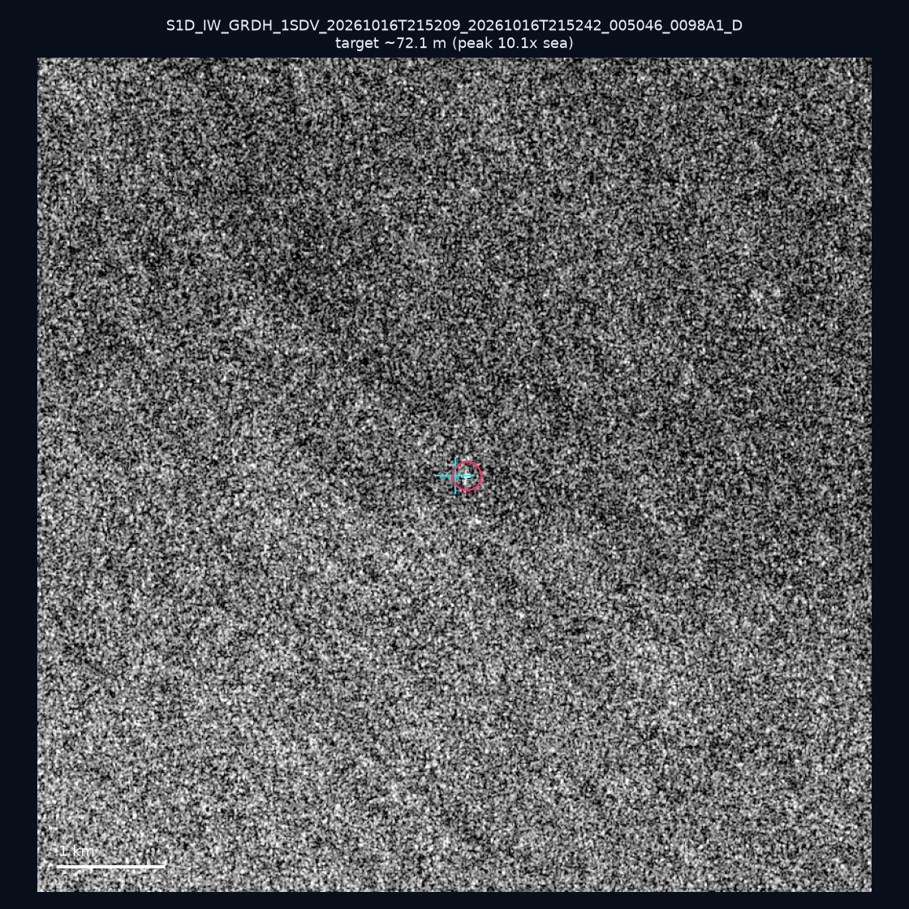
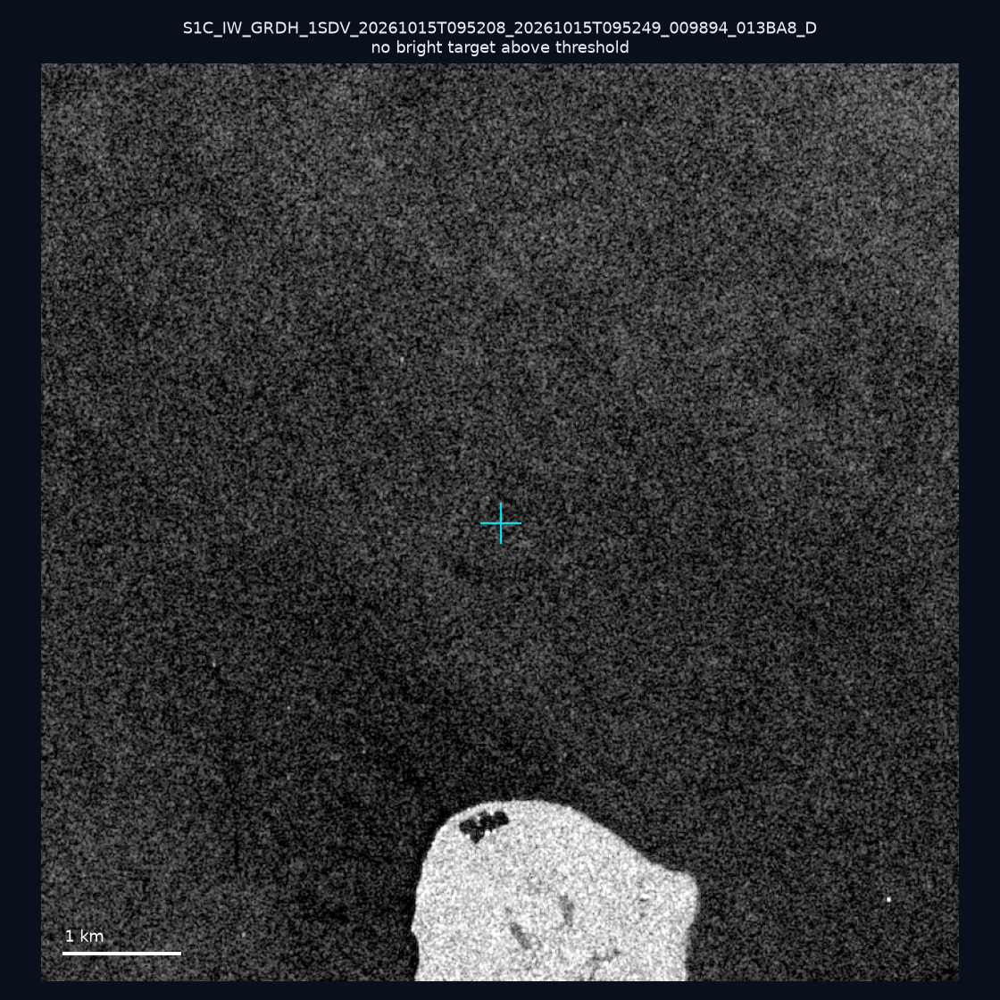
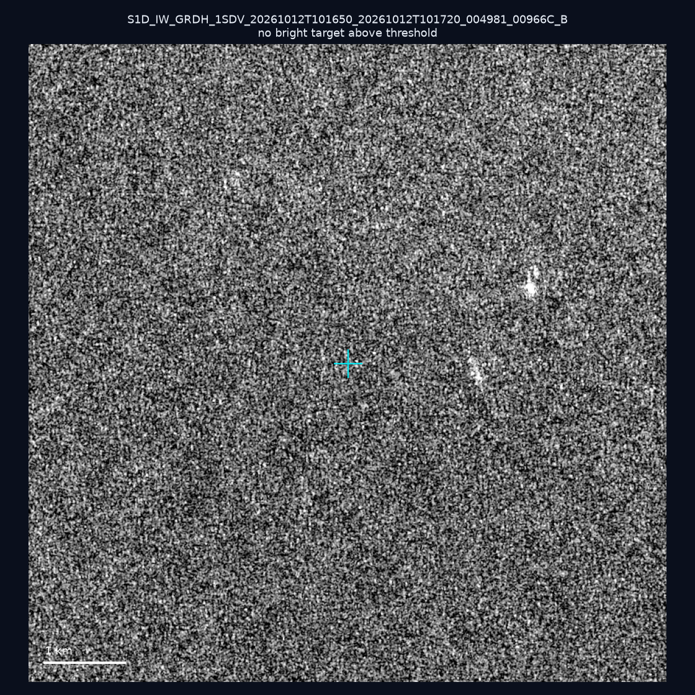
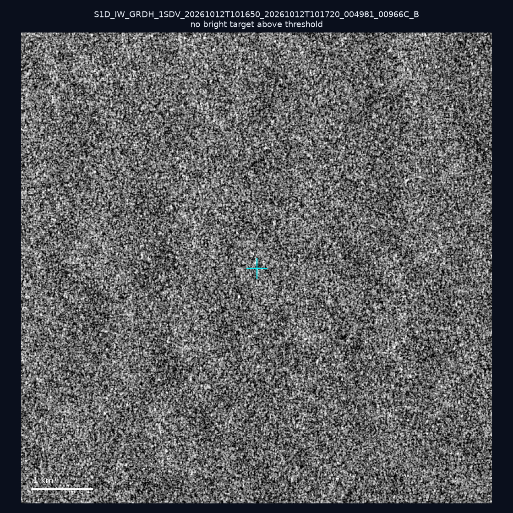
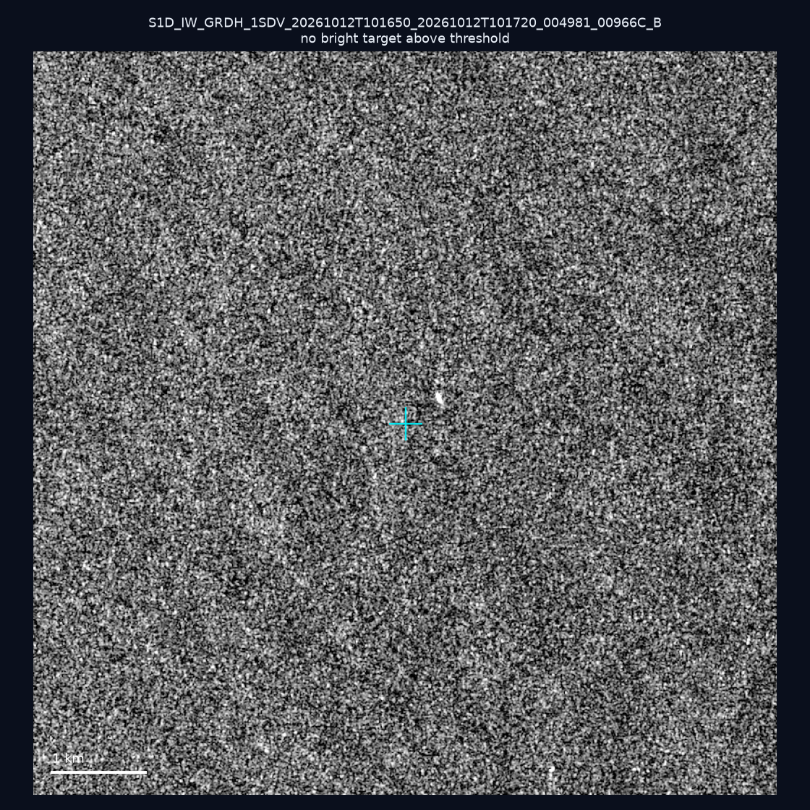
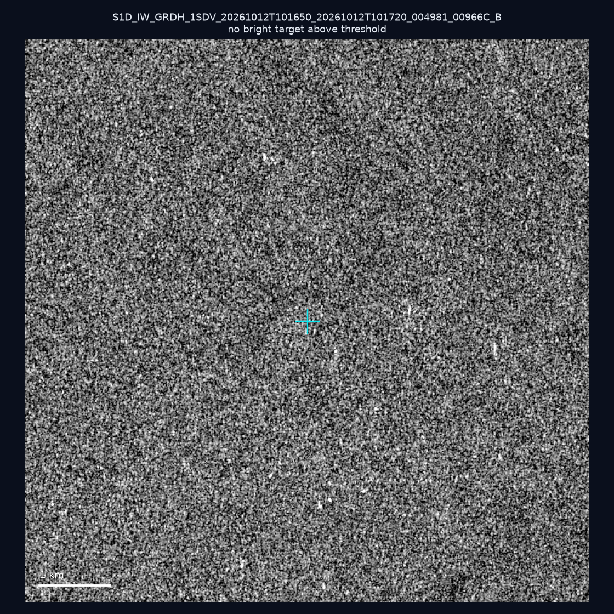
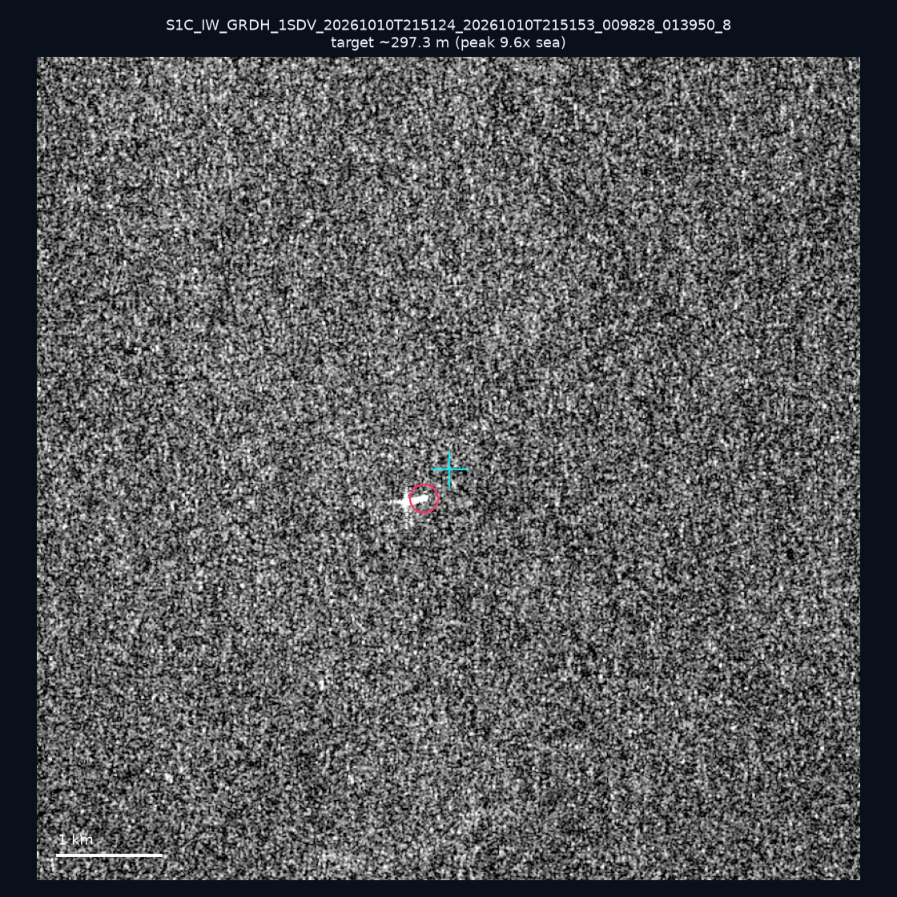
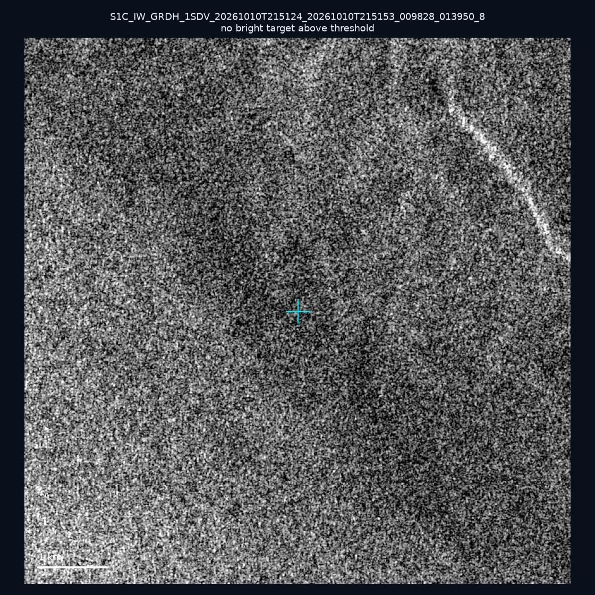

# 暗船 SAR 取證報告 — 2026-10-25

## 1. 總覽

- 執行時間：2026-10-25（GitHub Actions cron 自動執行）
- 線上比對摘要：暗偵測 14945 筆、殘餘暗船 9739 筆、假暗船剔除率 34.8%
- 本輪測試：10 筆
- 成功：10 筆
- 找到亮目標：2 筆
- 失敗：0 筆

## 2. 結果總表

| 日期 | 座標 | 海域 | 法域 | 成像時刻 | 判定 | 估計長度 | 峰值比 |
|------|------|------|------|----------|------|----------|--------|
| 2026-10-20 | 22.7, 121.67 | east | territorial_sea | 09:59:51 | ⚪ 無目標（雜訊或低RCS） | — | — |
| 2026-10-16 | 22.09, 119.23 | southwest | eez | 21:52:09 | ⚪ 無目標（雜訊或低RCS） | — | — |
| 2026-10-16 | 21.86, 120.22 | southwest | contiguous_zone | 21:52:09 | ✅ 確認實體目標 | ~72.1 m | 10.1× |
| 2026-10-15 | 24.29, 124.09 | east | eez | 09:52:08 | ⚪ 無目標（雜訊或低RCS） | — | — |
| 2026-10-12 | 23.09, 117.06 | southwest | eez | 10:16:50 | ⚪ 無目標（雜訊或低RCS） | — | — |
| 2026-10-12 | 22.88, 117.59 | southwest | eez | 10:16:50 | ⚪ 無目標（雜訊或低RCS） | — | — |
| 2026-10-12 | 22.99, 117.79 | southwest | eez | 10:16:50 | ⚪ 無目標（雜訊或低RCS） | — | — |
| 2026-10-12 | 23.03, 117.61 | southwest | eez | 10:16:50 | ⚪ 無目標（雜訊或低RCS） | — | — |
| 2026-10-10 | 24.34, 122.01 | east | territorial_sea | 21:51:24 | 🟡 弱目標 | ~297.3 m | 9.6× |
| 2026-10-10 | 24.82, 122.08 | east | territorial_sea | 21:51:24 | ⚪ 無目標（雜訊或低RCS） | — | — |

## 3. 逐目標段落

### 2026-10-20 (22.7, 121.67)

⚪ 無目標（雜訊或低RCS）。

### 2026-10-16 (22.09, 119.23)

⚪ 無目標（雜訊或低RCS）。

### 2026-10-16 (21.86, 120.22)

✅ 確認實體目標，估計長度 ~72.1 m，峰值 10.1× 海面背景（20 px）。

### 2026-10-15 (24.29, 124.09)

⚪ 無目標（雜訊或低RCS）。

### 2026-10-12 (23.09, 117.06)

⚪ 無目標（雜訊或低RCS）。

### 2026-10-12 (22.88, 117.59)

⚪ 無目標（雜訊或低RCS）。

### 2026-10-12 (22.99, 117.79)

⚪ 無目標（雜訊或低RCS）。

### 2026-10-12 (23.03, 117.61)

⚪ 無目標（雜訊或低RCS）。

### 2026-10-10 (24.34, 122.01)

🟡 弱目標，估計長度 ~297.3 m，峰值 9.6× 海面背景（139 px）。

### 2026-10-10 (24.82, 122.08)

⚪ 無目標（雜訊或低RCS）。

## 4. 後續建議

- 值得人工深查（確認實體目標且長度 ≥ 50m）：
  - 2026-10-16 (21.86, 120.22) ~72.1 m — 建議比對周邊 AIS 船長
- 累積統計：全歷史 623 筆（有效 622 筆），確認實體目標 68 筆（10.9%）

> 所有結果是研判線索，不是法律認定；無目標 ≠ 誤報（小型木殼漁船 RCS 低，SAR 可能拍不到）。
