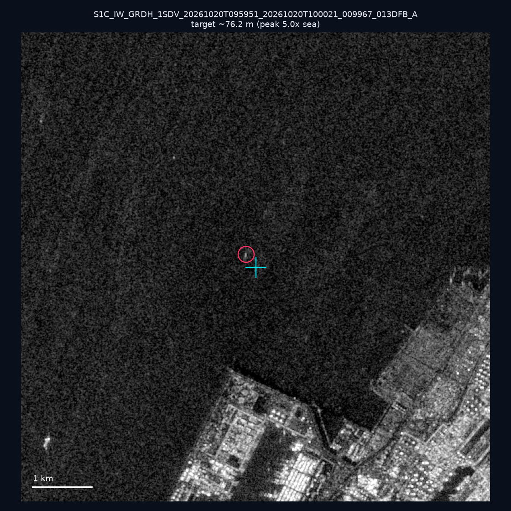
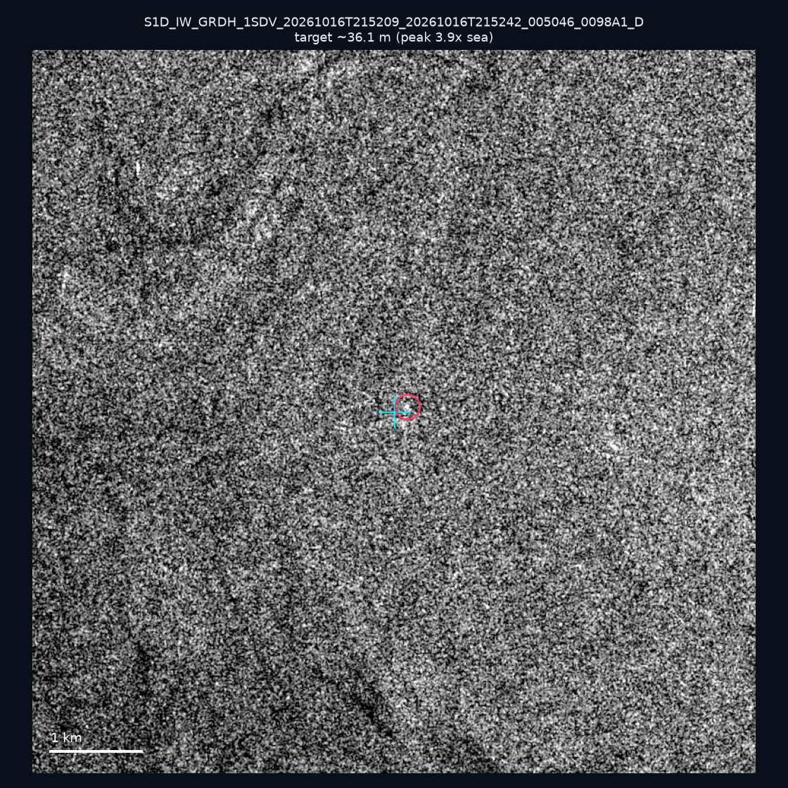
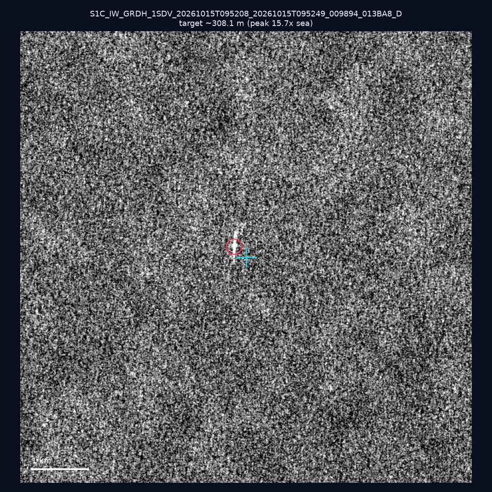
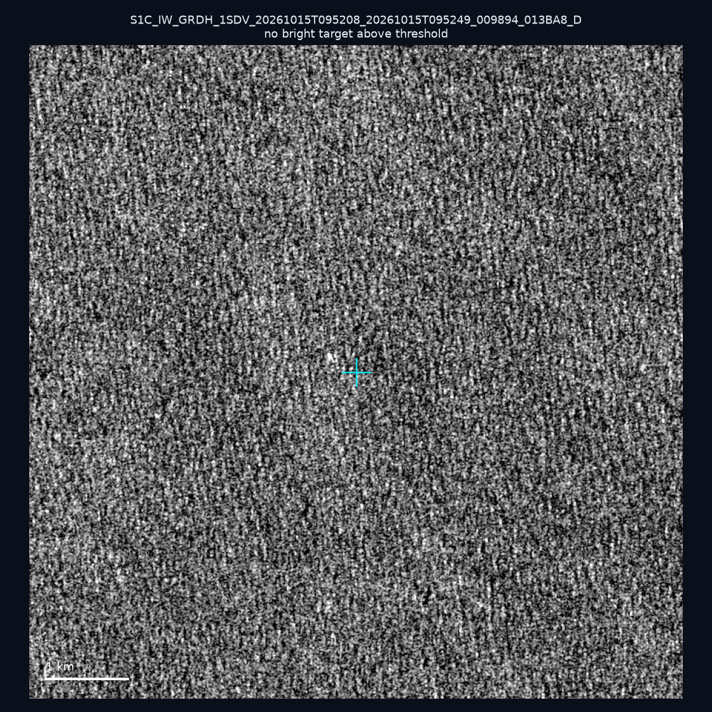
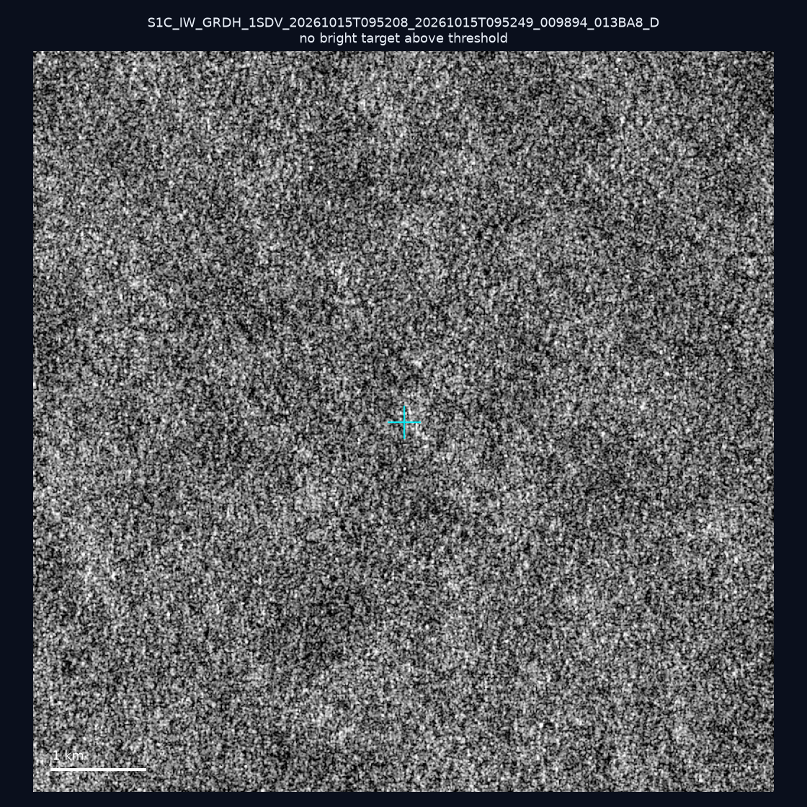
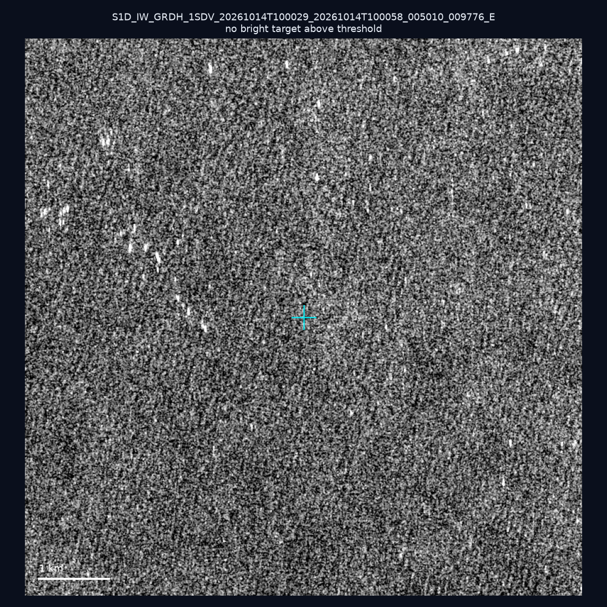
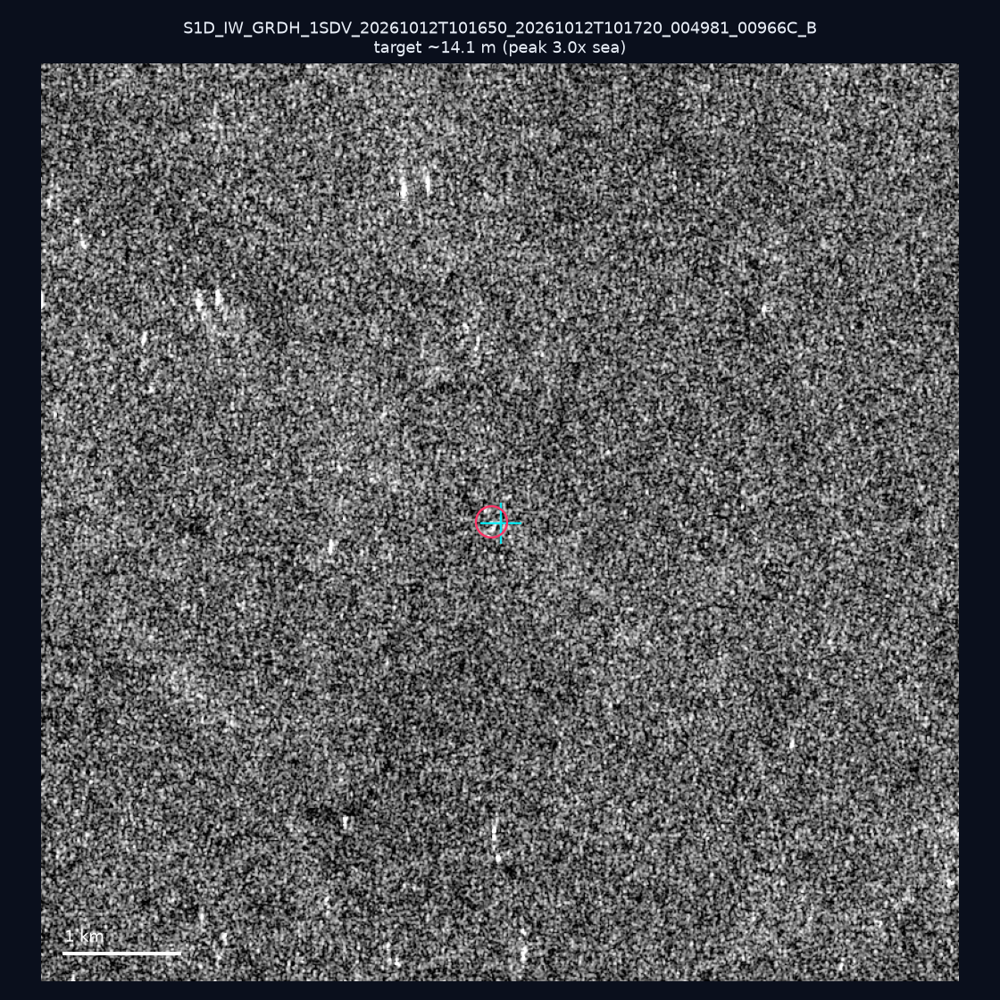
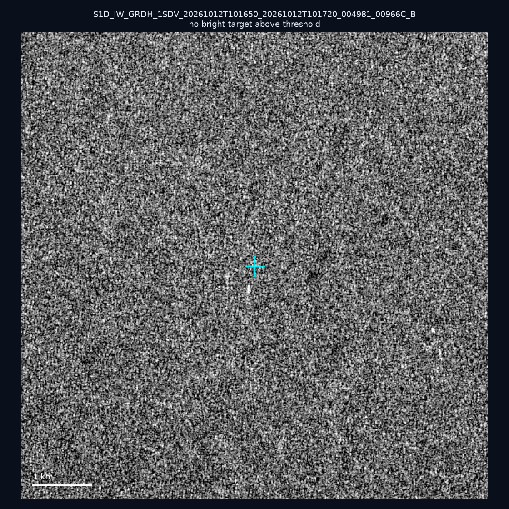
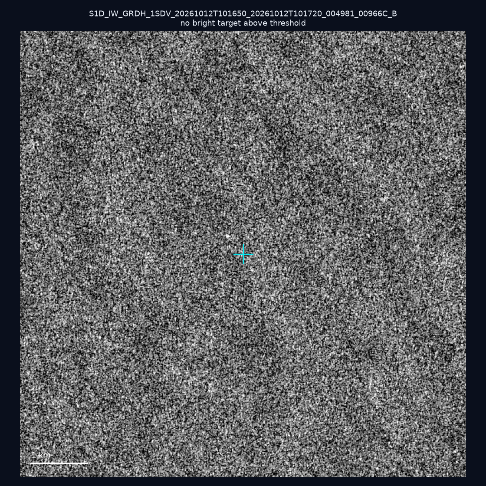
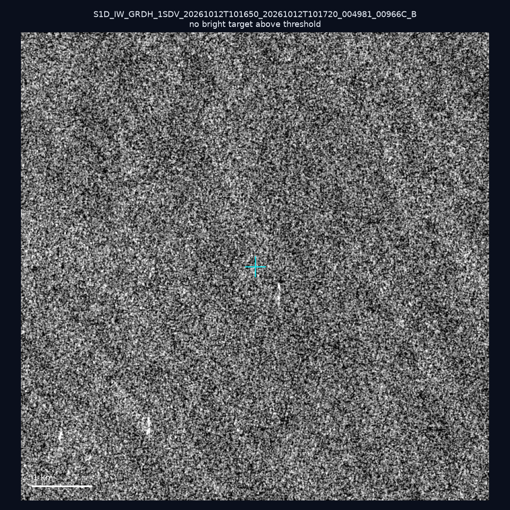

# 暗船 SAR 取證報告 — 2026-10-27

## 1. 總覽

- 執行時間：2026-10-27（GitHub Actions cron 自動執行）
- 線上比對摘要：暗偵測 14965 筆、殘餘暗船 9734 筆、假暗船剔除率 35.0%
- 本輪測試：10 筆
- 成功：10 筆
- 找到亮目標：4 筆
- 失敗：0 筆

## 2. 結果總表

| 日期 | 座標 | 海域 | 法域 | 成像時刻 | 判定 | 估計長度 | 峰值比 |
|------|------|------|------|----------|------|----------|--------|
| 2026-10-20 | 22.5, 120.32 | southwest | internal_waters | 09:59:51 | 🟡 弱目標 | ~76.2 m | 5.0× |
| 2026-10-16 | 22.23, 120.48 | southwest | internal_waters | 21:52:09 | 🟡 弱目標 | ~36.1 m | 3.9× |
| 2026-10-15 | 24.77, 123.8 | east | eez | 09:52:08 | ✅ 確認實體目標 | ~308.1 m | 15.7× |
| 2026-10-15 | 23.3, 122.22 | east | eez | 09:52:08 | ⚪ 無目標（雜訊或低RCS） | — | — |
| 2026-10-15 | 24.85, 123.99 | east | eez | 09:52:08 | ⚪ 無目標（雜訊或低RCS） | — | — |
| 2026-10-14 | 24.45, 121.98 | east | territorial_sea | 10:00:29 | ⚪ 無目標（雜訊或低RCS） | — | — |
| 2026-10-12 | 23.36, 117.22 | southwest | eez | 10:16:50 | 🟡 弱目標 | ~14.1 m | 3.0× |
| 2026-10-12 | 22.94, 117.05 | southwest | eez | 10:16:50 | ⚪ 無目標（雜訊或低RCS） | — | — |
| 2026-10-12 | 22.9, 117.72 | southwest | eez | 10:16:50 | ⚪ 無目標（雜訊或低RCS） | — | — |
| 2026-10-12 | 23.14, 118.28 | southwest | eez | 10:16:50 | ⚪ 無目標（雜訊或低RCS） | — | — |

## 3. 逐目標段落

### 2026-10-20 (22.5, 120.32)

🟡 弱目標，估計長度 ~76.2 m，峰值 5.0× 海面背景（17 px）。

### 2026-10-16 (22.23, 120.48)

🟡 弱目標，估計長度 ~36.1 m，峰值 3.9× 海面背景（5 px）。

### 2026-10-15 (24.77, 123.8)

✅ 確認實體目標，估計長度 ~308.1 m，峰值 15.7× 海面背景（82 px）。

### 2026-10-15 (23.3, 122.22)

⚪ 無目標（雜訊或低RCS）。

### 2026-10-15 (24.85, 123.99)

⚪ 無目標（雜訊或低RCS）。

### 2026-10-14 (24.45, 121.98)

⚪ 無目標（雜訊或低RCS）。

### 2026-10-12 (23.36, 117.22)

🟡 弱目標，估計長度 ~14.1 m，峰值 3.0× 海面背景（1 px）。

### 2026-10-12 (22.94, 117.05)

⚪ 無目標（雜訊或低RCS）。

### 2026-10-12 (22.9, 117.72)

⚪ 無目標（雜訊或低RCS）。

### 2026-10-12 (23.14, 118.28)

⚪ 無目標（雜訊或低RCS）。

## 4. 後續建議

- 值得人工深查（確認實體目標且長度 ≥ 50m）：
  - 2026-10-15 (24.77, 123.8) ~308.1 m — 建議比對周邊 AIS 船長
- 累積統計：全歷史 643 筆（有效 642 筆），確認實體目標 72 筆（11.2%）

> 所有結果是研判線索，不是法律認定；無目標 ≠ 誤報（小型木殼漁船 RCS 低，SAR 可能拍不到）。
