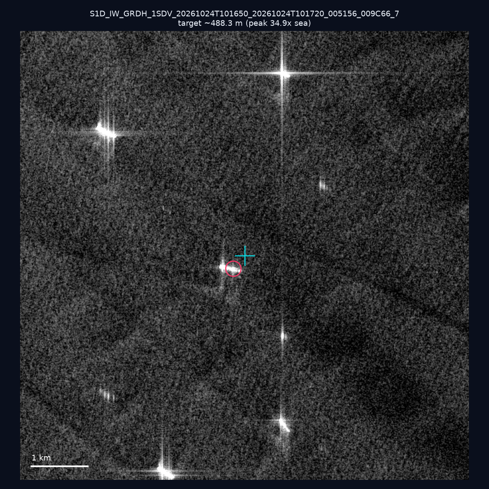
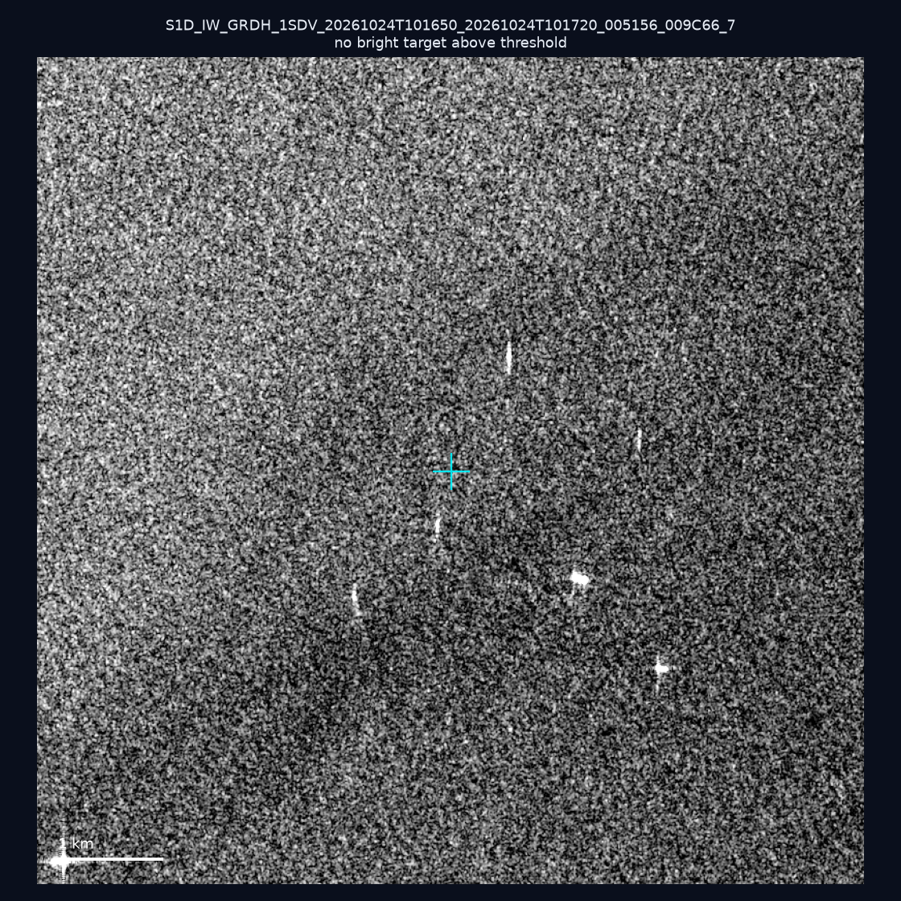
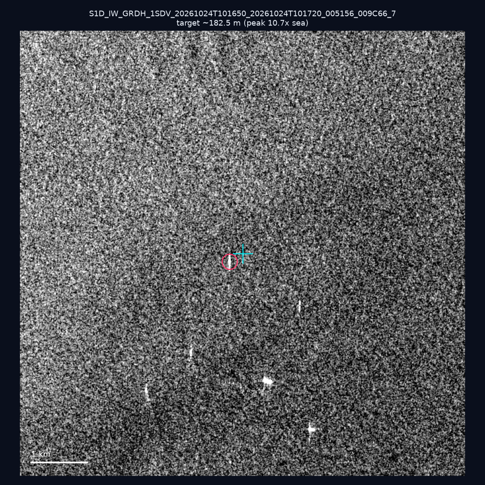
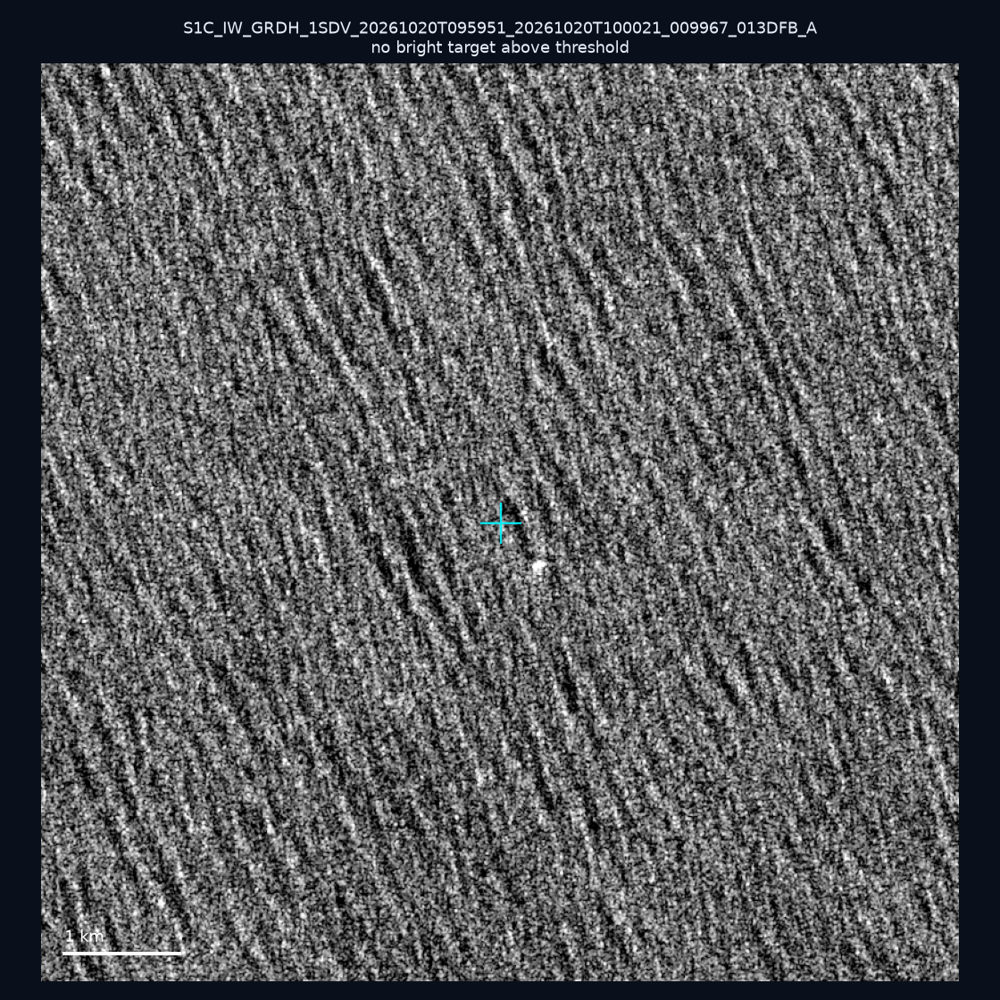
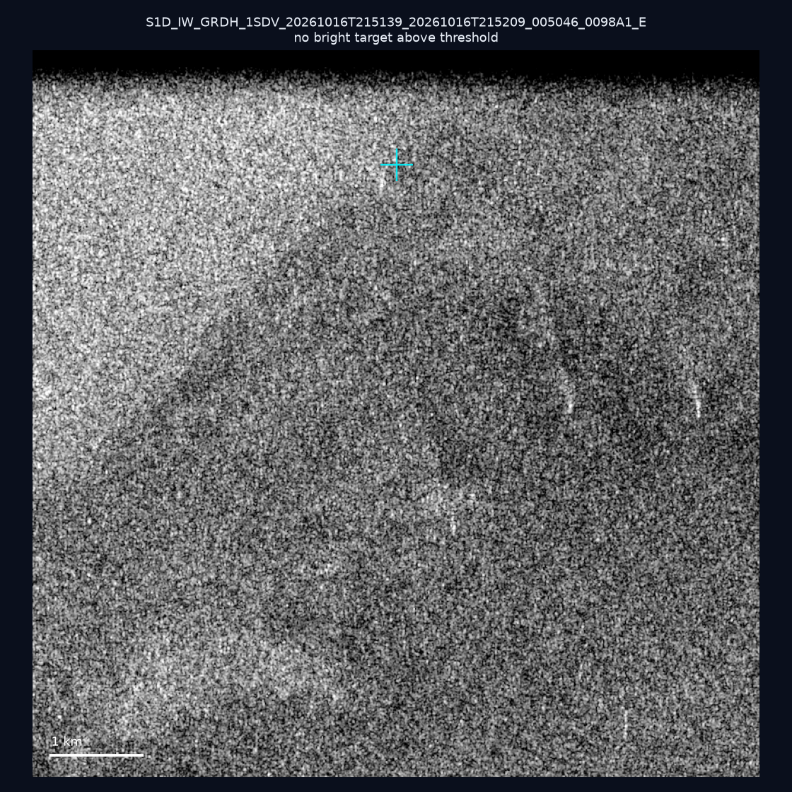
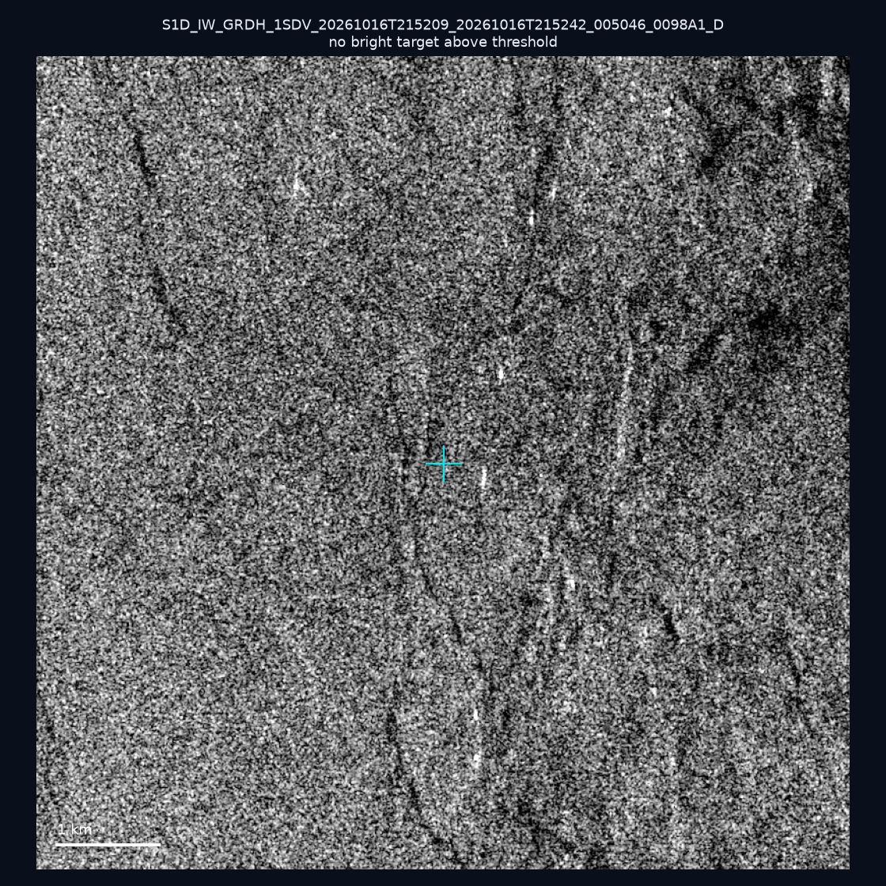
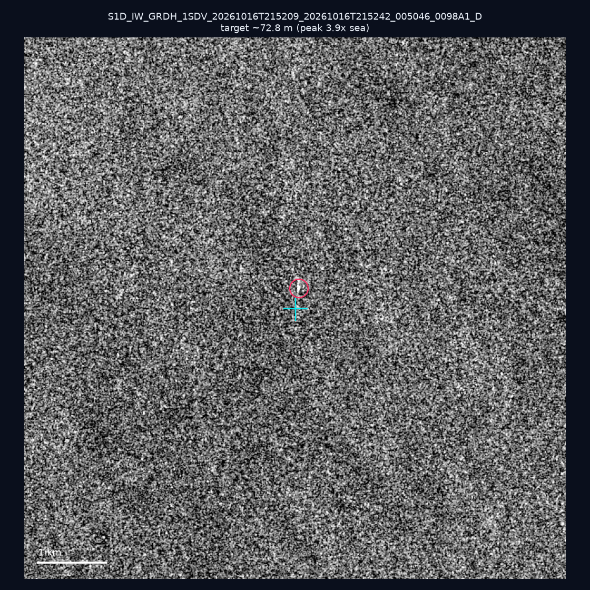
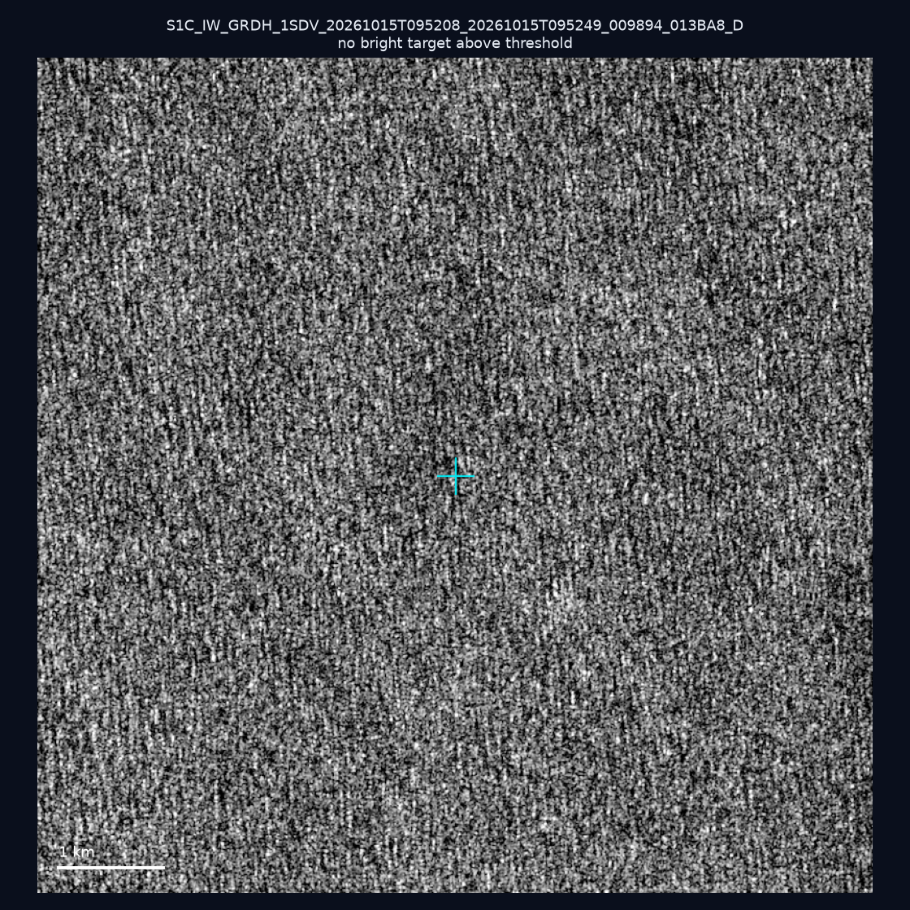
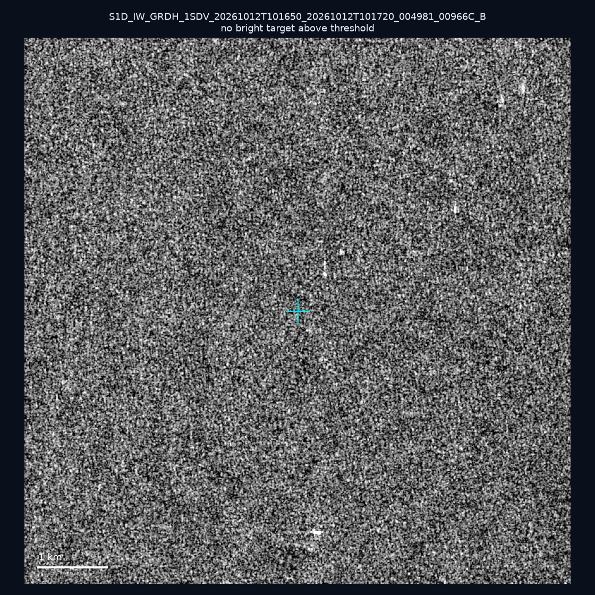
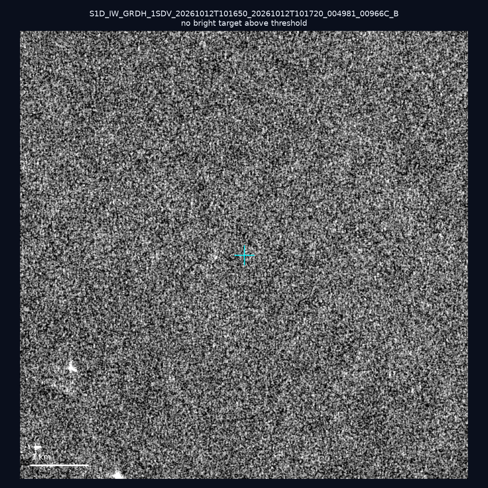

# 暗船 SAR 取證報告 — 2026-10-28

## 1. 總覽

- 執行時間：2026-10-28（GitHub Actions cron 自動執行）
- 線上比對摘要：暗偵測 14960 筆、殘餘暗船 9775 筆、假暗船剔除率 34.7%
- 本輪測試：10 筆
- 成功：10 筆
- 找到亮目標：3 筆
- 失敗：0 筆

## 2. 結果總表

| 日期 | 座標 | 海域 | 法域 | 成像時刻 | 判定 | 估計長度 | 峰值比 |
|------|------|------|------|----------|------|----------|--------|
| 2026-10-24 | 23.17, 117.63 | southwest | eez | 10:16:50 | ✅ 確認實體目標 | ~488.3 m | 34.9× |
| 2026-10-24 | 23.47, 117.33 | southwest | eez | 10:16:50 | ⚪ 無目標（雜訊或低RCS） | — | — |
| 2026-10-24 | 23.46, 117.34 | southwest | eez | 10:16:50 | ✅ 確認實體目標 | ~182.5 m | 10.7× |
| 2026-10-20 | 22.08, 122.31 | east | eez | 09:59:51 | ⚪ 無目標（雜訊或低RCS） | — | — |
| 2026-10-16 | 25.35, 121.86 | east | internal_waters | 21:51:39 | ⚪ 無目標（雜訊或低RCS） | — | — |
| 2026-10-16 | 23.15, 119.99 | southwest | internal_waters | 21:52:09 | ⚪ 無目標（雜訊或低RCS） | — | — |
| 2026-10-16 | 22.37, 119.75 | southwest | contiguous_zone | 21:52:09 | 🟡 弱目標 | ~72.8 m | 3.9× |
| 2026-10-15 | 23.69, 122.4 | east | eez | 09:52:08 | ⚪ 無目標（雜訊或低RCS） | — | — |
| 2026-10-12 | 23.15, 117.1 | southwest | eez | 10:16:50 | ⚪ 無目標（雜訊或低RCS） | — | — |
| 2026-10-12 | 23.39, 117.49 | southwest | eez | 10:16:50 | ⚪ 無目標（雜訊或低RCS） | — | — |

## 3. 逐目標段落

### 2026-10-24 (23.17, 117.63)

✅ 確認實體目標，估計長度 ~488.3 m，峰值 34.9× 海面背景（425 px）。

### 2026-10-24 (23.47, 117.33)

⚪ 無目標（雜訊或低RCS）。

### 2026-10-24 (23.46, 117.34)

✅ 確認實體目標，估計長度 ~182.5 m，峰值 10.7× 海面背景（49 px）。

### 2026-10-20 (22.08, 122.31)

⚪ 無目標（雜訊或低RCS）。

### 2026-10-16 (25.35, 121.86)

⚪ 無目標（雜訊或低RCS）。

### 2026-10-16 (23.15, 119.99)

⚪ 無目標（雜訊或低RCS）。

### 2026-10-16 (22.37, 119.75)

🟡 弱目標，估計長度 ~72.8 m，峰值 3.9× 海面背景（10 px）。

### 2026-10-15 (23.69, 122.4)

⚪ 無目標（雜訊或低RCS）。

### 2026-10-12 (23.15, 117.1)

⚪ 無目標（雜訊或低RCS）。

### 2026-10-12 (23.39, 117.49)

⚪ 無目標（雜訊或低RCS）。

## 4. 後續建議

- 值得人工深查（確認實體目標且長度 ≥ 50m）：
  - 2026-10-24 (23.17, 117.63) ~488.3 m — 建議比對周邊 AIS 船長
  - 2026-10-24 (23.46, 117.34) ~182.5 m — 建議比對周邊 AIS 船長
- 累積統計：全歷史 653 筆（有效 652 筆），確認實體目標 74 筆（11.3%）

> 所有結果是研判線索，不是法律認定；無目標 ≠ 誤報（小型木殼漁船 RCS 低，SAR 可能拍不到）。
