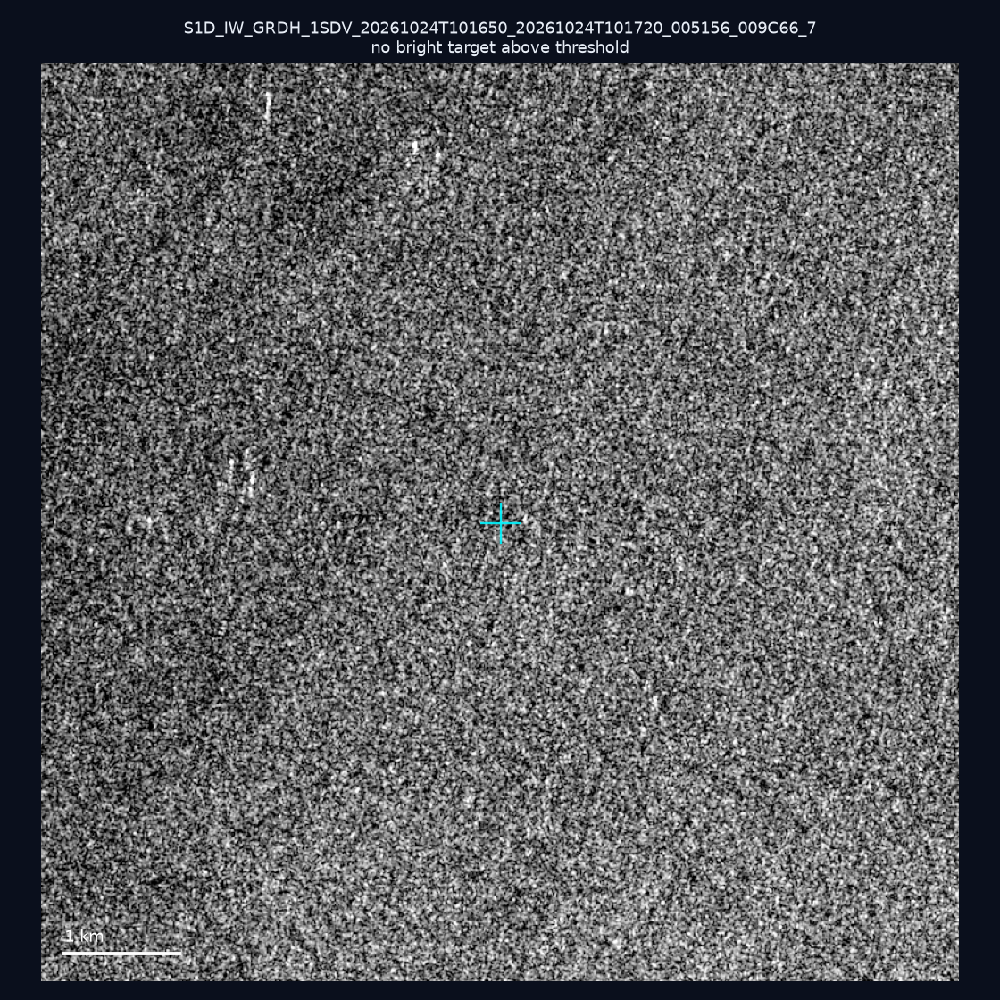
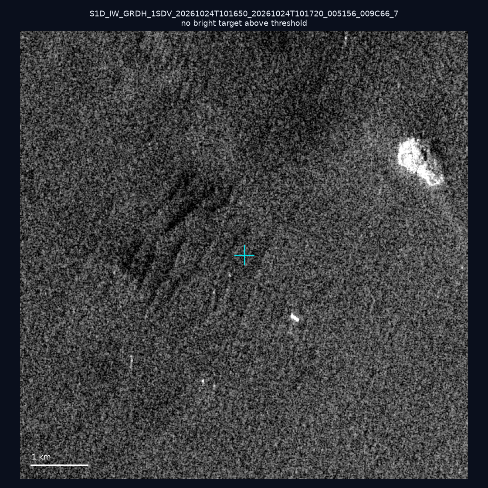
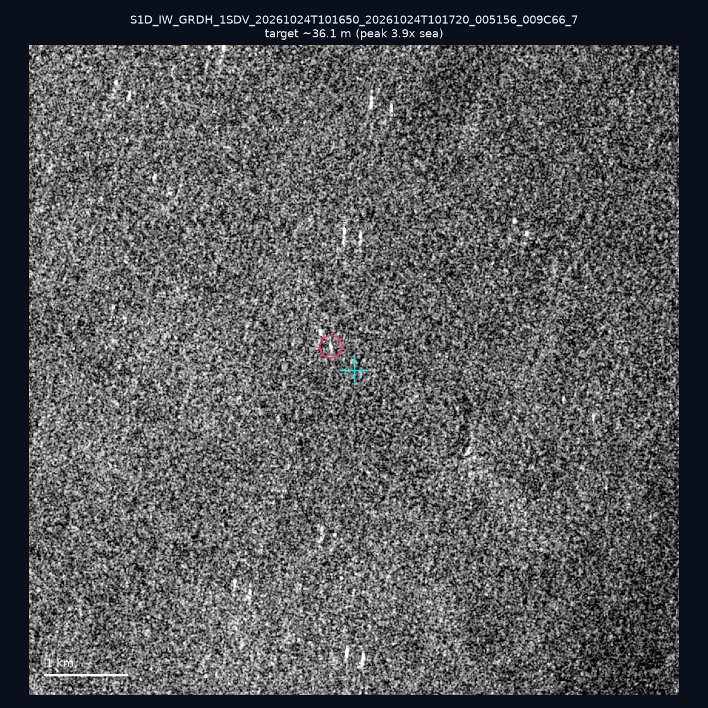
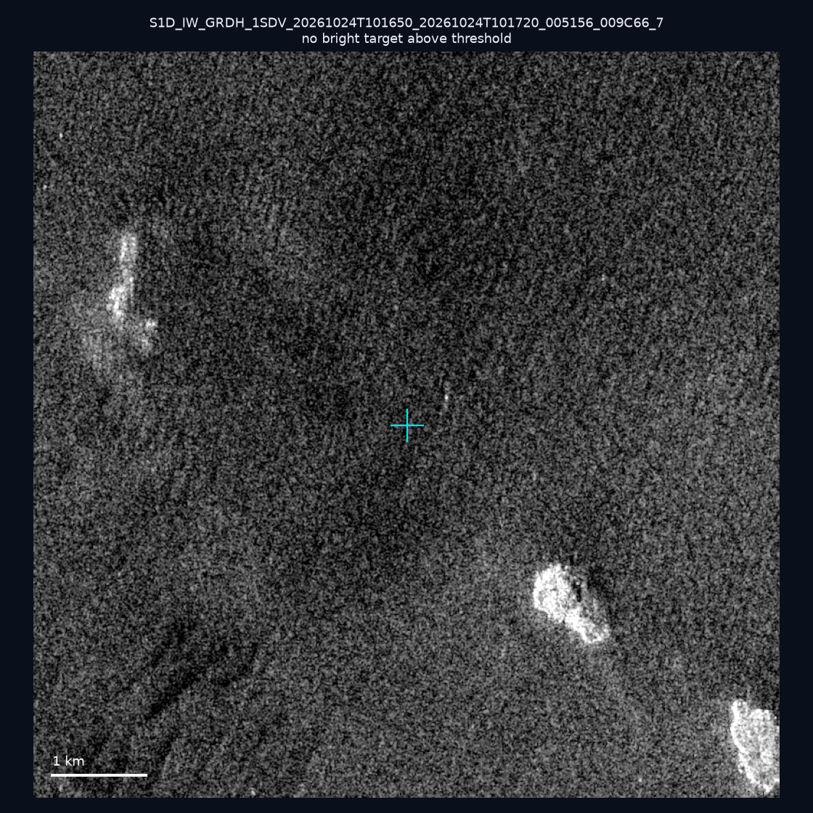
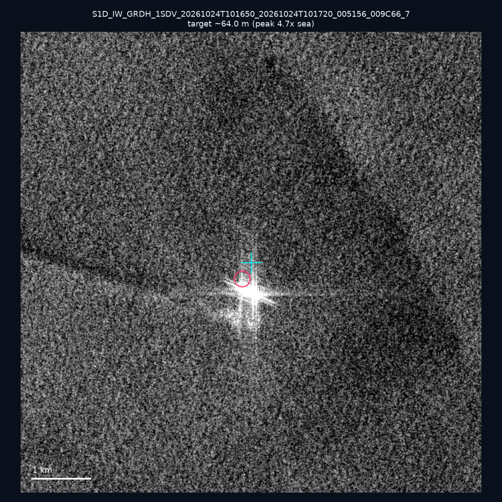
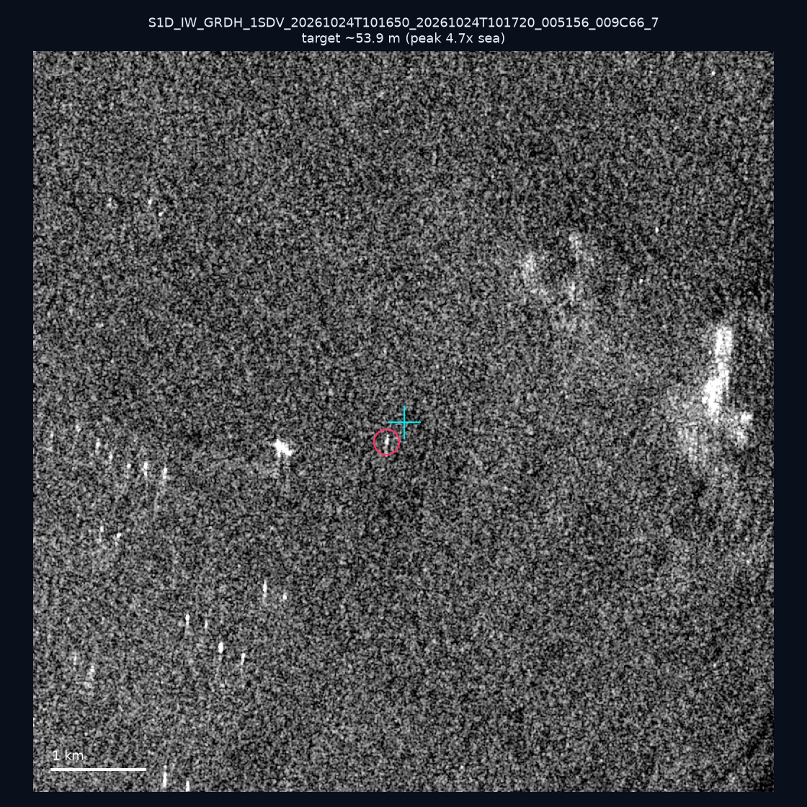
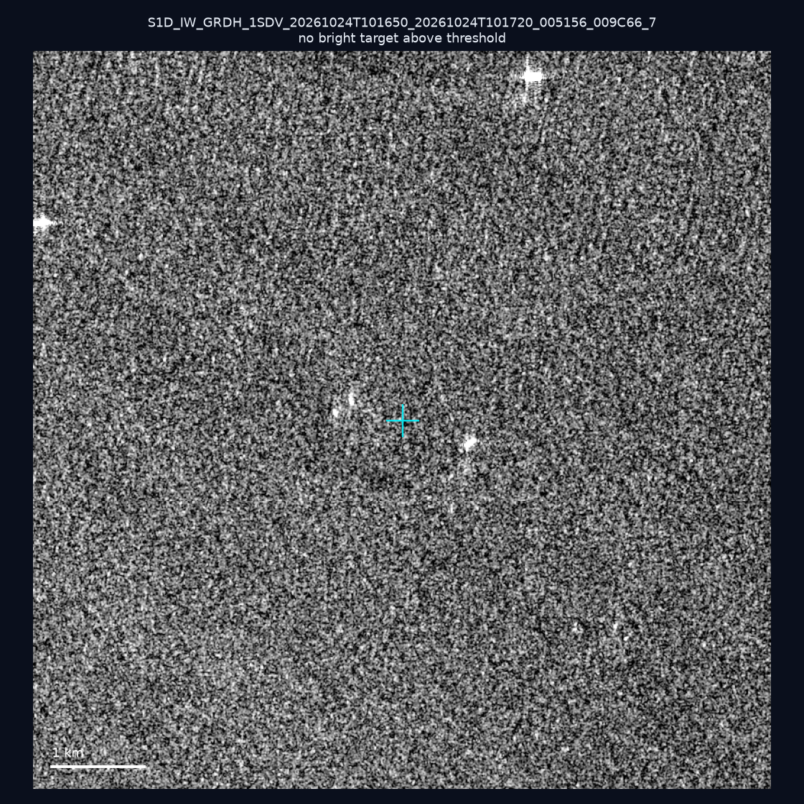
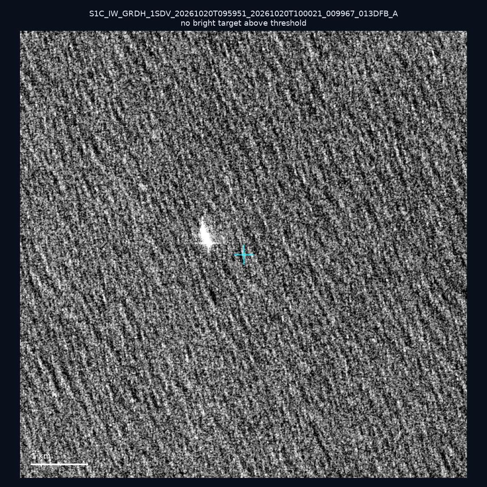
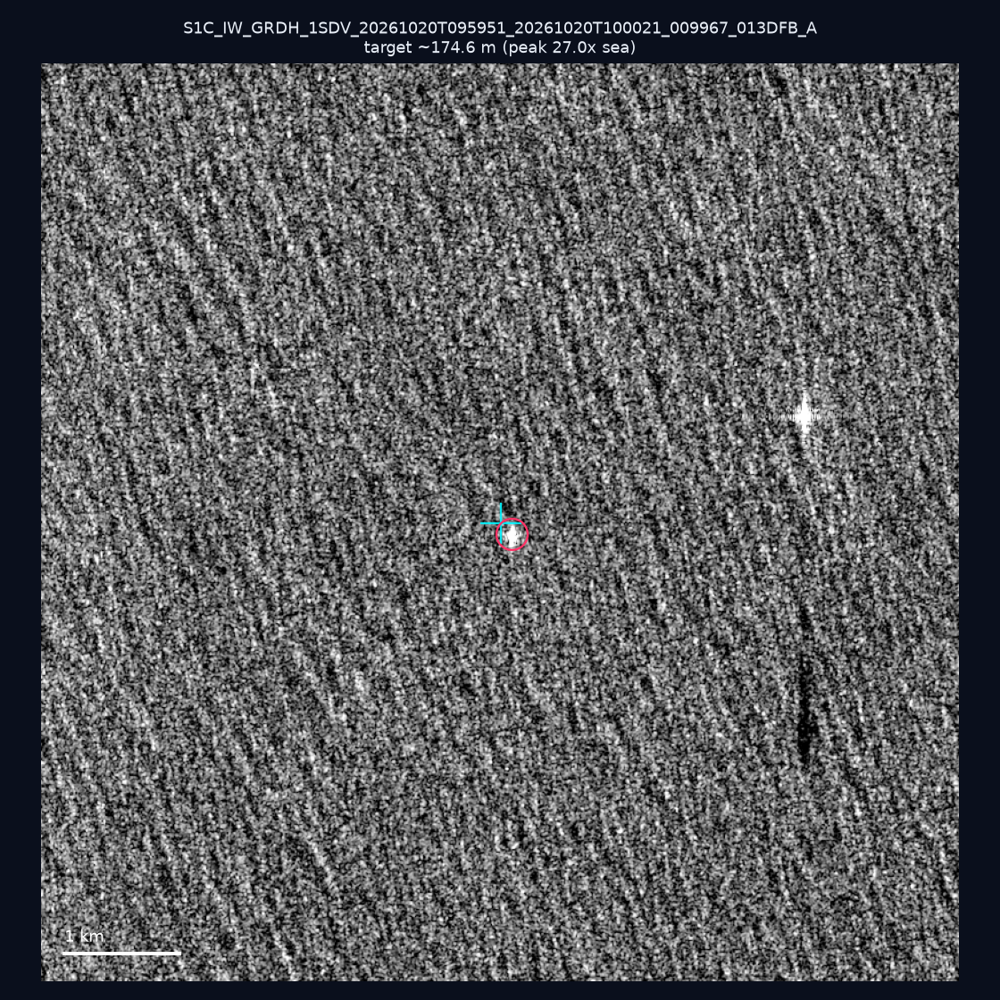
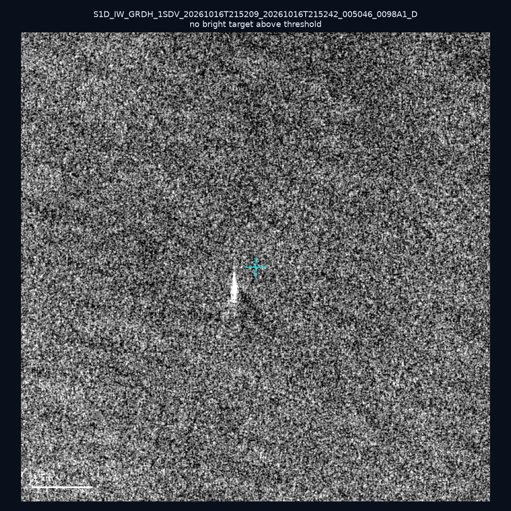

# 暗船 SAR 取證報告 — 2026-10-29

## 1. 總覽

- 執行時間：2026-10-29（GitHub Actions cron 自動執行）
- 線上比對摘要：暗偵測 12437 筆、殘餘暗船 8141 筆、假暗船剔除率 34.5%
- 本輪測試：10 筆
- 成功：10 筆
- 找到亮目標：4 筆
- 失敗：0 筆

## 2. 結果總表

| 日期 | 座標 | 海域 | 法域 | 成像時刻 | 判定 | 估計長度 | 峰值比 |
|------|------|------|------|----------|------|----------|--------|
| 2026-10-24 | 23.32, 117.24 | southwest | eez | 10:16:50 | ⚪ 無目標（雜訊或低RCS） | — | — |
| 2026-10-24 | 23.27, 117.25 | southwest | eez | 10:16:50 | ⚪ 無目標（雜訊或低RCS） | — | — |
| 2026-10-24 | 23.28, 117.17 | southwest | eez | 10:16:50 | 🟡 弱目標 | ~36.1 m | 3.9× |
| 2026-10-24 | 23.24, 117.27 | southwest | eez | 10:16:50 | ⚪ 無目標（雜訊或低RCS） | — | — |
| 2026-10-24 | 22.88, 117.38 | southwest | eez | 10:16:50 | 🟡 弱目標 | ~64.0 m | 4.7× |
| 2026-10-24 | 23.22, 117.21 | southwest | eez | 10:16:50 | 🟡 弱目標 | ~53.9 m | 4.7× |
| 2026-10-24 | 23.17, 117.17 | southwest | eez | 10:16:50 | ⚪ 無目標（雜訊或低RCS） | — | — |
| 2026-10-20 | 23.3, 121.93 | east | contiguous_zone | 09:59:51 | ⚪ 無目標（雜訊或低RCS） | — | — |
| 2026-10-20 | 22.36, 122.01 | east | eez | 09:59:51 | ✅ 確認實體目標 | ~174.6 m | 27.0× |
| 2026-10-16 | 21.87, 119.69 | southwest | eez | 21:52:09 | ⚪ 無目標（雜訊或低RCS） | — | — |

## 3. 逐目標段落

### 2026-10-24 (23.32, 117.24)

⚪ 無目標（雜訊或低RCS）。

### 2026-10-24 (23.27, 117.25)

⚪ 無目標（雜訊或低RCS）。

### 2026-10-24 (23.28, 117.17)

🟡 弱目標，估計長度 ~36.1 m，峰值 3.9× 海面背景（5 px）。

### 2026-10-24 (23.24, 117.27)

⚪ 無目標（雜訊或低RCS）。

### 2026-10-24 (22.88, 117.38)

🟡 弱目標，估計長度 ~64.0 m，峰值 4.7× 海面背景（10 px）。

### 2026-10-24 (23.22, 117.21)

🟡 弱目標，估計長度 ~53.9 m，峰值 4.7× 海面背景（9 px）。

### 2026-10-24 (23.17, 117.17)

⚪ 無目標（雜訊或低RCS）。

### 2026-10-20 (23.3, 121.93)

⚪ 無目標（雜訊或低RCS）。

### 2026-10-20 (22.36, 122.01)

✅ 確認實體目標，估計長度 ~174.6 m，峰值 27.0× 海面背景（69 px）。

### 2026-10-16 (21.87, 119.69)

⚪ 無目標（雜訊或低RCS）。

## 4. 後續建議

- 值得人工深查（確認實體目標且長度 ≥ 50m）：
  - 2026-10-20 (22.36, 122.01) ~174.6 m — 建議比對周邊 AIS 船長
- 累積統計：全歷史 663 筆（有效 662 筆），確認實體目標 75 筆（11.3%）

> 所有結果是研判線索，不是法律認定；無目標 ≠ 誤報（小型木殼漁船 RCS 低，SAR 可能拍不到）。
